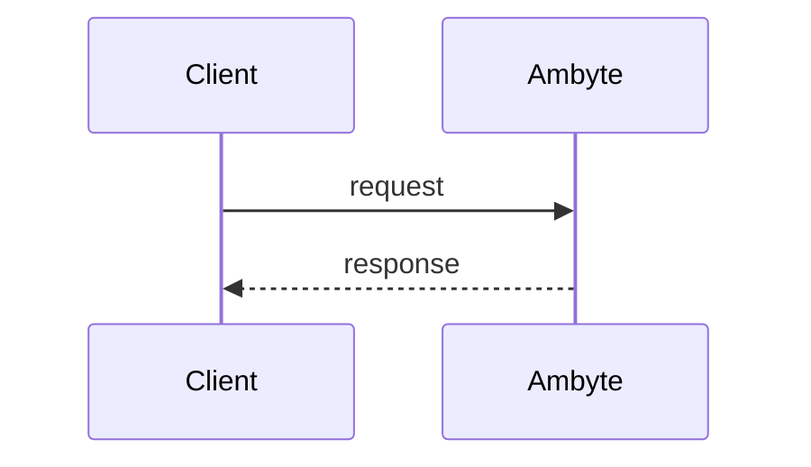

<!-- Title: Conventional Commit, e.g. feat(service): add …  (semantic-release reads it) -->

## What changed

<!-- The user-visible or device-visible change, one bullet per file group. -->

## How it fits together

<!-- Required for any change to a device contract, protocol, storage layout, update path or
     fleet tool: Mermaid diagrams of the delivered mechanism, rendered by GitHub. Typically a
     state diagram (modes and transitions), a sequence diagram (client ↔ device, including the
     reconnect or retry path) and a flowchart of the failure recovery. Put the same diagrams in
     the matching document under docs/. -->

## Bench captures

<!-- Required when the change can be exercised on a device: terminal-style images rendered from
     real console captures of the qualification run, committed under docs/images/<topic>/ and
     linked here with raw.githubusercontent.com URLs pinned to the commit. Redact credentials and
     anything that identifies a field site. Name the image/firmware version the capture came from. -->

## How it was built

<!-- Who or what built and verified it, how many review rounds, what the bench found. -->

## Testing criteria

<!-- Exact commands with expected results, plus the device checks a reviewer can repeat. Note
     HW-test status for anything awaiting hardware verification. -->

## Linear issues

<!-- Closes HAR-### / Contributes to HAR-### -->
