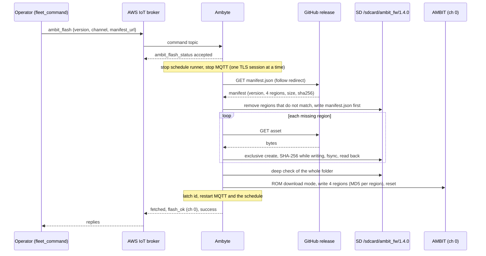
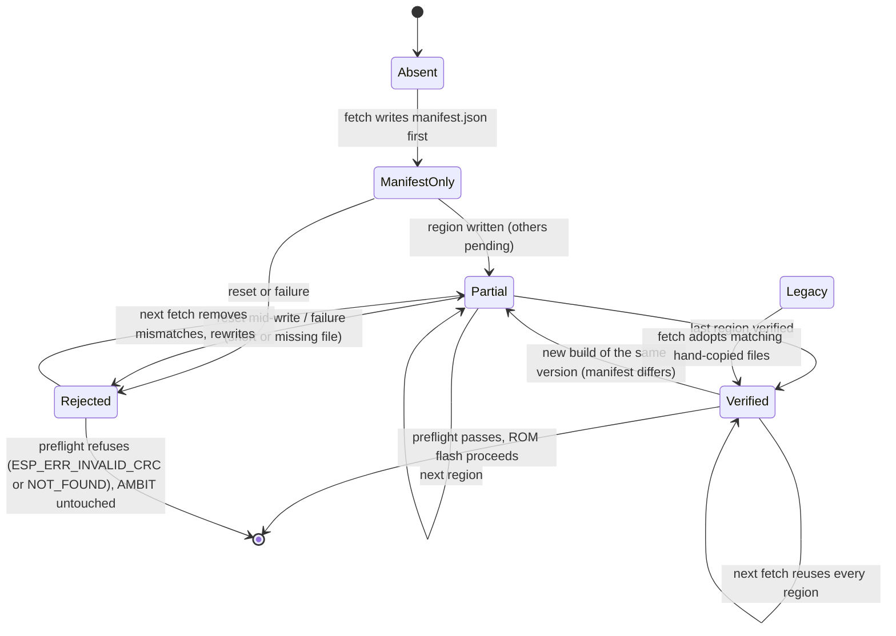
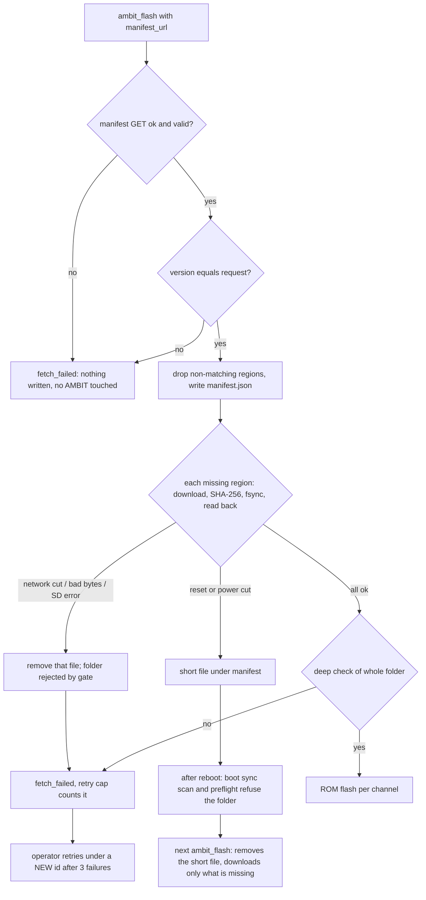
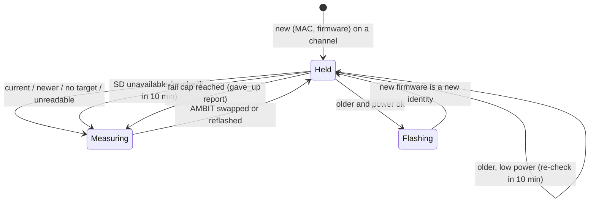
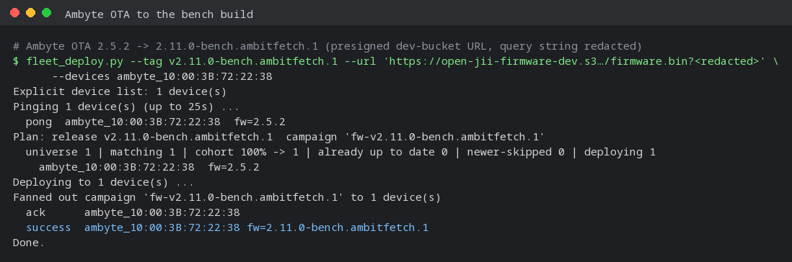
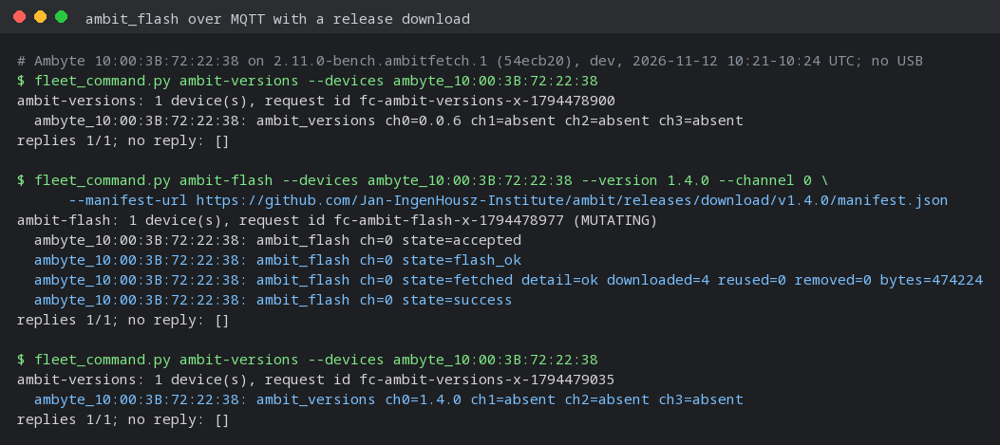
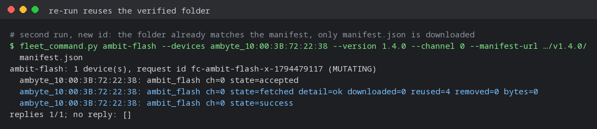
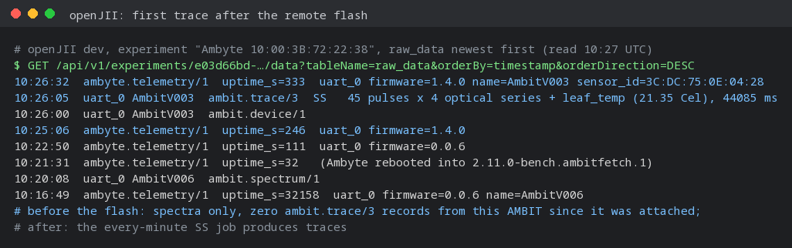
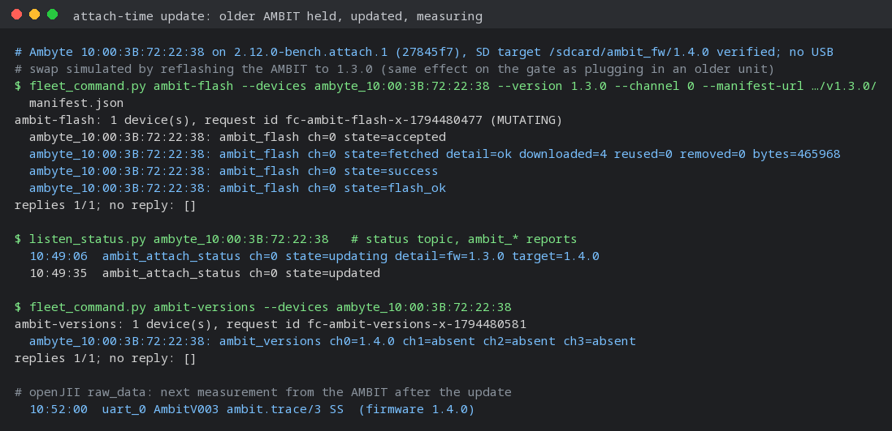

# Remote AMBIT reflash with a release download

An AMBIT running firmware older than 1.0 (for example `AmbitV006`, 0.0.6) has no
app-level OTA receiver, so `ambit_ota` cannot update it. The only way in is the ROM
bootloader: `ambit_flash` puts the AMBIT into download mode through the Ambyte and
writes four images (bootloader, partition table, otadata, app) from
`/sdcard/ambit_fw/<version>/`. Until this change nothing on the Ambyte could put
those files on the card, so updating such a unit meant someone pulling its SD card.

`ambit_flash` now takes an optional `manifest_url`. With it, the Ambyte downloads
the ambit-iot release itself, verifies every byte against the release's own
`manifest.json`, and only then flashes.

## Command

```json
{"type": "ambit_flash", "id": "af-1", "version": "1.4.0", "channel": 0,
 "manifest_url": "https://github.com/Jan-IngenHousz-Institute/ambit/releases/download/v1.4.0/manifest.json"}
```

- `version` must equal the manifest's `version`; the folder is `/sdcard/ambit_fw/<version>/`.
- `channel` is 0-3 or `"all"` (every channel whose ROM answers a probe).
- `manifest_url` must be `https://` and shorter than 256 characters. The manifest's
  SHA-256 values are what every downloaded byte is checked against, and they arrive
  over the same connection, so TLS (the ESP-IDF certificate bundle) is what makes them
  trustworthy. Each region is fetched from the manifest's directory plus the asset
  name in its `file` field; GitHub release redirects are followed.
- Without `manifest_url` the command behaves exactly as before (SD only).

From a workstation, with the fleet tool:

```sh
python tools/fleet_deploy/fleet_command.py ambit-versions --devices ambyte_10:00:3B:72:22:38 --profile openjii-dev
python tools/fleet_deploy/fleet_command.py ambit-flash --devices ambyte_10:00:3B:72:22:38 --profile openjii-dev \
    --version 1.4.0 --channel 0 \
    --manifest-url https://github.com/Jan-IngenHousz-Institute/ambit/releases/download/v1.4.0/manifest.json
```

On the console, `ambit_flash all 1.4.0 https://…/manifest.json` queues the same
operation.

The status topic carries `ambit_flash_status` reports. The device publishes
`accepted`, then (after MQTT is back) `fetched` or `fetch_failed` with a detail such as
`ok downloaded=4 reused=0 removed=0 bytes=474224`, then one per channel
(`flash_ok`, `flash_failed`, `absent`, `bus_busy`), then `success` or `failed`. AWS IoT
does not preserve order, so the post-reconnect reports can arrive interleaved;
`success` is sent only when every attempted channel flashed. `fleet_command.py` keeps
listening 5 s after the terminal report to collect the rest.

## How it fits together



### The folder and its gate

A folder that holds `manifest.json` is flashable only when every region matches it.
The flash preflight (remote `ambit_flash`, the CLI and boot sync, before the chip is
touched) checks size and SHA-256. Boot sync's target scan checks sizes on every boot.
A folder without `manifest.json` is a hand-staged legacy folder and keeps the old
rule (all four files present and non-empty).



### Failure recovery



## Rules the code keeps

- **Order.** Region files that do not match the new manifest are removed first, then
  `manifest.json` is written, then the missing regions. Every state a reset can leave
  is either rejected by the gate or holds exactly the release's bytes. The host tests
  reset the process right after each file is created and mid-write, and check that
  the preflight refuses every such folder.
- **No renames, no truncation.** Every file is created with `fopen("wx")` under its
  final name and never renamed, so removing one can never free another name's FAT
  chain. A file that fails is removed. A file that cannot be removed stays, the gate
  rejects it, and the next fetch removes it.
- **Bounds from the manifest.** Exactly the four known offsets, each once; the
  partition table must be at most 0x1000 bytes so the flash can never reach NVS at
  0x9000, where the per-unit calibration lives. Asset names are plain
  `[A-Za-z0-9._-]` so they cannot change the download path.
- **SD discipline.** The fetch takes an SD io reference per phase, never across an
  HTTP open; SD faults count under the `ambit_ota` writer in `sd_diag`.
- **Blackout.** The download runs after measurement and MQTT are suspended, like
  `ambit_ota`, because the board cannot hold the broker's TLS session and a download at
  once. A failed fetch flashes nothing and counts towards the retry cap (3 per id).

## Calibration

The ROM flash never writes NVS at 0x9000, so the AMBIT keeps its calibration. AMBIT
1.4.0 reads the same `config` keys a 0.0.6 unit carries (`actinic`, `spec`, `sun`,
`name`). PAR coefficients added after 0.0.6 do not exist on such a unit, so 1.4.0 uses
the fleet defaults for them until the unit is recalibrated.

## Tests

- `tests/test_ambit_fw_fetch.py`: production `ambit_fw_fetch.c`, `ambit_fw_manifest.c`
  and `ambit_flash_preflight.c` under the SD shim with a scripted HTTP server: manifest
  bounds, happy path and reuse, legacy adoption, server bytes that disagree with the
  manifest, network cuts, EIO/short/fsync/close/read-back faults, simulated resets after
  each create and mid-write, version/folder mismatch.
- `tests/ambit_host/red_green.py --rev e1ca6ee`: the earlier staging and preflight
  scenarios stay green with the gate in the preflight.
- `tests/test_fleet_command.py`: `ambit-flash` and `ambit-versions` payloads.

## Attach-time update

An AMBIT plugged in while the Ambyte runs used to be measured with whatever
firmware it carried until the next clean, externally powered boot. On a solar unit
the nightly reboot (around 01:20 UTC) has no input, so that boot may never come. Now
the schedule measures an AMBIT only after its firmware was checked against the
highest verified `/sdcard/ambit_fw/<ver>/` and, if older, updated.

- **Gate.** Every schedule action asks `ch_present()`, which pings the channel,
  reads the AMBIT's identity (MAC + firmware, cached after the first read) and asks
  `ambit_attach_gate_allow()`. A `(MAC, firmware)` pair the checker has not cleared
  (a new AMBIT, a swapped one, one reflashed by any path) is held and the checker is
  woken. Other channels keep measuring.
- **Check.** The `ambit_attach` pass on the maintenance worker compares the cached
  firmware string with the SD target. Current, newer (never downgraded), no target
  on the card, or a firmware string it cannot read: cleared at once, with no UART
  traffic and no pause in measurement.
- **Update.** Older: if there is charger input, or the battery is at least 3.7 V
  (the system rail stands in when the charger reports `battery_v=0`), measurement
  and MQTT pause and the AMBIT is ROM-flashed to the target and verified. The new
  firmware is then checked like any new identity, and cleared.
- **Not enough power:** the channel stays held and is re-checked every 10 min.
- **SD card parked or missing:** the AMBIT is measured (a parked card must never stop
  measurement) and re-checked every 10 min.
- **Repeated failure:** flashes share boot sync's per-channel cap of 3 attempts per
  target. After that the AMBIT is measured on its current firmware and an
  `ambit_attach_status` `gave_up` report asks for attention.
- **Identity unreadable** (pre-1.0 units that do not answer the version read): never
  held, since it can never be auto-updated. Use `ambit-flash` for those.

`ambit_attach_status` reports on the status topic: `updating`, `updated`,
`update_failed`, `waiting_power`, `newer`, `no_target`, `unreadable`, `gave_up`, with
`fw=<running> target=<sd target>`.



```mermaid
sequenceDiagram
    participant R as Schedule runner
    participant G as Attach gate
    participant W as Maintenance worker
    participant S as SD target
    participant A as AMBIT
    R->>A: ping, identity (MAC, fw 1.3.0)
    R->>G: allow(ch, MAC, 1.3.0)?
    G-->>R: no (held), wake checker
    W->>S: highest verified folder: 1.4.0
    W->>W: older; power ok
    W->>R: pause schedule (and MQTT)
    W->>A: ROM flash 1.4.0, verify version
    W->>R: resume
    R->>G: allow(ch, MAC, 1.4.0)?
    G-->>R: no (new identity), wake checker
    W->>S: 1.4.0 == target: clear
    R->>G: allow(ch, MAC, 1.4.0)?
    G-->>R: yes, measure
```

## Bench qualification (2026-11-12)

Dev Ambyte `ambyte_10:00:3B:72:22:38` with one AMBIT on channel 0 (`sensor_id`
3C:DC:75:0E:04:28) running 0.0.6, which had delivered spectra but no trace records.
Everything below went over MQTT and HTTPS; the board was not on USB.

1. The Ambyte was moved from 2.5.2 to this branch's build
   (`2.11.0-bench.ambitfetch.1`, commit 54ecb20) with `fleet_deploy.py` and a presigned
   URL in the dev firmware bucket.
2. `ambit-flash` with the published ambit-iot v1.4.0 `manifest.json`: the Ambyte
   downloaded all four regions (474,224 bytes), verified them, flashed channel 0 and
   reported `success` 47 s after the command.
3. A second `ambit-flash` under a new id downloaded only the manifest and reused all
   four verified files.
4. The AMBIT reports 1.4.0. It kept its NVS: the name it reports now comes from its NVS
   `name` key (`AmbitV003`). Its first `ambit.trace/3` (SS, 45 pulses on four optical
   series plus leaf temperature) reached openJII at 10:26 UTC.









### Attach-time update (2026-11-12, `2.12.0-bench.attach.1`)

Same Ambyte, over MQTT only. With the verified 1.4.0 folder on the card, the AMBIT was
reflashed to 1.3.0 remotely, which the gate sees exactly like an older AMBIT being
plugged in. 20 s later the schedule's next steady-state run held the channel, the
checker reported `updating fw=1.3.0 target=1.4.0`, and 29 s after that `updated`.
`ambit-versions` read 1.4.0, and the next trace reached openJII at 10:52 UTC.


