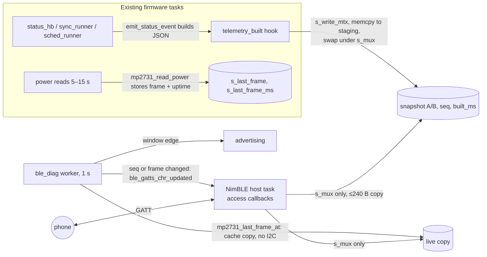
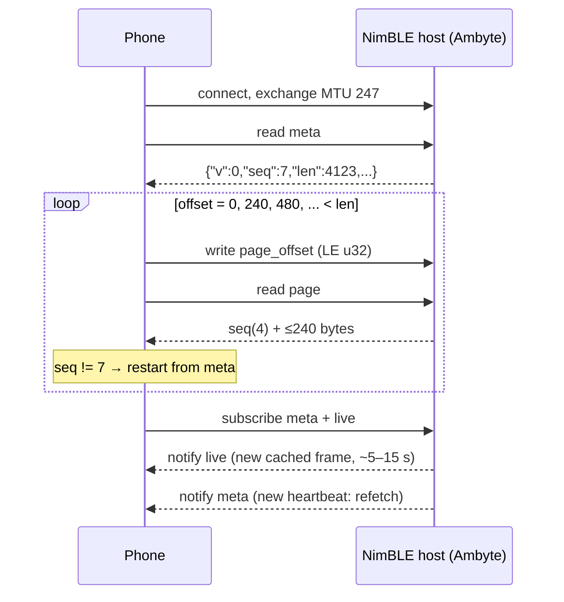
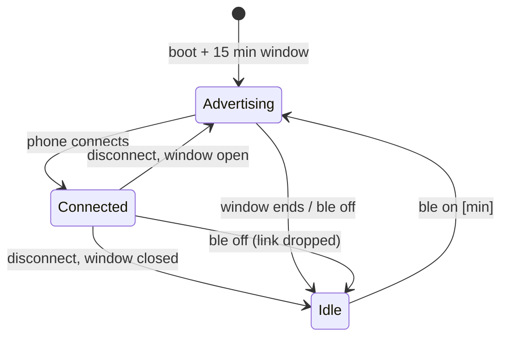

# Bench BLE diagnostics (prototype, env `bench-ble`)

**Bench prototype. Not a release feature.** The service is unauthenticated,
and the radio's power draw and Wi-Fi coexistence cost are unqualified. It
exists so the openJII phone app can read a real unit's diagnostics over BLE
during development. Every release env keeps Bluetooth out of the build
(`sdkconfig.defaults`: `# CONFIG_BT_ENABLED is not set`). Only
`sdkconfig.bench.ble.defaults`, used by `[env:bench-ble]`, switches it on, and
`tests/test_ble_diag.py` checks that no other env does.

```sh
pio run -e bench-ble
python3 tools/bench_flash.py --env bench-ble --port /dev/ttyACM0   # NVS preserved
```

The service is read-only: nothing a phone does changes device state, and
serving a read never triggers a sensor or charger read.

## Contract v0

| | |
|---|---|
| Advertising | 15 min after every boot, then off. `ble on [min]` reopens it (1–1440 min), `ble off` closes it and drops the link. One connection; advertising pauses while connected and resumes after disconnect while the window is open. A connection made inside the window survives the window's end. |
| Name | `Ambyte-XXXX`, the last two Wi-Fi STA MAC bytes (bench: `Ambyte-E704`). It is sent in the **scan response**, because it does not fit in the advertisement beside the 128-bit service UUID. |
| Service | `6a4d0001-3b2c-4f8e-9a51-0c7e2b4d9a10` (advertised) |
| MTU | preferred 247 (client should request it) |

| Characteristic | UUID | Props | Value |
|---|---|---|---|
| meta | `6a4d0002-…` | read, notify | `{"v":0,"seq":<u32>,"len":<bytes>,"age_ms":<ms\|null>,"fw":"<app version>","mac":"AA:BB:CC:DD:EE:FF"}`, ≤ 180 B. `seq` 0 / `age_ms` null = no heartbeat built since boot. Notifies on a new `seq`. |
| page_offset | `6a4d0003-…` | write (with response) | exactly 4 bytes, LE u32; any other length is refused (`0x0D`). Reset to 0 on connect. |
| page | `6a4d0004-…` | read | 4-byte LE `seq` + up to 240 snapshot bytes from `page_offset`; seq only at or past the end. |
| live | `6a4d0005-…` | read, notify | `{"age_ms":..,"vin_mv":..,"vsys_mv":..,"vbat_mv":..,"iin_ma":..,"ichg_ma":..,"status":<REG0C>,"fault":<REG0D>,"valid":<bool>,"reason":"ok\|no_input\|adc_timeout\|implausible\|i2c_error\|unavailable"}`, ≤ 200 B. Before the first charger read: `age_ms` null, zeros, `valid:false`, `reason:"unavailable"`. Notifies when a new frame is cached. |

**Snapshot** = the `ambyte.telemetry/1` sample object exactly as
`emit_status_event` built it (the element of the published envelope's
`sample` array, ≤ 8192 B, observed 2.3–4.4 KB). It is not the MQTT envelope
(timestamp, device_id and provenance are added at publish time). Every built
heartbeat counts: the 15-min direct heartbeat, the sync_runner stored
heartbeat and the schedule's `device/status-report`. A CLI preview does not.

**Notifications** carry at most MTU − 3 bytes. At the default MTU 23 a
`meta`/`live` notification is truncated, so a client must request MTU 247
before subscribing.

## Mechanism



What it deliberately does not touch:

- **No status build on demand.** A status report runs a charger read whose side
  effects (ADC start, history counters, re-detect/AICO after-read hooks) must
  not depend on a phone being near. The snapshot is the copy taken when the
  firmware built its own heartbeat.
- **No charger mutex in the host task.** `mp2731_last_frame_at` takes the
  charger read mutex, which an I2C read holds for up to ~1 s, so only the
  worker task calls it. Host callbacks take only the `s_mux` spinlock, never
  `event_log`'s mutex, never a FreeRTOS wait.
- **No NVS.** Security manager off, bond persistence off, window is RAM state.
- **Early init, late radio.** Controller, host, GATT table and both BLE tasks
  start right after NVS/PM, before Wi-Fi/TLS fragment the internal heap (see
  the RAM budget below); nothing is transmitted until boot-complete opens the
  window.
- **The event log and its cursor are untouched.** The hook runs before
  delivery on the building task and only copies.





## Internal RAM budget (why the overlay trims Wi-Fi and the controller)

The BT controller's buffers must be internal RAM, and this firmware runs with
little of it: with MQTT up, an image without BLE sits at ~20 KiB internal free,
largest block ~7.6 KiB. Bench boots on 2026-11-17 (unit 28:37:2F:FF:E7:04,
v2.23.0 base):

| Boot | Overlay / init | Result |
|---|---|---|
| 1 | NimBLE + coex only, init at boot-complete | `esp_bt_controller_init` Malloc failed, no BLE; MQTT 20.3 KiB free / 7.7 KiB largest |
| 2 | + Wi-Fi IRAM fast paths in flash, controller MAX_ACT 2, no scan/DTM/LL security | heap region 163 → 183 KiB; controller still failed (post-TLS heap fragmented) |
| 3 | + controller/host/GATT init early (before Wi-Fi) | BLE up, costs 31 KiB; schedule runner `ESP_ERR_NO_MEM`, MQTT at 11 KiB free / 2.5 KiB largest |
| 4 | + controller code in flash (`BT_CTRL_RUN_IN_FLASH_ONLY`), smaller BLE stacks | heap region 196 KiB; runner starts, but the host task (created at boot-complete) silently failed: never synced |
| 5 | + host and worker tasks created early too | **all up**: advertising, runner, MQTT; 20.4 KiB free / 7.7 KiB largest with MQTT up and advertising, 19.5 KiB while a client pages the snapshot |

So the IRAM moved to flash pays for the controller (about 35 KiB including
task stacks). Costs of those trims:
- Wi-Fi RX/TX fast paths in flash: lower peak Wi-Fi throughput, irrelevant at
  the MQTT rate.
- Controller in flash: its ISRs cannot run while the cache is off for a flash
  erase (littlefs writes), so a link may miss connection events there.
- DMA-capable free drops to ~11 KiB.

These trims, and the cost of keeping BLE beside MQTT, are the main open
question before any release use.

## Console

```
ble                 status: name, adv, window left, link, MTU, snapshot seq/len/age,
                    live age/reason, read counters, internal + PSRAM heap
ble on [minutes]    open (or restart) the advertising window, default 15
ble off             close the window, stop advertising, drop the link
```

## Host evidence

`CC=clang python3 -m pytest tests/test_ble_diag.py` builds
`components/ble_diag/ble_diag_core.c` with `tests/ble_diag_host.c` under
ASan/UBSan: paging round-trips at 1, 239, 240, 241, 480, 2300, 4400, 8191 and
8192 bytes; past-the-end pages; staged-but-unpublished copies stay invisible;
seq wraps past 0; offset writes must be exactly 4 bytes; meta and live render
within 180/200 bytes at their worst case; cJSON parses every rendered object.
