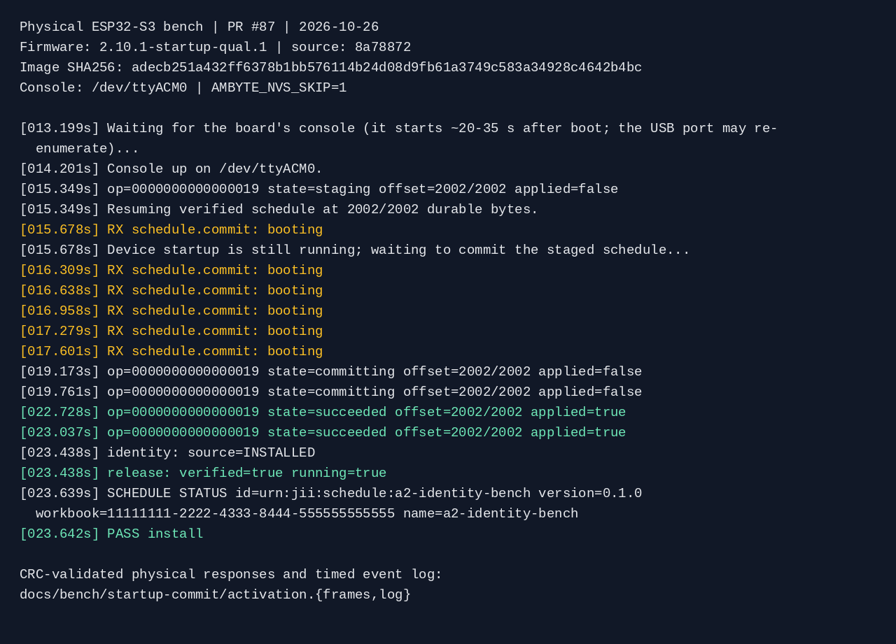
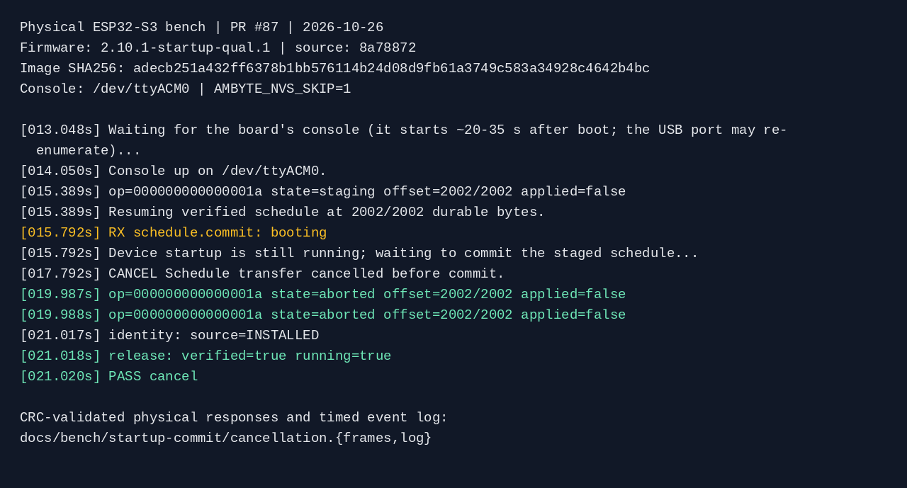

# Schedule commit during startup: PR #87 physical qualification

Qualified on 2026-10-26 using the physical ESP32-S3 bench
`28:37:2F:FF:E7:04`, after an explicit handover from the board owner.
This is physical USB/device evidence, separate from the host harness.

| Attribution | Value |
| --- | --- |
| Firmware source | `8a7887272e625865696c3caf8644bb37aaeaeee1` |
| Compiled application version | `2.10.1-startup-qual.1` |
| Application SHA-256 | `adecb251a432ff6378b1bb576114b24d08d9fb61a3749c583a34928c4642b4bc` |
| Fixture | `tests/identity_host/bench.yaml`, padded with short comments to 2,002 bytes |
| Fixture SHA-256 | `a83a61749727bb9160cf4dd4c7b514b8ed38f54f795f9d15d65200f4651b1184` |
| Fixture workbook | `11111111-2222-4333-8444-555555555555` |
| Store instance | `b43fe702a1a0bed2` |
| Flash scope | Application only at `0x20000`, always with `AMBYTE_NVS_SKIP=1` |

The qualification build used the production PlatformIO environment with an
explicit version, after cleaning the build directory so CMake picked up the
version. No boot delay, altered boot predicate or other firmware instrumentation
was used. The production Python `ServiceClient` handled framing, journaling,
retries and cancellation; the bench wrapper recorded replies and progress.

## Early commit and activation

A normal one-pass upload finished after startup on this bench. To target the
early-commit window, the PC retained a fully acknowledged staging operation
without sending commit, then rebooted the board. On reconnect, the production
client read back the same complete prefix and committed as soon as the console
became available. This also checks that a complete staging upload survives boot.

Times below are elapsed from the bench script starting, not device uptime.

| Observation | Recorded result |
| --- | --- |
| Complete staging readback | At 15.349 s, op `0000000000000019`, `staging`, offset/size `2002/2002` |
| Early commit | Six CRC-valid `booting` refusals, from 15.678 through 17.601 s |
| Commit admission | Same ID and prefix, `committing`, at 19.173 s |
| Activation | Same ID, `succeeded`, `applied:true`, at 22.728 s |
| Independent console verification | `INSTALLED`, matching fixture SHA/workbook/version; release `verified:true,running:true` |



The timed [event log](activation.log) records complete validated result objects.
The [physical response frames](activation.frames) retain the original correlation
IDs and CRCs; all 20 stored physical frames passed the production decoder.
The image abbreviates result JSON for readability; the text files keep it.

## Cancellation while booting

A second fully staged upload used op `000000000000001a`. On a new boot it
received `booting` at 15.792 s, then the production cancellation callback was
set. The client aborted its own staging operation; readback returned
`state:aborted,reason:aborted,applied:false` at 19.987 s. Identity and release
readback still showed the previously installed `pr87-early` program running.



See the [cancellation event log](cancellation.log) and
[physical response frames](cancellation.frames). All 15 stored frames passed the
production decoder. Before restoring the original program, the quiet fixture's
job table showed zero runs and zero failures:

```text
quiet            2026-12-31 23:00:00       0     0     0      0        0
```

## Restoration and handback

The exact original 2,624-byte installed schedule was saved before qualification
and restored through the production service installer. Its SHA-256 is
`943c294243a0254b364172dd3252069e350cbc54428fed88fb84f65c642ea2b7`, release
version `wb-v7`, built against `2.7.0`. Physical littlefs readback matched the
saved bytes exactly. The restored release's `installed_on_fw` truthfully records
`2.10.1-startup-qual.1`, which performed that restoration.

The application was then returned to released **v2.7.0**. Final physical flash
readback and console checks established:

| Preserved or restored state | Result |
| --- | --- |
| Selected app | `ota_0`, address `0x20000`, released v2.7.0, bytes equal to the owner's release image |
| Released app SHA-256 | `1cd543569c0be0ea222eb19c79e59a8402494c95d5a9ca24329ba5542c5e2d00` |
| OTA selection | Sequence 1, state 2 (`VALID`); both otadata sectors byte-identical to incoming |
| Otadata SHA-256 | `8ba3b110139f45443d4f268d1a3373ef99a1718b71d51664531b83ee2d4b91a3` |
| Bootloader and partition table | Original release bootloader and B01 table, both byte-identical |
| Other application slot | `ota_1` left untouched |
| Identity, certificates, provisioning and Wi-Fi | All 19 critical NVS key fingerprints unchanged; same MAC and thing name |
| Original program | Exact original bytes; console `INSTALLED`, `verified:true,running:true` on v2.7.0 |

NVS was never rewritten from a provisioning image. Normal event-log progress,
boot/time bookkeeping and the schedule's installation-firmware provenance did
change; preservation does not mean every NVS byte stayed frozen. No Wi-Fi reset,
network change, queue edit or event deletion was performed. Raw NVS and backup
images remain private on the bench host. Only the controlled fixture's response
frames and nonsecret event logs are committed here.

The serial port was closed and the exact final state was reported to the bench
owner before its next user's qualification round.
