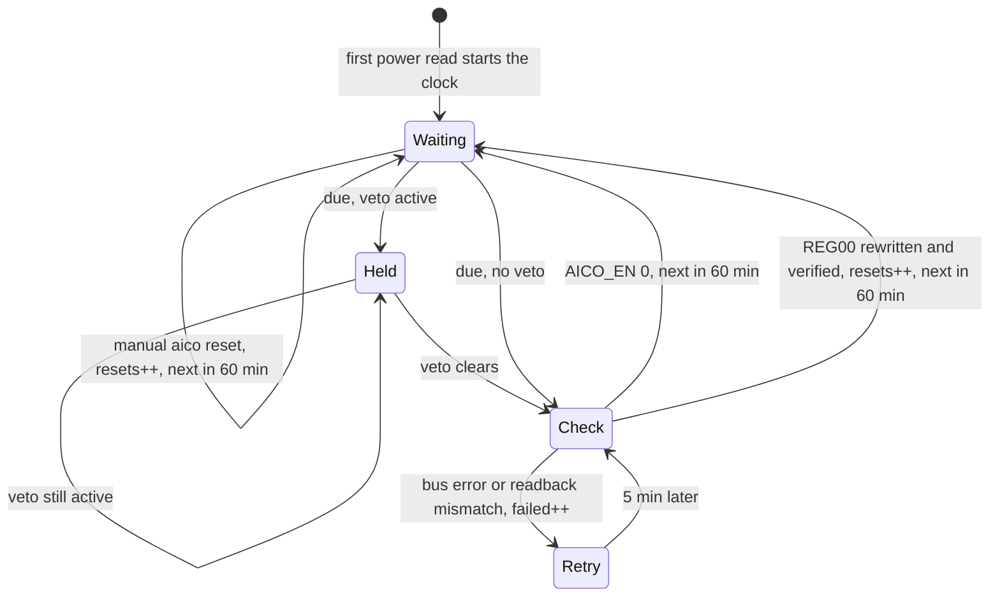
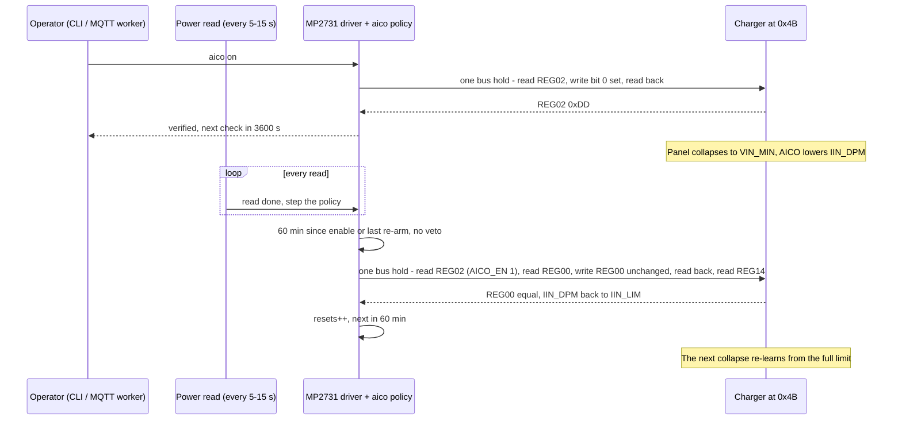
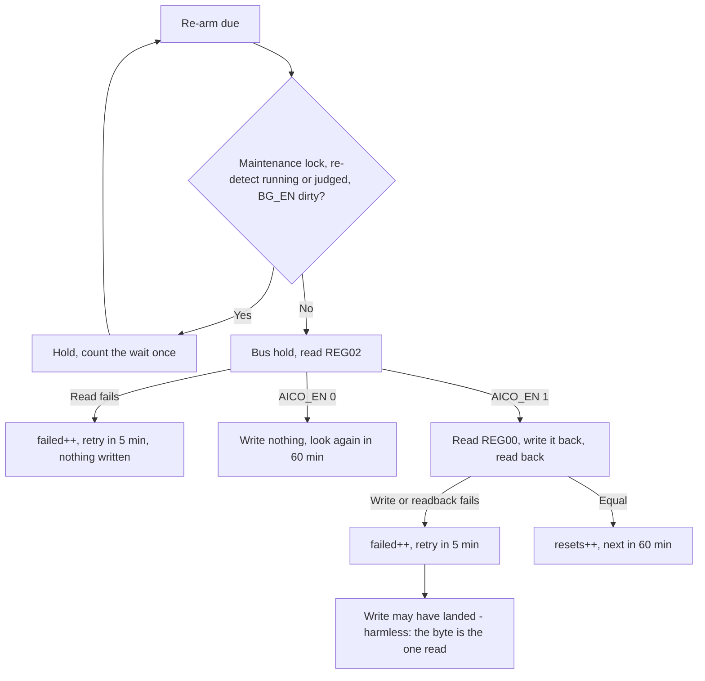
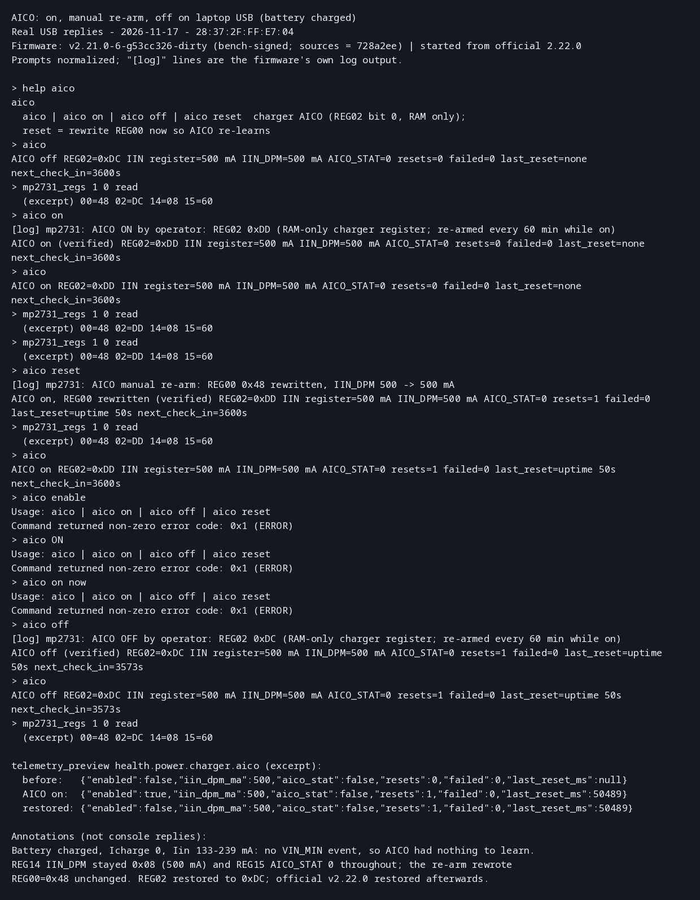

# MP2731 AICO switch and hourly re-arm

The `aico` CLI command and the `get_aico` / `set_aico` MQTT commands read or
switch the charger's **Automatic Input Current Optimizer** (AICO, REG02 bit 0).
While AICO is on, the firmware **re-arms** it at most once an hour by writing
REG00 back with its own value, so a limit AICO learned in weak light does not
cap the rest of the day. Companion of the
[input current limit](charger-iin-limit.md) and
[VIN limit](charger-vin-limit.md) commands, with the same contract: MQTT work
on the resident worker, single-flight `busy`, id rules, verified readback,
live register only.

## Why

When the charger draws more than a weak solar panel can give, the panel
collapses to the VIN_MIN floor (4.3 V) and the charger starts and stops: one
field unit logged 10 stops in 25 minutes before it dropped the panel. A
current limit just below what the panel can deliver keeps it near its 6-7 V
working point instead. AICO finds that limit on its own (datasheet Rev 1.2,
"Automatic Input Current Optimizer", p.21):

- on a VIN_MIN event it lowers the input current limit step by step until the
  input leaves VIN_MIN regulation, and reports the result in REG14[5:0]
  `IIN_DPM` (100 mA + 50 mA steps). REG15 bit 7 `AICO_STAT` flags AICO action;
- it **only ever lowers** that limit, and "does not automatically run the AICO
  function unless another VIN_MIN event occurs". A limit learned at dawn would
  therefore cap the charger all day;
- "Any write to IIN_LIM can reset IIN_DPM to the same IIN_LIM value when the
  AICO function is enabled." Rewriting REG00 unchanged hands AICO the full
  register limit again, and the next collapse re-learns from there.

The field fleet runs with AICO off (REG02=`0xDC`). This change adds the switch
and the re-arm; it does not turn AICO on anywhere.

## Serial console

```text
aico            read REG02/00/14/15 and the re-arm counters
aico on         set REG02 bit 0 (verified)
aico off        clear REG02 bit 0 (verified)
aico reset      rewrite REG00 with its own value now (test tool)
```

```text
AICO on (verified) REG02=0xDD IIN register=500 mA IIN_DPM=500 mA AICO_STAT=0 resets=0 failed=0 last_reset=none next_check_in=3600s
```

`IIN register` is the REG00 register limit (see the
[IIN-limit doc](charger-iin-limit.md): with `EN_ILIM` the ILIM pin may cap
lower still); `IIN_DPM` is the limit AICO applies now. Any other argument
prints the usage and returns 1 without touching the charger. `aico reset` is
refused under the maintenance lock and while a charger re-detect is in
progress or being judged; it works with AICO off too (it is then a harmless
rewrite) and counts as a reset either way.

## MQTT

```json
{"type":"get_aico","id":"aico-1"}
```

```json
{"type":"set_aico","id":"aico-on-1","enabled":true}
```

`enabled` must be a JSON boolean (`"true"`, `1` and `null` are rejected). The
id rules are those of the VIN/IIN commands: nonempty, at most 64 bytes.
Replies arrive on the status topic:

```json
{"type":"set_aico_result","id":"aico-on-1","ok":true,"enabled":true,"reg02":221,"iin_limit_ma":500,"iin_dpm_ma":500,"aico_stat":false,"resets":0,"failed":0,"last_reset_ms":null,"next_check_in_s":3600,"detail":"AICO on (verified) REG02=0xDD ..."}
```

`get_aico` replies `aico_result` with the same fields. `last_reset_ms` is the
uptime (ms) of the last verified re-arm, `null` before the first. Errors
carry `ok:false` and a `detail`, and omit every register field. `busy` (an
AICO request is pending; VIN/IIN requests do not block it) and
`queue_unavailable` never touch the charger. There is no MQTT reset: the
re-arm is automatic. The fleet tool exposes `fleet_command.py aico
--aico-action get|on|off` and the Fleet command workflow's `aico` choice;
`on`/`off` are MUTATING and need an explicit device list.

## Register semantics and lifetime

| Register | Field | Reset by REG_RST | Reset by watchdog | This command |
| --- | --- | --- | --- | --- |
| REG02 bit 0 | `AICO_EN` (POR 0) | Y | **N** | Switched; verified readback |
| REG02 bits 7:1 | shipping delay, NTC type/enables, `TJ_REG`, NTC option | Y | **Y** | Copied from the read, never changed |
| REG00 | `EN_HIZ`, `EN_ILIM`, `IIN_LIM` | Y | 7:6 Y, 5:0 N | Re-arm writes the byte back exactly as read |
| REG14[5:0] | `IIN_DPM` | read only | | Reported |
| REG15 bit 7 | `AICO_STAT` | read only | | Reported |

**What turns AICO off.** Per the datasheet table, `AICO_EN` is reset by
REG_RST (REG01 bit 7, which the firmware never sets: the VIN-limit setter
writes it 0) and by a charger power-on reset, and **not** by the I2C watchdog,
which is expired on the whole fleet (REG0D=`0x80`). The datasheet names VIN
power-on-reset effects only for IIN_LIM/VIN_MIN (behind an OTP option that is
off by default), the REG0B fast-charge bits and VIN_STAT; it says nothing for
REG02. With the battery attached the chip stays powered when the panel goes
dark, so `AICO_EN` should survive the night; a unit that loses battery and
input together returns to AICO off. This is the datasheet reading, not a
hardware qualification: check `aico` (or the heartbeat's `aico.enabled`) after
dawn on a field unit before relying on it.

The set changes only bit 0 because bits 7:1 *are* reset by the watchdog: the
setter reads REG02, flips bit 0 and writes back what it read, under one bus
hold, and reports success only when the readback equals the written byte.
Nothing is stored in NVS or OTP and nothing is reapplied at boot; an ESP
reboot does not touch the charger.

## The hourly re-arm

`components/mp2731/mp2731_aico.c` decides **when**, as a pure function fed by
the power reads that already run every 5-15 s (no task, no timer). The glue in
`mp2731.c` does the register access after the re-detect step, under the same
read mutex:

- the first read after boot starts the clock; switching AICO on restarts it,
  so AICO always gets a full interval to learn before its first re-arm;
- no sooner than `AICO_RESET_INTERVAL_MS` = 60 min later, one bus hold reads
  REG02. AICO off: nothing is written, the next look is an hour later. AICO
  on: REG00 is read, written back unchanged, read back (must match), and
  REG14 read again;
- a failed access is counted (`failed`) and retried after 5 min;
- a due re-arm is **held** (counted once per wait in the policy's `vetoed`)
  while the maintenance lock is held (OTA / AMBIT flash), while a manual
  charger re-detect runs (its settle snapshots must see only the pulse), while
  an automatic re-detect's outcome window is open, and while a BG_EN is not
  proven back at 0. The rewrite and the BG_EN pulse each hold the I2C bus for
  their whole sequence, so they can never interleave.

Why an hour: each re-arm costs one re-learn, and AICO can only learn through
a fresh panel collapse, the very event the limit avoids. Without AICO the
field unit collapsed about every 2.5 min; one dip an hour is ~4 % of that.
Clear-sky irradiance rises over hours (dawn to mid-morning), so an hourly
re-arm follows the day in ~10 steps while no learned limit is more than an
hour stale; a cloud that teaches a low limit costs at most the rest of that
hour.







## Telemetry

`health.power.charger.aico` is appended to the charger object after
`redetect`, and is dropped whole (never truncated) when the 2048 B charger
budget cannot hold it:

```json
"aico":{"enabled":true,"iin_dpm_ma":500,"aico_stat":false,"resets":1,"failed":0,"last_reset_ms":50489}
```

`enabled`, `iin_dpm_ma` and `aico_stat` come from the heartbeat's own register
scan (REG02, REG14, REG15) and are omitted when that register was not read;
`resets`, `failed` and `last_reset_ms` (uptime) are the per-boot counters,
including manual resets. The worst case is under 192 B.

## Verification

`CC=clang python -m pytest tests/test_aico.py` runs, under ASan/UBSan:

- the production policy (`tests/aico_policy_host.c`): never two resets closer
  than an hour over a simulated day, hourly looks only while off, 5 min retry
  after a failure, a veto held and counted once per wait, operator switch and
  manual reset restarting the period, render worst case and omitted fields;
- the production driver, CLI and MQTT handler (`tests/aico_host.c`) against a
  fake charger that models AICO. The fake asserts that REG00 is only ever
  written back exactly as read and REG02 only in bit 0, each in the same bus
  hold as its read, and never in the bus hold of a BG_EN pulse. Cases: the
  switch and its failures, the hourly re-arm restoring IIN_DPM (300 → 1000 mA),
  the AICO-off fleet (one REG02 read an hour, no write), every veto, a re-arm
  due while an automatic re-detect is pending, bus failures, manual reset,
  CLI and MQTT parsing, busy and queue refusal.

Breaking the code on purpose shows the tests catch it: dropping the REG02
bit 7:1 copy fails 7 cases, dropping the re-detect vetoes 2, removing the
interval 10, writing REG00 without bits 7:6 7, re-arming while AICO is off 1.

### Bench: on, manual re-arm, off on laptop USB

On 2026-11-17 the dev-fleet bench board 28:37:2F:FF:E7:04 started from official
signed v2.22.0 with REG00=`0x48`, REG02=`0xDC`, REG14=`0x08`, REG15=`0x60`, the
battery `charged` at 4.18 V on laptop USB. The bench-signed candidate's
firmware sources are those of `728a2ee`; its version string reads
`v2.21.0-6-g53cc326-dirty`, a CMake describe cached from a reconfigure before
the commit. NVS was preserved; the only fleet deployment running was v2.22.0
to prod, which cannot reach this dev-fleet board.

| Step | REG02 | REG00 | REG14 (IIN_DPM) | REG15 |
| --- | --- | --- | --- | --- |
| Before | `0xDC` | `0x48` | `0x08` (500 mA) | `0x60` |
| `aico on`, 4 samples over ~40 s | `0xDD` (verified) | `0x48` | `0x08` | `0x60` |
| `aico reset` (before → after) | `0xDD` | `0x48` → `0x48` (verified) | `0x08` → `0x08` | `0x60` |
| `aico off` | `0xDC` (verified) | `0x48` | `0x08` | `0x60` |

The battery was full, so the input current was the unit's own load
(133-239 mA, `Icharge` 0) and the 5.1 V USB input never approached VIN_MIN:
AICO had nothing to learn, `AICO_STAT` never set and IIN_DPM stayed at the
register limit. The run shows the verified switch with bits 7:1 unchanged
(`0xDC` ↔ `0xDD`), the re-arm writing REG00 back byte-exact, the counters and
the heartbeat object (`resets` 0 → 1, `last_reset_ms` set), rejected syntax
(`aico enable`, `aico ON`, `aico on now`, rc 1) and the exact restore of
REG02=`0xDC`. **No AICO learning and no automatic hourly re-arm were observed
on hardware**: the first needs a weak panel, the second an hour with AICO on.
Both are host-tested only.



[Text excerpt](images/charger-aico/cli-aico.txt),
[samples with raw registers](images/charger-aico/bench-samples.json) and the
[bench manifest](images/charger-aico/bench-manifest.json). Afterwards the bench
was returned to the production-signed official v2.22.0: REG00=`0x48`,
REG01=`0x06`, REG02=`0xDC`, all 13 configuration values and the installed
schedule SHA unchanged, no cloud or Wi-Fi command sent.

Not qualified on hardware: AICO learning on a collapsing panel, the hourly
automatic re-arm, the MQTT commands and fleet workflow (host-tested only),
`AICO_EN` across a night without input, and the AICO_STAT clearing behaviour
(the datasheet does not say whether reading REG15 clears it). A field trial
should switch AICO on for one unit on a weak panel and compare charge stops,
VIN and IIN_DPM in the heartbeat against a neighbour with AICO off.
