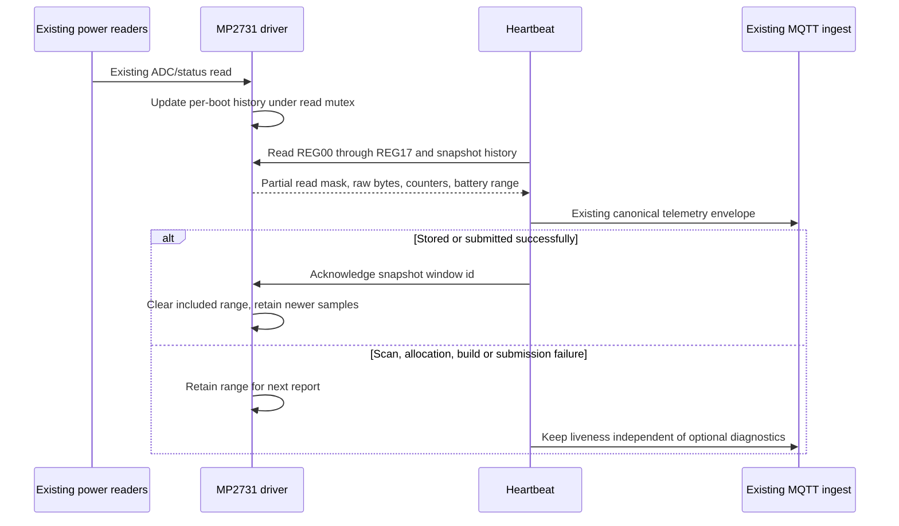

# Charger evidence in telemetry

`ambyte.telemetry/1` now adds `health.power.charger` to both stored status events
and the battery-independent direct heartbeat. It stays on the existing ingest
route. No new topic, schedule job, charger configuration write or restart is
introduced. The heartbeat cadence stays unchanged (direct reports every 15 min;
stored status cadence is configurable).

The MP2731's accepted power frame is still reported under `health.power`.
The new object is diagnostic evidence only: it cannot open a flash gate, release
brownout protection or hold back measurement publishing. The serial
`mp2731_regs` command also includes REG17 now.



## Registers and decoded fields

| Field | Unit / meaning |
| --- | --- |
| `scan_start_ms`, `scan_end_ms` | Monotonic milliseconds since this boot, bracketing the scan; not UTC. Sequential register reads are not an atomic chip snapshot. |
| `read_mask` | Bit N set only if register N was read successfully. Full mask = 16777215 (`0xFFFFFF`). |
| `read_error` | ESP error code, zero for a complete scan. On first failure, stop the scan to bound latency on a failing bus. |
| `registers` | Object keyed by uppercase two-digit hexadecimal addresses `00` through `17`, values integer 0–255. Missing reads are omitted, never zero-filled. Includes control, charge profile, watchdog/timer configuration, status/fault, ADC, limiting and JEITA registers. |
| `iin_limit_ma` | REG00[5:0] × 50 + 100 mA. Register ceiling only; an enabled hardware ILIM may be lower. |
| `external_ilim_enabled`, `high_impedance` | REG00 bits 6 and 7. |
| `vin_min_mv` | REG01[6:0] × 100 + 3700 mV. Actual readback, not a claimed default. |
| `charge_ntc_enabled`, `aico_enabled` | REG02 bits 4 and 0. |
| `charge_config` | REG04[5:4]: 0 disabled, 1 enabled, 2 reserved, 3 OTG. Does not measure the physical CE pin. |
| `safety_timer_enabled` | REG08 bit 0. |
| `ntc_pct` | REG10 × 0.392 **percent of the NTC reference**, not battery temperature or absolute millivolts. Thermistor network and NTC configuration are needed to interpret temperature. |
| `adc_freshness` | Always `unverified`: scans neither trigger ADC conversion nor prove freshness. This applies to NTC and all raw ADC result bytes, even when the existing reader reports `valid=true`. |
| `thermal_regulation`, `ntc_float` | REG0C bits 1 and 2. |
| `ntc_fault` | REG0D[2:0]: 0 normal, 2 warm, 3 cool, 5 cold, 6 hot; preserve other values. |
| `thermal_shutdown` | REG0D bit 4. |
| `safety_timer_expired` | REG17 bit 7. |

Decoded fields are omitted when their source register was not read. `vin_limited` and `iin_limited` decode REG14 bits 7/6; raw REG14 also
contains the active current limit;
REG16 supplies the JEITA configuration. Raw registers remain available for
interpretations beyond the decoded subset.

The scan shares the ADC-read mutex. It performs **reads only**, once per status
report, and stops on the first I²C failure. A scan failure does not invalidate
otherwise usable power readings or fail the heartbeat. If the driver mutex or
transient allocation cannot be obtained, `charger` is omitted rather than
presented as normal. A buffer failure retries the heartbeat without this optional
object and retains its voltage window.

## Between reports

`charger.history` counts **observed** states from every existing successful or
rejected power read whose status/fault registers completed. It adds no polling
task or I²C traffic between reports. Status and fault bytes remain live evidence
when the ADC frame is unusable.

| Field | Meaning |
| --- | --- |
| `last_read_ms`, `last_adc_change_ms` | Monotonic uptime of the latest power-read attempt and latest accepted ADC-frame change (the first accepted frame establishes the latter). Zero means never observed. The scan timestamps are separate. |
| `reads` | Power read attempts since boot. |
| `read_errors` | Non-OK power results, including `no_input` (a verdict, not necessarily a broken bus). |
| `status_reads` | Attempts with usable live status/fault bytes. |
| `adc_changes` | Changes between accepted five-channel ADC frames; changes are evidence, while equality cannot distinguish a stable value from a stale frame. |
| `charging_ms` | Sampled estimate: elapsed monotonic milliseconds credited to the preceding trickle/constant-current state between consecutive usable status reads at most 15 s apart. Includes no estimate through an error or longer gap. |
| `observed_ms`, `unobserved_ms` | Covered and uncovered durations between power-read attempts, including boot-to-first-read as uncovered. Neither includes the unsampled tail after the latest attempt. |
| `charge_stops` | Observed transitions from trickle/constant current to idle/done across the same continuity rule. Charge completion counts as a stop. |
| `last_stop` | `null` until observed; then `uptime_ms`, `status_reg`, `fault_reg` at that read. A timer/config scan at a later heartbeat is separate evidence. |
| `status_or`, `fault_or` | Bitwise OR of status/fault bytes since boot. Useful for flag occurrence. The OR of encoded VIN/CHG/NTC fields is **not** an observed enum and must not be decoded as one. |

Durations and stop counts cannot prove exact transition times or catch events
between reads. A longer gap breaks continuity; it cannot manufacture hours of
charging or a stop. Counters start at zero each boot; pair them with
`health.runtime.boot_count` and uptime. They write no NVS and do not survive
power loss. A failed/reconnected message does not reset them.

`charger.battery_window` contains `id`, `start_ms`, `end_ms`, and `min_mv` / `max_mv`
for positive battery ADC values accepted by the existing reader since the last
successfully stored/submitted diagnostic report. Empty windows emit two `null`
values. Zero/rejected frames never become a minimum. This is a range of reported
ADC values with unverified freshness, **not** an independent battery monitor;
no battery-only voltage range can be inferred. Failed sends preserve the range;
new reads after a snapshot survive its acknowledgement. Concurrent reporters
may cause overlapping windows, never erasure of newer observations. Direct
submission success is not proof of an accepted broker PUBACK: a lost message can
lose that interval's range; cumulative counters remain available in the next one.

## Measurement accounting

`health.measurements` carries saturating 64-bit per-boot counters. `stored` counts
committed MEASUREMENT records through `cmd_store_event` and explicitly stored
BME280 observations. `store_failures` counts failed attempts at those same stores.
It excludes status/identity/log events, backlog delivery and archive replay.
`sensor_command_failures` counts errors after attempting BME280 reads or AMBIT
temperature/spectrum/run/trigger/fetch commands. It includes CLI attempts and does
not equate command attempts or store retries with unique lost measurements.
Argument/admission refusals, sensor-status polling, configuration commands and
power protection skips do not increment it. Decode/store/build failures beyond
these boundaries are still described by existing diagnostics, not silently added
to the sensor-command count. All three counters are protected against concurrent
updates and tagged by the existing runtime boot counter.

## Qualification

Host checks (including ASan/UBSan) exercise read-only full/partial scans, REG17,
NTC and flags, observed stops, error/long-gap continuity, null voltage ranges,
failed reporting retries and concurrent range acknowledgement. The real
`device_commands`/event-store/MQTT harness checks heartbeat rendering and buffer
limits with a maximum-size diagnostic object. ESP32-S3 release-environment builds
verify the composition root and driver.

```sh
python -m pytest tests/test_charger_diagnostics.py tests/test_payload_v3.py tests/test_power_policy.py tests/test_status_heartbeat.py tests/test_evq_integration.py -q
pio run -e esp32-s3-devkitm-1
```

Hardware qualification remains pending. On a bench unit, compare the heartbeat's
registers with `mp2731_regs` on the same firmware, confirm REG17 is included,
observe a controlled charging-to-idle transition, and verify the subsequent
history/range and boot identity. Exercise input removal and a reporting failure.
Do not disable NTC/thermal protection or change charger settings for this check.
No field rollout is part of this change. No terminal capture from hardware is
claimed or fabricated.
