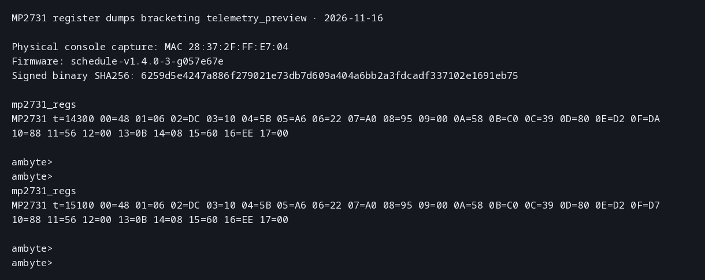
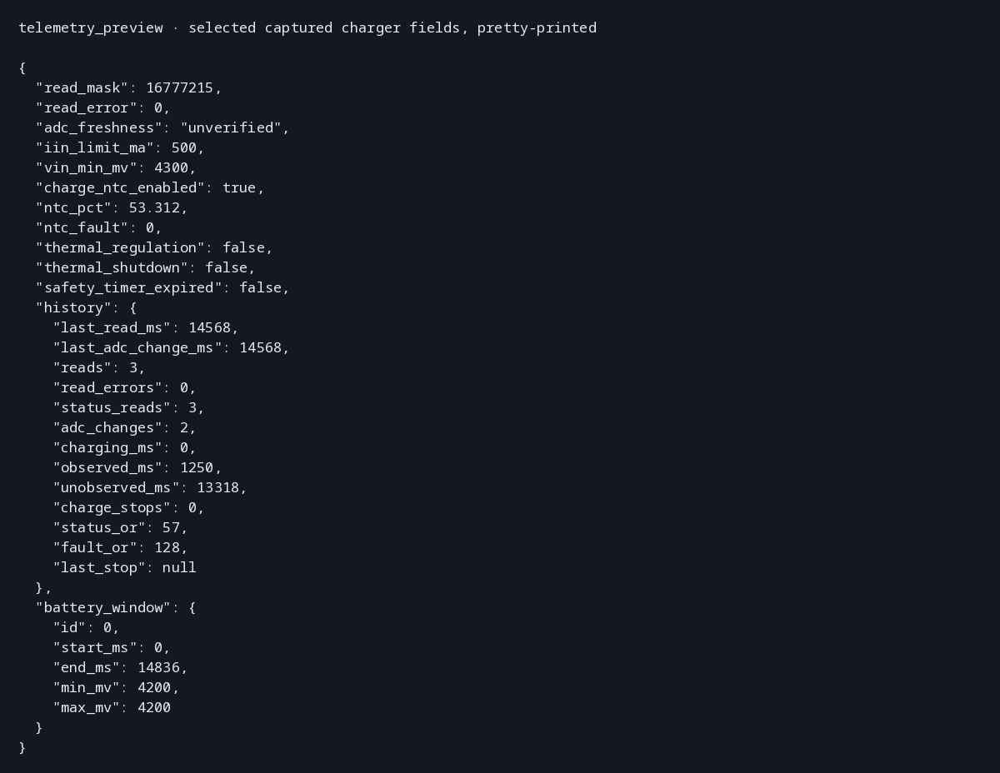
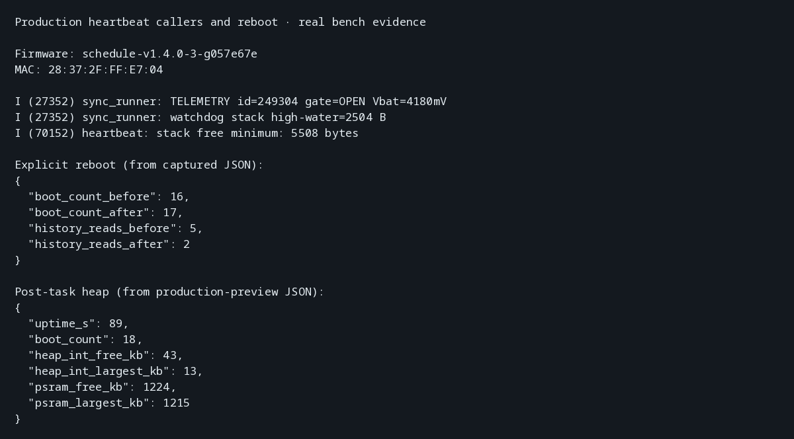

# Charger evidence in telemetry

`ambyte.telemetry/1` now adds `health.power.charger` to both stored status events
and the battery-independent direct heartbeat. It stays on the existing ingest
route. No new topic, schedule job, charger configuration write or restart is
introduced. The heartbeat cadence stays unchanged (direct reports every 15 min;
stored status cadence is configurable).

The MP2731's accepted power frame is still reported under `health.power`.
The new object is diagnostic evidence only: it cannot open a flash gate, release
brownout protection or hold back measurement publishing. Since the re-detection
change, the driver's own re-detection policy reads the same power reads (not
this scan), and its state is reported under `charger.redetect`. The serial
`mp2731_regs` command also includes REG17 now.

`telemetry_preview` uses the same canonical payload builder with synthetic `measure_id=0`, labeled outside the JSON. It allocates no persistent ID, stores/publishes nothing, skips SD diagnostic persistence and peeks without sealing or acknowledging charger windows. Its live BME/power reads can advance per-boot RAM counters/history. The caller owns the returned preview buffer. This command does not suppress autonomous firmware publishing; bench connectivity must separately target a development endpoint.


## Registers and decoded fields

| Field | Unit / meaning |
| --- | --- |
| `scan_start_ms`, `scan_end_ms` | Monotonic milliseconds since this boot, bracketing the scan; not UTC. Sequential register reads are not an atomic chip snapshot. |
| `read_mask` | Bit N set only if register N was read successfully. Full mask = 16777215 (`0xFFFFFF`). |
| `read_error` | ESP error code, zero for a complete scan. On first failure, stop the scan to bound latency on a failing bus. |
| `registers` | Object keyed by uppercase two-digit hexadecimal addresses `00` through `17`, values integer 0–255. Missing reads are omitted, never zero-filled. Includes control, charge profile, watchdog/timer configuration, status/fault, ADC, limiting and JEITA registers. |
| `iin_limit_ma` | REG00[5:0] × 50 + 100 mA. Register ceiling only; an enabled hardware ILIM may be lower. |
| `external_ilim_enabled`, `high_impedance` | REG00 bits 6 and 7. |
| `vin_min_mv` | REG01[6:0] × 100 + 3700 mV. Actual readback, not a claimed default. |
| `charge_ntc_enabled`, `aico_enabled` | REG02 bits 4 and 0. |
| `charge_config` | REG04[5:4]: 0 disabled, 1 enabled, 2 reserved, 3 OTG. Does not measure the physical CE pin. |
| `safety_timer_enabled` | REG08 bit 0. |
| `ntc_pct` | REG10 × 0.392 **percent of the NTC reference**, not battery temperature or absolute millivolts. Thermistor network and NTC configuration are needed to interpret temperature. |
| `adc_freshness` | Always `unverified`: scans neither trigger ADC conversion nor prove freshness. This applies to NTC and all raw ADC result bytes, even when the existing reader reports `valid=true`. |
| `thermal_regulation`, `ntc_float` | REG0C bits 1 and 2. |
| `ntc_fault` | REG0D[2:0]: 0 normal, 2 warm, 3 cool, 5 cold, 6 hot; preserve other values. |
| `thermal_shutdown` | REG0D bit 4. |
| `safety_timer_expired` | REG17 bit 7. |

Decoded fields are omitted when their source register was not read. `vin_limited` and `iin_limited` decode REG14 bits 7/6; raw REG14 also
contains the active current limit;
REG16 supplies the JEITA configuration. Raw registers remain available for
interpretations beyond the decoded subset.

The scan shares the ADC-read mutex. It performs **reads only**, once per status
report, and stops on the first I²C failure. A scan failure does not invalidate
otherwise usable power readings or fail the heartbeat. A partial scan included in a successfully stored/submitted report acknowledges its battery window; the scan error alone does not retain that window. If the driver mutex or
transient allocation cannot be obtained, `charger` is omitted rather than
presented as normal. A buffer failure retries the heartbeat without this optional
object and retains its voltage window.

## Between reports

`charger.history` counts **observed** states from every existing successful or
rejected power read whose status/fault registers completed. It adds no polling
task or I²C traffic between reports. Status and fault bytes remain live evidence
when the ADC frame is unusable. A partial bus failure after REG0C/REG0D still contributes flags and `status_reads`, but breaks duration/stop continuity. Lock timeouts count as failed power attempts too; diagnostic-scan lock timeouts do not. Concurrent power attempts conservatively break continuity even if they later succeed; timestamps are ordered at completion under a short critical section, without I²C or blocking inside it.

| Field | Meaning |
| --- | --- |
| `last_read_ms`, `last_adc_change_ms` | Monotonic uptime of the latest power-read attempt and latest accepted ADC-frame change (the first accepted frame establishes the latter). Zero means never observed. The scan timestamps are separate. |
| `reads` | Power read attempts since boot. |
| `read_errors` | Non-OK power results, including `no_input` (a verdict, not necessarily a broken bus). |
| `status_reads` | Attempts with usable live status/fault bytes. |
| `adc_changes` | Changes between accepted five-channel ADC frames; changes are evidence, while equality cannot distinguish a stable value from a stale frame. |
| `charging_ms` | Sampled estimate: elapsed monotonic milliseconds credited to the preceding trickle/constant-current state between consecutive usable status reads at most 15 s apart. A bus failure, overlapping attempt or longer gap breaks continuity. NO_INPUT, ADC_TIMEOUT and IMPLAUSIBLE verdicts remain eligible when both live status registers completed. |
| `observed_ms`, `unobserved_ms` | Covered and uncovered durations between power-read attempts, including boot-to-first-read as uncovered. Neither includes the unsampled tail after the latest attempt. |
| `charge_stops` | Observed transitions from trickle/constant current to idle/done across the same continuity rule. Charge completion counts as a stop. |
| `last_stop` | `null` until observed; then `uptime_ms`, `status_reg`, `fault_reg` at that read. A timer/config scan at a later heartbeat is separate evidence. |
| `status_or`, `fault_or` | Bitwise OR of status/fault bytes since boot. Useful for flag occurrence. The OR of encoded VIN/CHG/NTC fields is **not** an observed enum and must not be decoded as one. |

Durations and stop counts cannot prove exact transition times or catch events
between reads. A longer gap breaks continuity; it cannot manufacture hours of
charging or a stop. Counters start at zero each boot; pair them with
`health.runtime.boot_count` and uptime. They write no NVS and do not survive
power loss. A failed/reconnected message does not reset them.

`charger.battery_window` contains `id`, `start_ms`, `end_ms`, and `min_mv` / `max_mv`
for positive battery ADC values accepted by the existing reader since the last
successfully stored/submitted diagnostic report. Empty windows emit two `null`
values. Zero/rejected frames never become a minimum. This is a range of reported
ADC values with unverified freshness, **not** an independent battery monitor;
no battery-only voltage range can be inferred. Failed sends preserve the range;
new reads after a snapshot survive its acknowledgement. Concurrent reporters
may cause overlapping windows, never erasure of newer observations. Direct
submission success is not proof of an accepted broker PUBACK: a lost message can
lose that interval's range; cumulative counters remain available in the next one.

## Re-detection

`charger.redetect` carries the per-boot state and counters of the automatic
charger re-detection (BG_EN pulse when the chip ignores a live panel), plus the
number of manual pulses. It is the one part of this object that comes from a
control path, not from read-only evidence. Fields, thresholds and the
qualification are in [charger-redetect.md](charger-redetect.md). The object is
appended last and dropped (never truncated) if the charger object would exceed
its 2048 B buffer.

## Measurement accounting

`health.measurements` carries saturating 64-bit per-boot counters. `stored` counts
committed MEASUREMENT records through `cmd_store_event` and explicitly stored
BME280 observations. `store_failures` counts failed attempts at those same stores.
It excludes status/identity/log events, backlog delivery and archive replay.
`sensor_command_failures` counts errors after attempting BME280 reads or AMBIT
temperature/spectrum/run/trigger/fetch commands. It includes CLI attempts and does
not equate command attempts or store retries with unique lost measurements.
Argument/admission refusals, sensor-status polling, configuration commands and
power protection skips do not increment it. Decode/store/build failures beyond
these boundaries are still described by existing diagnostics, not silently added
to the sensor-command count. All three counters are protected against concurrent
updates and tagged by the existing runtime boot counter.

## Qualification

Host checks (including ASan/UBSan) exercise read-only full/partial scans, REG17,
NTC and flags, observed stops, error/long-gap continuity, null voltage ranges,
failed reporting retries and concurrent range acknowledgement. The real
`device_commands`/event-store/MQTT harness checks heartbeat rendering and buffer
limits with a maximum-size diagnostic object. ESP32-S3 release-environment builds
verify the composition root and driver.

```sh
python -m pytest tests/test_charger_diagnostics.py tests/test_payload_v3.py tests/test_power_policy.py tests/test_status_heartbeat.py tests/test_evq_integration.py -q
pio run -e esp32-s3-devkitm-1
```

Physical bench qualification on **2026-11-16** used USB MAC
`28:37:2F:FF:E7:04`, signed image `schedule-v1.4.0-3-g057e67e`, code commit
`057e67eb90d91e68063c5525ed56da351d186f79`. The SHA-256 captured **after**
`tools/bench_flash.py` regenerated and signed the flashed image is
`6259d5e4247a886f279021e73db7d609a404a6bb2a3fdcadf337102e1691eb75`.
NVS, certificates, installed schedule and existing event backlog were preserved.
The existing MQTT endpoint exactly matches the development endpoint documented
in [the HIL contract](evq-sd-overflow-hil-contract.md); this is a repository
endpoint/account mapping, not a live AWS account check (the local SSO session
was expired). Autonomous reporting stayed on that development endpoint.

| Physical check | Result |
| --- | --- |
| Full raw register scans around the preview | REG00–REG17 present; JSON mask `0xFFFFFF`, error 0. Sequential volatile values were bracketed, not assumed atomic. |
| Configuration before/after flash and preview | All 13 stable configuration registers unchanged; readback 500 mA / 4300 mV, NTC enabled. |
| NTC decode | Raw 136 gives 53.312% of reference. No conversion to panel/battery temperature is claimed. |
| Repeated preview | Synthetic id 0; unchanged window id, prior extrema retained; live read count advanced. |
| Explicit reboot | Boot counter 16 → 17, RAM read counter 5 → 2. USB reconnection can also reset this native-USB bench. |
| Real stored telemetry caller | Successful boot telemetry; watchdog task minimum stack headroom 2504 B. |
| Real direct heartbeat caller | Successful report at uptime 70 s; task minimum stack headroom 5508 B. |
| Heap after production callers | See captured runtime values below; neither caller required a stack increase in this change. |

The host suites passed 31 targeted tests, including production telemetry across
storage states, automatic delivery, actual allocator failures and real driver
adapters under ASan/UBSan. The unavailable-BME scenario was rerun after correcting
its disconnected-broker fixture and now asserts the harness exit status too.
A fresh Astra implementation review found no outstanding production-code issues;
the initial independent review findings were fixed before the bench run.

These are terminal-style renderings of real captured output or explicitly
labeled JSON excerpts, with their text beside each image:





[Image identity](images/charger-diagnostics/image-manifest.json),
[raw/JSON comparison](images/charger-diagnostics/comparison.json), and
[selected captured JSON](images/charger-diagnostics/bench-capture.json) preserve
the evidence behind these checks. The old crash object already present on this
bench was retained; it was not treated as a crash caused by this image.

**Unqualified physical cases:** controlled weak-panel operation, panel heat,
input removal and a charging-to-idle transition. The available bench remained on
its existing strong supply with a charged battery. Injected host failures qualify
the software boundaries, not those physical stimuli. No field rollout or charger
setting change is part of this change.
