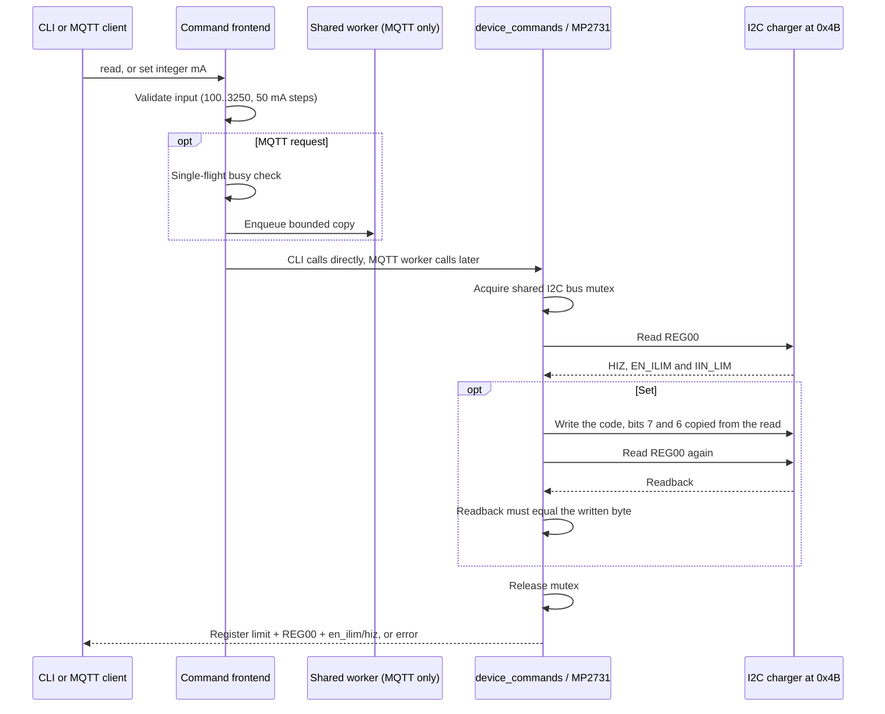
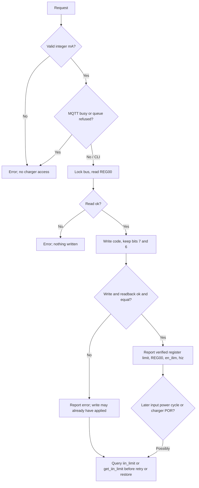
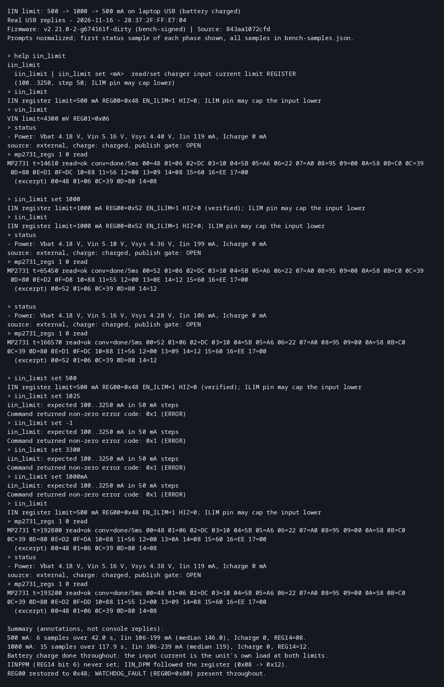

# MP2731 input current limit

The `iin_limit` CLI command and the `get_iin_limit` / `set_iin_limit` MQTT
commands read or change the charger's live input current limit **register**
(REG00 `IIN_LIM`). Both return the decoded register limit in milliamps, the raw
REG00 readback, and whether the hardware ILIM pin also limits (`EN_ILIM`). A
set reports success only after the whole register reads back exactly as
written. This is the companion of the [VIN-limit command](charger-vin-limit.md)
and follows its contract (worker split, single-flight `busy`, id rules, no NVS).

This is a diagnostic control, not a charging-policy change, and the number it
sets is a **ceiling**, not a current:

- With `EN_ILIM=1` (REG00 bit 6; set on every unit read so far: REG00=`0x48`)
  the chip limits the input to the **lower** of this register and the limit set
  by the board's ILIM-pin resistor (`IIN_LIM = 120 / R_ILIM(kΩ)` A, datasheet
  p.22). The resistor value on the Ambyte board is not documented in this
  repository, so a raised register can still be capped below the requested
  value. Replies therefore say "register limit" and never claim an input current.
- The limit is shared by the system load and battery charging. Raising it only
  changes anything while the charger is actually input-current-limited (REG14
  bit 6 `IINPPM` set). A panel that cannot deliver 500 mA, or a full battery,
  gives the same input current at 1000 mA as at 500 mA.
- With AICO disabled (REG02 bit 0, `0xDC` on the fleet), the register is the
  active limit; with AICO enabled the chip would lower it itself (REG14[5:0]
  `IIN_DPM`).

> **Heat.** The field team reported on 14 Nov that the charger area of a board
> got hot. At the same input voltage, 1 A doubles the charger's input power
> over the 500 mA default, and its conversion loss rises with it. The MP2731
> regulates its own junction temperature (REG02 `TJ_REG`, default `11` =
> 120 °C label; the electrical table gives 112 °C typical for that code) by
> cutting charge current, and shuts down at 150 °C. Those protect the chip, not
> the enclosure, battery or neighbouring parts. Watch REG0C bit 1
> (`THERM_STAT`, in the heartbeat as `thermal_regulation`) and the board
> temperature before leaving a unit at a raised limit in sun.

## Serial console

Use the existing USB console at 115200 baud:

```text
iin_limit
iin_limit set 1000
iin_limit
mp2731_regs 1 0 read
status
```

`iin_limit` reads without writing:

```text
IIN register limit=500 mA REG00=0x48 EN_ILIM=1 HIZ=0; ILIM pin may cap the input lower
```

`iin_limit set 1000` writes the register and reports
`IIN register limit=1000 mA REG00=0x52 EN_ILIM=1 HIZ=0 (verified); ILIM pin may cap the input lower`
on success. Arguments are integer milliamps: `1.0`, `1000mA`, off-step values
such as `1025`, negatives and values outside 100..3250 are rejected with no
rounding and no charger access. CLI commands return nonzero on invalid input or
a driver failure.

Record the original value before changing it and restore that measured value
afterwards (`iin_limit set 500` on a unit that read `0x48`). The datasheet's
OTP default is 500 mA; read the actual device rather than assuming it.

## MQTT

Publish either request to the device's existing command topic, without retain:

```json
{"type":"get_iin_limit","id":"iin-before-1"}
```

```json
{"type":"set_iin_limit","id":"iin-test-1","ma":1000}
```

Both requests require a nonempty string `id` of at most 64 UTF-8 bytes. A set
also requires a JSON number `ma`, an exact integer in 100..3250 in 50 mA steps.
A string such as `"1000"`, `null`, fractions and the VIN command's `mv` field
are rejected.

Replies arrive on the existing status topic. Successful examples:

```json
{"type":"iin_limit_result","id":"iin-before-1","ok":true,"ma":500,"reg00":72,"en_ilim":true,"hiz":false,"detail":"IIN register limit=500 mA REG00=0x48 EN_ILIM=1 HIZ=0; ILIM pin may cap the input lower"}
```

```json
{"type":"set_iin_limit_result","id":"iin-test-1","ok":true,"ma":1000,"reg00":82,"en_ilim":true,"hiz":false,"detail":"IIN register limit=1000 mA REG00=0x52 EN_ILIM=1 HIZ=0 (verified); ILIM pin may cap the input lower"}
```

`ma` is the register limit. `reg00` is a JSON integer, not a hex string.
`en_ilim: true` means the ILIM pin also limits and the lower of the two
applies; `hiz: true` means the converter is off (no input current at all,
whatever the limit). Errors carry `ok:false` and a `detail` message and omit
`ma`, `reg00`, `en_ilim` and `hiz`, because there is no confirmed readback.
Malformed ids are reported with an empty `id`. `busy` means an IIN request is
already pending (a pending VIN request does not block it); `queue_unavailable`
means the shared worker queue refused submission. Neither refusal touches the
charger. Retry with backoff.

I2C access runs on the resident maintenance worker; the MQTT callback only
validates and copies bounded input. Repeated sets, including QoS1 duplicates,
apply the same desired value; there is no NVS command-id deduplication. A lost
reply or a set/readback failure does not prove the write failed: query the
limit again before retrying or restoring.

The fleet tool exposes the same pair (`fleet_command.py iin-limit` and the
`iin-limit` choice of the Fleet command workflow); `set` is MUTATING and takes
an explicit device list only.

## Register semantics and lifetime

The [MPS MP2731 datasheet, Rev 1.2, page 30](https://www.monolithicpower.com/jp/documentview/productdocument/index/version/2/document_type/Datasheet/lang/en/sku/MP2731GQC/)
defines REG00:

| Bit | Name | POR | Reset by REG_RST | Reset by watchdog | This command |
| --- | --- | --- | --- | --- | --- |
| 7 | `EN_HIZ` | 0 | Y | **Y** | Preserved exactly as read; reported as `hiz` |
| 6 | `EN_ILIM` (`EN_LIM` in the table) | 1 | Y | **Y** | Preserved exactly as read; reported as `en_ilim` |
| 5:0 | `IIN_LIM` | `001000` (500 mA, OTP) | Y | **N** | Written |

```text
IIN_LIM_mA = 100 + (REG00 & 0x3f) * 50
 500 mA -> REG00 0x48 (with EN_ILIM=1, HIZ=0)
1000 mA -> REG00 0x52
```

The setter holds the shared I2C bus mutex across one read, one write and one
readback. The write copies bits 7:6 from the read, so the command never
changes Hi-Z or the ILIM-pin enable: setting HIZ would switch the converter
off, and clearing EN_ILIM would remove the board's hardware current cap. If
the readback differs from the written byte in any bit, the set fails with
`ESP_ERR_INVALID_RESPONSE`. A failed first read writes nothing. Nothing else
in the firmware writes REG00 (charger re-detection only reads it). Registers
other than REG00 are untouched.

**Watchdog.** The I2C watchdog is expired on every unit read so far
(REG0D=`0x80`, WATCHDOG_FAULT; the firmware never kicks it). Per the table,
a watchdog expiry resets REG00 bits 7:6 to their defaults but **not**
`IIN_LIM` [5:0], so it cannot undo a written limit. It is already expired, and
only writing REG08 bit 3 or toggling the watchdog enable restarts it, which
nothing in the firmware does. A further expiry would at most restore
`EN_HIZ=0` and `EN_ILIM=1`, the values the fleet already runs. The VIN limit
(REG01[6:0], also "not reset by watchdog") survived 62 s under the same
expired watchdog on the bench, and this run held 1000 mA for the whole 1 A
phase (see Verification).

**Power cycles.** The comment column says VIN power-on reset *can* restore
IIN_LIM from OTP, but the OTP map's `IINLIM/VINMIN RESET_EN` default is "not
reset when VIN POR" (REG18 bit 7, not readable). Which applies to this board
has not been qualified, exactly as for VIN_MIN. A full charger power loss
(battery and input both gone) returns POR defaults. Re-read `iin_limit` after
dawn or any input power cycle; do not assume yesterday's value still applies.

The command writes neither ESP NVS nor charger OTP, and the firmware does not
reapply a value at boot. An ESP reboot alone does not reset the charger: the
bench kept REG00=`0x48` across the candidate flash and reset.





## Verification

`CC=clang python -m pytest tests/test_iin_limit.py` executes the production
driver and CLI/MQTT handlers with faked I2C and worker boundaries, under
AddressSanitizer and UndefinedBehaviorSanitizer. It sets every one of the 64
codes under all four HIZ/EN_ILIM combinations (the I2C fake asserts that no
write changes bits 7:6 and that every write follows a read), decodes all 256
raw bytes, and covers bad values and ids, absent hardware, delayed dispatch,
busy, queue refusal, a failed first read (no write), write and readback
failures, a readback mismatch and a bit 6 change between write and readback.
`tests/test_fleet_command.py::IinLimit` covers the fleet tool and workflow.

### Bench: 500 → 1000 → 500 mA on laptop USB

Physical USB qualification on 2026-11-16 (UTC) ran on the dev-fleet bench
board 28:37:2F:FF:E7:04, starting from the official signed v2.21.0 with
REG00=`0x48`, REG01=`0x06`, REG0D=`0x80` (watchdog expired) and the battery
reported `charged` at 4.18 V. The bench-signed candidate was built from
`843aa10` (its firmware sources are those of the feature commit; the image's
version string reads `v2.21.0-2-g674161f-dirty`, a CMake describe cached from a
build configured before the commit). NVS was preserved. Each phase took a
`status` and a full `mp2731_regs 1 0 read` about every 9 s.

| Observation | 500 mA register (6 samples, 42 s) | 1000 mA register (15 samples, 118 s) |
| --- | --- | --- |
| REG00 | `0x48` | `0x52` (verified on set, and in every dump) |
| REG14 | `0x08`: no PPM, IIN_DPM 500 mA | `0x12`: no PPM, IIN_DPM 1000 mA |
| Charge state / Icharge | `charged` / 0 mA | `charged` / 0 mA |
| Reported input current, median (range) | 146 mA (106–199 mA) | 119 mA (106–239 mA) |
| Reported VIN | 5.10–5.16 V | 5.10–5.16 V |
| Reported Vsys | 4.34–4.40 V | 4.26–4.40 V |

**No electrical effect was expected and none is claimed.** The battery was
already full, so the charger drew only the unit's own load, a quarter of
either limit; IINPPM (REG14 bit 6) never set at either value. The input current
and Vsys ranges overlap and are not attributed to the limit. What the run does
show: the register write and verified readback, `EN_ILIM`/`HIZ` preserved
(`0x48` → `0x52` → `0x48`), the chip's own IIN_DPM field following the new
register value (REG14 `0x08` → `0x12`), the value holding for two minutes
under an expired watchdog, rejection of `1025`, `-1`, `3300` and `1000mA` with
CLI return code 1, and exact restoration of REG00=`0x48`. REG14's IIN_DPM does
not include the ILIM-pin cap, so this run does not reveal the board's pin
limit either. The USB-2 laptop port (rated 500 mA) was never loaded beyond
240 mA; a guard in the run script would have restored 500 mA at once on an
input sag.



The adjacent [text excerpt](images/charger-iin-limit/cli-iin-limit.txt),
[all samples with raw registers](images/charger-iin-limit/bench-samples.json)
and the [bench manifest](images/charger-iin-limit/bench-manifest.json) hold the
same evidence. ANSI escapes, prompts and asynchronous log lines are omitted;
no endpoint, credentials or site topic is included.

Afterwards the bench was returned to the production-signed official v2.22.0;
its raw dump read REG00=`0x48` and REG01=`0x06`, all 13 configuration values
and the installed schedule SHA matched the pre-test baseline, NVS was
preserved, and no cloud or Wi-Fi command was sent.

Not qualified on hardware: live MQTT commands (host-tested only), the fleet
workflow, behaviour while actually charging or input-current-limited, the
ILIM-pin resistor value, thermal behaviour at 1 A, and whether an input power
cycle restores 500 mA. A field experiment should record REG00, REG14,
`charge`, `Icharge` and board temperature at both limits on a unit that is
charging from a panel able to supply more than 500 mA.
