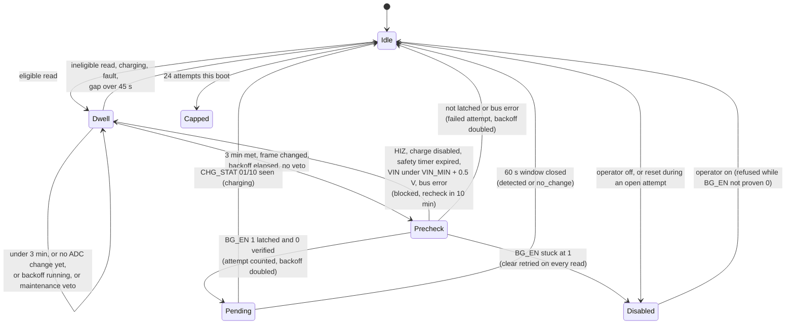
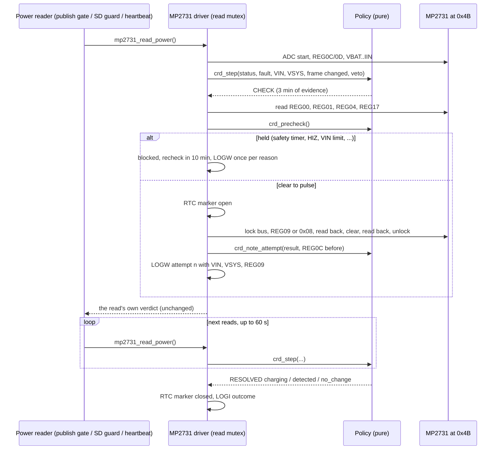
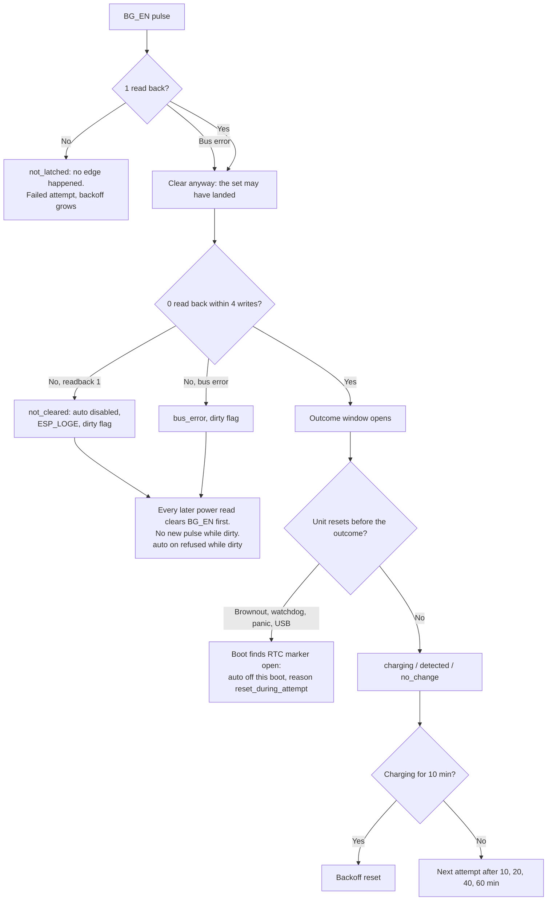
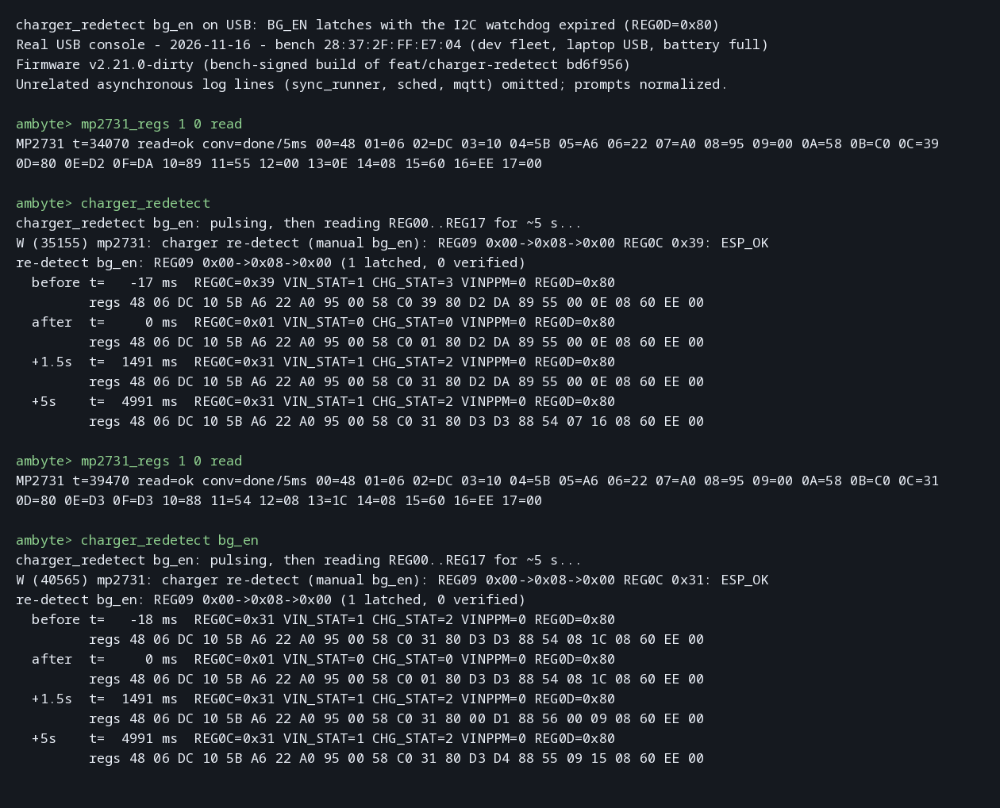
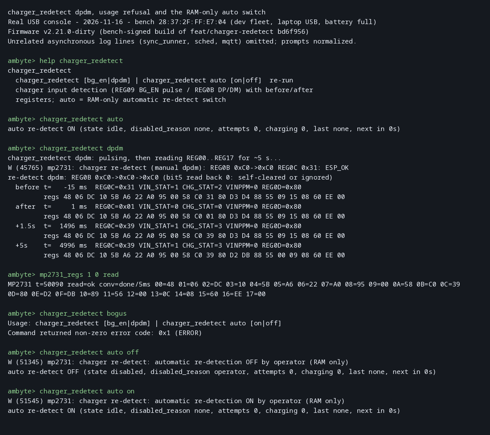

# MP2731 charger re-detection

A unit can sit beside a panel that clearly has power and still not charge. On
15–16 Nov 2026, 77 % of the daytime heartbeats from the 14 panel-fed Uluru
units showed an idle charger with 5.5–8 V on its input. The 17 Nov register
scans (`health.power.charger`, fw 2.21.0) show the state exactly. On
14:63:93:39:36:F8 from about 07:22 on:

| Register | Value | Meaning |
| --- | --- | --- |
| REG0C | `0x00` | VIN_STAT 000 "no input", CHG_STAT 00 "not charging" |
| VIN (ADC) | 7.4–7.6 V | the panel, unloaded |
| VSYS (ADC) | 3.5 V | the battery is not full |
| REG0D | `0x80` | only the I²C watchdog fault, which every unit in the fleet shows |
| REG17 | `0x00` | safety timer not expired |
| REG00 / REG04 / REG02 | `0x48` / `0x5B` / `0xDC` | HIZ off, charging enabled, AICO off |

Input qualification needs only `VIN > VBATT + 0.3 V` and `UVLO < VIN < OVP`
(datasheet Rev 1.2, *Device Power-Up from Input Source*), so the chip had every
reason to start charging and did not. It stayed that way for hours. A gateway
reboot never restarted it (0 of 3 cases), because an ESP reset does not reset the
charger. A brownout, which power-cycles the charger, did restart it in 3 of 4
cases.

The datasheet names the software equivalent of re-inserting the input:

> REG09 bit 3 BG_EN: "Setting this bit from 1 to 0 will reset the input plug-in
> detection and safety timer." … "Writing the BG_EN bit from 1 to 0 or
> re-inserting the input re-enables the input detection, clears the safety timer
> fault and restarts the safety timer."

This firmware adds two uses of that pulse: a **manual command** (CLI and MQTT)
that reports what the chip did, and an **automatic retry** that fires only
in the state above.

## Manual command

```text
charger_redetect            # = charger_redetect bg_en
charger_redetect dpdm
charger_redetect auto       # query the automatic switch
charger_redetect auto off   # RAM only; back on at the next boot
charger_redetect auto on
```

```json
{"type":"charger_redetect","id":"rd-1","method":"bg_en"}
{"type":"charger_redetect_auto","id":"rd-2","enabled":false}
{"type":"charger_redetect_auto","id":"rd-3"}
```

`method` defaults to `bg_en`. `enabled` is a JSON boolean; leave it out to query.
Both MQTT types need a nonempty `id` of at most 64 bytes, as for `vin_limit`.
Replies (`charger_redetect_result`, `charger_redetect_auto_result`) go to the
status topic. The MQTT callback only validates the request and copies it. The
pulse and its 5 s of settle reads run on the resident maintenance worker. Only
one request can be pending at a time (`busy`); `queue_unavailable` means the
worker refused it. Neither refusal touches the charger.

| Method | Writes | Verification |
| --- | --- | --- |
| `bg_en` | REG09 := REG09 \| 0x08, then REG09 & ~0x08. The reserved bits keep whatever the chip read back (read-modify-write). | The 1 must read back, otherwise no 1→0 edge happened and the result is a **failure** (`ESP_ERR_INVALID_RESPONSE`, nothing is cleared because nothing is set). The 0 must read back; the clear is retried 3 more times. A BG_EN that is still 1 is a failure (`ESP_ERR_INVALID_STATE`), and the driver retries the clear before every later power read. Set, verify, clear and verify run under one hold of the shared I²C bus, so the bandgap is never left "Disabled" while another bus user runs. |
| `dpdm` | REG0B bit 5 USB_DET_EN := 1. Bits 7:6 and 2:1 are preserved. DM, DP and FAST_CHG_RESET (bits 4/3/0) are always written 0, because writing 1 to them drives the pins. | Readback is reported. The datasheet gives no self-clear for bit 5. After the +5 s scan, a bit 5 that is still set is written back to 0, its POR value (`restored`). |

The command reports the full REG00–REG17 file four times: before the write,
immediately after it, at +1.5 s and at +5 s. Each scan includes the decoded
VIN_STAT, CHG_STAT and VINPPM. Detection is bounded by the 500 ms DCD timer plus
a 50 ms adapter timer and the primary/secondary comparisons, so +1.5 s (three DCD
timeouts) shows where VIN_STAT settled. The datasheet gives no time from
soft-start to CHG_STAT, so +5 s (ten DCD timeouts) shows whether charging began.
The read mutex is released during the waits, so power reads continue as normal.
An MQTT reply with four snapshots is about 1.1 KB. Registers are sent as one
48-character hex string; `--` marks a register that was not read.

The command is refused under the maintenance lock (OTA, AMBIT flash). It writes no NVS,
no OTP and no other register. **A manual `bg_en` restarts the charge cycle and the
safety timer.** On a full battery on USB the chip went from "done" to
constant-current charging. During detection the input is not used
(`VIN_STAT 000` immediately after the pulse), so the system runs from the
battery for about a second. Do not pulse a unit whose battery cannot carry
the load for that long.

## Automatic re-detection

The decision is a pure state machine
([`mp2731_redetect.c`](../components/mp2731/mp2731_redetect.c)) that
`tests/test_charger_redetect.py` drives verbatim. It adds no task and no polling
of its own: every existing charger read (publish-gate cache every 5 s, SD guard
every 15 s, heartbeat, CLI) feeds it while the driver still holds the read
mutex. All of the following must hold **continuously for 3 minutes**:

| Condition | Threshold | Why |
| --- | --- | --- |
| Valid read | ADC frame accepted (`ESP_OK`) and REG0C/REG0D completed | The voltages come from the frame. |
| Chip says no input, not charging | VIN_STAT 000 **and** CHG_STAT 00 | Never while charging, never on 11 (done), and never in a qualified-but-idle VIN_STAT: there is no evidence that BG_EN fixes that state. |
| No fault | REG0D & 0x7F = 0; REG0C NTC float and thermal regulation clear | Input OVP or "no input", thermal shutdown, battery OVP, OTG and NTC faults all block. Bit 7 (watchdog) is set on every unit in the fleet and is ignored. |
| Panel voltage | VIN ≥ 5.5 V | Above any USB source (5.25 V maximum), so a unit on 5 V never triggers. Below it, a 6 V-class panel (Voc ≈ 8.2 V in sun) is in deep twilight. |
| Headroom | VIN ≥ VSYS + 1.0 V | The battery ADC reads 0 while the charger is idle, so VSYS stands in for the battery. With no qualified input the system runs from the battery through the BATFET, so VSYS is at or slightly below VBATT. 1.0 V covers that drop and the ADC LSBs, and leaves about 0.7 V above the chip's own 0.3 V rule. With today's other limits it never binds (5.5 − 4.1 = 1.4 V); it is kept so that lowering the floor can never remove the headroom check. |
| Not full | VSYS < 4.1 V | VBATT_REG is 4.2 V, so 4.1 V is about 90 %. A full battery is left alone. |
| Fresh | the ADC frame changed at least once during the dwell | A frozen register file cannot keep re-arming retries. |

When the dwell is met, the driver reads REG00, REG01, REG04 and REG17 once more and
**holds** (`blocked`, not an attempt, re-checked every 10 min) on any of:

- HIZ (REG00 bit 7);
- charging disabled (REG04[5:4] ≠ 01);
- **an expired safety timer** (REG17 bit 7). The pulse would clear that fault,
  and a battery protection must never be defeated automatically. It is only
  reported;
- VIN < VIN_MIN + 0.5 V. VIN_MIN is read live, so a field VIN-limit experiment
  is respected.

It also holds under the maintenance lock (OTA, AMBIT flash), counted once per wait in
`vetoed`, and while a BG_EN is not yet proven back at 0.

| Pacing | Value | Why |
| --- | --- | --- |
| Dwell | 3 min | The chip's own transitions finish in seconds, and the 17 Nov dawn bursts restarted on their own within tens of seconds. The stuck state lasted hours. |
| Backoff | not before 10, 20, 40, 60, 60 … min after the previous attempt, plus a fresh full dwell | A panel that keeps collapsing costs at most one pulse an hour. |
| Backoff reset | 10 min of continuous charging | A charging burst of a few seconds that collapses again (17 Nov 06:56–07:21) must not re-arm a 3-minute loop. A bus failure or a gap of more than 45 s breaks the run. |
| Outcome window | 60 s | `charging` if CHG_STAT reaches 01/10, `detected` if VIN_STAT left 000 but no charging was seen, `no_change` otherwise. |
| Per-boot cap | 24 attempts | Units reboot nightly at 01:20 UTC (mid-day at Uluru); 24 attempts at the 60 min cap is a full day of daylight. |

Each attempt is logged once with `ESP_LOGW` (VIN, VSYS, REG0C/0D, how long the
state lasted, and REG09 before→set→after). Its outcome is logged once with
`ESP_LOGI`, and the first hold for each reason once with `ESP_LOGW`.

### State machine



### One automatic attempt



### Failure recovery



### Failure modes

| Case | What happens |
| --- | --- |
| Panel collapses again at once (07:00 on 17 Nov) | The outcome is `charging`, but the backoff still doubles: 10, 20, 40, 60 min. Only 10 min of continuous charging resets it. At most 24 attempts per boot. |
| Unit on a 5 V USB source | Never triggers: VIN < 5.5 V, and such a unit charges anyway (CHG_STAT ≠ 00). |
| Night or twilight | A dark panel gives VIN ≈ 0. At dusk an unloaded panel can stay above 5.5 V with almost no current, so an attempt can happen. It ends `detected` or `no_change` (or a short `charging` burst) and the backoff grows. The cost is one I²C pulse per backoff step. |
| Battery actually full | Excluded by VSYS ≥ 4.1 V and by CHG_STAT 11. The bench showed why this matters: a pulse on a full battery restarts a charge cycle. |
| Bus busy or failing | A lock timeout or bus error in the precheck counts as `blocked` (bus_error). During the pulse it is a failed attempt with backoff. If the set may have landed, the clear is retried on every later read. |
| I²C watchdog resets BG_EN | REG09 is "Reset by WTD". The watchdog is already expired on every unit and the firmware never kicks it, so no new expiry happens during the pulse. The bench confirmed that BG_EN latches 1 with REG0D = 0x80. If an expiry did reset the bit between the writes, the 0 readback still passes. Whether a watchdog reset counts as a 1→0 edge is undocumented; the outcome tracking shows it either way. |
| Silicon reacts badly to the bandgap toggle (VSYS collapse, hang) | The RTC_NOINIT marker is open from the pulse until the outcome is decided. After any reset except power-on, a deliberate `esp_restart` or deep sleep, automatic re-detection stays off for that boot (`reset_during_attempt`). A real power loss garbles RTC memory, which the magic plus the POWERON check reject. |
| AMBIT measurement running | Not a veto. The pulse fires only while the chip already ignores its input, so the system is already on battery. A successful re-detect is the same input transition the chip makes at every dawn or passing cloud. |
| Brownout protection active | Not a veto, on purpose. A unit shedding load because its battery browned out is the one that most needs charging. |
| Maintenance lock (OTA, AMBIT flash) | Vetoed. The attempt waits and fires when the lock is released. |
| Manual and automatic pulses together | A manual pulse restarts the dwell, so the two cannot overlap. Only one manual pulse runs at a time (CLI and MQTT share a single-flight flag). |

## Telemetry

`health.power.charger.redetect` is added inside the charger object (about
280 bytes; the worst case is under 512 B, inside the object's 2048 B cap). If it
does not fit, the charger object is sent without it. The bench charger object
with `redetect` was 1232 B.

| Field | Meaning |
| --- | --- |
| `auto` | Automatic re-detection is enabled. |
| `state` | `idle`, `dwell`, `backoff`, `pending`, `capped`, `disabled` |
| `disabled_reason` | `null`, `operator`, `reset_during_attempt`, `bg_en_stuck` |
| `attempts` | Automatic pulses this boot (including failed ones). |
| `charging`, `detected`, `no_change`, `failed` | Outcomes of those attempts. |
| `blocked`, `last_block` | Prechecks that held: `hiz`, `charge_disabled`, `safety_timer`, `vin_limit`, `bus_error`. `last_block` is cleared by the next attempt. |
| `vetoed` | Maintenance-lock waits. |
| `manual` | Manual pulses this boot (CLI/MQTT); not counted in `attempts`. |
| `dwell_s`, `backoff_s`, `next_in_s` | Current dwell length, the last applied backoff, and time until a retry is allowed. |
| `last` | `null`, or `{uptime_ms, outcome, reg0c_before, reg0c_after, vin_mv, vsys_mv}` for the latest attempt. `outcome` is `pending` until the window closes, and can also be `bus_error`, `not_latched` or `not_cleared`. `reg0c_after` is the last REG0C seen in the window. |

All counters are RAM-only and per boot, like the rest of `charger.history`.

## Verification

```sh
CC=clang python -m pytest tests/test_charger_redetect.py tests/test_vin_limit.py \
  tests/test_mp2731_driver.py tests/test_charger_diagnostics.py tests/test_power_policy.py -q
pio run -e esp32-s3-devkitm-1
```

`tests/test_charger_redetect.py` (ASan/UBSan) covers:

- **Policy:** a modeled replay of the 17 Nov stuck state (fires after exactly
  the dwell); never on trickle, CC, done, qualified-idle, NTC float, thermal
  regulation, any fault bit, 5 V USB, twilight, a full battery, a rejected
  frame, a bus failure or a frozen frame; dwell continuity, gaps and a backwards
  clock; backoff 10/20/40/60/60 and the 24-attempt cap; a collapsing panel; the
  sustained-charging reset (and that a bus error interrupts it); every outcome
  and pulse failure; every precheck reason; veto, operator switch and manual
  restart; valid JSON with a worst case that fits.
- **Driver:** the production adapter against a fake MP2731 that only allows writes
  to REG03, REG09 and REG0B. It checks that the reserved REG09 bits are preserved
  and that set and clear happen under one bus lock. It also covers BG_EN not
  latching, BG_EN stuck at 1 (bounded clears, cleared on a later read, `auto on`
  refused meanwhile), bus and lock errors, dpdm self-clear versus restore, the
  maintenance veto, an end-to-end automatic attempt through `mp2731_read_power`
  (one pulse at 180 s, `charging`, no pulse for the next hour while charging,
  heartbeat JSON with `redetect` and the fallback without it), the safety timer
  hold, and the reset guard (brownout disables, power-on and deliberate restart do
  not, operator re-enable).
- **Frontends:** CLI parsing, and the MQTT handler (deferred to the worker, no I²C
  on the MQTT task, snapshots in the reply, evidence on failure, invalid
  id/method/enabled, busy, queue refusal).

### Bench (USB, 2026-11-16)

Bench `28:37:2F:FF:E7:04` (dev fleet), bench-signed build of `bd6f956`
(image SHA-256 in the [manifest](images/charger-redetect/bench-manifest.json)),
NVS preserved. Supply was laptop USB with a full battery, so the field state
cannot be reproduced here: VIN 5.1 V is below the 5.5 V floor by design.

- **BG_EN latches while the I²C watchdog is expired** (REG0D = 0x80): REG09
  `0x00 → 0x08 → 0x00` on all three pulses.
- **The pulse resets input detection:** REG0C `0x39` (nonstandard adapter,
  charge done) → `0x01` immediately after (VIN_STAT 000, not charging) → `0x31`
  at +1.5 s (nonstandard adapter, constant-current charging). A new charge cycle
  started on a full battery, which is why the automatic path excludes full
  batteries.
- **dpdm:** bit 5 read back 0 at once (self-cleared, or never latched). Detection
  re-ran anyway (`0x31 → 0x01 → 0x39`) in the charger's default mode, despite the
  datasheet's "in the host mode". No restore write was needed.
- The ESP did not reset across the pulses (monotonic log timestamps 35 155 →
  51 545 ms in one boot). Usage errors return 1. The auto switch toggled in RAM.
- `telemetry_preview` in the same boot as one manual pulse showed
  `redetect.manual = 1`; [captured object](images/charger-redetect/telemetry-redetect.json).
- Restored to official signed v2.21.0. REG01 `0x06`, REG09 `0x00` and REG0B `0xC0`
  were checked; the 13 config values and the installed schedule were unchanged. No
  MQTT or cloud command was sent.





**Not qualified on hardware:** the automatic path (it needs VIN ≥ 5.5 V with an
idle charger, i.e. a panel or bench supply), MQTT on a live broker, behaviour on
battery only, and the field stuck state itself. The first field evidence will be
`health.power.charger.redetect` from a panel-fed unit.
