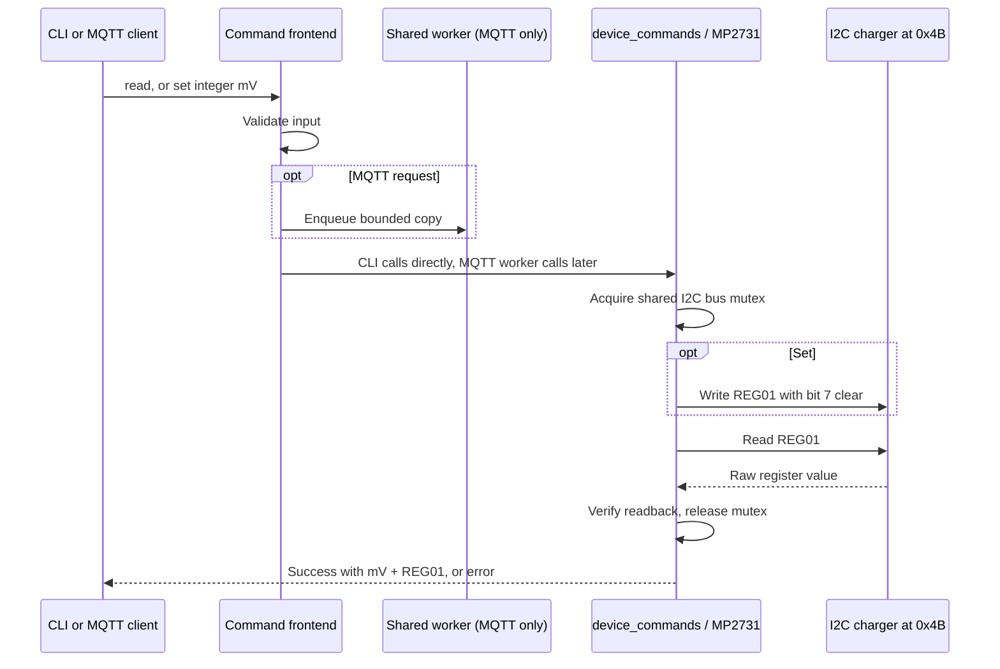
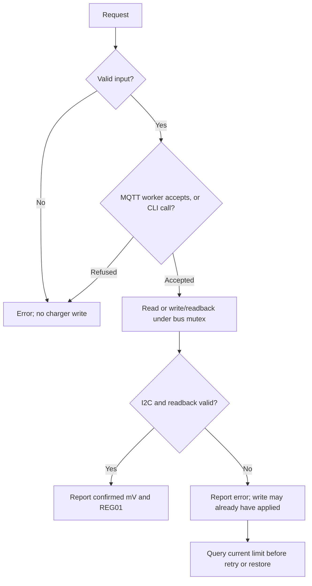
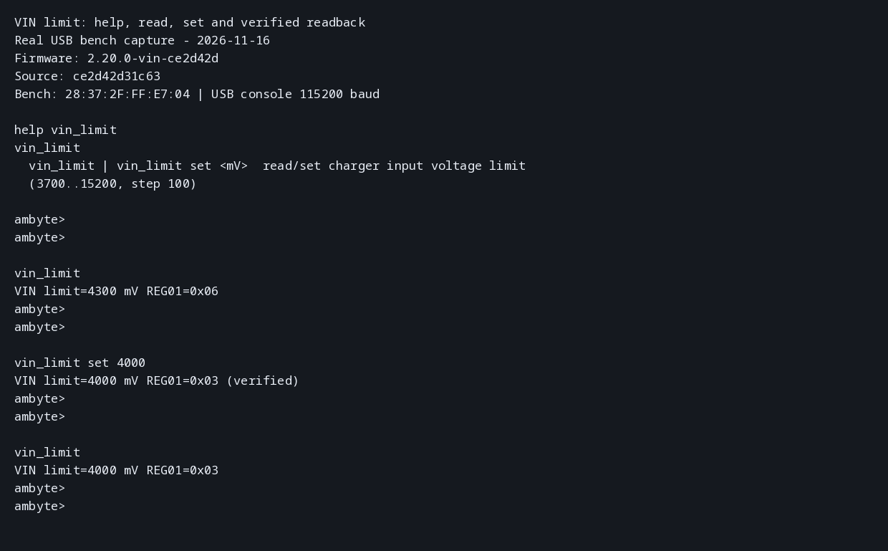
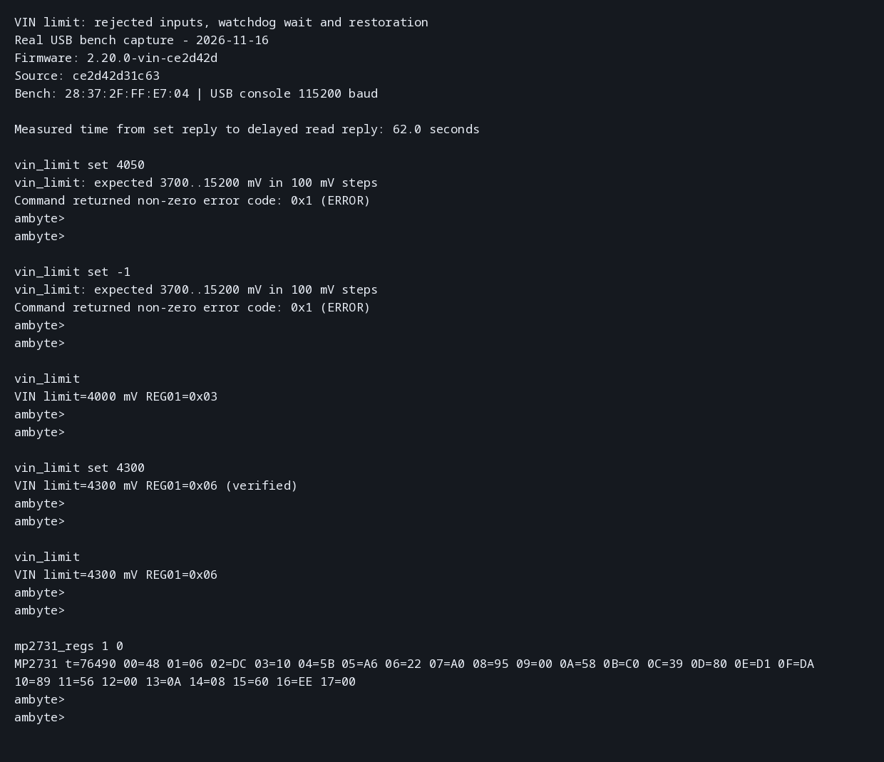
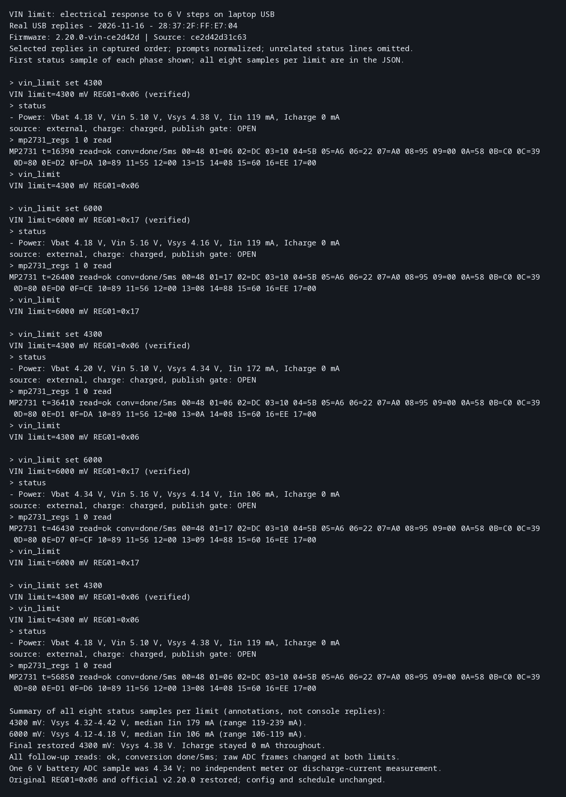

# MP2731 input voltage limit

The `vin_limit` CLI command and `get_vin_limit` / `set_vin_limit` MQTT commands
read or change the charger's live input voltage regulation threshold. Both
return the decoded limit in millivolts and the raw REG01 readback. A set reports
success only after the register reads back exactly as written.

This is a diagnostic control, not an automatic charging-policy change. Lowering
the threshold from 4.3 V to 4.0 V only affects operation when the input drops
close to the old threshold under load. If the loaded panel voltage stays above
4.3 V, lowering the threshold should have no effect. It does not force the panel
to operate at 4.0 V, increase available solar power, or change the firmware's
separate 4.7 V external-power detection threshold. Use measured VIN, input
current, battery voltage and charging current to assess the experiment.
Publishing on current firmware is not gated on this threshold; the charger
evidence still informs diagnostics and AMBIT flashing admission.

## Serial console

Use the existing USB console at 115200 baud:

```text
vin_limit
vin_limit set 4000
vin_limit
status
```

`vin_limit` reads without writing. `vin_limit set 4000` applies 4.0 V and reports
`VIN limit=4000 mV REG01=0x03 (verified)` on success. `status` reports measured
VIN, Vbat, Vsys, input current, charging current, and the publish power gate.
All arguments are integer millivolts: `4.0`, fractional millivolts, off-step
values such as `4050`, and values outside 3700..15200 are rejected. There is
no rounding. CLI commands return nonzero on invalid input or a driver failure.

Record the original value before changing it, and restore that measured value
after the experiment. The datasheet's default is 4300 mV; read the actual device
rather than assuming it still uses that default.

## MQTT

Publish either request to the device's existing command topic, without retain:

```json
{"type":"get_vin_limit","id":"vin-before-1"}
```

```json
{"type":"set_vin_limit","id":"vin-test-1","mv":4000}
```

Both requests require a nonempty string `id` of at most 64 UTF-8 bytes. A set
also requires a JSON number `mv`, an exact integer in 3700..15200 in 100 mV
steps. A string such as `"4000"`, `null`, and fractions are rejected.

Replies arrive on the existing status topic. Successful examples:

```json
{"type":"vin_limit_result","id":"vin-before-1","ok":true,"mv":4300,"reg01":6,"detail":"VIN limit=4300 mV REG01=0x06"}
```

```json
{"type":"set_vin_limit_result","id":"vin-test-1","ok":true,"mv":4000,"reg01":3,"detail":"VIN limit=4000 mV REG01=0x03 (verified)"}
```

`reg01` is a JSON integer, not a hex string. Errors carry `ok:false` and a
`detail` message; they omit `mv` and `reg01` because there is no confirmed
readback. Malformed ids are reported with an empty `id`. Invalid values are
rejected before dispatch. `busy` means a VIN request is already pending;
`queue_unavailable` means the shared worker queue refused submission. Neither
refusal touches the charger. Retry with backoff after the pending work completes.

I2C access runs on the resident maintenance worker, so it can queue behind
other maintenance work. The MQTT callback only validates and copies bounded
input. Repeated sets, including QoS1 duplicates, apply the same desired value;
there is no NVS command-id deduplication. A lost reply or a set/readback failure
does not prove the write failed: query the limit again before deciding whether
to retry or restore it.

## Register semantics and lifetime

The [MPS MP2731 datasheet, page 30](https://www.monolithicpower.com/jp/documentview/productdocument/index/version/2/document_type/Datasheet/lang/en/sku/MP2731GQC/)
names REG01[6:0] `VIN_MIN` (input voltage limit):

```text
VIN_MIN_mV = 3700 + (REG01 & 0x7f) * 100
4300 mV -> 0x06
4000 mV -> 0x03
```

REG01 bit 7 is REGISTER RESET. The setter writes it as zero and holds the
shared I2C bus mutex across write and readback. Concurrent CLI/MQTT requests
therefore cannot interleave within a write/readback transaction. Registers other
than REG01 are untouched by these commands.

If `vin_limit` reports `ESP_ERR_INVALID_RESPONSE`, use `mp2731_regs 1 0` to
inspect the raw byte, including a reset-bit or out-of-range value that cannot
be returned as a valid decoded limit.

The command changes only the live charger register. It writes neither ESP NVS
nor charger OTP, and the firmware does not reapply an override at boot. An ESP
reboot alone need not reset the charger.

The datasheet marks VIN_MIN as **not reset by the I2C watchdog**. It also says
that VIN power-on reset can restore VIN_MIN from OTP. On a panel-only unit,
nightly loss of input can therefore reset the experiment's setting. Re-read
`vin_limit` after dawn or any input power cycle; do not assume the previous
day's setting still applies. Input-removal/reapplication behavior has not been
physically qualified by this test.





## Verification

`uv run --locked --group test pytest -q tests/test_vin_limit.py` executes the
production driver and CLI/MQTT handlers with faked I2C and worker boundaries,
under AddressSanitizer and UndefinedBehaviorSanitizer. It covers every supported
setting, reset-bit exclusion, bad values/ids, absent hardware, delayed dispatch,
queue refusal, bus errors, and readback mismatch. The device command ports are
shimmed in this host harness; firmware build verification covers their wiring.

Physical USB qualification on 2026-11-16 used source
`ce2d42d31c634c5e8cb9366399794c9c0660e935`, compiled as
`2.20.0-vin-ce2d42d`. The actual console confirmed `help vin_limit`, the initial
4300 mV (`REG01=0x06`), setting 4000 mV with verified `REG01=0x03`, and readback.
Both `4050` and `-1` were rejected with CLI return code 1. After 62 seconds the
limit still read 4000 mV; the original 4300 mV/full `REG01=0x06` was restored
and independently checked in the raw register dump. That dump also shows
`REG0D=0x80` (WATCHDOG_FAULT), while the voltage limit remained set through the
62-second wait. The capture also ran `status`. Firmware SHA and capture facts are in the
[bench manifest](images/charger-vin-limit/bench-manifest.json).

After qualification, the bench was returned to the production-signed official
v2.20.0 release. Its raw register dump confirmed the complete `REG01=0x06` byte;
all 13 captured configuration values and the installed schedule SHA were
unchanged. NVS was preserved and no cloud command was sent.

These images render real USB replies; the adjacent text files retain the
same excerpts. ANSI escapes, trailing whitespace, and leading asynchronous
telemetry-log fragments are omitted from the excerpts. No endpoint,
credentials, or site topic is included.





### Laptop USB comparison: 4300 and 6000 mV

To test an electrical response with the threshold clearly above USB voltage,
a run alternated 4300 → 6000 → 4300 → 6000 → restored 4300 mV on the same
signed image. Each phase collected four `status` readings two seconds apart,
each followed by `mp2731_regs 1 0 read`. The battery baseline was 4.20 V. Each
6000 mV phase lasted approximately 10 seconds before returning to 4300 mV.

| Observation, eight status samples per limit | 4300 mV limit | 6000 mV limit |
| --- | --- | --- |
| Verified REG01 | `0x06` | `0x17` |
| Reported Vsys, median (range) | 4.35 V (4.32–4.42 V) | 4.15 V (4.12–4.18 V) |
| Reported input current, median (range) | 179 mA (119–239 mA) | 106 mA (106–119 mA) |
| Reported VIN | 5.04–5.16 V | 5.16 V |
| Charge current | 0 mA | 0 mA |
| REG14 input voltage regulation flag | Clear | Set |

The system-voltage reduction appeared in both 6000 mV phases and recovered in
the intervening 4300 mV phase; the final restored reading was 4.38 V. The
reported input current also decreased, but did not approach zero. This is
evidence of a response beyond the status flag. It is consistent with the
battery supporting the system when the requested input floor cannot be met;
battery discharge current was not independently measured, so its share of the
load is not established.

Every follow-up production read reported `ok`, with conversion completion at
the first 5 ms poll. The raw five-channel ADC frames changed at both limits
(seven distinct frames out of eight samples at each), rather than remaining
bit-identical throughout a phase. Status and raw dumps use separate, sequential
reads. All measurements still come from the charger ADC, without an independent
meter. One 6000 mV status sample reported Vbat 4.34 V; the other values and that
sample are retained without correction in the evidence. No charging benefit
or actual 4 V source operation is established.

Full REG01 `0x06` and official v2.20.0 were restored again. The final register
dump, all 13 configuration values and the loaded schedule identity matched the
run's baseline; NVS was preserved and no cloud or Wi-Fi configuration write
was made.



[All status samples and raw registers](images/charger-vin-limit/usb-6v-samples.json)
and the [6 V test manifest](images/charger-vin-limit/usb-6v-manifest.json) preserve
the source image, ADC evidence, statistics and restoration checks.

MQTT is host-tested only. Live MQTT commands, input-removal/reapplication,
status under controlled load, and weak-solar charging behavior remain unqualified
on hardware. The CLI test demonstrates register control and watchdog persistence
on this bench; it does not establish a charging improvement.
