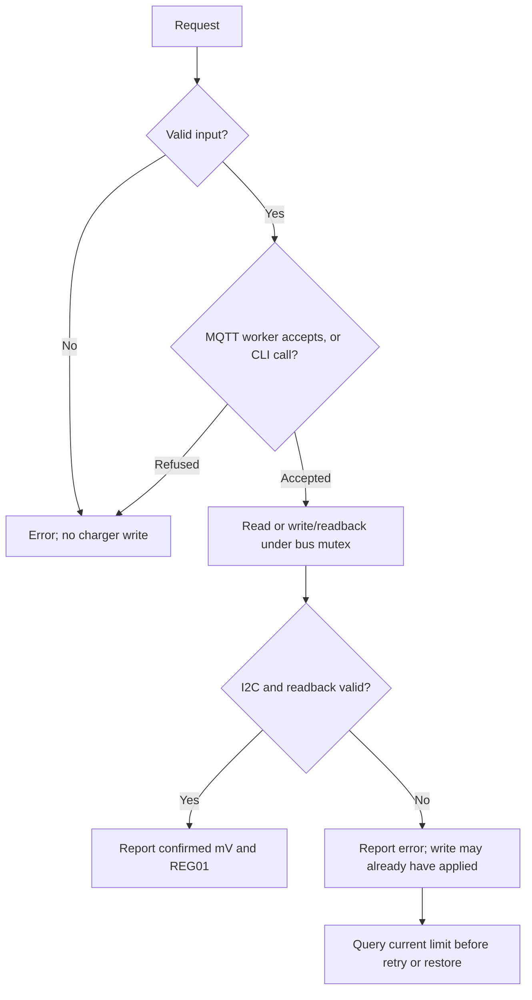

# MP2731 input voltage limit

The `vin_limit` CLI command and `get_vin_limit` / `set_vin_limit` MQTT commands
read or change the charger's live input voltage regulation threshold. Both
return the decoded limit in millivolts and the raw REG01 readback. A set reports
success only after the register reads back exactly as written.

This is a diagnostic control, not an automatic charging-policy change. Lowering
the threshold from 4.3 V to 4.0 V only affects operation when the input drops
close to the old threshold under load. If the loaded panel voltage stays above
4.3 V, lowering the threshold should have no effect. It does not force the panel
to operate at 4.0 V, increase available solar power, or change the firmware's
separate 4.7 V external-power detection threshold. Use measured VIN, input
current, battery voltage and charging current to assess the experiment.
Publishing on current firmware is not gated on this threshold; the charger
evidence still informs diagnostics and AMBIT flashing admission.

## Serial console

Use the existing USB console at 115200 baud:

```text
vin_limit
vin_limit set 4000
vin_limit
status
```

`vin_limit` reads without writing. `vin_limit set 4000` applies 4.0 V and reports
`VIN limit=4000 mV REG01=0x03 (verified)` on success. `status` reports measured
VIN, Vbat, Vsys, input current, charging current, and the publish power gate.
All arguments are integer millivolts: `4.0`, fractional millivolts, off-step
values such as `4050`, and values outside 3700..15200 are rejected. There is
no rounding. CLI commands return nonzero on invalid input or a driver failure.

Record the original value before changing it, and restore that measured value
after the experiment. The datasheet's default is 4300 mV; read the actual device
rather than assuming it still uses that default.

## MQTT

Publish either request to the device's existing command topic, without retain:

```json
{"type":"get_vin_limit","id":"vin-before-1"}
```

```json
{"type":"set_vin_limit","id":"vin-test-1","mv":4000}
```

Both requests require a nonempty string `id` of at most 64 UTF-8 bytes. A set
also requires a JSON number `mv`, an exact integer in 3700..15200 in 100 mV
steps. A string such as `"4000"`, `null`, and fractions are rejected.

Replies arrive on the existing status topic. Successful examples:

```json
{"type":"vin_limit_result","id":"vin-before-1","ok":true,"mv":4300,"reg01":6,"detail":"VIN limit=4300 mV REG01=0x06"}
```

```json
{"type":"set_vin_limit_result","id":"vin-test-1","ok":true,"mv":4000,"reg01":3,"detail":"VIN limit=4000 mV REG01=0x03 (verified)"}
```

`reg01` is a JSON integer, not a hex string. Errors carry `ok:false` and a
`detail` message; they omit `mv` and `reg01` because there is no confirmed
readback. Malformed ids are reported with an empty `id`. Invalid values are
rejected before dispatch. `busy` means a VIN request is already pending;
`queue_unavailable` means the shared worker queue refused submission. Neither
refusal touches the charger. Retry with backoff after the pending work completes.

I2C access runs on the resident maintenance worker, so it can queue behind
other maintenance work. The MQTT callback only validates and copies bounded
input. Repeated sets, including QoS1 duplicates, apply the same desired value;
there is no NVS command-id deduplication. A lost reply or a set/readback failure
does not prove the write failed: query the limit again before deciding whether
to retry or restore it.

## Register semantics and lifetime

The [MPS MP2731 datasheet, page 30](https://www.monolithicpower.com/jp/documentview/productdocument/index/version/2/document_type/Datasheet/lang/en/sku/MP2731GQC/)
names REG01[6:0] `VIN_MIN` (input voltage limit):

```text
VIN_MIN_mV = 3700 + (REG01 & 0x7f) * 100
4300 mV -> 0x06
4000 mV -> 0x03
```

REG01 bit 7 is REGISTER RESET. The setter writes it as zero and holds the
shared I2C bus mutex across write and readback. Concurrent CLI/MQTT requests
therefore cannot interleave within a write/readback transaction. Registers other
than REG01 are untouched by these commands.

The command changes only the live charger register. It writes neither ESP NVS
nor charger OTP, and the firmware does not reapply an override at boot. Charger
reset/power loss can restore the OTP default; input-power reset behavior depends
on the chip's OTP configuration. An ESP reboot alone need not reset the charger.

```mermaid
sequenceDiagram
    participant C as CLI or MQTT client
    participant R as Command frontend
    participant W as Shared worker (MQTT only)
    participant D as device_commands / MP2731
    participant I as I2C charger at 0x4B
    C->>R: read, or set integer mV
    R->>R: Validate input
    opt MQTT request
        R->>W: Enqueue bounded copy
    end
    R->>D: CLI calls directly; MQTT worker calls later
    D->>D: Acquire shared I2C bus mutex
    opt Set
        D->>I: Write REG01 with bit 7 clear
    end
    D->>I: Read REG01
    I-->>D: Raw register value
    D->>D: Verify readback, release mutex
    D-->>C: Success with mV + REG01, or error
```



## Verification

`uv run --locked --group test pytest -q tests/test_vin_limit.py` executes the
production driver and CLI/MQTT handlers with faked I2C and worker boundaries,
under AddressSanitizer and UndefinedBehaviorSanitizer. It covers every supported
setting, reset-bit exclusion, bad values/ids, absent hardware, delayed dispatch,
queue refusal, bus errors, and readback mismatch. The device command ports are
shimmed in this host harness; firmware build verification covers their wiring.

Hardware qualification is pending. On a bench unit, record the initial limit,
set a test value, confirm both CLI and MQTT readback, capture `status` under the
same lighting/load conditions, and restore the recorded limit. No physical-unit
capture or charging improvement is claimed by the host tests.
