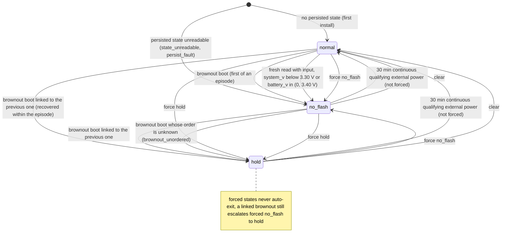
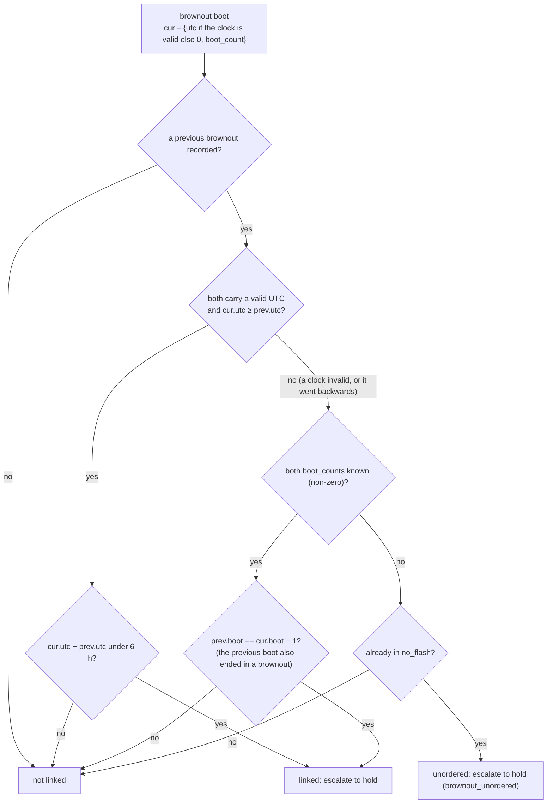
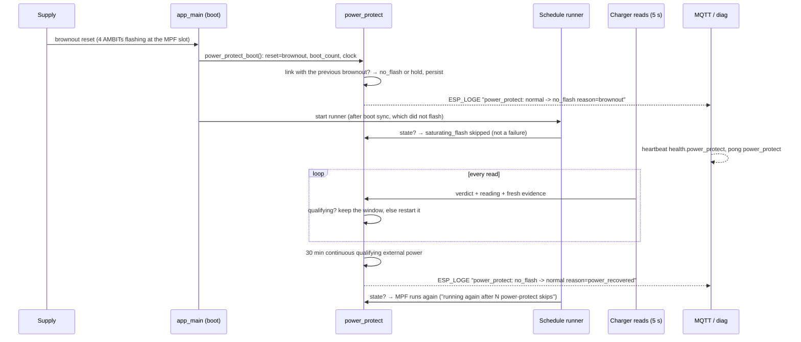

# Brownout protection

On 15 Nov 2026 firmware v2.18.0's restart reasons gave the first direct proof
from the field: Uluru unit `14:63:93:39:36:48`, on battery with no external
input, reported `reset_reason: brownout` on boots 2, 3 and 4 (07:00, 07:13 and
07:18 ACST). Each time it restarted straight back into the same load and went
silent soon after. The day before, units on firmware without diagnostics reset
exactly at the every-10-minute MPF slots, when all four AMBITs fire saturating
flashes at once, and then died; units with input present but a sagging rail
(2.7–2.9 V) or a 0 V battery kept rebooting.

Nothing in the firmware reacted. The rule this feature implements: **detect
it, stop the risky work, report it, and hold the actions until the power status
changes.**

| Part | What the device does | Where it shows up |
|---|---|---|
| A. State machine | A persistent `normal` / `no_flash` / `hold` state with the entry and exit rules below | `components/power_protect` (pure core + glue) |
| B. Load shedding | `no_flash` skips actinic-bearing AMBIT work, AMBIT flashing and every OTA; `hold` skips every `ambit/` action as well | schedule runner, `ota_update`, `ambit_ota`, `ambit_flash` |
| C. Reporting | One `ESP_LOGE` per transition, per-reason skip counters | `health.power_protect` in every heartbeat, `power_protect` in `pong`, `ambyte.log/1` |
| D. Operator command | `power_protect` with `action: status \| clear \| force` | `fleet_command.py power-protect`, Actions → **Fleet command** |

Payload details are normative in [mqtt-payload.md](mqtt-payload.md) §9.6 and
§19; this page explains the mechanism.

## What the firmware can and cannot see

The MP2731 ADC converts only with external input (charge or OTG mode,
datasheet p.26, [power-telemetry.md](power-telemetry.md)). **On battery alone
there is no voltage reading**, so the firmware cannot predict a brownout on
battery. It can only react to the first one: `esp_reset_reason() ==
ESP_RST_BROWNOUT`, already surfaced by `components/diag`. With input present,
valid frames give `system_v` and `battery_v`, and power_policy's freshness
evidence (the frame must be changing) tells a live reading from a frozen
register file.

## A. The state machine



**Entry.**

- `normal → no_flash` when this boot's reset reason is `brownout`, or a
  **fresh** valid read with input present shows `system_v < 3.30 V` or
  `0 < battery_v < 3.40 V`. Fresh = power_policy's AMBIT-flash evidence
  (`power_gate_flash_ok`): the latest read valid with input present and the
  ADC frame changing.
  - `battery_v == 0` with input present means no battery or an idle charger
    ([power-telemetry.md](power-telemetry.md)). On its own it never triggers.
  - Invalid, stale (frozen frame), `no_input` and input-absent reads never
    trigger.
- `→ hold` on a brownout **linked** to the previous recorded brownout (below):
  from `no_flash`, and also straight from `normal` when the unit had
  recovered and browns out again within the episode. A unit that went down
  twice in 6 h has shown that its power cannot carry even the reduced load.
- `→ hold` also when the unit is already in `no_flash` and the new brownout
  cannot be ordered against the previous one at all: no valid clock AND a
  `boot_count` of 0 on either side (diag's counter is 0 when NVS is
  unavailable). Reason `brownout_unordered`. Without it a battery unit with no
  clock and no counter would brown out in `no_flash` forever. A `normal` unit
  in the same situation enters `no_flash` (a new episode).
- A brownout that is not linked leaves an already protected state as it is
  (the history entry is still recorded).

**Exit.** Either protected state returns to `normal` after **30 minutes of
continuous qualifying reads**. A read qualifies when it is valid, input is
present, the frame is fresh, `system_v ≥ 3.60 V`, and `battery_v ≥ 3.70 V` or
`battery_v == 0` (no battery: the rail alone carries the unit). The thresholds
sit above the entry ones so a rail at the edge cannot flap.

- Any read that does not qualify restarts the window: invalid, stale,
  `no_input`, input absent, or a value below the exit thresholds.
- So does a gap of more than 60 s between reads: nobody looking is not
  evidence. `device_commands` reads the charger at most every 5 s on demand,
  and the power-guard task asks every 15 s (`device_commands_power_tick`), so
  a gap only happens when something is wrong.
- `hold` therefore never exits on battery.
- The window lives in RAM. A reboot restarts it.
- Without a charger monitor there are no reads, so a protected state stays
  until `clear` (fail-closed, like AMBIT flashing).

### Brownout history and the clock

Each brownout boot appends `{utc, boot_count}` to a persisted history (the
newest 8). Two brownouts are **linked** when:



The clock is **valid** when it is past 2024 and its source is `sntp`, or `rtc`
with nothing making it suspect this boot. `hwm` (the persisted high-water mark
holding the clock up after a power loss stopped the RTC) is a lower bound, not
the time, so it is never valid here, and neither is a suspect RTC. When the
clock is valid at both brownouts, UTC alone decides, both ways: two brownouts
7 h apart on consecutive boots are not linked. The fallback rule is
deliberately narrow ("the previous boot also ended in a brownout"): it links
the Uluru 2-3-4 sequence even with no clock at all, and never links two
brownouts with a normal boot in between.

When neither works (no valid clock and a `boot_count` of 0 on either side),
the order is unknown and the unit assumes the worst: an already protected
unit escalates to `hold` (`brownout_unordered`).

`brownouts_6h` counts the history the same way: an entry with a valid UTC,
read with a valid clock, counts when it is within 6 h; otherwise, with both
boot counts known, it counts when it belongs to the run of consecutive
brownout boots ending at this boot; an entry whose age cannot be established
at all counts (conservative) until `clear` wipes the history.

### Persistence

NVS namespace `pwr_protect`, key `state`: one 113-byte blob (version, state,
reason, forced flag, `since_utc`, the history, CRC32), explicit
little-endian bytes rather than a struct dump. It is written **only** on a
state transition, a recorded brownout (at most once per boot), `force` and
`clear`. Never per charger read, never per heartbeat.

At boot the blob is either:

- **absent** (`ESP_ERR_NVS_NOT_FOUND` for the namespace or the key: first
  install, never protected) → `normal`;
- **unreadable** (`nvs_open` or `nvs_get_blob` failed otherwise, or the blob
  fails its version, length, CRC or range checks) → `no_flash`, reason
  `state_unreadable`, not forced, `persist_fault: true`, logged. A corrupted
  forced `hold` must not come back at full load after a watchdog reboot. It
  exits like any automatic state: the 30-min window or `clear`. Nothing is
  written at boot; the next persisting event (a transition, a brownout record,
  `force`, `clear`) rewrites the blob and clears `persist_fault`.

`persist_fault` is also raised when a write fails at run time (the new state
holds in RAM but would not survive a reboot) and cleared by the next
successful write. RTC_NOINIT alone was
not an option: a brownout is a power-on-class reset, exactly the reset this
state has to survive.

`power_protect_boot()` runs in `app_main` right after the I2C/RTC bring-up
(on both sides of its error check), once NVS, `diag` and `clock_trust` have
decided boot count and clock trust, and **before** AMBIT boot sync, the
schedule runner and the MQTT command path (held behind the boot gate). The
first action after a brownout is therefore already shed.

## B. Load shedding

| | `normal` | `no_flash` | `hold` |
|---|---|---|---|
| `ambit/trace` whose protocol has a segment with `actinic != 0` (MPF, the qE light phases) | runs | **skipped** | **skipped** |
| `ambit/actinic` with `level != 0` | runs | **skipped** | **skipped** |
| other `ambit/trace` (SS), `ambit/spectrum`, `ambit/leaf-temp`, `ambit/actinic` level 0 | runs | runs | **skipped** |
| `device/status-report`, `db/store-event`, `device/log`, `device/sleep` | runs | runs | runs |
| Ambyte OTA (`ota_update`, Jobs) | runs | **refused** | **refused** |
| AMBIT OTA, `ambit_flash`, attach updates, boot sync | runs | **refused / held** | **refused / held** |
| `script_update`, heartbeat, MQTT, `log_list`/`log_read`, `power_protect` | runs | runs | runs |

- **Actinic content comes from the compiled program, not from names.** A job
  is actinic-bearing when any of its steps is an `ambit/trace` whose protocol
  has a segment with `actinic != 0`, or an `ambit/actinic` with `level != 0`.
  The ticket said "level > 0"; negative levels are raw DAC values in the
  WRENCH convention (`ambit_actinic_to_dac`) and light the LED too, so only
  `0` (off) is kept.
- **The whole job is skipped**, never single steps. A job that lights the
  actinic LED and then measures (the qE light phase) would otherwise store a
  dark measurement labelled as a lit one.
- **A skip is not a failure.** `run_job` checks before the first step, before
  the sensor-inventory bracket and before any UART traffic. A shed run stores
  nothing, so the event-log cursor and the delivery pipeline cannot notice it.
  It never touches `runs`, `failures` or `fail_streak` (the failure-streak
  throttle neither logs it nor resets a real streak); it counts in the job's
  `power_skipped` and in `health.power_protect.skipped`. It logs like a
  failure streak: the first skip, every 300th, and the resumption.
- A queued overlap firing of a shed job is dropped with it, never replayed
  once protection lifts.
- A persisted actinic run (`persist: true`) can leave the LED lit after its
  job, and the job that would switch it off carries flash segments itself. On
  the first shed the runner therefore resets the AMBITs exactly as a runner
  stop does (`sched_runner_cleanup_lights`, a no-op unless a persistent run
  was attempted). CHIP_EN power-down is out of scope.
- **Updates are checked at every safe boundary**, not just at worker entry:
  the charger refresh keeps running while a worker waits (500 ms ack flush,
  up to 15 min of fleet spread, a download, earlier channels' writes) and can
  enter `no_flash` meanwhile. A write that has started is never interrupted
  (that is what bricks an AMBIT); the next one is not started.

  | Path | Boundaries | Refusal |
  |---|---|---|
  | Ambyte OTA (MQTT, Jobs) | 1. worker entry, before `accepted`; 2. final admission after the ack flush and the spread, before the Jobs IN_PROGRESS report, the suspend and the download; 3. after download + image admission, before `esp_https_ota_finish()` selects the image (abort; the slot stays inactive) | `ota_status` `dropped`, detail `power_protect` (fleet_deploy's retry candidate); Jobs: retryable. Refused at 1 or 2 the execution stays QUEUED; at 3 it is already IN_PROGRESS and the same 10-min retry re-installs it |
  | AMBIT OTA | worker entry; after the ack flush and the spread; after the download; before each channel's stream | `ambit_ota_status` `failed` / `power_protect` (per channel and terminal) |
  | `ambit_flash` | worker entry; after the ack flush (before suspend and the release fetch); before each channel's ROM flash | `ambit_flash_status` `failed` / `power_protect`; channels not started report `skipped` / `power_protect`; the per-id retry cap is not consumed |
  | Attach update | at the decision, and again after the quiesce, right before the write | held, `waiting_power`, re-checked every 10 min |
  | Boot sync | before the loop (no 30-s wait for power evidence) and before each channel | channels left on their firmware |

  `device_commands_flash_power_ok()` is also false while protected, for any
  future caller.
- Self-reboot paths are unchanged: a reboot does not clear the state.

## C. Reporting

- **Heartbeat:** `health.power_protect = {state, reason, since_utc|null,
  forced, persist_fault, brownouts_6h, skipped: {flash_runs, ambit_runs, ota}}` in every
  `ambyte.telemetry/1`, rendered from RAM (no NVS access). `skipped` counts
  since this boot.
- **pong:** `power_protect: normal | no_flash | hold`.
- **Transitions:** exactly one `ESP_LOGE("power_protect: <from> -> <to>
  reason=<reason>")` per transition, which v2.18.0's diag capture delivers as
  an `ambyte.log/1` record. A same-state force or a history-only clear logs a
  warning instead (not a transition).



## D. Operator command

```jsonc
{"type":"power_protect","id":"r1","action":"status"}
{"type":"power_protect","id":"r2","action":"force","state":"hold"}
{"type":"power_protect","id":"r3","action":"clear"}
// → {"type":"power_protect_result","id","ok","action","detail","state","reason",
//    "forced","persist_fault","since_utc","brownouts_6h","exit_in_s","skipped":{…}}
```

- `status` is read-only. `clear` returns to `normal` and wipes the brownout
  history and the forced flag. `force` sets a **forced** state that never
  auto-exits; only `clear` ends it (a linked brownout can still escalate a
  forced `no_flash` to `hold`).
- Runs on the resident maintenance worker, the same pattern as
  `set_timezone` / `log_read`: the esp-mqtt task only parses and copies;
  `clear` / `force` take the maintenance lock.
- Not retained. Invalid input is refused explicitly (`invalid_id`,
  `invalid_action`, `invalid_state`); see [mqtt-payload.md](mqtt-payload.md) §19.

```bash
fleet_command.py power-protect --action status --devices ambyte_14:63:93:39:36:48
fleet_command.py power-protect --action force --state hold --devices …   # MUTATING
fleet_command.py power-protect --action clear --devices …                # MUTATING
```

`clear` and `force` print `(MUTATING)` and refuse fleet-wide discovery; the
run fails unless every reply confirms the requested state. In Actions →
**Fleet command**, pick `power-protect` with `power_protect_action` (and
`power_protect_state` for `force`).

## Evidence

- `tests/test_power_protect.py` drives the production core and glue (fake NVS
  that counts every write, the real power_policy gate for freshness) and the
  command codec: every transition and exit timer, window restarts on invalid,
  stale, `no_input`, input-absent, out-of-threshold reads and read gaps,
  `battery_v == 0`, forced states, `clear`, escalation with a valid and an
  invalid clock (the Uluru 2-3-4 replay), an unknown boot counter (0 twice,
  0 then known, known then 0), the blob round trip and corruption, unreadable
  state after non-brownout reboots and after open/read failures,
  NVS writes only on transitions, the command codec and its allocation
  failures.
- `tests/sched_runner_host.c` decides shedding on the shipped `default.yaml`
  and `schedule/qe_multichannel.yaml` and proves the skip accounting;
  `tests/sensors_host/runner_driver.c` runs the production `run_job` in `hold`.
- `tests/ota_host/update_driver.c` runs the production OTA worker refusal on
  the https and Jobs paths, including protection that begins after the ack
  flush and during the download.
- `tests/power_protect_host/ambit_worker_driver.c` runs the production AMBIT
  worker functions (extracted verbatim) with protection beginning during the
  spread, the ack flush, the download / release fetch and mid-sweep.
- **Real brownout behaviour is covered by host tests only.** A bench cannot
  brown out on demand; the bench run exercises `force` and `clear`.
