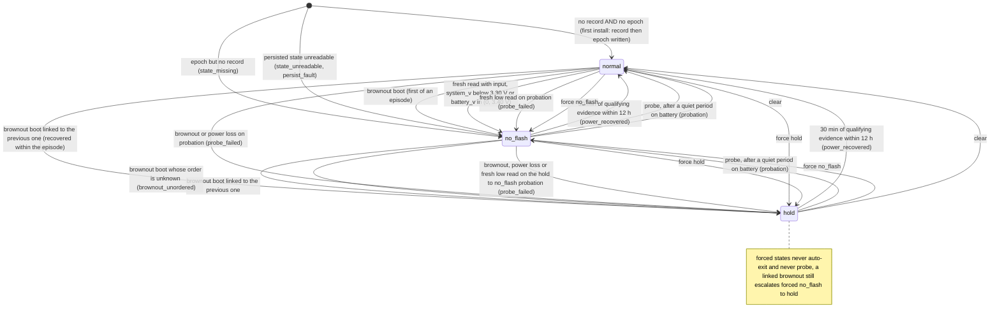
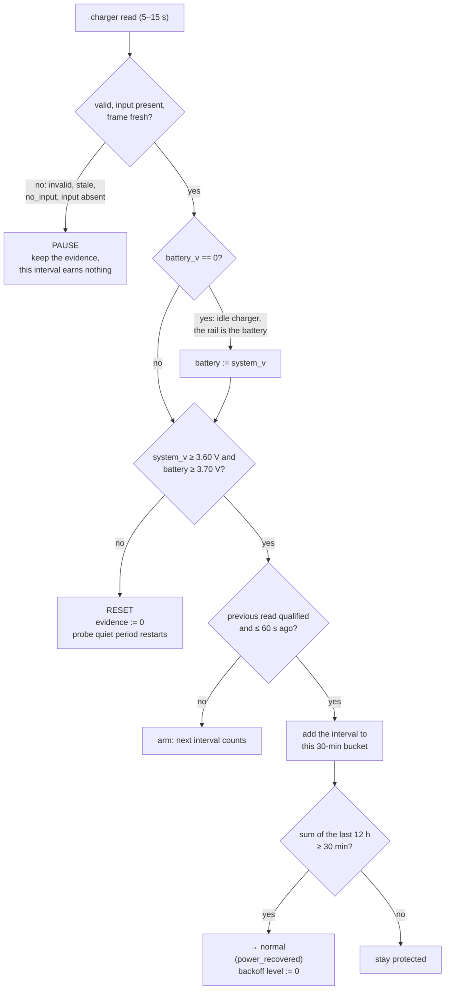
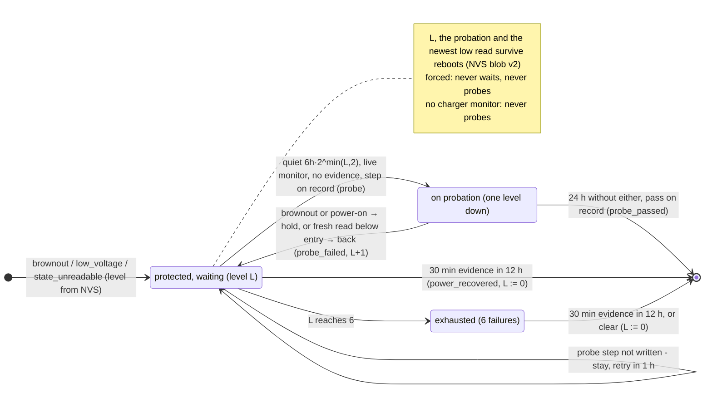
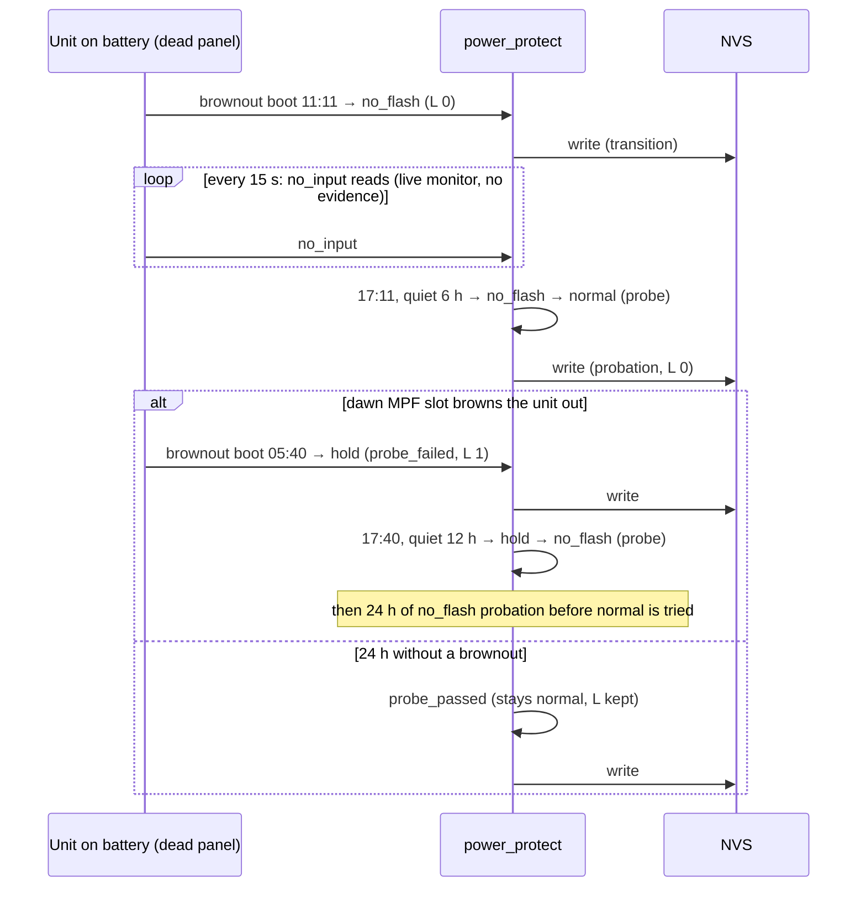
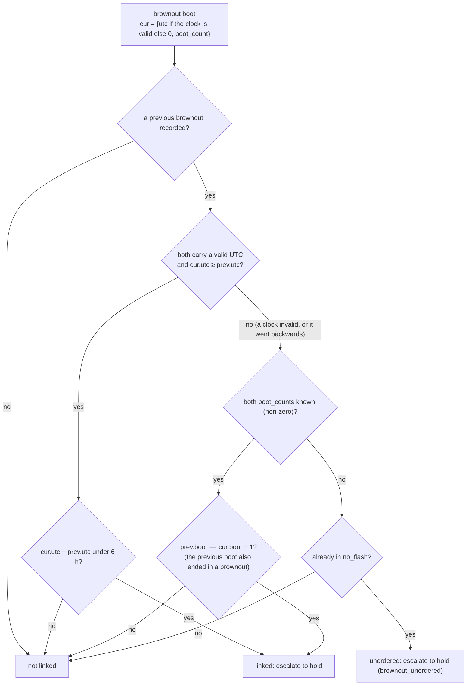
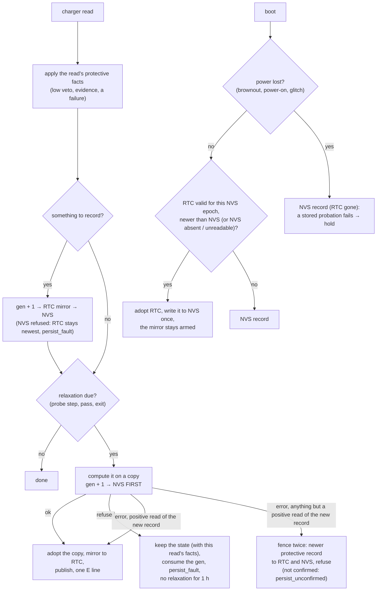
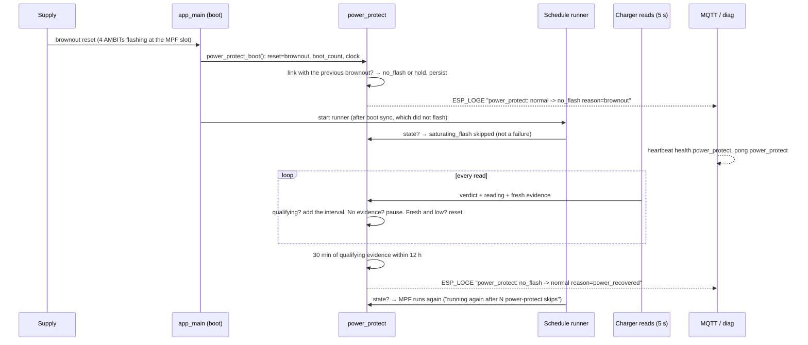

# Brownout protection

On 15 Nov 2026 firmware v2.18.0's restart reasons gave the first direct proof
from the field: Uluru unit `14:63:93:39:36:48`, on battery with no external
input, reported `reset_reason: brownout` on boots 2, 3 and 4 (07:00, 07:13 and
07:18 ACST). Each time it restarted straight back into the same load and went
silent soon after. The day before, units on firmware without diagnostics reset
exactly at the every-10-minute MPF slots, when all four AMBITs fire saturating
flashes at once, and then died; units with input present but a sagging rail
(2.7–2.9 V) or a 0 V battery kept rebooting.

Nothing in the firmware reacted. The rule this feature implements: **detect
it, stop the risky work, report it, and hold the actions until the power status
changes.**

The first release left protection only after 30 minutes of *continuous*
charger-confirmed good power. On the solar units at Uluru (17–20 Nov) that was
too strict. `14:63:93:37:A0:C4` browned out once at 11:11 ACST, its panel
delivered nothing (charger `no_input` on 186 of 187 heartbeats), and it stayed
in `no_flash` all day without a single saturating-pulse measurement. Weak
panels charge in 80-s bursts and collapse to the 4.3 V floor between them, so
their batteries recover over hours without ever giving 30 continuous minutes.
And `10:BD:A3:63:FD:20` left protection on a 3.68 V rail with `battery_v` 0
(the idle charger's reading, when the rail *is* the battery) and went back to
`hold` the same day. Recovery now works on accumulated evidence, with a
battery-only probe, and `battery_v` 0 is judged on the rail (§A, "Exit").

| Part | What the device does | Where it shows up |
|---|---|---|
| A. State machine | A persistent `normal` / `no_flash` / `hold` state with the entry and exit rules below | `components/power_protect` (pure core + glue) |
| B. Load shedding | `no_flash` skips actinic-bearing AMBIT work, AMBIT flashing and every OTA; `hold` skips every `ambit/` action as well | schedule runner, `ota_update`, `ambit_ota`, `ambit_flash` |
| C. Reporting | One `ESP_LOGE` per transition, per-reason skip counters | `health.power_protect` in every heartbeat, `power_protect` in `pong`, `ambyte.log/1` |
| D. Operator command | `power_protect` with `action: status \| clear \| force` | `fleet_command.py power-protect`, Actions → **Fleet command** |

Payload details are normative in [mqtt-payload.md](mqtt-payload.md) §9.6 and
§19; this page explains the mechanism.

## What the firmware can and cannot see

The MP2731 ADC converts only with external input (charge or OTG mode,
datasheet p.26, [power-telemetry.md](power-telemetry.md)). **On battery alone
there is no voltage reading**, so the firmware cannot predict a brownout on
battery. It can only react to the first one: `esp_reset_reason() ==
ESP_RST_BROWNOUT`, already surfaced by `components/diag`. With input present,
valid frames give `system_v` and `battery_v`, and power_policy's freshness
evidence (the frame must be changing) tells a live reading from a frozen
register file.

## A. The state machine



**Entry.**

- `normal → no_flash` when this boot's reset reason is `brownout`, or a
  **fresh** valid read with input present shows `system_v < 3.30 V` or
  `0 < battery_v < 3.40 V`. Fresh = power_policy's AMBIT-flash evidence
  (`power_gate_flash_ok`): the latest read valid with input present and the
  ADC frame changing.
  - `battery_v == 0` with input present (the idle charger, see "battery_v 0"
    below) never triggers on its own, as in the first release. Uluru units
    idle on 3.3–3.6 V rails all day; entering `no_flash` there would cut
    their Fv/Fm data mid-deployment. Only the **exit** reads the rail as the
    battery.
  - Invalid, stale (frozen frame), `no_input` and input-absent reads never
    trigger.
- `→ hold` on a brownout **linked** to the previous recorded brownout (below):
  from `no_flash`, and also straight from `normal` when the unit had
  recovered and browns out again within the episode. A unit that went down
  twice in 6 h has shown that its power cannot carry even the reduced load.
- `→ hold` also when the unit is already in `no_flash` and the new brownout
  cannot be ordered against the previous one at all: no valid clock AND a
  `boot_count` of 0 on either side (diag's counter is 0 when NVS is
  unavailable). Reason `brownout_unordered`. Without it a battery unit with no
  clock and no counter would brown out in `no_flash` forever. A `normal` unit
  in the same situation enters `no_flash` (a new episode).
- A brownout that is not linked leaves an already protected state as it is
  (the history entry is still recorded).

**Exit.** A protected, automatic (not forced) state leaves in one of two
ways: **accumulated evidence** with external power, or a **battery-only probe**
when there is no evidence at all. A forced state does neither; only `clear`
ends it.

#### Accumulated evidence (power_recovered)

A read **qualifies** when it is valid, input is present, the frame is fresh,
`system_v ≥ 3.60 V`, and the battery is ≥ 3.70 V (with `battery_v` 0: the rail,
below). The thresholds sit above the entry ones so a rail at the edge cannot
flap.

- Each interval between two **consecutive qualifying reads**, at most 60 s
  apart, adds to the evidence. **30 minutes** of it within the last **12 hours**
  returns the unit to `normal` (`power_recovered`) and resets the probe
  backoff.
- Reads that carry **no evidence** **pause** the accumulation: invalid,
  stale, `no_input`, input absent, and a gap of more than 60 s between reads.
  The interval around them earns nothing, but what was collected stays.
  Clouds and start-stop charging therefore recover a healthy unit.
- A **fresh read with input that is low** (below either exit threshold)
  **resets** it to zero. A sagging battery never recovers, and the probe
  waits a full quiet period from that read.
- Evidence older than the horizon drops out, in 30-minute buckets (evidence
  11.5–12 h old may already be gone).
- The accumulation lives in RAM. A reboot starts it again: the power_protect
  blob is never written per read.

Why these numbers:

- **30 minutes** is unchanged. It is the amount of charger-confirmed healthy
  power the first release asked for; only the "in one piece" requirement
  went.
- **12 hours** is one daylight period. Yesterday afternoon's evidence is
  separated from this morning by a night on battery that the ADC cannot see,
  so it must not count. Where some does carry across the night, the first
  fresh read in the morning resets it if the battery sagged. A battery still
  ≥ 3.70 V after the night is a healthy one.
- **No rising-trend rule.** While charging, `battery_v` sits above the
  resting voltage by the charge current times the cell's internal
  resistance. A rising reading across bursts is as much "more current" as
  "more charge", and the idle reads between bursts (the rail, below) already
  tell a resting battery's voltage. The accumulation alone recovers the
  burst case (tests below).



#### battery_v 0: the rail is the battery

`battery_v == 0` with input present was read as "no battery: the rail alone
carries the unit", so the exit qualified on the rail at 3.60 V. In the field it
is the MP2731 idling beside a live panel (VIN_STAT 000, not charging, VIN
7–8 V, [power-telemetry.md](power-telemetry.md)). The unit runs on the battery
through the BATFET, so the rail is the battery minus a small drop.
`10:BD:A3:63:FD:20` recovered on a 3.68 V rail and was back in `hold` the same
day.

The board **cannot tell** an absent battery from an idle charger. The
MP2731 reports no battery-present bit, and both read `battery_v` 0. The safe
reading is chosen **for the exit**: whenever `battery_v` is 0, `system_v`
must meet the **battery** exit threshold (3.70 V). A battery-less unit on
external power still recovers when its regulated rail sits at 3.70 V or above.
If its rail is lower, it stays protected until `clear`.

**Entry is unchanged**: a `battery_v` of 0 never triggers on its own (only
`system_v < 3.30 V` does). Many Uluru units idle on 3.3–3.6 V rails, and
entering `no_flash` on a 3.35 V idle rail would cut a lot of Fv/Fm data. A
probation is failed by the same entry rule.

#### Battery-only probe

On battery the ADC is dead (§"What the firmware can and cannot see"), so
nothing ever qualifies. The only evidence is the absence of the brownout reset.
A protected, automatic state with a **live charger monitor** steps **one level
down on probation** after a **quiet period** in which there was no brownout,
no fresh low read and no collected evidence:

- `hold → no_flash` first, so steady-state work comes back before the
  saturating flashes do; `no_flash → normal` on the next probe.
- **Quiet period:** 6 h, then 12 h, then 24 h (capped) after each failed
  probe. With a valid clock it is measured from the later of the state entry
  (or the probe step) and the newest recorded brownout, across reboots.
  Without one it counts uptime since boot or since this boot's last
  transition, so any reboot restarts it (conservative). A fresh low read
  restarts it, durably: the newest low read of the state is stored (below),
  so a reboot cannot erase the veto. Evidence inside the 12-h horizon holds
  the probe off, because the accumulation decides then.
- **Probation:** 24 h, measured the same way (from the probe step).
  - A **brownout** during it fails the probe. It belongs to the episode the
    probe stepped out of, so it escalates like a linked brownout: → `hold`,
    reason `probe_failed`, backoff level +1.
  - So does a fresh read below the **entry** thresholds. That read goes back
    to the level the probe left: `normal → no_flash`, or the `hold → no_flash`
    step back to `hold`.
  - 24 h without either: the probation passes (`probe_passed`). The state
    keeps reason `probe`. The backoff level stays: only a qualifying exit or
    `clear` proves the power good again.
- **Bounded:** after **6 failed probes** in a row (6+12+24+24+24+24 h ≈ 5
  days of trying) the probe is `exhausted` until a qualifying exit or
  `clear`.
- **Never** for a forced state, and **never without a charger monitor**: no
  reads at all, `unavailable` (no charger fitted) or `i2c_error` (the charger
  does not answer). A live `no_input` answer is a monitor; it is the
  battery-only unit itself. Without one, the unit fails closed as before.
- The probe step, a failed probe and a passed probation each write the blob
  once (they are transitions). The backoff level and the probation survive
  reboots.
- **On record first.** A relaxation (the probe step, a passed probation, the
  accumulated exit) takes effect only once NVS has accepted it; if the write
  fails the unit stays protected, keeps that read's low veto, and the next
  relaxation waits an hour (§ "One generation-ordered record").
- **A power loss on probation is a failed probe.** A probation found at boot
  after a power-on or power-glitch reset counts as failed exactly like a
  brownout (→ `hold`, level +1; no brownout entry is recorded). The nightly
  reboot and watchdog resets keep the probation: the nightly reboot runs
  every day, so failing on it would make the 24-h probation impossible.

Why these numbers:

- **6 h base.** Past the 6-h brownout link window: by the linking rule's own
  measure, the episode that put the unit here is over.
- **Doubling to 24 h.** A failed probe costs one brownout, a power-on-class
  reset of a depleted battery on a card without a journal. Doubling and the
  cap keep that at most one every 6/12/24 h, so never more than one a day
  once the level is 2.
- **24 h probation.** It covers one full day and night, including the
  pre-dawn battery minimum when the MPF slots hit the weakest battery. A
  shorter probation would "pass" in the evening and fail at dawn as a fresh,
  unlinked episode: one silent brownout a day, forever. That is the loop the
  design must not cause.
- **6 attempts.** This bounds the cost of a unit whose battery is simply
  dying (a dead panel). An operator sees `probe: exhausted` in the heartbeat
  and decides.





### Brownout history and the clock

Each brownout boot appends `{utc, boot_count}` to a persisted history (the
newest 8). Two brownouts are **linked** when:



The clock is **valid** when it is past 2024 and its source is `sntp`, or `rtc`
with nothing making it suspect this boot. `hwm` (the persisted high-water mark
holding the clock up after a power loss stopped the RTC) is a lower bound, not
the time, so it is never valid here, and neither is a suspect RTC. When the
clock is valid at both brownouts, UTC alone decides, both ways: two brownouts
7 h apart on consecutive boots are not linked. The fallback rule is
deliberately narrow ("the previous boot also ended in a brownout"): it links
the Uluru 2-3-4 sequence even with no clock at all, and never links two
brownouts with a normal boot in between.

When neither works (no valid clock and a `boot_count` of 0 on either side),
the order is unknown and the unit assumes the worst: an already protected
unit escalates to `hold` (`brownout_unordered`).

`brownouts_6h` counts the history the same way: an entry with a valid UTC,
read with a valid clock, counts when it is within 6 h; otherwise, with both
boot counts known, it counts when it belongs to the run of consecutive
brownout boots ending at this boot; an entry whose age cannot be established
at all counts (conservative) until `clear` wipes the history.

### Persistence

NVS namespace `pwr_protect`, key `state`: one 128-byte blob, version 2. It
holds the version, state, reason, forced flag, `since_utc`, the history, the
probation step, the backoff level, the newest fresh low read of the state
(`has_low`, `low_utc`) and a **generation** number, then a CRC32. The bytes are
explicit little-endian, not a struct dump. It is written **only** on:

- a state transition (the probe step and a failed probe included);
- a passed probation;
- a recorded brownout (at most once per boot);
- a fresh low read while protected: the first of the state; the first one
  the clock can date; the switch to undated when a low read arrives while the
  clock is not trusted; then **at most once an hour** while low reads go on;
- `force` and `clear`;
- once at boot, to put a newer record from RTC memory on record (below);
- a fence after a relaxation whose write outcome cannot be read back (below);
- the NVS epoch, once per NVS lifetime, and on a first install the first
  record just before it (below).

Never per charger read, never per heartbeat. **The real bound for the low
record:** per protected state, 1 (the first low read) + at most 1 an hour of
continued low reads (≤ 24 a day) + at most 2 per change of clock trust
(undate, re-date). Transitions and brownout records come on top, as before.
In practice the hourly refresh dominates, and only on days a protected unit
sees its panel with a low battery.

The stored low read keeps the probe's veto across a reboot (the nightly
reboot, a no-PUBACK reboot). After a reboot a dated one counts an hour later
than written, since it may be that stale, so the veto is never shorter than
it was before the reboot. An undated one (the clock was not trusted at the
newest low read) makes the quiet period count from boot. Every transition
clears it (the new `since_utc` is later anyway).

#### One generation-ordered record

Three review rounds of PR #113 found reset windows in patching NVS and an
RTC copy separately:

- a probe step that NVS refused still took effect, so its failure never
  counted;
- an RTC copy consumed at its first adoption protected for one reset only;
- an older RTC copy could override a newer durable record;
- a rejected relaxation rolled back the low read that came with it;
- rewriting the single RTC slot in place left no valid copy for a moment;
- an NVS write that reported an error could still have landed.

The model is now one record, ordered by generation:

- **Every record written carries a generation number**, one more than the
  last, never reused. A refused relaxation consumes its number too, because
  it may have landed.
- **Two copies:** NVS, and a mirror of the newest record in RTC_NOINIT memory.
  The mirror survives resets without power loss and is **never consumed** by
  being read.
  - It has **two slots**, each checked by a magic word, the blob's own CRC (so
    garbage never decodes) and the NVS epoch (below).
  - A rewrite goes to the slot that does *not* hold the newest record. It is
    invalidated, filled, and only then armed. A reset anywhere inside it
    leaves the previous slot valid.
  - Writing a record the newest slot already holds is skipped.
- **Protective updates go RTC first, then NVS.** Entry, escalation, a failed
  probe, a brownout or low-read record and a force up take effect at once.
  If NVS refuses, the RTC copy is the newest record.
- **Relaxations go NVS first.** The probe step, a probation pass, the
  accumulated exit, `clear` and a force down are computed on a copy and
  written to NVS. Only then do they replace the state and the RTC mirror.
  - The core never applies an automatic relaxation inside a read. It applies
    the read's protective facts (the low veto, the evidence, a failure) and
    reports the relaxation as due.
  - If NVS refuses, the unit keeps every protective fact of that read and
    stays protected (`persist_fault: true`). No automatic relaxation is tried
    for an hour: at most one write attempt an hour while NVS refuses.
  - An operator relaxation that NVS refuses is **not applied**. The reply is
    `persist_failed` with the unchanged state.
  - **An NVS error is not proof that nothing was written, and an immediate
    re-read is not proof of anything except a positive read of the new
    record.** This is shown on the pinned ESP-IDF itself: its `Storage`,
    `Page` and `PageManager` run on an in-memory partition with fault
    injection (`tests/power_protect_host/nvs_native`).
    - `Storage::writeItem` writes the new blob first and can fail after it:
      `ESP_ERR_NVS_REMOVE_FAILED` erasing the old copy, or any error from
      `eraseMultiPageBlob`.
    - An immediate read then returns NOT_FOUND (`Page::alterEntryState`
      invalidated the page for this boot; reopening a handle does not reset
      that) or even the OLD record. After a re-init (the next boot) it
      returns the NEW one.
  - So after any error, **only a positive read of exactly the new record
    counts as landed**: the relaxation stands, and state, log line and reply
    say so (`ok`, with a warning in the log). Anything else (absent, the old
    record, unreadable) is **unknown** and is **fenced**:
    - A newer protective record (the unchanged state; the relaxation's
      generation is consumed) goes to RTC and NVS until **two clean writes in
      a row follow the last failure**, at most **4** fence writes.
      - A write that failed part-way can leave a stray chunk under the next
        blob version while this boot's `Storage` still holds the old index.
        The next clean write then lands under that same version, reports
        `ESP_OK`, and after a re-init the stray record is what NVS returns
        (round 4, native matrix).
      - A second clean write toggles the version, and its erase of the
        previous version removes the strays.
      - A failed *fence* write is such a part-way write too, so one clean
        write after it does not cancel it. Round 5's native two-fault repro:
        the candidate fails at raw write #2, the first fence at #4, one
        clean fence "confirmed" it, and after a re-init NVS held no record
        at all.
      - Only clean writes count here. A positive read says nothing about
        strays.
    - If such a run is reached, the reply is `persist_failed`: the relaxation
      **cannot win at any later boot**, after a reset or a power loss. The
      native scan of every pair of two transient write faults (a ≤ 16,
      b ≤ 24, 248 pairs) checks exactly this.
    - If it is not confirmed, the reply is **`persist_unconfirmed`**. The
      fence is then only in RTC: the unit is protected now and after any
      reset without power loss, and that reset's boot puts the fence on NVS.
      **Stated limit:** a power loss before such a reset reads NVS, and a
      relaxation that did land there wins. On the real IDF this happens when
      a flash fault leaves its `Storage` refusing writes for the rest of the
      boot. Total NVS failure cannot be made durable.
- **At boot the newer record by generation wins.** RTC is only considered
  after a reset without power loss, and only for the current NVS epoch. It
  then wins over NVS when its generation is higher, or when NVS is absent or
  unreadable. An adopted RTC record is written to NVS once at boot, and the
  mirror stays armed until NVS holds a newer record.
- **The NVS epoch** binds RTC records to one NVS lifetime. It is a random
  non-zero number in NVS (`pwr_protect/epoch`), created once when absent:
  one NVS write per NVS lifetime. Its creation is a write like any other, so
  the epoch is whatever **reads back** afterwards, whatever the write
  reported. If there is no epoch yet, creation is retried after every write
  NVS takes and before every automatic relaxation.
  - A deliberate NVS rewrite or wipe (flash_gui provisioning, `clean_nvs`)
    creates a new epoch. That rewrite ends in a USB or watchdog reset, which
    keeps RTC memory, but an RTC record from before it is never adopted.
  - **An epoch that exists but cannot be *read* is UNVERIFIED** (rounds 5-6).
    The RTC records may belong to another NVS lifetime (round 5: a foreign
    *cleared* record overwrote a current forced hold), or to this one (round
    6: a same-lifetime low veto was dropped on a rank tie, and a foreign
    gen-17 record in one slot shadowed an intact hold in the other). Nothing
    can be ordered, so **nothing is selected**:
    - **Merge.** The NVS record (or the fail-closed `no_flash`) and **every**
      decodable RTC slot, of any epoch, are merged into the most protective
      composite (`pp_merge_protective`):
      - state, reason and forced from the highest protection rank (`hold` >
        `no_flash` > `normal`, forced above automatic);
      - the largest backoff level;
      - the low veto (OR; the newest dated time, or undated if any is);
      - the union of the brownout histories;
      - a probation only if every candidate agrees.
    - The composite is written to NVS only if it adds protection, under a
      generation above every candidate's.
    - **No automatic relaxation** runs while the epoch is unverified.
    - RTC writes made while unverified are **tagged** and are never ordered
      by generation against anything.
    - **On verification** (the epoch reads back: retried after every write
      and before every relaxation, so always BEFORE a relaxation), the state
      is reconciled first:
      - it already holds the composite, and any tagged slot written since is
        folded in;
      - the result goes to NVS under a newer generation, and only then are
        the tagged slots retired.
    - A **verified boot** orders only untagged records of its own lifetime
      by generation, and folds the facts of any tagged slot that NVS does not
      hold yet.

    A record of another lifetime can therefore only ever **raise**
    protection, and a same-lifetime fact (a retained failure, a low veto) is
    never lost to an unreadable epoch. **Stated caveat:** a more protective
    foreign state merged in under this ambiguity stays. A foreign **forced
    hold**, for example, is still forced after the epoch reads again, and
    only an operator `clear` ends it. Not every state taken in while
    unverified heals by itself.
  - **With no epoch at all** (absent and not creatable), RTC records are
    neither written nor adopted, and **no automatic relaxation happens**. A
    failure after such a relaxation that NVS refused could not survive a
    reset. Review round 4 found exactly that: a first upgrade boot with a
    transient NVS fault, then a probe, then a refused failure, came back at
    full load after a software reset. The relaxation waits an hour and
    retries; operator relaxations still apply.
- **A stored probation after a power loss is a failed probe.** That covers a
  brownout, power-on or power-glitch reset, where the RTC copy is gone.
  After any other reset it goes on: failing it on the nightly reboot would
  make the 24-h probation impossible, and the mirror carries an unrecorded
  failure across such a reset.

Why one rule closes every window: the RTC copy is only ever *ahead* of NVS
by protective updates, because relaxations reach NVS first. A reset between
the two writes of either kind therefore leaves the newer record winning:

- a protective update interrupted mid-write: the RTC copy is newer;
- a relaxation interrupted mid-write: NVS is newer, or the relaxation never
  happened.



The 113-byte version-1 blob of the first release is still read, with no
probation and level 0, so an upgrade keeps every stored state. The next
persisting event writes version 2. A **rollback** to firmware before this
change reads a version-2 blob as unreadable and starts in `no_flash`
(`state_unreadable`). That is the safe side; `clear` repairs it. Only units
that already carried a version-1 record and had no persisting event under the
new firmware keep version 1 and are unaffected. Units that had **no record
at all** before (never protected: most of the fleet) get a version-2 `normal`
record on their first boot of this release (the first install writes it),
so a rollback starts them in `no_flash` / `state_unreadable` too: fail-closed,
until `clear` or the accumulated exit.

At boot the blob is either:

- **absent with no epoch** (`ESP_ERR_NVS_NOT_FOUND`, and no `epoch` key: a
  first install, or an NVS wiped since) → `normal`. That boot writes the
  record (generation 1) and *then* the epoch, so from then on **an epoch
  always means a record was written**. If the record write fails, no epoch
  is created, and the next boot is a first install again.
- **absent beside an epoch** (or beside an unreadable one) → the state was
  **lost**: `no_flash`, reason `state_missing`, `persist_fault: true`
  (round 5: the root cause behind an interrupted fence booting at full load,
  closed for any storage path). It exits like an unreadable state;
- **unreadable** (`nvs_open` or `nvs_get_blob` failed otherwise, or the blob
  fails its version, length, CRC or range checks) → `no_flash`, reason
  `state_unreadable`, not forced, `persist_fault: true`, logged. A corrupted
  forced `hold` must not come back at full load after a watchdog reboot (a
  reset without power loss now restores the real record from the RTC mirror
  instead; this path is the power-loss case). It exits like any automatic state: accumulated evidence, the probe (assuming
  backoff level 2, the longest wait, since the stored level is lost) or
  `clear`. Apart from a first install's record and epoch, nothing is written
  at boot; the next persisting event (a transition, a brownout record,
  `force`, `clear`) rewrites the blob and clears `persist_fault`.

`persist_fault` is also raised when a write fails at run time (a protective
record holds in RAM and the RTC mirror; a relaxation does not happen) and
while a record adopted from the RTC mirror is not yet on NVS; it is cleared
by the next successful write. RTC_NOINIT alone was
not an option: a brownout is a power-on-class reset, exactly the reset this
state has to survive.

`power_protect_boot()` runs in `app_main` right after the I2C/RTC bring-up
(on both sides of its error check), once NVS, `diag` and `clock_trust` have
decided boot count and clock trust, and **before** AMBIT boot sync, the
schedule runner and the MQTT command path (held behind the boot gate). The
first action after a brownout is therefore already shed.

## B. Load shedding

| | `normal` | `no_flash` | `hold` |
|---|---|---|---|
| `ambit/trace` whose protocol has a segment with `actinic != 0` (MPF, the qE light phases) | runs | **skipped** | **skipped** |
| `ambit/actinic` with `level != 0` | runs | **skipped** | **skipped** |
| other `ambit/trace` (SS), `ambit/spectrum`, `ambit/leaf-temp`, `ambit/actinic` level 0 | runs | runs | **skipped** |
| `device/status-report`, `db/store-event`, `device/log`, `device/sleep` | runs | runs | runs |
| Ambyte OTA (`ota_update`, Jobs) | runs | **refused** | **refused** |
| AMBIT OTA, `ambit_flash`, attach updates, boot sync | runs | **refused / held** | **refused / held** |
| `script_update`, heartbeat, MQTT, `log_list`/`log_read`, `power_protect` | runs | runs | runs |

- **Actinic content comes from the compiled program, not from names.** A job
  is actinic-bearing when any of its steps is an `ambit/trace` whose protocol
  has a segment with `actinic != 0`, or an `ambit/actinic` with `level != 0`.
  The ticket said "level > 0"; negative levels are raw DAC values in the
  WRENCH convention (`ambit_actinic_to_dac`) and light the LED too, so only
  `0` (off) is kept.
- **The whole job is skipped**, never single steps. A job that lights the
  actinic LED and then measures (the qE light phase) would otherwise store a
  dark measurement labelled as a lit one.
- **A skip is not a failure.** `run_job` checks before the first step, before
  the sensor-inventory bracket and before any UART traffic. A shed run stores
  nothing, so the event-log cursor and the delivery pipeline cannot notice it.
  It never touches `runs`, `failures` or `fail_streak` (the failure-streak
  throttle neither logs it nor resets a real streak); it counts in the job's
  `power_skipped` and in `health.power_protect.skipped`. It logs like a
  failure streak: the first skip, every 300th, and the resumption.
- A queued overlap firing of a shed job is dropped with it, never replayed
  once protection lifts.
- A persisted actinic run (`persist: true`) can leave the LED lit after its
  job, and the job that would switch it off carries flash segments itself. On
  the first shed the runner therefore resets the AMBITs exactly as a runner
  stop does (`sched_runner_cleanup_lights`, a no-op unless a persistent run
  was attempted). CHIP_EN power-down is out of scope.
- **Updates are checked at every safe boundary**, not just at worker entry:
  the charger refresh keeps running while a worker waits (500 ms ack flush,
  up to 15 min of fleet spread, the 65-s AMBIT quiesce, the suspend, a
  download, a ROM probe, the SD preflight, the ROM connect, earlier channels'
  writes) and can enter `no_flash` meanwhile. The rule: **the last admission
  sits immediately before the destructive step, after every blocking probe,
  identity read, preflight, quiesce or flush.** A write that has started is
  never interrupted (that is what bricks an AMBIT); the next one is not
  started. The writers carry the last check themselves: `ambit_ota_one_impl`
  after the version read, right before OTA_BEGIN; `ambit_flash_image_gated`
  after the preflight, bus wait, ROM reset, stub connect and baud change,
  and then inside the first region, after its SD ref, `fopen`, seek, size
  check and log line, immediately before `esp_loader_flash_start` sends the
  first erase (refused: the file is closed, the SD ref released, the AMBIT
  reset back into its existing application, `ESP_ERR_NOT_ALLOWED`). Later
  regions are not gated: a channel that has started erasing completes. Only the USB console's
  `ambit_flash` uses the ungated `ambit_flash_image` (an operator at the
  bench, deliberately).

  | Path | Boundaries | Refusal |
  |---|---|---|
  | Ambyte OTA (MQTT, Jobs) | 1. worker entry, before `accepted`; 2. after the ack flush and the spread, before the Jobs IN_PROGRESS report and the suspend; 3. after the IN_PROGRESS flush, the workload suspend and the comms suspend, immediately before `esp_https_ota_begin()`; 4. after download + image admission, before `esp_https_ota_finish()` selects the image (abort; the slot stays inactive) | `ota_status` `dropped`, detail `power_protect` (fleet_deploy's retry candidate); Jobs: retryable. Refused at 1 or 2 the execution stays QUEUED; at 3 or 4 it is already IN_PROGRESS and the same 10-min retry re-installs it. 3 and 4 resume workload and comms first |
  | AMBIT OTA | worker entry; after the ack flush and the spread; after the 65-s quiesce and the comms suspend, immediately before the download; before each channel (cheap early exit); inside `ambit_ota_one_impl` after the ping and version read, right before OTA_BEGIN | `ambit_ota_status` `failed` / `power_protect` (per channel and terminal) |
  | `ambit_flash` | worker entry; after the ack flush (before the suspend); after the suspend, immediately before the release fetch; before each channel's ROM probe (cheap early exit); inside the first region of `ambit_flash_image_gated`, after its file open / seek / size check, right before the first erase | `ambit_flash_status` `failed` / `power_protect`; channels not started report `skipped` / `power_protect`; the per-id retry cap is not consumed |
  | Attach update | at the decision; after the quiesce; inside the first region of `ambit_flash_image_gated`, after its file open / seek / size check, right before the first erase | held, `waiting_power`, re-checked every 10 min; the attach fail cap is not consumed (the pre-attempt bump is undone) |
  | Boot sync | before the loop (no 30-s wait for power evidence); before each channel; inside the first region of `ambit_flash_image_gated`, after its file open / seek / size check, right before the first erase | channels left on their firmware; the boot fail cap is not consumed |

  `device_commands_flash_power_ok()` is also false while protected, for any
  future caller.

### Destructive primitives and their gates

The final admission is attached to the exact primitive that starts each
destructive or heavy operation, with **no blocking I/O between the admission
and the primitive** (review round 4 of PR #103). Every earlier check in the
table above is an early exit; this table is the contract.

| Operation | Primitive that starts it | Final admission, immediately before it | Refusal |
|---|---|---|---|
| AMBIT ROM flash: `ambit_flash` command, attach update, boot sync (first region only; a started channel completes) | `loader_flash_begin_cmd`, the flash-begin erase command (`esp_serial_flasher/src/esp_loader.c`) | `esp_loader_flash_start_admitted(…, admit, …)` (local patch in the vendored loader): `admit` runs after `init_flash_params` (SPI attach, flash-ID size detection, SPI parameters: UART round trips; the first `flash_start` after a stub connect always does them), the size checks, MD5 init and the timer arm; then `loader_flash_begin_cmd` | nothing erased; `*refused`; region file closed, SD ref released; `ESP_ERR_NOT_ALLOWED`; AMBIT reset back into its app; UART session ended |
| AMBIT OTA (`ambit_ota` command; DATA/END of a begun update stay ungated) | sending `OTA_BEGIN` (the AMBIT erases its inactive slot): `ambit_send_cmd` in `uart_sensors.c` | `do_query_admitted(…, admit)` (via `cmd_ambit_ota_begin_admitted` and the `uart_query_admitted` port): `admit` runs after `channel_acquire` and the `ambit_wake` handshake; then `ambit_send_cmd` | nothing sent; channel released normally, not marked disconnected; `ESP_ERR_NOT_ALLOWED`; channel `failed` / `power_protect` |
| AMBIT OTA image download | `http_get_to_stage` | `power_blocks_write` after the 65-s quiesce, the comms suspend and the SD mount (an `else if` chain: the mount runs in the preceding condition) | no download; resume; `failed` / `power_protect` |
| `ambit_flash` release fetch | `ambit_fw_fetch` | `power_blocks_write` after the workload/comms suspend and the SD mount | no fetch, no write; resume; `failed` / `power_protect` |
| Ambyte OTA download (MQTT, Jobs) | `esp_https_ota_begin` (TLS connect + HTTP GET; the image is written only to the inactive slot) | `power_late = power_protect_blocks_flash()` on the line before, after the IN_PROGRESS flush and the workload/comms suspend | no download; resume; `dropped` / `power_protect`; Jobs retryable |
| Ambyte OTA image selection | `esp_https_ota_finish` (sets the boot partition) | `power_protect_blocks_flash()` right before it, after the download and image admission | abort (slot stays inactive); resume; `dropped` / `power_protect` |
| USB console `ambit_flash` | `esp_loader_flash_start` (unchanged upstream behaviour) | none, deliberately: an operator at the bench | none |

Evidence: `tests/power_protect_host/loader_driver.c` runs the vendored
`init_flash_params` + `esp_loader_flash_start(_admitted)` and the production
`do_query_admitted` / `do_query` verbatim, switching protection on inside the
SPI attach, the size detection, the SPI parameters, the channel wait and the
wake: no erase, no OTA_BEGIN send; the ungated wrappers keep upstream
behaviour. With the two primitive gates removed those 5 scenarios fail.
- Self-reboot paths are unchanged: a reboot does not clear the state.

## C. Reporting

- **Heartbeat:** `health.power_protect = {state, reason, since_utc|null,
  forced, persist_fault, brownouts_6h, qualifying_s, probe, next_probe_s|null,
  backoff_level, skipped: {flash_runs, ambit_runs, ota}}` in every
  `ambyte.telemetry/1`, rendered from RAM (no NVS access). `skipped` counts
  since this boot. The object stays bounded: at most ~330 bytes, rendered
  into a 384-byte slice and omitted (never truncated) if it does not fit.
  - `qualifying_s`: the evidence collected inside the 12-h horizon.
  - `probe`: `off`, `waiting`, `probation`, `exhausted` or `no_monitor`.
  - `next_probe_s`: seconds to the probe while `waiting`.
  - `backoff_level`: failed probes since the last qualifying exit or `clear`.
- **pong:** `power_protect: normal | no_flash | hold`, unchanged. The
  recovery detail is in the heartbeat and the `status` reply.
- **Transitions:** exactly one `ESP_LOGE("power_protect: <from> -> <to>
  reason=<reason>")` per transition, which v2.18.0's diag capture delivers as
  an `ambyte.log/1` record. Reasons: `power_recovered` (evidence), `probe`
  (the step), `probe_failed`. A passed probation is not a state change but
  gets its own line: `power_protect: <state> probation passed
  reason=probe_passed backoff_level=<L>`. A same-state force or a
  history-only clear logs a warning instead (not a transition).



## D. Operator command

```jsonc
{"type":"power_protect","id":"r1","action":"status"}
{"type":"power_protect","id":"r2","action":"force","state":"hold"}
{"type":"power_protect","id":"r3","action":"clear"}
// → {"type":"power_protect_result","id","ok","action","detail","state","reason",
//    "forced","persist_fault","since_utc","brownouts_6h","exit_in_s","qualifying_s",
//    "probe","next_probe_s","backoff_level","skipped":{…}}
```

- `status` is read-only. `clear` returns to `normal` and wipes the brownout
  history, the forced flag, any probation and the backoff level. `force` sets
  a **forced** state that never auto-exits or probes, and ends a probation;
  only `clear` ends it (a linked brownout can still escalate a forced
  `no_flash` to `hold`).
- `clear` and a force **down** (`hold` → `no_flash`) lower protection, so like
  every relaxation they take effect only once NVS has them: if the write
  fails nothing changes and the reply is `persist_failed` with the unchanged
  state. If NVS reports an error but a positive read shows the new record, it
  stands and the reply is `ok`. Anything else is fenced and refused:
  `persist_failed` when the fence is confirmed on NVS (it cannot win later),
  `persist_unconfirmed` when it is not. In that case it is protected now and
  across resets, but **a power loss before the next reset may let the
  relaxation win** (stated limit: total NVS failure cannot be made durable).
  A force **up** applies at once; if NVS refuses it the reply is
  `persist_failed`, the forced state holds in RAM and the RTC mirror
  (surviving resets without power loss), and a power loss loses it.
- Runs on the resident maintenance worker, the same pattern as
  `set_timezone` / `log_read`: the esp-mqtt task only parses and copies;
  `clear` / `force` take the maintenance lock.
- Not retained. Invalid input is refused explicitly (`invalid_id`,
  `invalid_action`, `invalid_state`); see [mqtt-payload.md](mqtt-payload.md) §19.

```bash
fleet_command.py power-protect --action status --devices ambyte_14:63:93:39:36:48
fleet_command.py power-protect --action force --state hold --devices …   # MUTATING
fleet_command.py power-protect --action clear --devices …                # MUTATING
```

`clear` and `force` print `(MUTATING)` and refuse fleet-wide discovery; the
run fails unless every reply confirms the requested state. In Actions →
**Fleet command**, pick `power-protect` with `power_protect_action` (and
`power_protect_state` for `force`).

## Evidence

- `tests/test_power_protect.py` drives the production core and glue (fake NVS
  that counts every write, the real power_policy gate for freshness) and the
  command codec. It covers:
  - every transition;
  - the accumulated exit: pauses on invalid, stale, `no_input`, input-absent
    and `i2c_error` reads and on read gaps; resets on fresh low reads; the
    12-h horizon;
  - intermittent solar: 3 × 12-min bursts with collapses and 20-min `no_input`
    gaps, and 80-s start-stop spells;
  - the idle `battery_v` 0 rail: 3.65 V never qualifies, 3.75 V does, and an
    idle 3.35 V rail does **not** enter (unchanged entry);
  - the battery-only probe: the quiet period, the probation across the nightly
    reboot and its pass; a brownout on probation → `hold` with backoff
    6 → 12 → 24 → 24 h that survives reboots and exhausts after 6; `hold`
    stepping down to `no_flash` first; low reads failing either probation;
    forced states and no charger monitor never probing; a low read restarting
    the quiet period; uptime counting without a valid clock; evidence holding
    the probe off;
  - forced states, `clear`, escalation with a valid and an invalid clock (the
    Uluru 2-3-4 replay), an unknown boot counter (0 twice, 0 then known, known
    then 0);
  - the blob round trip, corruption and the v1 → v2 upgrade; unreadable state
    after non-brownout reboots and after open/read failures;
  - durability (review rounds 1-2):
    - a probe step whose write fails never takes effect, before or after 8
      brownouts or a software reset, and is retried after an hour;
    - a probe failure whose write fails stays protected through 3 consecutive
      resets of each kind without power loss (software, task / interrupt /
      system watchdog, panic) × valid / untrusted clock × boot counter known /
      0, is synced to NVS at the next boot once NVS works, and is counted
      after a brownout, power-on or power glitch;
    - resets injected at both NVS boundaries (before the store, after the
      commit) for a protective update and for a relaxation: the newer record
      wins and an older RTC copy never overrides a newer durable one;
    - the accumulated exit and the probation pass commit first, and a
      rejected pass keeps that read's low veto;
    - the low-read veto survives a software reset in `no_flash` and `hold`,
      with and without a valid clock, and a trusted → untrusted → trusted
      clock change (and a suspect RTC);
    - low reads cost at most one write an hour;
    - a `clear` or force down that NVS refuses changes nothing, and a force
      up survives a reset but not a power loss;
    - (round 3) a reset at the boot's mirror rewrite and at each point inside
      the RTC write (before invalidating, between invalidating and filling,
      before arming) never loses the retained failed probe; a write that
      lands and then reports `ESP_ERR_NVS_REMOVE_FAILED` (operator `clear`,
      force down, the automatic probe step) stands and is reported as such;
      with the re-read failing it is fenced across a reset and a power loss;
      a rewritten NVS (new epoch) never adopts the old RTC record;
    - (round 4) a write that lands and errors and then re-reads as NOT_FOUND
      or as the OLD record is fenced, for the operator `clear` and the probe
      step, across a reset and a power loss; a first boot that cannot create
      the epoch keeps a later refused failure across a software reset, and an
      epoch write that lands with an error is read back; without an epoch no
      automatic relaxation happens; a refused fence is reported as
      `persist_unconfirmed`, and its stated limit (a direct power loss) is
      asserted;
    - (round 5) a missing record beside an epoch (or an unreadable epoch)
      boots `no_flash` / `state_missing`, no epoch and no record is a first
      install that writes its record before the epoch; with the epoch
      unreadable, foreign cleared / probation / `no_flash` RTC records never
      lower a forced hold in NVS (and nothing is written over it, and no
      relaxation runs), a more protective foreign record may win, a foreign
      `normal` never beats the fail-closed `no_flash`, and a retained failure
      of the same lifetime still survives;
    - (round 6) the same-lifetime low veto kept in RTC survives an
      unverified boot (passes on db64678, failed on 6c998a4); a foreign
      gen-17 record never shadows an intact hold written while unverified,
      which reaches NVS at verification and survives a power loss; the merge
      keeps every protective fact of NVS and both slots; verification
      reconciles and writes the merged facts BEFORE the probe step, and a
      merged veto still blocks the probe after verification;
    - (round 5, native) every pair of two transient raw-write faults across
      a `clear` and its fence writes (a ≤ 16, b ≤ 24), then a direct power
      loss: `persist_failed` always means a forced hold on NVS (the reviewer's
      #2/#4 case included);
    - (round 4, `NativeNvsRelaxationTest`) the production glue on the PINNED
      ESP-IDF NVS on an in-memory partition: an operator `clear` and the
      probe step with a fault at each of the first 16 raw writes and 16 reads.
      An applied relaxation stands everywhere; a `persist_failed` one never
      wins after a reset or a direct power loss; a `persist_unconfirmed` one
      never wins after a reset;
  - NVS writes only on transitions; the command codec and its allocation
    failures.

  The 13 recovery scenarios also build against the previous core (origin/main
  a13fbfd), where 12 of them fail. `blob_v1_upgrade` is new-API only. The 5
  durability regressions build against the round-0 head b4103f5, where all 5
  fail. `tests/test_evq_integration.py` I5 renders the widest
  `health.power_protect` through the production `pp_render_json`: the
  max-width heartbeat is 6637 of 8192 bytes. The 5 round-2 regressions
  build against round-1 head 92f1698, where all 5 fail; the 3 round-3
  regressions build against round-2 head 85205f0, where all 3 fail; the
  round-4 regressions build against round-3 head e0d4e2e, where 4 fail, the
  codec reply reads `persist_failed` instead of `persist_unconfirmed`, and
  the native matrix fails at the reviewer's point (write fault 4:
  REMOVE_FAILED, refused, NORMAL after the next reset). The round-5
  regressions build against round-4 head db64678: the native two-fault scan
  fails at the reviewer's #2/#4 case (persist_failed, then normal with no
  record after a power loss), `missing_record_fails_closed` and
  `unverified_epoch_never_relaxes` fail.
- `tests/sched_runner_host.c` decides shedding on the shipped `default.yaml`
  and `schedule/qe_multichannel.yaml` and proves the skip accounting;
  `tests/sensors_host/runner_driver.c` runs the production `run_job` in `hold`.
- `tests/power_protect_host/loader_driver.c`: the loader and UART primitives
  (table above).
- `tests/ota_host/update_driver.c` runs the production OTA worker refusal on
  the https and Jobs paths, including protection that begins after the ack
  flush and during the download.
- `tests/power_protect_host/ambit_worker_driver.c` runs the production AMBIT
  worker functions and writers (extracted verbatim: `ambit_do_ota`,
  `ambit_do_flash`, `ambit_ota_one_impl`, `ambit_flash_image_gated`,
  `ambit_flash_attach_flash`) with protection beginning inside the spread,
  the ack flush, the quiesce, the suspend, the download / release fetch, a
  ping, the version read, the ROM probe, the SD preflight, the UART bus wait,
  the ROM connect, the first region file's open and seek, the loader's flash
  setup, the OTA_BEGIN wake, an SD mount on a present-but-unmounted card, and
  mid-sweep (26 scenarios, the region writer and the OTA sink included; with the round-2 gates
  removed the 9 round-2 in-step scenarios fail, and on the round-2 head the 3
  open/seek scenarios fail). The Ambyte worker also covers protection during
  the suspend and the second flush.
- **Real brownout and solar behaviour is covered by host tests only.** A
  bench cannot brown out on demand and has no solar rig. The bench run
  exercises `force` and `clear`. For the solar-recovery change the bench box
  was not reachable, so no capture was made (see its PR).
