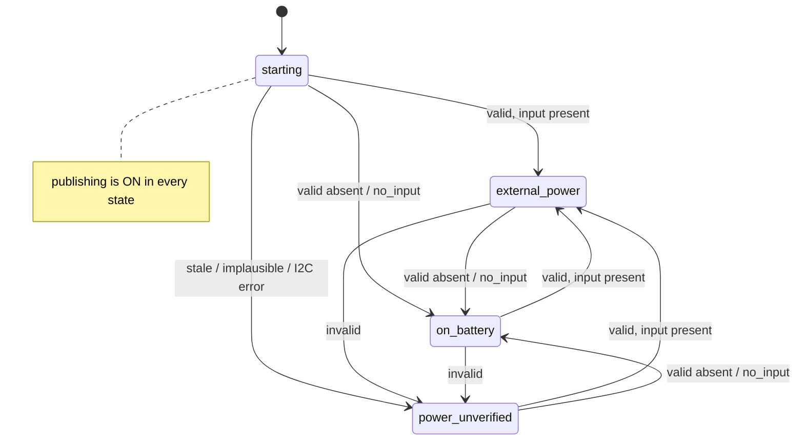

# MP2731 power telemetry and the power gates

The MP2731 charger (I2C 0x4B) is the only source of the device's power facts:
battery, system and input voltage, charge and input current, and whether
external power is present. Three firmware decisions run on those facts. Since
2026-11-13 only two of them can refuse anything:

| Consumer | Where | Rule |
|---|---|---|
| Publish gate | `device_commands_publish_power_ok` → `power_publish_ok` | **Never closes** while a charger is fitted, whatever the reading. The charger is still read every 5 s so the heartbeat can report the power state (`publish_gate_reason`) |
| AMBIT flashing (boot sync, attach update) | `device_commands_flash_power_ok` → `power_gate_flash_ok` | **Fail-closed.** Allowed only on fresh, positive evidence of external power: the latest read is valid with input present, AND two consecutive present frames had different ADC values (within the last 6 present reads). Any valid-absent, `no_input` or invalid read resets that evidence. Refused on battery, on `no_input`, on any invalid read, on a frozen frame, and without a charger monitor (unless the build sets `AMBYTE_FLASH_WITHOUT_CHARGER`) |
| Low-battery SD park guard | `app_power_guard_task` → `power_guard_step`, every 15 s | Parks only on **fresh** evidence: 3 consecutive changing, valid frames below 3300 mV on battery. Un-parks at ≥ 3600 mV or external power (4 reads), or after 12 reads without evidence. In practice it cannot fire on this hardware (below) |

Every heartbeat reports what the charger said and the observed power state:
`health.power.valid`, `reason`, `status_reg`, `fault_reg`, and
`health.connectivity.publish_gate_reason`. See [mqtt-payload.md](mqtt-payload.md) §9.2.

## The 2026-11-13 incident

Uluru (prod), fw 2.9.0 – 2.16.0, local time ACST (UTC+9:30):

- **No charging all day.** On 2026-11-13, from 08:47 to 21:04 ACST, every
  `14:63:93:…` unit's live charger status said "not charging" on every
  heartbeat, while its ADC frame never changed. These were daytime hours.
  Units died during the day (`39:36:18` at 12:10, `37:A0:A8` at 15:22 ACST).
  The units appear to have had no external power or charging at all in the
  field.
- **`14:63:93:37:A3:FC`:** an all-zero power frame (system_v 0 V on a running
  unit) on every heartbeat from 10:43 ACST. The old gate read it as "no input"
  and stayed closed for 9+ h. The store grew from 340 to 2,519 pending records
  while only heartbeats went out.
- **`14:63:93:39:37:30` and `39:40:0C`:** one bit-identical *charging* frame
  (VIN 4.98 V, 420 mA charge) for 10+ h, across 30+ ESP resets, while the same
  heartbeats' live status said "not charging". The old gate believed VIN 4.98 V
  and stayed open. Its AMBIT boot-sync flash used that same gate.

The prod raw archive (2026-11-08 … 13, ~18,000 heartbeats from 18 devices)
shows the stale signature on every Uluru unit: charge current in the frame
while the live status says "not charging", in 85–100 % of their heartbeats,
with only 1–2 distinct frames per unit. The healthy `10:BD:A3:…` units show it
in 0 of ~14,000 heartbeats.

## Root cause

MP2731 datasheet, Rev. 1.1, 2020-08-24 (Farnell mirror
<https://www.farnell.com/datasheets/3437344.pdf>; page numbers are the
datasheet's own):

- **p.26:** the 8-bit ADC "is available in charge mode and OTG mode". There
  is no battery-only conversion, and every ADC spec carries the condition
  "Charge mode or OTG mode".
- **pp.37–39:** the result registers 0x0E–0x13 power on at 0x00 and are
  reset neither by `REG_RST` nor by the I2C watchdog. When no conversion runs,
  they keep their last value forever (or 0x00 after the chip itself restarts).
- **p.31:** REG03 bit 7 `ADC_START` "stays high during ADC conversion".
  Bit 6 `ADC_RATE` selects one-shot (0) or continuous (1). Both bits are reset
  by the I2C watchdog.
- **p.33:** the I2C watchdog defaults to 40 s and is kicked via REG08 bit 3.
  The firmware has never kicked it. The bench chip reads `REG0D = 0x80`
  (`WATCHDOG_FAULT`), so every unit runs in the charger's "default mode".

The v2.16.0 read was: write `REG03 | ADC_START`, sleep 80 ms, read
0x0E–0x13. It never checked that a conversion happened. Whenever the ADC
wasn't converting, the firmware republished the last frame as a fresh
measurement:

- on a unit without input (Uluru, all day on 2026-11-13): a frozen frame,
  e.g. a charging one (37:30, 40:0C);
- after a chip reset: the power-on zeros (A3:FC);
- on healthy solar units at night: the dusk frame. That is the long-standing
  "battery_v = 0 at night" pattern.

A stale frame fails in both directions, as the incident shows.

## The read (components/mp2731/mp2731_core.c)

```mermaid
flowchart TD
    A[read REG03] --> B{START or RATE set?}
    B -- yes --> C[write REG03 with both ADC bits clear]
    B -- no --> D
    C --> D[write REG03 = base | ADC_START<br/>a real 0→1 edge, OTG bits kept]
    D --> E[poll REG03 every 5 ms<br/>until START falls, max 250 ms]
    E --> F[read REG0C status, REG0D fault,<br/>results 0x0E–0x13]
    F --> G{live status: VIN_STAT 000<br/>AND INPUT_FAULT AND not charging?}
    G -- yes --> NI[POWER_ERR_NO_INPUT<br/>no voltages; reported on_battery]
    G -- no --> H{START fell?}
    H -- no --> TO[POWER_ERR_ADC_TIMEOUT]
    H -- yes --> I{plausible frame?}
    I -- no --> IM[POWER_ERR_IMPLAUSIBLE]
    I -- yes --> OK[ESP_OK]
```

A frame is **implausible** when any of these holds:

- all five results are zero (the power-on value);
- VSYS < 2.5 V (the ESP32 runs on it) or > 5.0 V;
- VBAT > 4.8 V;
- charge current ≥ 35 mA while the live `CHG_STAT` says not charging. This is
  the stale-frame signature from the archive. ICHG is a charge-mode-only
  channel, so a real conversion cannot report current the chip is not
  delivering.

VBAT = 0 is **not** rejected: the field reads it whenever the charger idles
with input present.

**"No input" needs all three live bits to agree.** VIN_STAT is also 000 at
power-on and while the input is being qualified. Requiring `INPUT_FAULT`
("OVP or no input", live, p.37) as well means an all-zero register file
(A3:FC) does *not* count as "no input".

**One-shot, not continuous.** In continuous mode `ADC_START` is read-only, so
freshness becomes unobservable. The un-kicked watchdog would also reset
`ADC_RATE` 40 s later. The watchdog is deliberately left alone: kicking or
disabling it would move the charger to "host mode", a change to charging
behaviour this fix does not need. Each read sets the ADC bits itself.

**What the completion poll can and cannot prove.** On the bench (charge mode)
`ADC_START` already reads 0 on the first read-back, about 0.6 ms after the
start write (10/10 probes). The poll therefore catches a START bit stuck high
but cannot prove a fresh conversion. The live-status cross-checks (no input;
charging per ADC but not per status) and the plausibility limits reject what
they can. A stale-but-plausible frame still reads `ok` (for example a frozen
twilight frame with an inconclusive status). That is why:

- the publish gate no longer acts on readings at all;
- the consumers that need freshness (AMBIT flashing, the SD guard) require the
  frame to change between reads.

Whole reads are serialised by a driver mutex: four tasks read the charger,
and an interleaved "clear START" would abort another task's conversion.

## The publish gate: keep sending always

**Decision (user, 2026-11-13).** Uluru ran a whole day without charging, with
stale frames that misled the gate in both directions. A stale-but-plausible
frame cannot be told from a fresh one on this silicon: `ADC_START` reads low
within ~0.6 ms either way, and a frozen twilight frame passes every
plausibility check. So no reading class may stop publishing:

- the gate is open from boot;
- `power_publish_ok()` is true for every state;
- it holds whether the reading is a valid "absent" frame, `no_input`, stale,
  implausible, or an I2C error.

`publish_gate_reason` reports the observed power state for observability
only:

| Reason | Meaning |
|---|---|
| `starting` | no charger read yet |
| `external_power` | latest read valid, input present |
| `on_battery` | latest read valid without input, or live status `no_input` |
| `power_unverified` | latest read stale, implausible or unreadable. A rate-limited WARN fires after 12 in a row |
| `no_charger` | no charger monitor wired |

**Trade-off, stated plainly: the publish gate no longer saves battery at
night.** Before, a healthy solar unit stopped draining its backlog from dusk
to dawn. It closed at dusk on a valid frame below 4.7 V and then stayed closed
on the frozen dusk frame. Now it publishes through the night on battery:

- dusk frames are valid "absent" frames, reason `on_battery`;
- the night reads `no_input`, also reason `on_battery`;
- AMBIT flashing is refused from dusk to dawn.

That costs energy on every battery night, fleet-wide. The user accepted it:
holding data back on an unverifiable reading proved worse (A3:FC). The event
store is internal littlefs and power-loss-safe, so a unit that browns out
loses nothing it had stored.



## The AMBIT flash gate: fresh, positive evidence

A brownout mid-flash bricks an AMBIT, so flashing needs evidence of its own:

- the **latest** read is valid (`ok`) with input present; and
- the frame **changed** between two valid reads within the last
  `POWER_FLASH_FRESH_WINDOW` = 6 valid reads.

Any `no_input`, invalid read or valid "absent" frame resets the evidence at
once. After that, flashing needs at least two **consecutive** present frames
whose **ADC values** differ. Freshness is computed on the five measured values
only, never on the `input_present` flag, so a flag flip with identical numbers
never re-qualifies a frame seen before the loss.

Without a charger monitor (`read_power == NULL`) the gate refuses. A real unit
whose charger failed its boot I2C probe looks exactly like a dev board without
one. Only a dev/bench build may opt in with `-DAMBYTE_FLASH_WITHOUT_CHARGER=1`.

The attach-time battery-floor rule (flash on battery ≥ 3700 mV) is retired. On
battery that battery value is a stale frame, and the decision is no AMBIT
flashing on battery or unknown power.

Boot sync waits up to 30 s for the evidence. That is about six 5 s charger
reads, enough for two differing frames on a powered unit. Attach updates
re-check every 10 min.

## The SD park guard

Same thresholds and streaks as before, but a read counts as battery evidence
only when all of these hold:

- it is valid;
- it is fresh (its frame differs from the previous valid frame);
- it reports external input or a non-zero VBAT.

Rules:

- no evidence → never park;
- parked + 12 reads without evidence → remount (`POWER_GUARD_UNPARK_UNVERIFIED`).

**This guard effectively cannot fire on battery on this hardware.** It needs a
fresh battery voltage below 3300 mV while on battery, and on battery the
MP2731 ADC does not convert (p.26). Every release before this one compared a
stale frame, or the idle charger's VBAT 0, which it skipped. So it has most
likely never parked a field unit correctly. It now refuses stale frames instead
of acting on them by accident. A real on-battery voltage source (an ESP ADC
divider, or OTG-mode reads) is future work.

## Field effect of the OTA

| Unit state | Before (≤ 2.16.0) | After |
|---|---|---|
| Healthy, charging by day | publishes (gate opens at 15 s) | publishes; `external_power`; AMBIT flash allowed |
| Healthy solar unit at night | stops publishing at dusk | **publishes on battery**; `on_battery`; flash refused |
| All-zero frame (A3:FC) | **holds data back indefinitely** | publishes; `power_unverified`, `reason: implausible` |
| Frozen charging frame, live "not charging" (Uluru all day) | publishes; AMBIT boot sync could flash on battery | publishes; flash refused (`no_input` or frozen frame) |
| Charger unreadable / failed boot probe | publishes (no charger = never gated); flash allowed | publishes; flash refused |
| AMBIT attach-update (#91), unit without external power (Uluru today) | allowed on battery ≥ 3.7 V (a stale frame) | **never auto-flashes** (intended): attach updates need the same fresh external-power evidence as boot sync; a stale AMBIT's channel stays **held** (not measured) and re-checks every 10 min (`AMBIT_ATTACH_RETRY`) |

**AMBIT attach updates without external power.** A channel whose AMBIT is older than the SD target stays held while the unit has no external power; today's Uluru AMBITs match their target (1.4.0), so none is held.
Current, newer or unreadable AMBITs are cleared at once and keep measuring.

Drain after the OTA: A3:FC's 2,519 pending records go out through the
windowed publisher (≤16 in flight, bench ~17 events/s), which is minutes on a
good link and well inside the ~17 h store budget. Delivery stays
at-least-once: the cursor, ACK and SD-overflow paths are untouched.

## Diagnostics

- `status` shows the reading or the reason it was rejected, plus
  `gate reason`.
- `mp2731_regs [passes] [interval_ms] [read]` dumps REG00–REG16. It is
  read-only unless `read` is given; `read` runs the production read and prints
  its verdict and conversion time.
- `mp2731_regs probe [n]` times one conversion by polling REG03 back to back.
- Heartbeats carry `status_reg` (REG0C) and `fault_reg` (REG0D) for valid
  *and* rejected frames. That is how a frozen unit in the field says why its
  ADC stopped (input, NTC, thermal, watchdog).

Bench evidence (dev bench Ambyte on USB, 2026-11-13; excerpts and provenance in
[images/power-telemetry/](images/power-telemetry/README.md)):


Host evidence:

- `tests/test_power_policy.py` drives the production read and policy against a
  fake charger (stuck, all-zero, never-completing, I2C-erroring,
  no-input, stale-charging, healthy-changing).
- It replays the incidents against a verbatim v2.16.0 port
  (`tests/fixtures/power_v2_16_0`), which must fail. These replays are
  MODELED. Field heartbeats never carried full REG0C/REG0D, so the all-zero
  replay assumes status 0x20 / fault 0x00, and the frozen-frame replay assumes
  status 0x01 with INPUT_FAULT. Both are assumed values, not captured ones.
