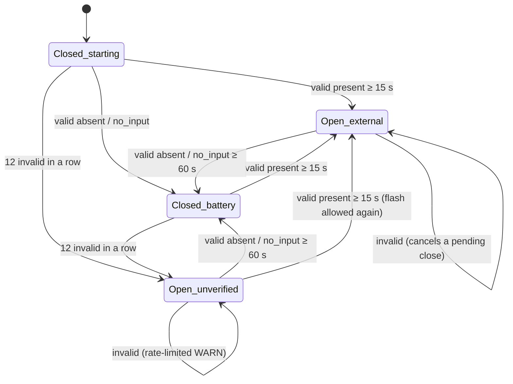
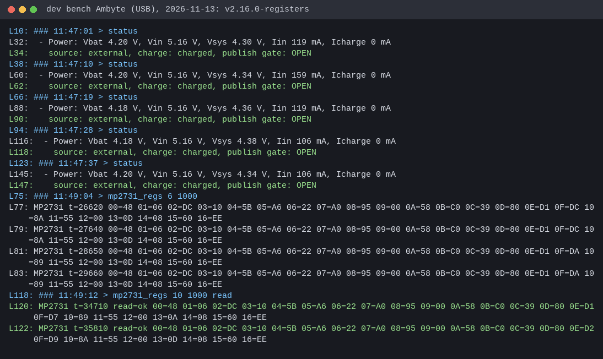
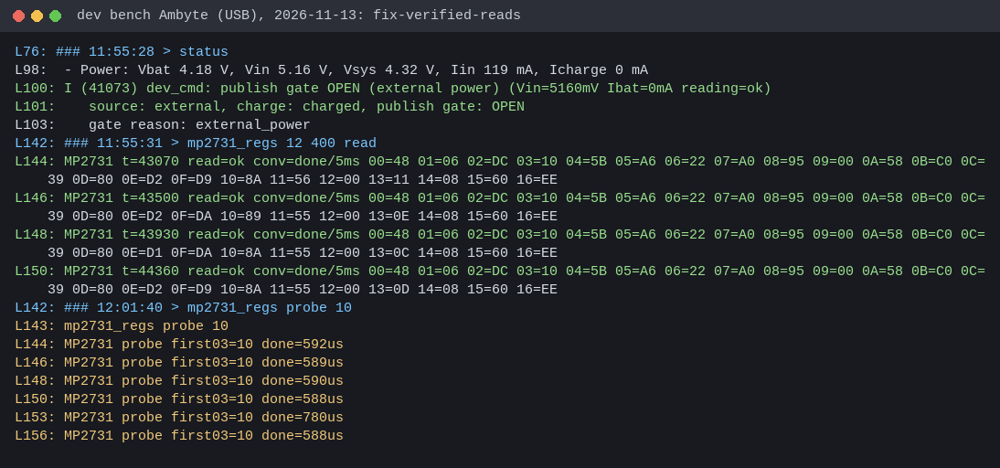
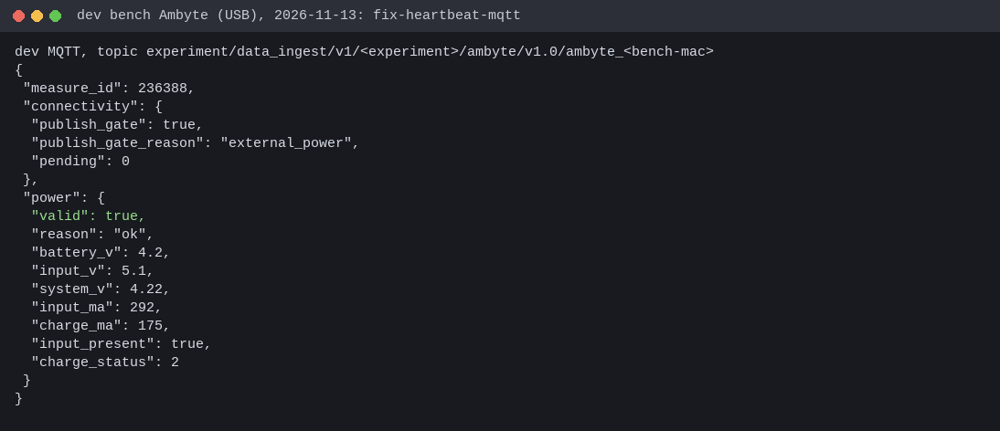

# MP2731 power telemetry and the power gates

The MP2731 charger (I2C 0x4B) is the only source of the device's power facts:
battery, system and input voltage, charge and input current, and whether
external power is present. Three firmware decisions run on those facts:

| Consumer | Where | On a valid reading | On an invalid reading |
|---|---|---|---|
| Publish gate (drain the backlog only on external power) | `device_commands_publish_power_ok`, every 5 s | Phase 1 rule, unchanged: VIN ≥ 4.7 V or charge current → open after 15 s; otherwise close after 60 s | Never closes the gate. After 12 invalid reads in a row it **opens** (`power_unverified`) |
| Low-battery SD park guard | `app_power_guard_task`, every 15 s | Unchanged: park below 3300 mV on battery (3 reads), un-park at ≥ 3600 mV or external power (4 reads) | Never parks. After 12 reads without evidence a parked card is **remounted** |
| AMBIT flashing (boot sync, attach update) | `device_commands_flash_power_ok`, `ambit_attach_power_ok` | Allowed on verified external power (or battery ≥ 3700 mV for attach) | **Refused** (fail-closed: a brownout mid-flash bricks the sensor) |

Every heartbeat reports what the charger said and what the gate did with it
(`health.power.valid`, `reason`, `status_reg`, `fault_reg`;
`health.connectivity.publish_gate_reason`, see [mqtt-payload.md](mqtt-payload.md) §9.2).

## The 2026-11-13 incident

Uluru (prod), fw 2.9.0 – 2.16.0:

- `14:63:93:37:A3:FC` reported an all-zero power frame (system_v 0 V on a
  running unit) on every heartbeat from 01:13 UTC. The gate read it as "no
  input", stayed closed for 9+ h, and the store grew from 340 to 2,519 pending
  records while only heartbeats went out.
- `14:63:93:39:37:30` and `39:40:0C` repeated one bit-identical *charging*
  frame (VIN 4.98 V, 420 mA charge) for 10+ h across 30+ ESP resets. The gate
  believed VIN 4.98 V and stayed **open**, on battery, through the night.

The prod raw archive (2026-11-08 … 13, ~18,000 heartbeats from 18 devices)
shows the signature on every Uluru unit. In 85–100 % of their heartbeats the
frame reports charge current while the live status in the same heartbeat
says "not charging". Each unit repeats only 1–2 distinct frames. The healthy
`10:BD:A3:…` units show that combination in 0 of ~14,000 heartbeats.

## Root cause

MP2731 datasheet, Rev. 1.1, 2020-08-24 (Farnell mirror
<https://www.farnell.com/datasheets/3437344.pdf>; page numbers are the
datasheet's own):

- **p.26:** the 8-bit ADC "is available in charge mode and OTG mode". There
  is no battery-only conversion, and every ADC spec carries the condition
  "Charge mode or OTG mode".
- **pp.37–39:** the result registers 0x0E–0x13 power on at 0x00 and are
  reset neither by `REG_RST` nor by the I2C watchdog. When no conversion runs,
  they keep their last value forever (or 0x00 after the chip itself restarts).
- **p.31:** REG03 bit 7 `ADC_START` "stays high during ADC conversion".
  Bit 6 `ADC_RATE` selects one-shot (0) or continuous (1). Both bits are reset
  by the I2C watchdog.
- **p.33:** the I2C watchdog defaults to 40 s and is kicked via REG08 bit 3.
  The firmware has never kicked it. The bench chip reads `REG0D = 0x80`
  (`WATCHDOG_FAULT`), so every unit runs in the charger's "default mode".

The v2.16.0 read was: write `REG03 | ADC_START`, sleep 80 ms, read
0x0E–0x13. It never checked that a conversion happened. Whenever the ADC
wasn't converting, the firmware republished the last frame as a fresh
measurement:

- the dusk frame every night (the long-standing "battery_v = 0 at night"
  pattern);
- the power-on zeros after a chip reset (A3:FC);
- a frozen charging frame (37:30, 40:0C).

A stale frame fails in both directions, as the two incidents show.

## The read (components/mp2731/mp2731_core.c)

```mermaid
flowchart TD
    A[read REG03] --> B{START or RATE set?}
    B -- yes --> C[write REG03 with both ADC bits clear]
    B -- no --> D
    C --> D[write REG03 = base | ADC_START<br/>a real 0→1 edge, OTG bits kept]
    D --> E[poll REG03 every 5 ms<br/>until START falls, max 250 ms]
    E --> F[read REG0C status, REG0D fault,<br/>results 0x0E–0x13]
    F --> G{live status: VIN_STAT 000<br/>AND INPUT_FAULT AND not charging?}
    G -- yes --> NI[POWER_ERR_NO_INPUT<br/>no voltages, but evidence: on battery]
    G -- no --> H{START fell?}
    H -- no --> TO[POWER_ERR_ADC_TIMEOUT]
    H -- yes --> I{plausible frame?}
    I -- no --> IM[POWER_ERR_IMPLAUSIBLE]
    I -- yes --> OK[ESP_OK]
```

A frame is **implausible** when any of these holds:

- all five results are zero (the power-on value);
- VSYS < 2.5 V (the ESP32 runs on it) or > 5.0 V;
- VBAT > 4.8 V;
- charge current ≥ 35 mA while the live `CHG_STAT` says not charging. This is
  the stale-frame signature from the archive. ICHG is a charge-mode-only
  channel, so a real conversion cannot report current the chip is not
  delivering.

VBAT = 0 is **not** rejected: the field reads it whenever the charger idles
with input present.

**"No input" needs all three live bits to agree.** VIN_STAT is also 000 at
power-on and while the input is being qualified. Requiring `INPUT_FAULT`
("OVP or no input", live, p.37) as well means an all-zero register file
(A3:FC) does *not* count as "no input".

**One-shot, not continuous.** In continuous mode `ADC_START` is read-only, so
freshness becomes unobservable. The un-kicked watchdog would also reset
`ADC_RATE` 40 s later. The watchdog is deliberately left alone: kicking or
disabling it would move the charger to "host mode", a change to charging
behaviour this fix does not need. Each read sets the ADC bits itself.

**What the completion poll can and cannot prove.** On the bench (charge mode)
`ADC_START` already reads 0 on the first read-back, about 0.6 ms after the
start write (10/10 probes). The poll therefore catches a START bit stuck high
but cannot prove a fresh conversion. Freshness rests on the live-status
cross-checks (no input; charging per ADC but not per status) and the
plausibility limits.

Whole reads are serialised by a driver mutex: four tasks read the charger,
and an interleaved "clear START" would abort another task's conversion.

## The publish gate (components/device_commands/power_policy.c)



- *valid* = `ESP_OK`. `no_input` counts as a valid "absent" sample: the
  charger's live status is evidence that there is no external power.
- *invalid* = `adc_timeout`, `implausible` or `i2c_error`. An invalid sample
  is the absence of evidence:
  - it never closes the gate;
  - it cancels a pending close, so a close needs a fresh 60 s of valid
    "absent" samples;
  - it never restarts a pending open;
  - after `POWER_POLICY_INVALID_FAILOPEN_N` = 12 in a row (≥ 60 s at the 5 s
    cache) it opens the gate.
- AMBIT flashing uses `power_gate_flash_ok`. It is true only when the gate is
  `external_power` and the latest sample was valid, never on
  `power_unverified`.

### The trade-off: battery

Failing open costs energy: a unit whose charger cannot be read publishes on
battery too. That is the cheaper failure:

- the event store is internal littlefs and power-loss-safe, so a unit that
  browns out loses nothing;
- a gate held closed by an unreadable charger holds data back for as long as
  the reading stays dead (forever, on a frozen chip) and eventually overflows
  the ~17 h store budget.

The approved boundary is that only *missing* evidence fails open. A charger
that reports "no input" consistently closes the gate as before. So a normal
battery night (ADC off, live status "no input") stays closed, and the
fail-open is confined to charger faults.

## The SD park guard

Same thresholds, same streaks. A read carries battery evidence only when it is
valid and reports either external input or a non-zero VBAT.

- No evidence → never park.
- Parked + 12 reads without evidence → remount (`POWER_GUARD_UNPARK_UNVERIFIED`).

**Known limit: this guard has most likely never parked a field unit.** It
needs a fresh battery voltage below 3300 mV while on battery, but on battery
the MP2731 ADC does not convert (p.26). Every release before this one
compared a stale frame, or the idle charger's VBAT 0, which it skipped. The
guard now refuses to act on such frames instead of acting on them by accident.
A real on-battery voltage source (an ESP ADC divider, or OTG-mode reads) is
future work.

## Field effect of the OTA

| Unit state | Before | After |
|---|---|---|
| Healthy, charging by day | gate opens at 15 s | same |
| Battery night, ADC off, live status "no input" | closed (by luck: stale dusk frame said VIN < 4.7 V) | closed (`no_input`), heartbeats say `valid:false, reason:no_input` |
| Frozen charging frame, live status "no input" (37:30 at night) | **open on battery** | closed after 60 s |
| All-zero frame, status not "no input" (A3:FC if its input is present) | **closed indefinitely** | open after 60 s (`power_unverified`), backlog drains |
| Frozen charging frame, status input present (the Uluru daytime pattern) | open | open (`power_unverified`), AMBIT flashing refused, `reason:implausible` |
| A3:FC if its input really is absent | closed | closed (`no_input`): the backlog keeps waiting for input, as designed |

On the drain: a unit that opens on `power_unverified` drains its backlog
through the windowed publisher (≤16 in flight, bench ~17 events/s), i.e.
2,519 records in a few minutes on a good link. Delivery stays at-least-once:
the cursor and acknowledgement path are untouched. A store that already
overflowed to SD drains from the card when the card is mounted. With this
change a frozen charger can no longer keep the card parked.

## Diagnostics

- `status` shows the reading or the reason it was rejected, plus
  `gate reason`.
- `mp2731_regs [passes] [interval_ms] [read]` dumps REG00–REG16. It is
  read-only unless `read` is given; `read` runs the production read and prints
  its verdict and conversion time.
- `mp2731_regs probe [n]` times one conversion by polling REG03 back to back.
- Heartbeats carry `status_reg` (REG0C) and `fault_reg` (REG0D) for valid
  *and* rejected frames. That is how a frozen unit in the field says why its
  ADC stopped (input, NTC, thermal, watchdog).

Bench evidence (dev bench Ambyte on USB, 2026-11-13; excerpts and provenance in
[images/power-telemetry/](images/power-telemetry/README.md)):





Host evidence:

- `tests/test_power_policy.py` drives the production read and policy against a
  fake charger (stuck, all-zero, never-completing, I2C-erroring,
  no-input, stale-charging, healthy-changing).
- It replays the two incidents against a verbatim v2.16.0 port
  (`tests/fixtures/power_v2_16_0`), which must fail.
