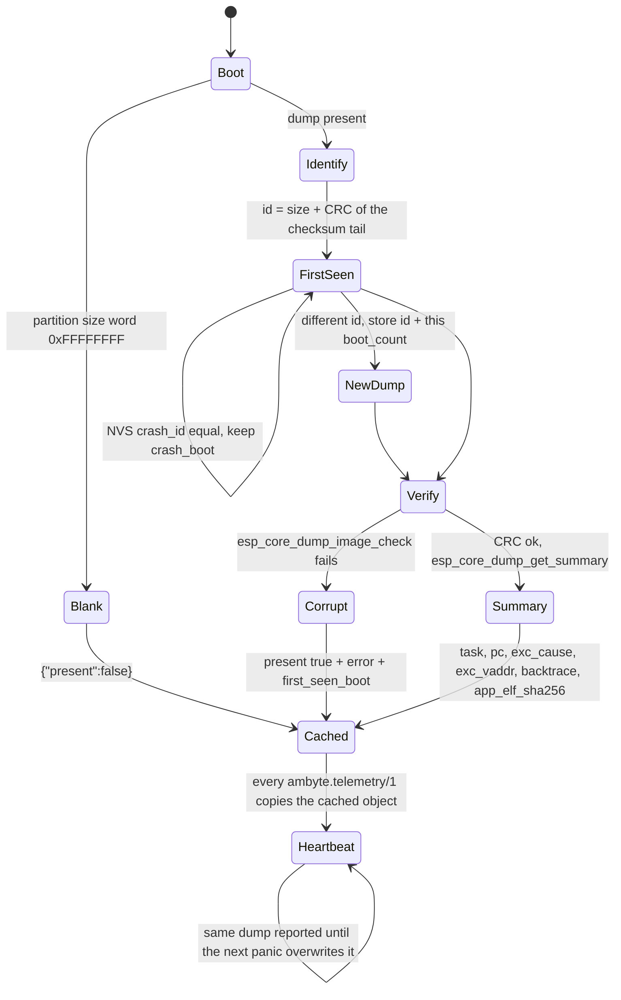
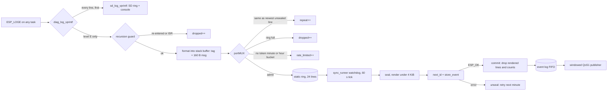
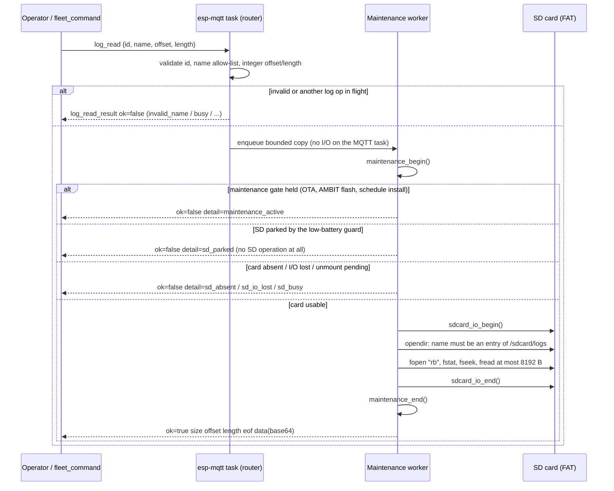

# Remote diagnostics

On 14 Nov 2026 the Uluru gateways restarted repeatedly, mostly at the
every-10-minute MPF slots, and then went silent. From the cloud the cause could
only be guessed from timing and power readings. The evidence existed on every
unit: the `boot sync: last reset was <reason>` line in
`/sdcard/logs/ambyte.log` and the coredump partition (`0x610000`, 64 KiB, ELF +
CRC32). Neither left the device, and nobody copies SD cards by hand.

The rule this feature implements: diagnostics are **sent**; what was not sent is
**readable remotely**.

| Part | What the device does | Where it shows up |
|---|---|---|
| A. Restart reason | `esp_reset_reason()` as a stable string, plus an NVS boot counter | `health.runtime.reset_reason` / `boot_count` in every `ambyte.telemetry/1` (stored heartbeat, direct heartbeat, `device/status-report`), and in `pong` |
| B. Crash summary | The stored coredump, read and verified once per boot, cached | `health.crash` in every `ambyte.telemetry/1` |
| C. Error log lines | `ESP_LOGE` lines captured, rate-limited, batched | `ambyte.log/1` event-log records (tag `LOG`) on the normal QoS1 path |
| D. Remote SD log reads | `log_list` / `log_read`, read-only, bounded | `log_list_result` / `log_read_result` on the status topic |
| E. Tooling | `fleet_command.py log-list` / `log-read` | Actions → **Fleet command** |

Payload details are normative in [mqtt-payload.md](mqtt-payload.md) §9.2, §9.5,
§17 and §18; this page explains the mechanisms.

## A. Restart reason and boot counter

`diag_boot_init()` runs once in `app_main`, right after NVS is up. It maps
`esp_reset_reason()` through `components/diag/diag_reset.c`: `poweron`,
`brownout`, `panic`, `int_wdt`, `task_wdt`, `other_wdt`, `sw`, `deepsleep`,
`ext`, `sdio`, `usb`, `jtag`, `efuse`, `pwr_glitch`, `cpu_lockup`, `unknown`.
That is now the only table: `ambit_flash.c`'s boot-sync log line spells the
reason through it too, so the SD log and the heartbeat say the same word.

`boot_count` is a `u32` in NVS namespace `diag`, incremented once per boot (one
NVS write per boot). RTC_NOINIT was rejected: it does not survive the power-on
resets that matter most. `boot_count: 0` means NVS was unavailable; an
unreadable counter is never restarted at 1.

How to read it: a `brownout` with a rising `boot_count` every ten minutes is a
supply collapse under the measurement load; `panic`/`*_wdt` points at
`health.crash`; `sw` is an orderly `esp_restart()` (OTA, watchdogs, nightly
maintenance, `reboot`), which `last_wd_reboot_reason` further explains.

## B. Crash summary



- Read once per boot in task context; the heartbeat only copies a cached
  string. Nothing runs in an ISR or on the heartbeat path.
- The CRC is verified **before** `esp_core_dump_get_summary()`, because that
  IDF function walks ELF headers straight out of the mmapped partition without
  bounds checks. A corrupt dump is reported as `present: true` with `error`
  and is never parsed, so it cannot crash the boot.
- Read-only: the dump is **never erased**. It is reported on every boot until
  the next panic replaces it. `first_seen_boot` (persisted in NVS keyed by the
  dump's identity) tells a stale dump from weeks ago apart from a new one:
  compare it with `boot_count`.
- Decoding: `pc` and `backtrace` are `0x…` strings for `addr2line` against
  the ELF whose SHA-256 starts with `app_elf_sha256` (the release's
  `firmware.elf`); `exc_cause` is the Xtensa EXCCAUSE (28 = LoadProhibited,
  29 = StoreProhibited, 0 = IllegalInstruction).

## C. Error log lines → `ambyte.log/1`



**Hook chain (explicit order).** `sd_logger_init()` installs `sd_log_vprintf`
first; `diag_log_install()` runs right after it and saves that hook as its
downstream sink:

```
esp_log_write → diag_log_vprintf → sd_log_vprintf → console vprintf
```

Every line reaches SD logging and the console exactly as before, and only then
is an error line captured. If sd_logger failed to start, the downstream sink is
the console itself.

**Why the hook is safe on the esp-mqtt task and for `s_mtx` holders.** The repo
invariant is that the esp-mqtt task touches only the portMUX latch table and
the completion queue, never event_log's `s_mtx`, and that producers never move
the cursor. The hook:

- takes **no lock but its own portMUX** (`g_diag_log_mux`, a spinlock held
  for a compare, a token refill and a ~200-byte copy, with no calls out);
- never calls event_log, never allocates, never blocks, never sleeps, and does
  not call `time()`/`gettimeofday()` (IDF takes a `_lock` there): lines are
  stamped with `esp_timer` uptime, which is lock-free;
- so a task that holds `s_mtx` and logs an error spins at most for that short
  copy and never waits for `s_mtx` itself. No lock-order edge to `s_mtx` exists,
  so it cannot deadlock. The esp-mqtt task logging an error does the same: a
  bounded copy into RAM, no event_log, no socket wait.

`vsnprintf` into a stack buffer is the same call `sd_log_vprintf` and the console
sink already make on every line. Its frame lives in a separate non-inlined
function that runs after the downstream sinks have returned, so the worst-case
stack depth of a logging task grows only by the hook's own small frame.

**Drops are counted, never waited for.** Each ESP_LOGE occurrence ends in
exactly one place: a ring line (counted in its `repeat`), `dropped` (ring
full, ISR context, recursion, more than 8 tasks logging at once) or
`rate_limited`.

**Rate limit.** Two token buckets, one token from each per admitted line:

| bucket | burst | refill | bound in any window |
|---|---|---|---|
| minute | 20 | 1 per 6 s | 20 + 10 = **30 lines / 60 s** |
| hour | 60 | 1 per 15 s | 60 + 240 = **300 lines / h** |

A bucket with burst B and refill rate r admits at most B + r·W in any window W,
so these parameters make the ticket's ≤ 30/min and ≤ 300/h hold for every
sliding window, not just on average (the host test checks every window over 3 h
of dense arrivals). Identical consecutive lines coalesce into `repeat` and cost
no token, so an error loop costs one line.

**Drainer.** The sync_runner watchdog task already stores the periodic
heartbeat as a producer. Its once-a-minute tick now also calls
`cmd_store_log_event()`:

1. seals the ring (sealed lines can no longer be coalesced into or reused);
2. renders one `ambyte.log/1` object of at most 4095 bytes, with as many lines
   as fit (the rest wait for the next record);
3. stores it with `next_id` + `store_event`: the id is allocated under
   event_log's mutex and the cursor is not touched;
4. on `ESP_OK` drops exactly the rendered lines and the reported counts; on any
   failure unseals, so nothing is lost.

At most one record per 60 s. The record is far below every record cap, so the
cap chain (`AMBIT_RUN_PAYLOAD_CAP` < `EVLOG_RECORD_CAP_NORMAL` < publish max)
is unchanged. Delivery is the normal at-least-once path, so a duplicate after a
lost PUBACK is possible and harmless.

**Time.** `uptime_ms` is always present. `utc_ms` is back-computed at drain time
along the monotonic uptime axis, and only for lines captured after the clock
was first known valid (RTC at boot or SNTP). Earlier lines carry
`utc_ms: null`. `boot_count` in the record says which boot the uptimes belong
to.

**Routing.** The workbook `when:` routing has no macro for `ambyte.log/1`, so
the records land in `clean_data` only, by design. Query them by
`sample[0].schema = 'ambyte.log/1'` (or envelope tag `LOG`).

## D. Remote SD log reads



- **Read-only.** Files are opened `"rb"`. Nothing is written, renamed,
  truncated or deleted. `CONFIG_FATFS_FS_LOCK=0` lets a reader open the file
  sd_logger is appending to. The writer is untouched.
- **Bounded.** `name` is a plain basename that must be found in
  `/sdcard/logs`: 1–64 characters of `[A-Za-z0-9._-]`, no leading `.`, no
  `..`, so no `/` and no other directory, ever. `length` defaults to 4096 and
  is clamped to 8192. A negative `offset` reads from the end. An offset past
  EOF is refused (`offset_past_eof`: the file was most likely rotated).
- **Never waits on the card, never holds it during the reply.** Every SD state
  refusal is immediate, and the reply is published only after
  `sdcard_io_end()`, so a slow MQTT write can never delay a low-battery
  unmount.
- **Encoding.** `data` is standard padded base64. It was chosen over escaped
  text because its size is bounded at 4/3 of the raw bytes (≈ 11 KiB on the
  wire at the 8192-byte cap), while escaped text can grow up to 6×.

## E. Tooling

```
fleet_command.py log-list --devices ambyte_28:37:2F:FF:FC:80
fleet_command.py log-read --devices ambyte_28:37:2F:FF:FC:80 --name ambyte.log --tail 65536 --out ambyte.log
fleet_command.py log-read --devices ... --name ambyte.1.log --offset 0 --length 8192
```

- Without `--out`: one request to each listed device; the replies (with base64
  `data`) go to `--results-json`.
- With `--out FILE` (exactly one explicit device): consecutive chunks with
  correlated ids `<request>-<n>` are stitched until EOF. Each chunk is checked
  for the requested name and offset, a byte count that matches the decoded
  data, and a file that did not shrink between chunks (rotation). `no_mem`
  halves the chunk size; `busy` (a QoS1 duplicate) is retried. The bytes read
  so far are always written; the command fails unless the file is complete.
- A missing reply, a refusal (`sd_parked`, …) or an inconsistent chunk fails
  the command, like every other fleet command.

Actions → **Fleet command** offers `log-list` and `log-read` (inputs
`log_name`, `log_tail_bytes`) behind the same per-environment approval gate as
every other command. `log-read` there always stitches into the run artifact
`device-log.txt`. Offset and length control is available from the CLI.

## Qualification

Host tests run the production code:

- `tests/test_diag.py`: the reset table (and its match with the pinned IDF
  enum); crash JSON present, absent and corrupt; parsing, truncation and UTF-8
  safety; coalescing exactly-once across a failed store; full ring; the
  recursion and ISR guards; pre-sync `utc_ms: null`; worst-case records split
  under 4 KiB; sliding-window bucket caps; 12 concurrent producers plus a
  drainer under ASan and ThreadSanitizer with exact accounting.
- `tests/test_log_command.py`: `log_command.c` with the pinned-IDF cJSON on a
  real directory, covering name validation (`..`, `/`, unknown names), negative
  offsets, past EOF, the length cap, binary safety, every SD and maintenance
  refusal, busy and a full worker queue, and a read-only proof (file hashes
  unchanged).
- `tests/test_fleet_command.py`: payloads, the stitcher, and mocked-transport
  runs (correlated ids, QoS duplicates, missing replies, refusals).

**Hardware qualification follows the release.** PR builds are unsigned and the
dev bench accepts only production-signed images, so the bench captures
(`docs/images/remote-diagnostics/`) are produced on the dev bench over OTA after
release, and they land in a follow-up docs PR.
