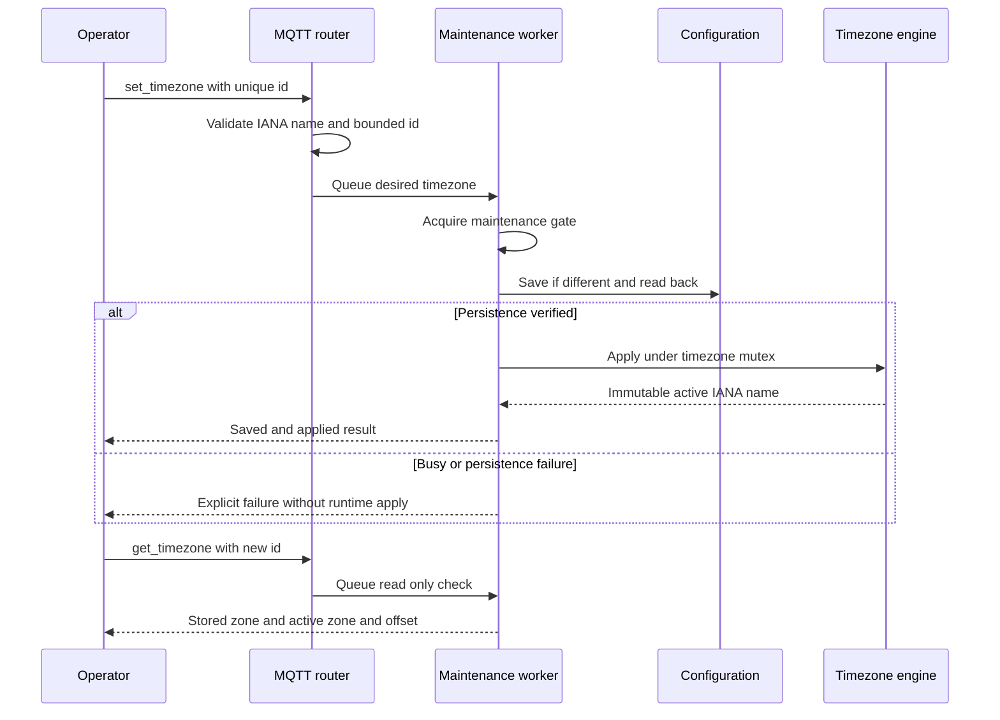
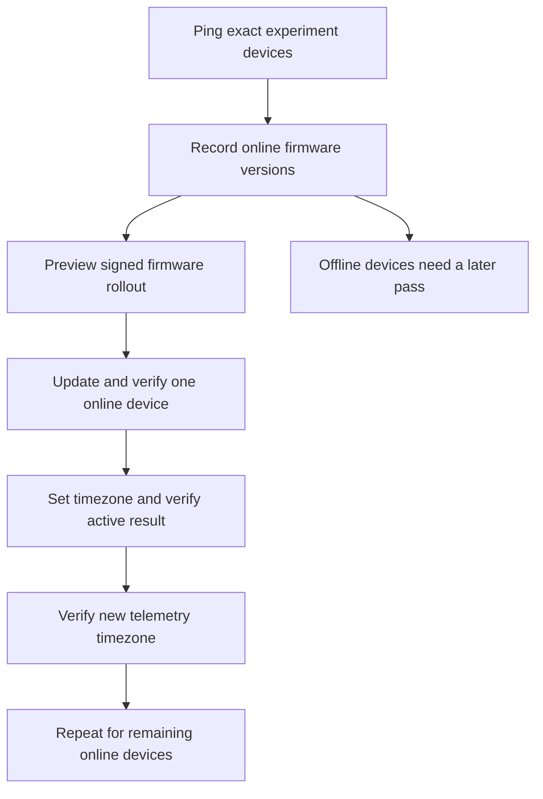

# Remote timezone maintenance

> **Since the location resolver ([timezone-from-location.md](timezone-from-location.md)):**
> the device derives its zone from its location. `set_timezone` with a zone
> now stores the configured **fallback** (in effect only while no location
> resolves); add `"pin": true` to hold it over the location, and send
> `"timezone": "auto"` to release a pin. Replies keep every key below
> (`timezone` is the configured fallback) and add `requested_timezone`,
> `requested_pin`, `timezone_source`, `pinned`, `resolved_timezone`,
> `location_source` and `location_set`. The text below describes #98 as it
> shipped in 2.16.0.

`set_location` stores latitude/longitude and preserves the current timezone.
It does not translate coordinates into an IANA timezone. Field firmware 2.9.0
and 2.14.0 therefore cannot correct a provisioned `Europe/Berlin` timezone over
MQTT. This change adds explicit remote timezone maintenance; automatic
coordinate lookup followed in [timezone-from-location.md](timezone-from-location.md).

Publish on the device's existing command topic, QoS 1, **not retained**:

```json
{"type":"set_timezone","id":"unique-request-id","timezone":"Australia/Darwin"}
```

The reply is `set_timezone_result` on the existing status topic. Require `ok`,
`saved`, and `applied` all true, and `timezone == active_timezone ==` the requested
IANA name. `utc_offset_seconds` is the offset at the device's current UTC clock;
Darwin is +34200 seconds in both seasons. `get_timezone` with a unique `id`
returns `timezone_result` without writing configuration.

The command accepts nonempty names supported by the firmware's compiled IANA
zone table. The MQTT task copies bounded input; fast refusal replies may read the current configuration and runtime snapshot. The existing resident
maintenance worker acquires the shared maintenance gate, persists and reads back
the timezone, then applies it. Duplicate desired values skip the NVS write.
Persistence/readback failures do not change the runtime timezone. Busy/queue
errors are explicit failures; the operator can retry the same desired timezone.

Runtime apply serializes libc TZ mutation and offset reads with a mutex. New
measurement and heartbeat envelopes obtain the same immutable active-zone name
as the scheduler, instead of the provisioning-time buffer. Latitude/longitude,
RTC UTC time, topics, workbook, certificates, and stored records stay unchanged.
This does not rewrite historical cloud rows. Normal day/night and solar triggers
use the corrected local offset; no firmware reboot is needed after the command.





Use Actions → **Fleet command** with `get-timezone` or `set-timezone` and an
explicit device list. `set-timezone` requires `timezone`, for example
`Australia/Darwin`. The normal protected production environment remains in use.
Missing replies and unverified timezone results fail the command job; they are
not counted as success. Older firmware needs the reviewed firmware update first.

## Qualification

Host qualification executes the production command implementation, pinned-IDF
cJSON, and actual timezone engine, with NVS/worker boundaries replaced. It covers
invalid input, deferred dispatch, busy rejection, commit/readback failures,
idempotent desired state, both Darwin seasons and concurrent offset readers.
Physical bench and live rollout evidence will be recorded before claiming the
field fleet is corrected.

## Scheduler transition at application

Applying a new zone re-anchors local-wall and solar triggers on the next poll.
For Uluru, Berlin in November (+01:00) to Darwin (+09:30) advances the local
frame by 8.5 hours. Wall triggers in that skipped window are not replayed as a
historical campaign; the existing 600-second grace can run one recently due job.
A backward change can repeat a daily wall trigger in the repeated window. The
nightly maintenance window also follows the new zone. UTC capture timestamps and
measurement IDs are not rewritten. The rollout accepts this one-time scheduling
transition in order to restore the correct field schedule; verification must
include the active zone and +34200-second offset.

Queued records use the timezone active when published, resolved at their capture
UTC instant. They do not carry a historical per-record timezone. The publisher
snapshots the IANA name and offset together so concurrent application cannot
produce a mismatched `timestamp_local` and `timezone` pair. Position-only changes
and schedule restarts now preserve the exact offset instead of round-tripping
through the legacy whole-hour location getter.

## Physical uploader correction found during qualification

The existing bench wrapper used `pio -t nobuild -t upload`. Without CMake upload
metadata, that route wrote the app at the board default `0x10000`, although
`partitions.csv` and IDF's generated `flasher_args.json` place it at `0x20000`.
The board booted its old OTA fallback, so an uploader exit status was not proof
that the intended firmware ran. The qualification caught this before field use.

The wrapper now consumes the generated four-image layout, substitutes the signed
application, bounds every image including erase rounding, and invokes the GUI's
shared flash routine. It checks the MAC and existing partition table in the same
flash session and writes otadata to select the new app. NVS is omitted unless
`--provision` was explicitly requested; littlefs and event storage are untouched.
Run it in the GUI dependency environment (for example `uv run --group test python
tools/bench_flash.py --port <selected-port>`). This correction does not change
MQTT OTA delivery.
