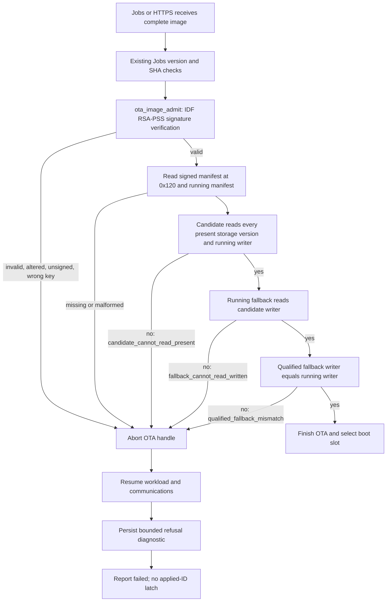

# Signed images and storage compatibility

Ambyte authenticates an incoming application in the **running application's OTA
path**, before selecting its boot slot. The existing unsigned bootloader and
partition table remain installed during OTA. Hardware secure boot, flash
encryption, anti-rollback and security eFuse changes are outside this change.
Physical flash rewriting remains a trusted bench operation.

## Overview



```mermaid
sequenceDiagram
    participant O as Bench operator
    participant U as Unsigned v2.7.0 in ota_0
    participant S as Signed candidate in ota_1
    participant B as Existing unsigned bootloader
    O->>U: Existing HTTPS OTA or one thing-targeted Job
    U->>S: Write reviewed signed candidate to inactive slot
    U->>B: Reboot (bootloader bytes unchanged)
    B->>S: Boot PENDING_VERIFY
    O->>B: B03a: reset before confirmation
    B->>U: Mark ota_1 ABORTED; boot ota_0
    O->>U: Re-upgrade with a fresh request ID
    B->>S: Boot PENDING_VERIFY
    O->>O: B03b: observe candidate pending on held-open serial
    O->>O: Set only dev bench certificate INACTIVE
    S->>S: MQTT health gate expires; rollback API refuses unsigned fallback
    S->>B: Existing forced restart
    B->>U: Mark candidate ABORTED; boot unsigned v2.7.0
    O->>O: Restore certificate ACTIVE; verify, retry on failure
    O->>U: Compare retained data; re-upgrade using a new ID
    B->>S: Boot PENDING_VERIFY
    S->>S: MQTT plus persistence healthy; mark VALID
```



```mermaid
stateDiagram-v2
    [*] --> Legacy: ota_0 unsigned v2.7.0 VALID
    Legacy --> Pending: OTA writes signed ota_1; select NEW
    Pending --> Legacy: reset or health failure; bootloader ABORTED
    Pending --> SignedValid: MQTT and persistence confirm
    SignedValid --> SignedPending: next same-key compatible signed image in ota_0
    SignedPending --> SignedValid: bootloader rollback to signed fallback
    SignedPending --> NextValid: health confirmation
    SignedValid --> BenchRecovery: physical app and otadata recovery
    BenchRecovery --> Legacy: exact v2.7.0 app and selecting otadata restored
```

The Evaluator's real bench transcripts and terminal-style images will be added
under `docs/images/signed-images/` after hardware qualification. Host results do
not establish bootstrap, retained-data or device-memory qualification.

## Toolchain and trust

PlatformIO resolves `espressif32@6.12.0` and
`framework-espidf@3.50500.0` (ESP-IDF **5.5.0**) for this project. Another
installed framework directory may be a different version; use `pio pkg list -e
esp32-s3-devkitm-1` and the build's generated configuration as evidence.

The S3 uses RSA-3072 PSS, SHA-256/MGF1, a 32-byte salt, and the Secure Boot v2
signature format. `CONFIG_SECURE_SIGNED_APPS_NO_SECURE_BOOT` and
`CONFIG_SECURE_SIGNED_ON_UPDATE_NO_SECURE_BOOT` turn on application OTA checks.
`CONFIG_SECURE_BOOT` stays off. The old bootloader accepts the signed image as a
normal application and can still execute the unsigned bootstrap fallback.

In this mode, IDF trusts only the public key in the running image's **first**
signature block. It does not authenticate that running signature again during
the update; the trusted first install establishes the root. The pinned source
`components/bootloader_support/src/secure_boot_v2/secure_boot_signatures_app.c`
sets `secure_boot_num_blocks=1` at lines233–237, bounding both the incoming block
loop at239 and trusted-key loop at259. `secure_boot.c:165–169` warns that later
signatures are ignored. Adding a second signature or escrow key cannot enable
rotation. Published images must have exactly one nonempty block.

Firmware key IDs are `fw-rsa3072:<64 lowercase hex>`: SHA-256 of the SBv2
little-endian modulus, exponent, R-squared and m-prime fields. This is the IDF
key digest, not a digest of PEM text or SPKI. Receipt issuer keys planned for A8
have a separate algorithm/domain and two compiled verifier slots. Those slots
do not change the firmware root or this single-key limitation.

See Espressif's [signed application verification without hardware secure
boot](https://docs.espressif.com/projects/esp-idf/en/v5.5/esp32s3/security/secure-boot-v2.html#signed-app-verification-without-hardware-secure-boot).
Hardware secure boot would require a different bootloader/eFuse deployment and
would prevent the unsigned bootstrap rollback. It is deliberately outside this
OTA preparation work.

## Manifest bytes and compatibility

`.rodata_custom_desc` places the manifest immediately after IDF's 256-byte app
descriptor. Its image offset is **0x120** (24-byte image header, 8-byte segment
header, 256-byte app descriptor). Both the normal image hash and RSA signature
cover these bytes. An unsigned JSON sidecar is never an admission authority.

| Offset | Encoding | Field | A5 |
| --- | --- | --- | --- |
| 0 | 8 bytes | Magic | ASCII `AMBYTEM1` |
| 8 | uint16 LE | Schema | 1 |
| 10 | uint16 LE | Length | 32 |
| 12 | uint16 LE | Target | 9, ESP32-S3 |
| 14 | uint16 LE | Reserved | 0 |
| 16 | uint32 LE | Readable version bitset (bit n = version n) | 2, version1 |
| 20 | uint32 LE | Written storage version | 1 |
| 24 | uint32 LE | Qualified fallback's written storage version | 1 |
| 28 | uint32 LE | Reserved flags | 0 |

The complete v1 vector is
`414d425954454d31010020000900000002000000010000000100000000000000`.
[Machine-readable vectors](signed-image-vectors.json) are consumed by the real-C
host harness. Numeric storage versions are 1..31; version0, unknown schemas,
nonzero reserved fields, missing own readable bits and fallback0 are invalid.

The admission decision uses running manifest R, candidate C, and a storage
provider's `present_versions` set P. It requires:

1. C can read **P union {R.written}**.
2. R can read C.written, so the actual running image can serve as fallback.
3. C's qualified fallback writer equals R.written.

In A5 there is one unchanged on-disk format and P={R.written}. **Before A6 writes
version2, it must persist a durable union marker under `/evstore` and preserve
that union through rollback.** A running writer version is not an inventory of
retained data. For example, after an image writes v2 and rolls back to a reader
of {1,2} that writes v1, a candidate that reads only v1 must still fail
`candidate_cannot_read_present`. Recomputing P from the running writer would
lose that protection. Invalid running metadata fails `running_manifest_invalid`.

Storage version1 names the unchanged capture/index, schedule/provenance and
service formats. No event store or publisher encoding changes here. A new
reader must be installed and qualified while still writing the old format
before a later image can write a new one. A numeric declaration does not prove
qualification: every store-changing release names and tests its actual fallback.
Unsigned v2.7.0 is only a **bootstrap qualification** fallback. Supported fleet
fallbacks after bootstrap must themselves be signed and qualified.

All boot-selection callers use `ota_image_admit`: the shared Jobs/HTTPS worker,
`ota_selftest` clone, and test-only `evq_hil boot_slot`. The future local uploader
must call the same function after complete writes and before selecting boot.
Signature verification runs before manifest decoding, using the received-byte
bound rather than allowing stale inactive-slot bytes to supply a missing tail.

## Builds, signing and release failure

`pio run -e esp32-s3-devkitm-1` produces an **unsigned signing intermediate**.
Automatic build-time signing is disabled. It must not be flashed: IDF aborts
at startup if signed-update verification is enabled but the running image has
no signature block. A physical upload also resets otadata, so that abort loop
can occur in UNDEFINED state without automatic rollback.

Every environment inherits signed verification and a pre-upload guard:
`esp32-s3-devkitm-1`, `bench`, `svc-bench`, `evq-hil`,
`sensors-recovery-hil`, `bench-spiram-internal`, `bench-wifi-ps-none`, and
`bench-pm-none`. The guard reads that build's effective sdkconfig, verifies the
actual image signature, and refuses unsigned/corrupt input before esptool.
It and PR CI check that security/eFuse-changing options remain off, including
ROM-download disabling, secure ROM download, hardware secure boot, flash
encryption, anti-rollback and ROM log-mode changes. GUI factory/local flashing
also rejects unsigned modern-manifest images before opening the port.

Development bench provisioning is explicit:

```sh
python3 tools/bench_flash.py --env esp32-s3-devkitm-1 --port /dev/ttyACM0
```

This uses the loudly named public
`tools/keys/UNSAFE_BENCH_ONLY_firmware.pem`, signs explicitly, keeps NVS, then
passes the normal upload guard. Anyone with the repository can sign for that
root. It must never reach a field device. Physical provisioning may write app,
bootloader, partitions and otadata; it is **not** the bootstrap test below.

Release promotion signs the PR-built intermediate without rebuilding it. Dominik
supplies secret `AMBYTE_FIRMWARE_SIGNING_KEY_PEM` and commits the reviewed public
key ID in `tools/keys/release_firmware.keyid`. The committed placeholder
`UNCONFIGURED` deliberately fails. A GitHub variable cannot silently select a
different release root. **A5 must not merge until the real key, reviewed pin and
CI secret exist.** Agents do not create the production key or secret.

`tools/publish_release_units.py` prepares and verifies the complete raw image and
ZIP before either semantic-release call. Missing/placeholder pin, absent secret,
wrong key, bench key, malformed input, version mismatch or bundle mismatch
publishes neither firmware nor schedule when both are due. Schedule-only
releases need no firmware key. The secret stays in process memory and is never
written to an artifact or temporary key file.

The final raw `firmware.bin` and ZIP app are identical; every other ZIP member
is preserved. `tools/check_release_signing.py` checks the published signature,
exactly one block, reviewed root, bench exclusion, manifest, target and size.
Its `--intermediate` mode is explicitly a build-input check, never a release
approval. `--self-test` includes an unsigned-with-option image, the public bench
root even when requested as the pin, and a genuine wrong-key signature. The
existing no-HIL guard remains mandatory.

The fleet rollout tool authenticates the complete release against the reviewed
pin before deployment. The added `fleet_command.py ota` command is a **dev-bench
transport**, resolves the actual STS account, refuses prod even under a renamed
profile, requires one explicit thing and is absent from GitHub fleet-command
choices. It does not create an alternate release path.

## Bootstrap and negative tests

The old unsigned image cannot enforce the new policy. First-install delivery is
therefore trusted operator-reviewed OTA to the inactive slot while the other
slot still contains exact released unsigned v2.7.0. Preserve bootloader and
partition read-back digests and nonsecret capture/index/schedule/config/cert
fingerprints before and after. `AMBYTE_NVS_SKIP=1 pio ... -t upload` does not
preserve the bootloader or otadata and cannot qualify this transition.

The accepted contract gives the full bench sequence. Evaluator first verifies
there is no conflicting dev fleet workflow or active/scheduled Job. The helper
conservatively rejects conflicts, including group Jobs, and monitors between
trials. It accepts only thing `ambyte_28:37:2F:FF:E7:04` in dev account
084375565727. An existing dev S3 bucket is explicitly selected; no bucket or
public access policy is created.

```sh
AMBYTE_NVS_SKIP=1 AMBYTE_PROJECT_VER=2.8.0-a5-r1 pio run -e esp32-s3-devkitm-1
python3 tools/bench_signed_ota.py fixtures --unsigned .pio/build/esp32-s3-devkitm-1/firmware.bin --out "$A5_OUT"
python3 tools/bench_signed_ota.py preflight --profile jii-dev-084 --thing 'ambyte_28:37:2F:FF:E7:04' --out "$A5_OUT"
python3 tools/bench_signed_ota.py stage --profile jii-dev-084 --bucket "$A5_BUCKET" --run "$A5_RUN" --out "$A5_OUT"
python3 tools/bench_signed_ota.py https --profile jii-dev-084 --run "$A5_RUN" --case candidate --out "$A5_OUT"
python3 tools/bench_signed_ota.py job --profile jii-dev-084 --run "$A5_RUN" --case incompatible --out "$A5_OUT"
python3 tools/bench_signed_ota.py cleanup --profile jii-dev-084 --run "$A5_RUN" --out "$A5_OUT"
```

Use a fresh output directory and a safe unique run label of at most24 characters.
The helper records each fixture's exact descriptor version and SHA. Candidate is
`2.8.0-a5-r1`; negative cases n1..n7 use respectively `code-flip`,
`manifest-flip`, `wrong-key`, `unsigned`, `incompatible`, `missing-manifest`,
`missing-fallback`. The two flips occur **after** signing; the manifest flip is
inside0x120 and the code flip is inside an executable segment. Policy negatives
are genuinely signed by the candidate's key. Every negative version differs
from the running one, so Jobs cannot skip installation as already running it.
A subsequent accepted control uses `--candidate-version 2.8.0-a5-r2` in a fresh
fixture directory. Unique request/job IDs avoid the applied-ID latch.

Stage and both delivery paths compute the exact presigned URL length and refuse
>=2048 before any cloud mutation/send; v2.7.0 has the same limit. Evidence stores
only lengths, never credential-bearing URLs. URLs expire in3600s. Existing HTTPS
fleet jitter stays enabled (this board's MAC slot is69s); the command deadline
is2100s. A negative trial returns a nonzero command result with truthful failed
device evidence. Cleanup cancels/deletes only recorded run-owned Jobs, confirms
their absence and removes run-owned S3 objects/versions. Preserve outcome files.

Reset while PENDING_VERIFY first proves the bootloader's ABORTED→v2.7.0 path.
For the separate Planner-approved health trial, open serial **before** delivery
and keep it open. Re-upgrade with a fresh ID. After console evidence of the old
image's OTA reboot and the candidate's pending boot, set only the bench
certificate INACTIVE. After the bootloader returns to v2.7.0, restore ACTIVE,
retry restoration and verify describe-certificate evidence. Do not change the
AP, Wi-Fi settings, configuration or SD state. Current confirmation still needs
MQTT within300s plus persistence health; offline local confirmation is A9.

The signed app's rollback API itself rejects the unsigned slot. Its existing
forced restart is what lets the old bootloader perform fallback. Once a signed
candidate becomes VALID, ordinary signed OTA cannot restore unsigned v2.7.0.
If Planner requests that end state, physically write only the exact release app
to its original slot and matching otadata selecting it. Preserve bootloader,
partitions, NVS and all storage, and recheck B01 digests. This is recovery, not
evidence of OTA rollback.

At B01, save the original selecting otadata alongside the slot/descriptor
evidence. If an authorized end-state recovery is later needed, the template
below writes only that saved selection and the exact released app. Set
`A5_LEGACY_OFFSET` from the observed original slot (ota_0 is0x20000; ota_1
is0x310000). Verify the app's release digest before writing and retain the
original bootloader/partition readbacks for comparison.

```sh
# B01 backup, before any update; Evaluator only
python3 -m esptool --chip esp32s3 --port /dev/ttyACM0 read-flash 0xf000 0x2000 "$A5_OUT/otadata-before.bin"
# Only if Planner requests physical restoration after signed VALID
python3 -m esptool --chip esp32s3 --port /dev/ttyACM0 --after watchdog-reset write-flash --flash-mode keep --flash-size keep --flash-freq keep "$A5_LEGACY_OFFSET" "$A5_LEGACY_IMAGE" 0xf000 "$A5_OUT/otadata-before.bin"
```

## Refusal readback and resource bounds

`ota_status` retains its slot lines and adds `policy: {JSON}`. Schema1 reports
readable/written/fallback versions, `refusal_state` and `last_refusal` (ID,
source, reason). Older images lack this line; the GUI reports unavailable.
Signature presence shown before GUI flashing is not release trust: the UI says
only that embedded-key consistency was checked.

Latest refusal storage is `/littlefs/ota/refusal.bin` (192 bytes), with bounded
`refusal.tmp` during atomic replacement. CRC/magic/length/schema protect the
record. Write/flush/fsync/close/rename failures retain previous evidence. The
OTA handle is cleaned and workload/comms resume before diagnostic persistence.
Persistence failure never selects boot and is explicit for the new policy
failures. Existing MQTT error strings remain unchanged; additive reasons are
listed in [MQTT payload documentation](mqtt-payload.md#ota-admission-failure-details).
No new NVS keys/bytes or per-capture bytes are added; the event store and partition
table have no format diff. Maximum diagnostic logical files are384 bytes.

Signed image budget includes padding and the whole signature sector: strictly
less than2,764,800 bytes. Static DRAM allowance is4096 bytes over A4, RTC noinit
delta0. Device gates are internal free heap>=8192, largest block>=4096,
CLI/worker stack margins>=2048 and runner>=1024. `ota_policy` logs before/after
verification, including since-boot minimum heap; continuous existing `svc.stats`
samples must cover crypto/load, rather than using only idle observations.
Twenty warmed admission/refusal cycles allow at most2048 bytes of attributable
heap decline. Hardware measurements and filesystem allocation remain part of
Evaluator evidence, not inferred from host tests.

## Key custody, loss and compromise

Keep offline encrypted backups of the **one** release private key, in separate
custody, and run a documented restore/sign/verify drill before field distribution.
Compare a recovered key's ID against the reviewed repository pin. Back up the
key material independently of CI; a secret's existence is not a recovery plan.

Stock signed-update mode cannot rotate keys by accepting an image signed only
by a new key. Loss of the one key therefore requires a physical USB app recovery
visit to each affected unit (about245 prod units in the current fleet). Preserve
identity NVS, capture stores and schedule, install a newly trusted signed app,
and qualify its signed fallback before returning it to service.

On compromise, stop rollout authorization, contain the delivery/CI access, and
physically recover affected devices onto a new reviewed root. A device trusting
the compromised key can accept malicious OTA until recovery; there is no instant
offline revocation. A future old-key-signed transition image built with
SIGNED_ON_UPDATE disabled could bridge to another root, but it deliberately
weakens the policy and needs a separate reviewed recovery design. A5 neither
implements nor releases such an image. Receipt issuer key rotation is separate.
