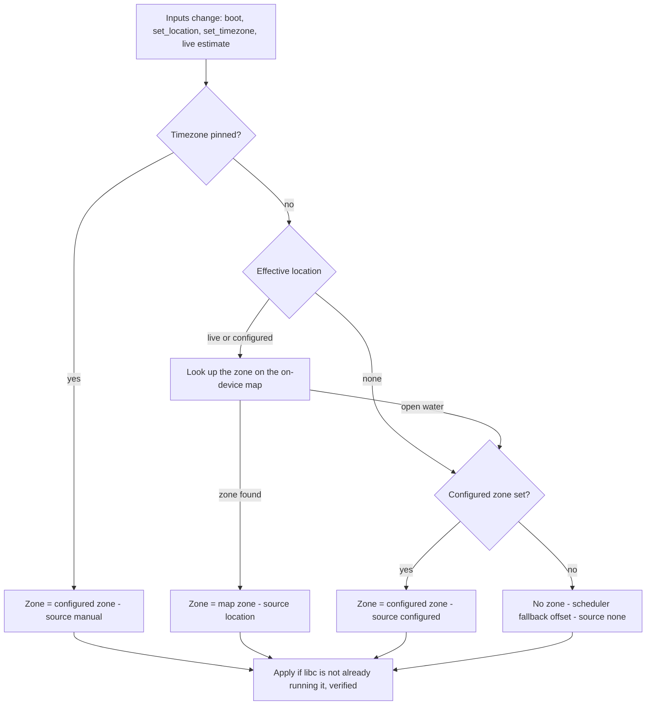
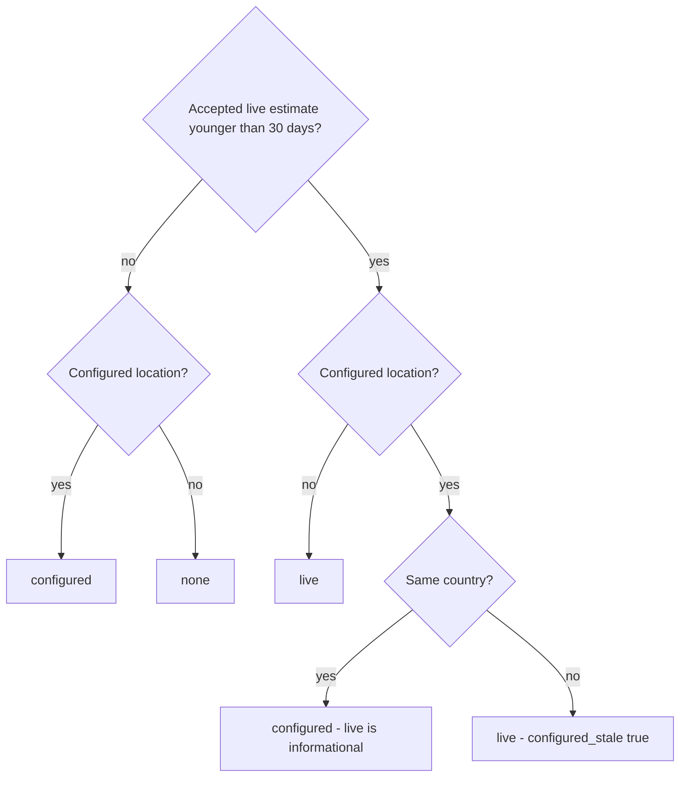
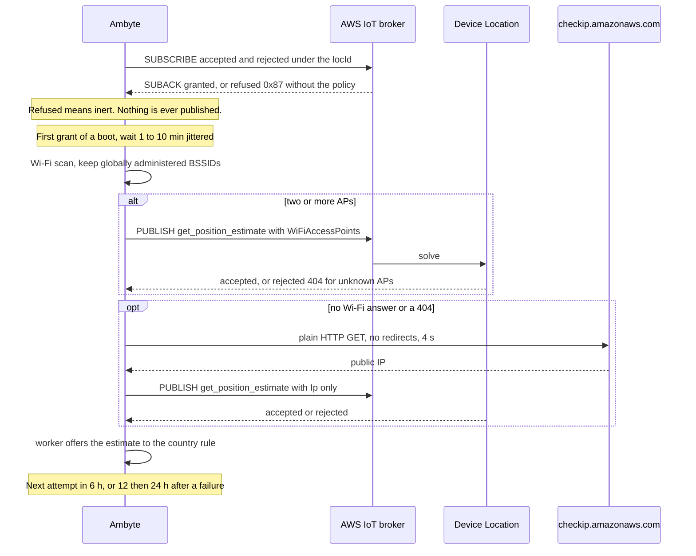

# Timezone from location

An Ambyte now chooses its own IANA timezone from where it is. Units are
prepared in one place and deployed in another. The flash GUI stamps the
laptop's zone, so the Uluru units (experiment `c382cc8b`, ~55 Ambytes) ran
on `Europe/Berlin`. That stayed true after operators sent the real
coordinates with `set_location`: the coordinates were stored but never turned
into a zone, so day/night and solar triggers stayed 8.5 h out. #98 added
explicit remote `set_timezone`. This change makes the explicit step
unnecessary: whatever an operator or tool sets is a **fallback**, and the
zone in effect is **derived** from the device's location.

The Ambyte has no GPS. It knows its location in two ways:

| source | how it arrives | precision |
| --- | --- | --- |
| `configured` | provisioning image (GUI), MQTT `set_location`, USB `sync loc` | exact, but often a preset from the preparation site |
| `live` | AWS IoT Core Device Location over the device's MQTT connection (Wi-Fi scan, else public IP) | Wi-Fi 59–68 m with 2–4 known APs; IP 5 km (office line) to 50 km (Uluru cellular egress resolved to Adelaide, 1,285 km away) |

## The rule

The effective location is chosen by country. Each coordinate goes through
the on-device map to a zone, and then to that zone's ISO country from
tzdata `zone.tab`:

The reasons for this rule:

- **Same country, configured wins.** A cellular site's IP resolves to its
  carrier's CGNAT egress city. At Uluru the egress resolved to Adelaide:
  ±50 km, 1,285 km away, and `Australia/Adelaide` (+10:30 in summer) instead
  of `Australia/Darwin` (+9:30). An error inside one country is the expected
  failure of the live source, and the configured coordinates are more
  precise.
- **Different country, live wins.** A configured location in another
  country is a stale preset, for example the European preparation site.
  Even a coarse estimate in the right country beats it. STATUS and identity
  report `configured_stale: true`.
- **A pin always wins.** It is an explicit escape hatch: MQTT `set_timezone`
  with `"pin": true`, or `cfg set timezone_source manual`. It is released by
  `"timezone": "auto"`, by `cfg set timezone auto`, or by a location change.
  A re-send of identical coordinates does not release it: `set_location` is
  safe to retain, and its replay on every reconnect must not undo an
  operator's pin.

### Live-estimate acceptance

| rule | value | reason |
| --- | --- | --- |
| accuracy | reported and ≤ 200 km | A sanity floor only. Real IP answers are 5–50 km at 0.67 confidence, and the country rule does the real work. |
| zone | must resolve to a zone with a country | Open water or `Etc/*` gives nothing to compare. |
| hysteresis | 3 agreeing estimates (same zone) spanning ≥ 6 h | Applies only when changing a zone that is already live-derived, so a noisy source cannot flap the zone and re-anchor the scheduler. Replacing a configured- or fallback-derived zone takes effect at once. |
| persistence | one NVS blob, written on a zone change or > 1 km movement | Flash wear. A reboot without an uplink keeps the live location. |
| age | used while ≤ 30 days old (needs a trusted clock) | A unit moved and left offline falls back to configured. |

The unconfirmed candidate lives in RAM. A reboot restarts the count, which
errs toward not changing the zone.

## The on-device map

`tools/gen_tz_geo.py` builds a region quadtree from timezone-boundary-builder
**2026c** (`timezones.geojson.zip`, SHA-256 pinned). That release matches the
tzdata 2026c of the compiled rule table. The quadtree keeps only zones that
the table can apply (419). The firmware embeds it as
`components/timezone/tz_geo.bin` (224,544 B). The flash GUI reads the
byte-identical copy in `flash_gui/tz_geo_data.py` through
`flash_gui.tz_geo.zone_for(lat, lon)`, so the GUI predicts exactly what a
device will pick.

- **Border tolerance.** The finest cell is 360/8192° × 180/8192°: 4.9 ×
  2.4 km at the equator, 4.4 × 2.4 km at Uluru, 3.0 × 2.4 km in the
  Netherlands. A point can resolve to the neighbouring zone only inside a
  cell that straddles a border, so roughly within 5 km of it. On 50,000
  random land points, 0.18 % resolve differently from the source polygons,
  almost all within 2 km of a border. The outliers are disputed or
  overlapping polygons (Dixon Entrance, West Bank).
- **Coasts.** From 20 × 10 km cells (depth 11), a cell holding one zone plus
  water resolves to that zone. Near-shore points therefore resolve, while
  open ocean resolves to nothing, and the zone then stays what it is.
- **Format.** There are 32 × 32 tiles, each a pre-order bitstream of
  palette symbols. A lookup walks one tile with every read bounds-checked.
  Malformed data fails closed (fuzzed under ASan). The full format is
  documented in the generator.
- **Freshness.** `tests/test_tz_geo.py` pins the header to the generator's
  source pin and parameters, keeps both copies identical, and regenerates
  byte-identically when the pinned zip and `shapely==2.2.0` are present.
  Regenerate both tables together on a tzdata update.

## Live location: AWS IoT Core Device Location

Contract (verified on DEV eu-central-1, open-jii PR #2430):

- **Topic id.** `locId` is the thing name with every byte outside
  `[A-Za-z0-9]`, `-` included, replaced by `-` and two uppercase hex digits:
  `ambyte_28:37:2F:FF:E7:04` → `ambyte-5F28-3A37-3A2F-3AFF-3AE7-3A04`.
  - The rule is injective. An earlier one-dash rule let `edge_box`,
    `edge-box` and `edge:box` share one id, and with it one policy grant
    (gpt-6-astra).
  - AWS accepts only `[A-Za-z0-9-]`, at most 128 chars, and silently drops
    other ids. A longer result keeps the client inert; the id is never
    truncated.
  - The policy binds `${iot:Connection.Thing.Attributes[deviceLocationId]}`,
    which the platform sets with the same rule (open-jii #2430). Tests use
    byte-exact vectors, including the collision trio.
- **Request.** The schema is strict: `Timestamp` (a string),
  `MessageId`, and either `WiFiAccessPoints` or `Ip`, never both. Unknown
  APs plus an IP return 404 with no fallback. AWS does not use the
  connection's source IP.
- **Public IP.** The device learns its public IP over plain HTTP, because
  this board cannot hold a second TLS session beside MQTT. A spoofed answer
  only shifts a coarse estimate, which the country rule bounds. The answer
  must be a public IPv4 or global IPv6 literal.
- **Gating.** The client publishes nothing until both reply subscriptions
  are granted on the current connection, like `iot_jobs`. Our client runs
  MQTT 5, so a certificate without the policy sees a refused SUBACK and no
  disconnect. (Under MQTT 3.1.1, AWS disconnects on a denied SUBSCRIBE.)
  There are no refused PUBACKs, which keeps the delivery-pipeline invariant
  in CLAUDE.md intact.
- **Cost and quota.** AWS bills per request, with 1,000 free in the first
  year, and the default account quota is 10 TPS shared by the fleet.
  Requests come once per boot (jittered) and then every 6 h ±10 %, with
  backoff to 24 h on failure. At 500 units that is up to ~2,000 requests a
  day. Use `cfg set loc_live off` per unit if needed.
- **Data sent and residency.** The device sends AWS IoT Device Location the
  BSSIDs and RSS of nearby Wi-Fi access points (globally administered ones
  only; at most 8), or its public IP address. AWS resolves them with
  third-party solvers that may process the data outside the EU. Nothing else
  leaves the device for this purpose. `cfg set loc_live off` disables it per
  device, and the device then keeps the configured location.
- **Not used.** The IP solver's city/country strings are ignored (country
  comes from tzdata). AWS's terms bar using the IP solver to identify a
  street address. This use, choosing a timezone, is fine.

A router-GNSS source (Teltonika RutOS over Modbus TCP) was evaluated and
parked. The framework takes other live sources via
`timezone_command_offer_live()`.

## Scheduler re-anchor

A derived zone change re-anchors local-wall and solar triggers on the next
poll, exactly like `set_timezone` (see
[remote-timezone.md](remote-timezone.md#scheduler-transition-at-application)):
skipped wall triggers are not replayed, the 600 s grace can run one recently
due job, and a backward change can repeat a daily trigger. At boot the
derived zone is applied before the schedule runner starts, so a corrected
unit boots straight into the right frame with no re-anchor. Hysteresis keeps
live-driven changes rare. UTC capture timestamps and measurement ids are
never rewritten.

## What existing units do on first boot with this firmware

| state before OTA | result |
| --- | --- |
| European unit, no coordinates (the provisioning default writes none) | Configured zone unchanged. If the device-location policy is granted, the first live estimate in the same zone is adopted with no change. If a live estimate disagrees, it wins only with no configured location, and then a European IP stays European. |
| Uluru unit on 2.9.0/2.14.0: `Europe/Berlin` + Uluru coordinates | Switches to `Australia/Darwin` (+9:30) **before the scheduler starts**. Nothing is written: Berlin stays as the fallback. This is the goal. |
| The five Uluru units corrected with #98 `set_timezone`: `Australia/Darwin` + Uluru coordinates | Stay `Australia/Darwin` from the configured location (`source: location`). A live Adelaide estimate is the same country, so configured wins and live is shown as informational. #98 wrote no pin key, so they are not pinned. |
| Unit with `set_location` near Wageningen and `Europe/Berlin` | Switches to `Europe/Amsterdam` (same offset). |

Upgrade path from 2.16.0: the stored `timezone` becomes the configured
fallback. No `tz_source` key means not pinned. Nothing is migrated or
rewritten.

## Interfaces (frozen contract v1)

- **identity** (`timezone.auto` capability) adds two keys:
  - `location{set, source, lat, lon, accuracy_m, configured_stale,
    configured{set, lat, lon}, live{set, lat, lon, accuracy_m, age_s, status}}`
  - `timezone{configured, active, source: manual|location|configured|none,
    pinned, resolved, utc_offset_seconds}`
  - Coordinates are only ever persisted or live ones, never the scheduler's
    compiled default.
- **STATUS** (`health.location`) carries `{source, lat, lon, accuracy_m,
  configured_stale, live_status, timezone, timezone_source, pinned}`.
  Measurement envelopes are unchanged: per-record location would carry the
  publish-time location on backlogged records.
- **MQTT** `set_timezone`:
  - `{"timezone": "<IANA>"}` sets the fallback; add `"pin": true` to pin;
    `{"timezone": "auto"}` unpins.
  - Replies keep the #98 keys, where `timezone` means the configured
    fallback, and add `requested_timezone`, `requested_pin`,
    `timezone_source`, `pinned`, `resolved_timezone`, `location_source`,
    `location_set`.
- **MQTT** `set_location_result` adds `resolved_timezone`,
  `timezone_source`, `pinned`, `location_source` and `timezone_action`. When
  the action is `queued`, a `timezone_result` with `"trigger": "set_location"`
  follows.
- **CLI** `locate [ip]` requests one live estimate now (`ip` skips the Wi-Fi
  scan). It still sends nothing without the policy grant.
- **CLI cfg** (all take effect at reboot):
  - `timezone` is the fallback; `timezone auto` releases a pin.
  - `timezone_source` is `auto` or `manual`.
  - `loc_live` is `aws` (default) or `off`.
  - `sync loc` triggers resolution immediately.
- **Fleet** (`tools/fleet_deploy/fleet_command.py set-timezone`):
  - `--pin` pins the zone, and `--timezone auto` releases a pin.
  - A fallback stored while the location wins is reported as its own
    outcome (`timezone_fallback_only`), never a silent pass.

## Qualification

The host tests run the production sources:

| test | covers |
| --- | --- |
| `tests/test_timezone_policy.py` | Command worker, country rule, hysteresis and persistence over a write-counting fake NVS, with the real map and the measured AWS fixtures: Uluru egress → Adelaide ±50 km; a Dutch IP estimate ±5 km. |
| `tests/test_location_aws.py` | Codec against the verified payloads, locId spec cases, public-IP validation. |
| `tests/test_tz_geo.py`, `tests/test_tz_geo_c.py` | The map and C/Python parity. |
| `tests/test_remote_timezone.py` | The #98 paths, including setenv failure and libc rejection. |
| `tests/test_identity.py`, `tests/test_payload_v3.py` | Frozen shapes. |

Bench captures are in `docs/images/timezone-from-location/`.
