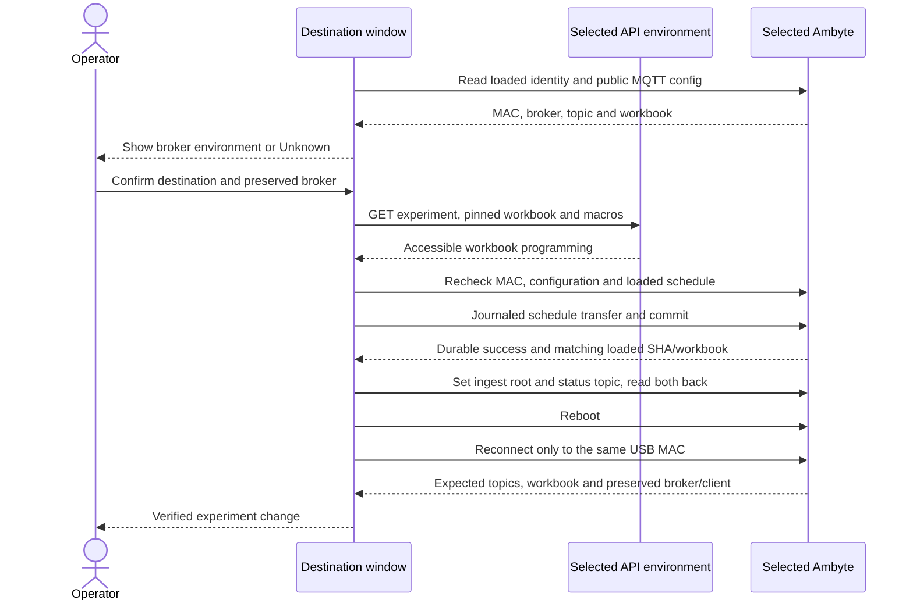
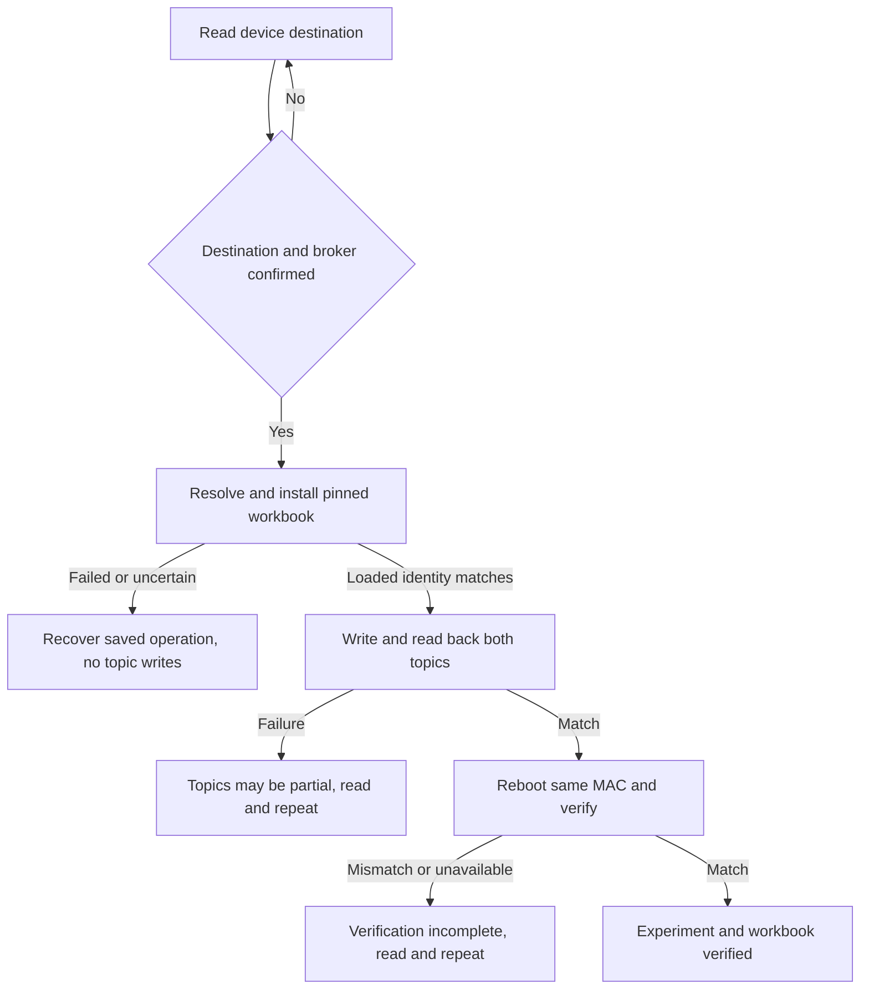
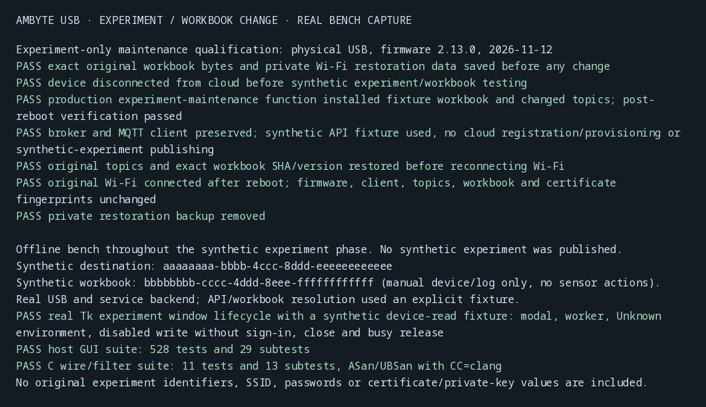

# Change an existing Ambyte's experiment and workbook

Open **Change experiment / workbook…** from the Device section. The window first
reads the selected USB device's MAC, client identity, compiled firmware, broker,
current experiment and installed workbook. Reading needs no sign-in or release.
It reads public configuration only, never NVS images, certificates or private keys.

To change experiment, sign in and select the destination in the main window,
then click **Change experiment / workbook…** inside the destination window.
The action requires service-capable firmware (v2.9.0+), access to the destination
experiment and its pinned workbook/programming cell. It does not require access
to the device's registry entry, an existing experiment binding, or permission
to issue certificates. It makes no register, onboard, issue or rotate request.
The existing wildcard ingest policy permits the topic change independently of
registry bindings. The platform's bound-device list is therefore not changed
by this local action.

## Which environment and credentials?

The device's stored MQTT broker is its actual target. Selecting dev or prod in
the GUI selects the API account/workbook source and does not change that broker.
The display matches the broker against nonsecret endpoints learned from earlier
explicit onboarding responses. A missing or ambiguous match is **Unknown /
unverified**, never guessed from the selected API environment. A known mismatch
blocks the switch. Unknown requires explicit confirmation showing the broker,
API environment, destination experiment and device MAC side by side.

Certificate presence and validity are not exposed by this firmware's console.
Configuration being present is not proof that a certificate exists or is valid.
**Check cloud status** optionally reads the matching client from the selected
API environment's visible registry, showing its active/revoked and connectivity
status. It does not compare the USB device's certificate and is never a gate:
a registry permission failure does not imply lack of destination-experiment
access. The maintenance flow keeps the broker and credentials; cross-environment
provisioning remains a separate, explicit identity replacement.

## Direct handover

The destination workbook is fetched again using the device's running firmware
version, then stamped through the existing workbook compiler. This avoids
installing a cached workbook compiled for another release. Its journaled service
transfer and loaded SHA/workbook verification finish before topic writes.

Only the experiment UUID segment of the raw seven-segment ingest root changes.
Sensor type, version and sensor ID, including a literal `{MAC}`, are preserved.
The status topic is explicitly set to `<new-root>/status`; the command topic,
client ID, broker and name stay unchanged. The switch does not write timezone;
any device-managed drift is reported separately. The old `a3b865d1` migration
destination is refused because released firmware rewrites its status topic.
Unsupported topic shapes and lines exceeding the USB console buffer fail before
any maintenance write.

**Queued and transitional records follow the topic and workbook current when
published.** This switch neither drains nor discards the backlog and can run
offline after resolving the workbook. The device may briefly run the newly
installed workbook against the old topic until the reboot applies the topics.
No record deletion, cursor movement or delivery override is added.

## Failures and recovery

The serial-action gate remains held while the window is open. Writes compare
the preview's identity and config on the same descriptor. Startup is allowed to
finish before comparing the loaded schedule. The MAC-keyed journal lease spans
the change: a different incomplete operation must be resolved first; a matching
workbook transfer can resume through the existing service client. The action
never rotates certificates as recovery.

A failed or uncertain workbook install performs no topic write. After the
workbook succeeds, a cfg failure truthfully reports that topics may be partial:
either setter might have persisted before the failure. Read the destination and
explicitly repeat the action. Topic construction is idempotent, including when
the ingest root already contains the new experiment. After reboot, enumerate
ports without opening unrelated devices and open only the matching USB serial.
Transient disappearance/boot errors retry within the reconnect deadline. Drivers
that omit the serial require an operator refresh rather than a fleet scan.

The final check requires unchanged MAC, client identity, firmware, broker,
command topic and device name, the expected ingest/status topics, and
an INSTALLED schedule with the exact target SHA and workbook version.

## Qualification

Host tests exercise real console bytes and the service client for the direct
switch, raw topic preservation, environment consent/mismatch, destination 403,
board swaps, compile rejection, partial cfg writes and rerun, startup settling,
wrong loaded workbook, transient re-enumeration and avoiding unrelated devices.
GUI tests cover read-only use without sign-in, confirmation, worker boundaries,
partial-result reporting and unverified credential labels.

Physical qualification on Ambyte `28:37:2F:FF:E7:04`, firmware 2.13.0,
passed using the production maintenance backend and an explicit synthetic API /
workbook fixture. The device was kept offline throughout the synthetic
experiment phase. The fixture workbook had only a manually dispatched log job,
with no sensor actions. The change installed that workbook, changed both topics,
rebooted and passed the production post-reboot checks while preserving broker
and client identity. No synthetic experiment was published to the cloud.

Before reconnecting Wi-Fi, the original topics and exact cached workbook bytes
(SHA `943c294243a0254b364172dd3252069e350cbc54428fed88fb84f65c642ea2b7`)
were restored and verified. The original Wi-Fi then connected after reboot, and
firmware, client, topics, workbook and certificate fingerprints matched the
baseline. Private restoration backups were removed. This proves the USB path
on that image; it does not claim end-to-end ingestion into a live destination.

A real Tk lifecycle check with a synthetic device-read fixture verified modal
construction, worker completion, the Unknown environment label, disabled writes
without sign-in, grab release and busy release. The complete host GUI suite
passes **528 tests and 29 subtests**; the production C wire/filter suite passes
**11 tests and 13 subtests** under ASan/UBSan with `CC=clang`.

[Redacted qualification transcript](images/usb-experiment-maintenance/qualification.txt).

## Automatic checks on maintenance reads

The destination window also performs the [automatic workbook and deployment
checks](usb-maintenance-sync.md) on read. It uses the device's current experiment,
regardless of the destination selected in the main window. The direct Change
experiment action still installs and verifies its selected workbook before topic
writes; afterward the deployment timezone check can ask for a separate correction.
The workbook/timezone results are shown independently of the experiment result.

Device-managed timezone drift after experiment switching is graded through the
same function as firmware maintenance: an explained location-derived change is
informational; an unexplained configured/manual change has a visible needs-attention
warning with both values. It cannot silently disappear from the primary result.
