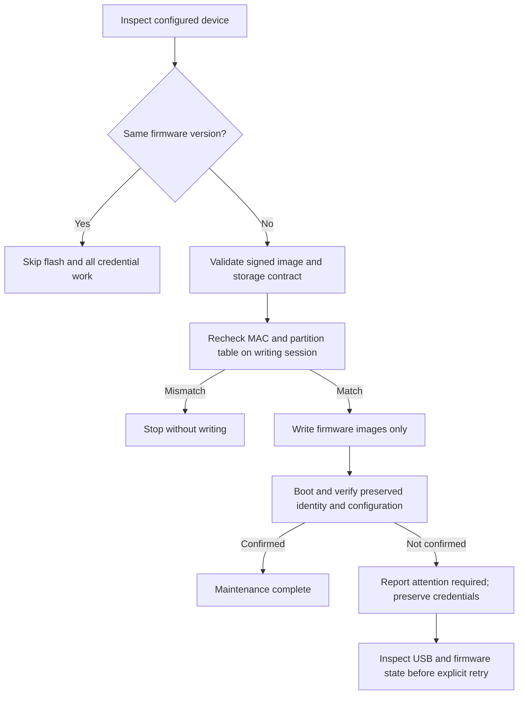

# Identity-preserving USB firmware updates

**Update firmware (keep settings)** is the GUI's primary existing-device action.
It requires a serial port and a downloaded firmware release, without openJII
sign-in, device registry visibility, experiment selection or a workbook. It never
calls registration, onboarding, certificate issuance or rotation. The separate
**Initial setup / replace identity…** action retains full provisioning.

## Write boundary and admission

The updater reads versioned `identity` and nonsecret `cfg get` settings. A
configured board has a broker URI, client ID and topic root, with its expanded
stored client ID matching the effective running identity. This does not prove
certificate presence or validity: firmware exposes neither offline. No private
key is extracted, and no network failure falls back to credential replacement.

Only the release's four firmware images are accepted in the deployed dual-OTA
layout: bootloader `0x0`, partition table `0x8000`, OTA selection `0xf000`, and
application `0x20000`. Image extents, including erase-sector rounding, are bounded
to those regions. NVS `0x9000`, littlefs `0x620000`, coredump and storage are never
included in the write. In particular, littlefs contains both the installed
schedule and the durable service operation store.

```mermaid
sequenceDiagram
    actor Operator
    participant GUI as Firmware maintenance
    participant Console as Selected USB console
    participant ROM as Same-port esptool session
    Operator->>GUI: Update firmware (keep settings)
    GUI->>GUI: Verify image version, signer pin and bounds
    GUI->>Console: Read identity and nonsecret cfg
    alt Version already installed
        GUI-->>Operator: Up to date; no flash
    else Different version
        GUI->>GUI: Refuse downgrade or incompatible storage
        GUI->>Console: Read-only active operation check
        GUI->>ROM: Connect on selected port
        GUI->>ROM: Recheck MAC and read partition table
        alt MAC or table differs
            GUI-->>Operator: Refuse before any write
        else Matches
            GUI->>ROM: Flash release images only
            ROM-->>Console: Reboot into application
            GUI->>Console: Verify MAC, client, version, cfg and schedule
            GUI-->>Operator: Verified maintenance result
        end
    end
```

Release `2.12.0` and later requires a valid RSA-3072 signature and storage
manifest. Signed images must match the reviewed release key pin under
`tools/keys/release_firmware.keyid`, bundled as a constant in the GUI. The embedded
image version must match the selected release. The signature check covers the
application; the firmware bundle is downloaded from the project's release source
using the existing release loader.

Physical flashing bypasses device OTA admission, so the host checks mutual
readability between running and target storage contracts and the target fallback
version. This path accepts only written format 1 on both sides: the durable union
of historic store versions is not exposed over USB, so a future store-changing
release needs a separately qualified path. An older running image with no storage
manifest is treated as format 1. Downgrades are refused.

The partition table is compared byte-for-byte on the very esptool session that
will perform the write, after rechecking the MAC. A changed layout is a refusal,
not permission to overwrite device data. OTA selection is reset by the release;
an old image left in the other slot is not a qualified automatic fallback.

## Verification and recovery

After reboot, the GUI waits for the console and schedule startup, then compares
MAC, effective client identity and all captured nonsecret settings. An installed
schedule must retain its digest and workbook/version metadata and remain loaded.
`NONE`/unavailable schedule evidence is given time to settle; embedded fallback or
a changed installed program is reported as needing attention. Embedded defaults
come from the new firmware and are allowed to change with it.



An interrupted write can leave the board in ROM download mode. Automatic initial
provisioning is never attempted. Recovery of a non-booting board requires a
separate firmware-only recovery procedure; the normal maintenance action requires
running identity-capable firmware. The existing initial-setup recovery controls
write provisioning images and must not be used merely to repair firmware while
preserving identity.

Wi-Fi maintenance is a separate action described in
[USB Wi-Fi settings](usb-wifi-settings.md). This firmware-only action preserves
the experiment topic and does not move queued measurements to another experiment.
Direct experiment/workbook switching is not part of this action.

## Qualification

Host tests: `python -m pytest flash_gui/tests -q`. The firmware maintenance tests
use real signed ESP32-S3 image bytes and the production console parser with
simulated USB, while guarding the actual esptool write boundary for MAC/layout
mismatches. They verify no API dependency, no NVS/filesystem writes, signed-image
refusals, no downgrade, unchanged configuration, and skipping an installed version.

Physical qualification results and redacted terminal captures are recorded under
`docs/images/usb-maintenance-gui/`. Qualification must verify identity and
certificate/key fingerprints before and after updating, reboot persistence,
Wi-Fi operation on both legacy and service firmware, and the post-boot schedule.
