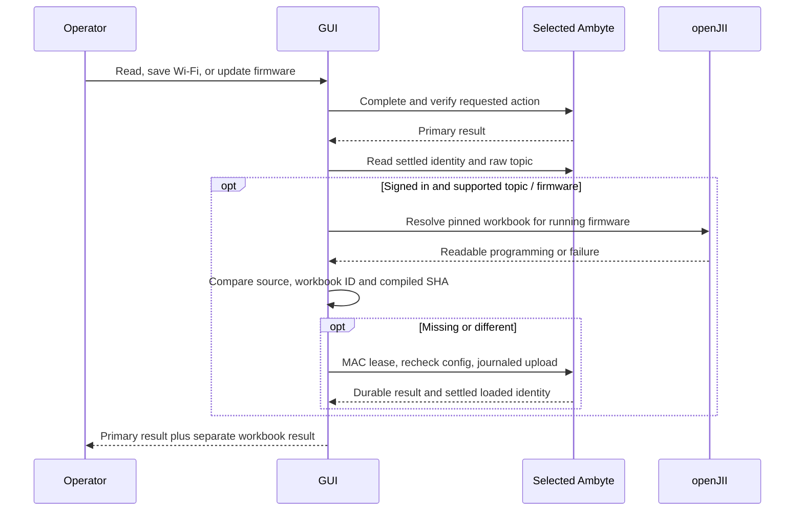
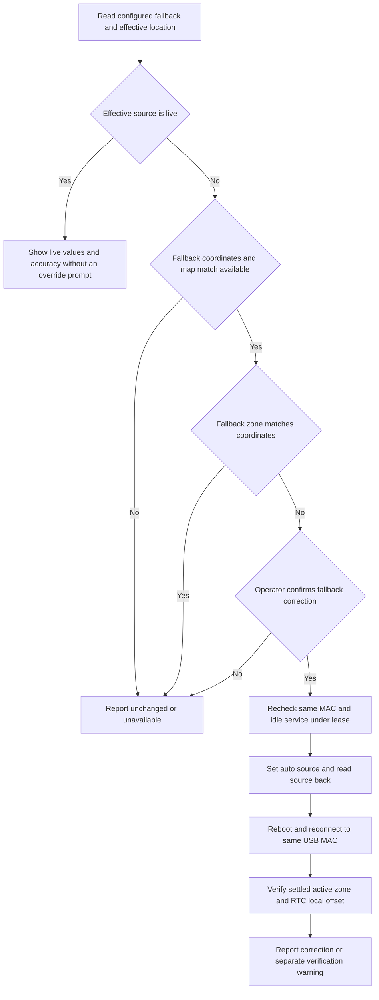

# Automatic workbook and deployment timezone checks

The GUI checks the workbook automatically after a successful **Read device**,
**Save Wi-Fi**, **Test & save**, or verified firmware update. The result has its
own line: `Workbook: up to date`, `Workbook: installed vX`, or
`Workbook: not checked: <reason>`. The Wi-Fi/firmware outcome remains successful
if openJII is unavailable, the operator is signed out, the experiment is not
visible, the workbook cannot compile/install, or firmware lacks journaled push.

The experiment comes exclusively from the raw persistent seven-segment ingest
root (`experiment/data_ingest/v1/<canonical UUID>/<type>/<version>/<id>`).
The main window's experiment selection and registry bindings are irrelevant.
Only destination experiment/workbook read access is used. The workbook is
resolved and compiled for `identity.fw`, then compared with the settled loaded
source, workbook version ID and SHA. Embedded/fallback, missing provenance or
a different SHA causes an install through the existing journaled service path.
Topics, credentials and other configuration are preserved.

A saved unfinished operation is never silently cancelled or archived. Recover
it using **Check saved result** before starting incompatible work. After an
uncertain install, the device may already have changed its workbook; the
primary save result is still true, and a later read rechecks loaded state.

## Configured fallback and effective location/timezone

The inputs are **Fallback location/timezone (used until the Ambyte finds its live
location)**. The GUI writes defaults for offline operation, while the Ambyte
manages its effective location/timezone. The laptop zone is display-only.

The additive identity contract distinguishes them:

- `location.configured` is the persisted fallback tuple `{set, lat, lon}`.
- `location` reports the effective tuple, `source` (`live`, `configured`, `none`)
  and `accuracy_m`; the nested `live` estimate also carries `age_s`.
- `timezone` reports configured/active/resolved zones, the control source
  (`auto`, `manual`, `provisioned`, `unknown`) and the active UTC offset.

The maintenance result displays effective values, source and accuracy separately
from the configured fallback. Older firmware reports effective location
unavailable. Malformed optional metadata is also unavailable, while stable MAC,
firmware and workbook discovery remain usable. Runtime `sync loc` fallback values
are never substituted for a persisted location. An arriving online estimate or
its changing age cannot block workbook or experiment maintenance.

When effective location source is `live`, the values are informational and no
mismatch prompt appears. Otherwise the offline `tz_geo.zone_for` resolver compares
the **configured fallback** coordinates with the stored fallback zone. Missing
coordinates, `(0,0)` and no map match never cause a write. A mismatch asks once.
No leaves the fallback/source untouched. Yes on auto-capable firmware uses
`cfg set timezone auto`, reads back `timezone_source`, reboots and reconnects only
to the same USB MAC, then verifies the settled identity and public RTC local
offset. Legacy persisted-location discovery without auto uses an explicitly
confirmed zone and readback before the same reboot check. Firmware with no
persisted-location discovery cannot take this path.

The firmware is the authority on geographic resolution. A different newly active
zone is reported alongside the GUI prediction without retrying or writing a
second explicit zone. A later internally consistent auto zone reports a map
warning instead of asking to override it. The map is an estimate, with roughly
5 km uncertainty near zone boundaries. No host tzdata or online lookup is needed
for the GUI comparison; the live estimate, when available, belongs to the device.

No location/timezone state can fail the primary maintenance action. After a
verified firmware update, any stored timezone drift is reported separately.
Explained device-managed changes show `Timezone updated by the Ambyte: <old> →
<new>` with source and accuracy. Missing/inconsistent source evidence or a change
under configured/manual control shows a visible `Timezone needs attention`
warning with both values. All other configuration, MAC/client and workbook
verification requirements remain in force.

## Initial setup

Initial setup accepts fallback latitude/longitude and an IANA fallback zone.
Leave the zone blank to resolve known fallback coordinates automatically, or
enter an explicit fallback default. Without coordinates or a map match a choice
is required. Both coordinates and the chosen zone travel through the existing
provisioning plan. The GUI writes no `tz_source` pin: explicit defaults remain
eligible for replacement when the Ambyte finds a better location. The remote
manual-pin escape hatch is separate from these setup inputs.

## Qualification

The full GUI suite currently passes 607 tests and 29 subtests. Tests use real
console parsing and the shared service client, covering missing/outdated/current
workbooks, permissions and cloud errors, saved operations, optional-check failure
isolation, timezone confirmation/no-op/unavailable paths, dataset disagreement,
source/readback/runtime verification, live metadata failure isolation and initial setup fallback defaults.
The repository suite with `CC=clang uv run --locked --group test pytest -q`
passed 786 tests and 1276 subtests (4 skips, 2 expected failures). The default
`cc` lacks its ASan/UBSan libraries on this host, so the full run uses clang.

On the shared DEV bench with firmware 2.16.0, the actual DEV pinned workbook
compiled to the exact pre-existing SHA and workbook ID. The production maintenance
path reported `Workbook: up to date` and correctly reported that the old image
lacked persisted-location discovery. Public configuration and the loaded workbook
were unchanged; no device writes were performed, so no restoration was needed.

[Redacted capture](images/usb-maintenance-sync/read-2.16.txt).
Changed-workbook install, timezone yes/no and firmware-auto correction hardware
qualification await the PR3 image and coordinated bench access. Existing manual
experiment-change qualification is recorded in
[USB experiment maintenance](usb-experiment-maintenance.md).
