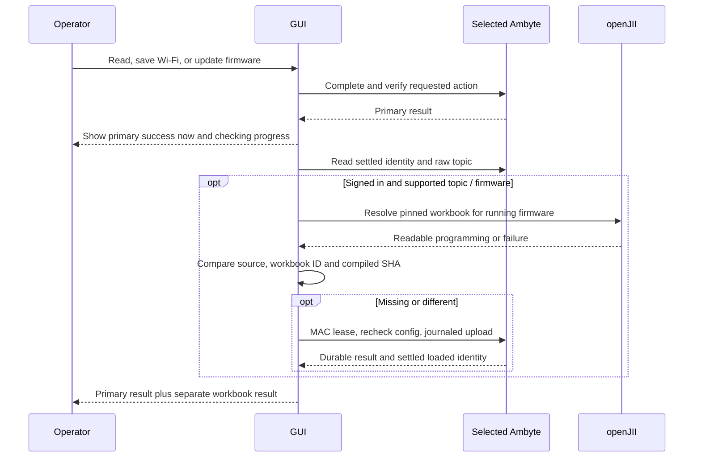
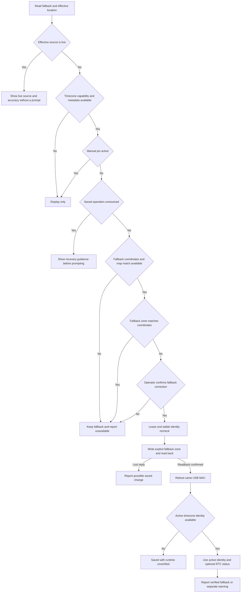
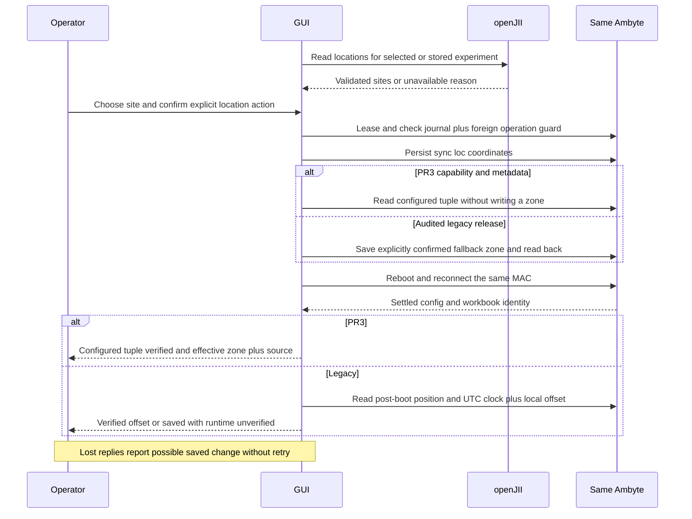
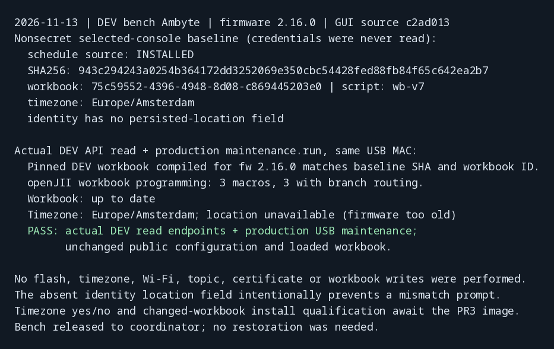
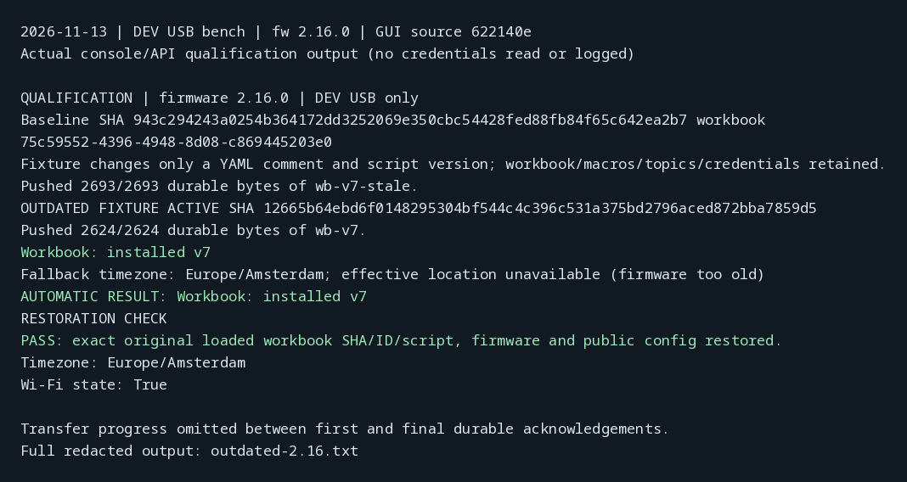
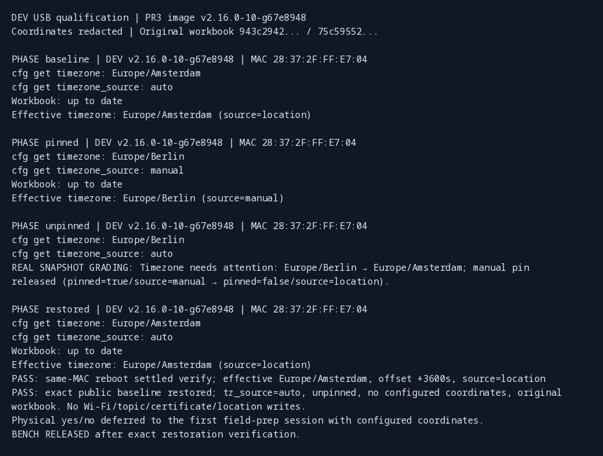
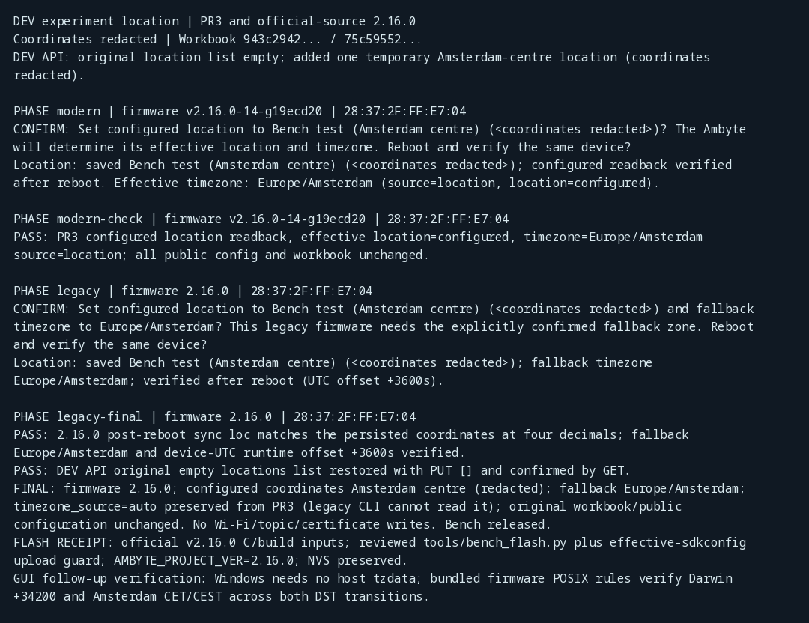

# Automatic workbook and deployment timezone checks

The GUI publishes the primary result first, then checks the workbook after a successful **Read device**,
**Save Wi-Fi**, **Test & save**, or verified firmware update. The extra phase says **Checking workbook… keep USB connected**, and its result
has its own line: `Workbook: up to date`, `Workbook: installed vX`, or
`Workbook: not checked: <reason>`. The Wi-Fi/firmware outcome remains successful
if openJII is unavailable, the operator is signed out, the experiment is not
visible, the workbook cannot compile/install, or firmware lacks journaled push.

The experiment comes exclusively from the raw persistent seven-segment ingest
root (`experiment/data_ingest/v1/<canonical UUID>/<type>/<version>/<id>`).
The main window's experiment selection and registry bindings are irrelevant.
Only destination experiment/workbook read access is used. The workbook is
resolved and compiled for `identity.fw`, then compared with the settled loaded
source, workbook version ID and SHA. Embedded/fallback, missing provenance or
a different SHA causes an install through the existing journaled service path.
Topics, credentials and other configuration are preserved.

A saved unfinished operation is never silently cancelled or archived. Recover
it using **Check saved result** before starting incompatible work. After an
uncertain install, the device may already have changed its workbook; the
primary save result is still true, and a later read rechecks loaded state.

## Configured fallback and effective location/timezone

The inputs are **Fallback location/timezone (used until the Ambyte finds its live
location)**. The GUI writes defaults for offline operation, while the Ambyte
manages its effective location/timezone. The laptop zone is display-only.

The additive identity contract distinguishes them:

- `location.configured` is the persisted fallback tuple `{set, lat, lon}`.
- `location` reports the effective tuple, `source` (`live`, `configured`, `none`)
  and `accuracy_m`; the nested `live` estimate also carries `age_s`.
- `timezone` reports configured/active/resolved zones, the active-zone source
  (`manual`, `location`, `configured`, `none`), a pin flag and the active UTC offset.

The result displays effective values, source and accuracy separately from the
configured fallback, including the firmware's `configured_stale` flag and opaque
live-estimate status. `timezone.source` in the frozen contract is `manual`,
`location`, `configured` or `none`; `pinned` is a separate boolean. Location source
is independently `live`, `configured` or `none`. Samples from production
`cli_identity.c` in PR3's host harness are checked into the GUI test fixtures.
Physical PR3 capture alignment is still pending.

All maintenance timezone prompts and writes require **`timezone.auto`** in
`identity.capabilities` and valid PR3 metadata. Without it the GUI is display-only,
so this GUI can ship before that firmware. A unit with a manual pin is also
display-only; a fallback correction never unpins it. Pending journal work is
reported before any prompt. Firmware too old to report identity gets a terminal
unavailable label rather than a read-again loop. Malformed optional metadata is
unavailable while MAC, firmware and workbook discovery remain usable.

When effective location source is `live`, the GUI shows it without an override
prompt. Otherwise it compares configured fallback coordinates with the stored
fallback zone using the offline resolver. No coordinates, `(0,0)` or no map match
cause no write. Each eligible mismatch may prompt when that maintenance check
runs; declining does not pin or suppress future checks. No preserves the fallback.
Yes sends **`cfg set timezone <coordinate-resolved zone>`**, reads back the fallback,
reboots and reconnects only to the same USB MAC. The setter preserves pin/source
state. The `auto` setter is never used here: in PR3 it only releases a pin and
leaves the fallback unchanged.

Verification compares the configured fallback, stable identity/workbook/settings
and configured coordinates. Volatile effective position/age/source are excluded
from stable write guards; arriving live state does not invalidate a successful
primary action. Active zone/offset comes from the post-boot identity, with an
optional cross-check against STATUS when the RTC local line exists. A missing
line does not fail verification. If active identity disappears after a saved
write, the result is **saved, runtime unverified**, never inferred from an offset
alone. A setter with a lost reply is a **possible saved change** from the moment
transmission starts. No automatic retry or alternate setter is attempted.

Firmware owns geographic resolution. A different configured-source active zone
is reported alongside the GUI prediction without retrying. A live-source active
zone is informational. The map has roughly 5 km uncertainty near zone boundaries.
No host tzdata or online GUI geolocation is needed. Initial setup shows both the
coordinate-resolved fallback and the explicitly entered fallback, and catches an
unavailable/corrupt resolver so the operator can select a fallback explicitly.
The packaged smoke check verifies the bundled Uluru resolver/data result.

No location/timezone state can fail the primary maintenance action. Grading after
firmware updates and experiment switches compares the **effective** zone: the
pre-action `identity.timezone.active` (or stored fallback on older images) against
the post-action active zone. Location-derived changes show `Timezone updated by
the Ambyte: <old> → <new>` with source and accuracy, even when the fallback remains
unchanged, as PR3 intends. A mutation of the stored fallback itself always shows
`Timezone needs attention`, as does an unexplained effective change or a released
manual pin, even if the effective zone stays the same. A released-pin warning
shows both pin/source states. The grade
is displayed in the primary and final result, retained across optional checks,
and logged. All other configuration, MAC/client and workbook checks remain strict.

When the device already uses the coordinate-resolved active zone, the fallback
prompt explains that saving the offline default does not change the active zone
now. It still confirms the persistent fallback and reboot verification separately.

## Initial setup

Initial setup accepts fallback latitude/longitude and an IANA fallback zone.
Leave the zone blank to resolve known fallback coordinates automatically, or
enter an explicit fallback default. Without coordinates or a map match a choice
is required. Both coordinates and the chosen zone travel through the existing
provisioning plan. The GUI writes no `tz_source` pin: explicit defaults remain
eligible for replacement when the Ambyte finds a better location. The remote
manual-pin escape hatch is separate from these setup inputs.

## Experiment locations

The signed-in account can read `GET /api/v1/experiments/{id}/locations` with
experiment read access. The GUI rejects invalid lists, non-finite or out-of-range
coordinates, booleans and the `(0,0)` unset marker. No registry or certificate
permission is involved.

Initial setup offers **Use experiment location** beside the editable fallback
fields. One site is preselected and fills only empty coordinate fields; several sites require
an explicit dropdown selection. Selecting a site resolves its fallback zone when no explicit zone is entered.
Operator-typed coordinates/zone are preserved, including late single-site API replies. Changing experiments clears
an unchanged automatic prefill; manually edited coordinates remain explicit.
Stale API replies cannot populate a different experiment or account.

The destination dialog offers **Also set this device's location to <name>**.
With PR3 persisted metadata it defaults on when the configured site is absent or
in another country, and off in the same country. Country comparison uses the
shared IANA zone-country table, not the laptop or API display labels. Multiple
sites need a selection first. On legacy firmware it defaults off with
`Configured location unavailable on this firmware; choose explicitly`.
The experiment change publishes its verified primary result first, then writes
the chosen location as a separate phase/result. A location failure never erases
the successful experiment change.

**Set location from experiment** uses the connected device's **current** raw
ingest topic, independently of the selected destination. It is disabled with a
reason when signed out, the topic is unrecognized, the experiment is unreadable
or has no locations. Merely reading locations never writes a device.

### Persisted console paths and verification

| Firmware | Persistence path | Verification |
| --- | --- | --- |
| 2.9.0, 2.14.0, 2.16.0 | `sync loc <lat> <lon>` calls `device_config_set_location`, which atomically writes `device_cfg/site_state` | Explicitly confirm the resolved fallback zone, write/read `cfg set timezone`, reboot the same MAC, then compare post-boot `sync loc` within its four-decimal precision |
| PR3 with `timezone.auto` and valid identity | The same persisted `sync loc` path plus the firmware location/timezone worker | Read `identity.location.configured` before and after reboot, preserve the fallback zone, show effective zone/source from the device |
| Other legacy/custom images | Not admitted without a source audit | Refuse with update/MQTT `set_location` guidance |

Source audit: each named legacy tag's `components/CLI/CLI.c:cli_cmd_sync` calls
the persistent setter before its runtime position update. `components/device_config`
encodes `site_state`, and `components/sched_runner/sched_runner.c:apply_location_from_config`
loads it before the schedule runs after reboot. A pre-write `sync loc` read is
never evidence that a deployment site exists; it can be the compiled default.

The legacy timezone exception is restricted to this explicit location action,
with a confirmation naming the target IANA zone. It does not weaken automatic
maintenance's `timezone.auto` write gate. Verification reads the device's UTC
clock with `rtc`, computes the expected offset using the bundled firmware POSIX rule and compares
it to RTC local STATUS. Windows needs no host tzdata. The generated Python rules
match all 598 firmware entries; all 94 distinct rules passed 1128 monthly libc
reference probes. Darwin and Amsterdam DST boundary regressions run with
`zoneinfo.ZoneInfo` unavailable. Missing clock/rule/status or a wrong offset reports
`saved, runtime unverified`, never a verified zone. PR3 writes no zone itself;
the device remains authoritative. A changed configured location can release a
manual pin, which the confirmation states explicitly.

Each action holds the same MAC lease, refuses unresolved journal/foreign device
operations and rechecks stable identity/site configuration after service exit.
Every write is possibly saved from transmission onward. Lost replies or failed
readback report uncertainty with no automatic retry. No topics, certificates,
Wi-Fi, raw NVS image or runtime-only offset argument are written. Coordinates
appear only in operator-facing choices/results; diagnostic logs and public
captures redact them. Fixtures use synthetic sites.

## Qualification

The full GUI suite currently passes 709 tests and 29 subtests. Tests use real
console parsing and the shared service client, covering missing/outdated/current
workbooks, permissions and cloud errors, saved operations, optional-check failure
isolation, timezone confirmation/no-op/unavailable paths, dataset disagreement,
source/readback/runtime verification, live metadata failure isolation and initial setup fallback defaults.
The repository suite with `CC=clang uv run --locked --group test pytest -q`
passed 787 tests and 1286 subtests (3 skips, 2 expected failures). The default
`cc` lacks its ASan/UBSan libraries on this host, so the full run uses clang.

On the shared DEV bench with firmware 2.16.0, the actual DEV pinned workbook
compiled to the exact pre-existing SHA and workbook ID. The production maintenance
path reported `Workbook: up to date` and correctly reported that the old image
lacked persisted-location discovery. Public configuration and the loaded workbook
were unchanged; no device writes were performed, so no restoration was needed.

[Redacted capture](images/usb-maintenance-sync/read-2.16.txt).
The outdated-to-installed path also passed on the same 2.16.0 DEV board. A
fixture added only a trailing YAML comment and a temporary script version to the
original workbook, preserving its jobs/macros and workbook ID. The stale digest
`12665b64…` was confirmed active before the production automatic check fetched
the actual DEV pinned workbook and reported `Workbook: installed v7`. A final
settled snapshot proved exact restoration of original SHA `943c2942…`, workbook
ID `75c59552…`, script `wb-v7`, firmware `2.16.0` and all public configuration.
Timezone stayed Europe/Amsterdam and Wi-Fi was connected. No topic, Wi-Fi,
timezone or certificate write was performed, and the original-byte backup was
deleted after restoration proof. The bench was released.

[Full redacted transfer output](images/usb-maintenance-sync/outdated-2.16.txt).

A real Tk desktop lifecycle run with synthetic device reads exercised the main
frame, Wi-Fi/destination dialogs, worker completion, fallback/live labels, empty
fallback setup fields, enabled controls, modal/grab cleanup and busy-gate release.
It performed no USB/network actions and closed every created window.

The PR3 image `v2.16.0-10-g67e8948` (PR #100 head `312f55c`) was qualified on
the same DEV board. Production `AmbyteConsole` parsed the real location/timezone
groups without metadata errors, including capability `timezone.auto`, a persisted
live fix, `source=location` timezone and `cfg get timezone_source = auto`. A
redacted physical-live fixture preserves the captured fields with synthetic
coordinates; the configured-coordinate yes/no tests build on that wire shape.

The physical run confirmed that live location suppresses the fallback prompt,
that maintenance leaves an explicit MQTT Europe/Berlin manual pin intact, and
that `set-timezone auto` restores location control while leaving the Berlin
fallback unchanged. The shared firmware/experiment grading helper, given those
real before/after snapshots, reported the released pin as `needs attention` with
both states. No firmware was flashed in this slot; a full USB firmware-update
run was not repeated. Restoring the Amsterdam fallback and rebooting the same
MAC verified active Europe/Amsterdam and offset +3600 seconds. Final public
configuration and original workbook SHA/ID/script matched the baseline,
`tz_source=auto`, unpinned, with no configured coordinates. No coordinate,
Wi-Fi, topic or certificate writes occurred; the bench was released.

Physical yes/no deferred to the first field-prep session with configured
coordinates. The bench has no configured coordinates and live source, so
creating a mismatch would have violated the instruction to leave coordinates
untouched. Real-console fixture tests cover both consent choices and USB write /
read-back / reboot verification. Existing manual experiment-change qualification
is recorded in [USB experiment maintenance](usb-experiment-maintenance.md).

[Redacted PR3 capture](images/usb-maintenance-sync/pr3-physical.txt).

### Experiment-location physical qualification

The DEV experiment began with an empty location list. A temporary Amsterdam-centre
site was added through the API and chosen through the production current-experiment
lookup. On PR3 image `v2.16.0-14-g19ecd20`, the USB action persisted coordinates,
verified the configured tuple after reboot and reported effective location
`configured`, zone Europe/Amsterdam, source `location`; no zone was written.
An independent settled read confirmed the same result. A hub enumeration fault
during an extra read required a cable replug; the same MAC/image was verified
before proceeding.

The official v2.16.0 firmware C/build inputs were then bench-signed/flashed using
the reviewed bench flasher and effective-sdkconfig upload guard, with NVS and
filesystem preserved. The legacy action explicitly confirmed Europe/Amsterdam,
wrote coordinates plus the fallback zone, then verified the same MAC after reboot,
post-boot coordinates within four decimals and the expected UTC offset +3600s.
Independent final reads waited for the settled schedule before checking position.
The original workbook SHA `943c2942…`, ID `75c59552…`, script `wb-v7`, public config
and connected Wi-Fi were retained. The DEV location list was restored with
`PUT []`, and a final GET proved it empty.

The released bench is on **2.16.0**, with Amsterdam-centre configured coordinates
(redacted), fallback Europe/Amsterdam and the original workbook. PR3 had proved
`tz_source=auto`/unpinned; the NVS-safe flash and legacy action never change that
key. Legacy firmware cannot expose it over its CLI. No Wi-Fi, topic or certificate
writes occurred.

[Redacted PR3 and legacy capture](images/usb-maintenance-sync/experiment-location.txt).
