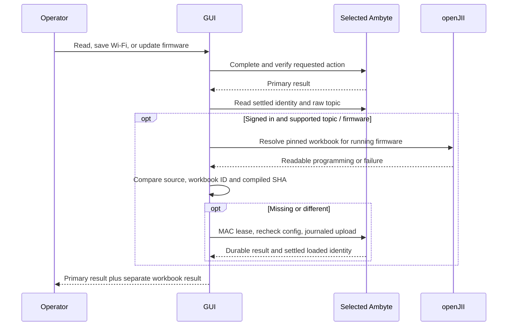
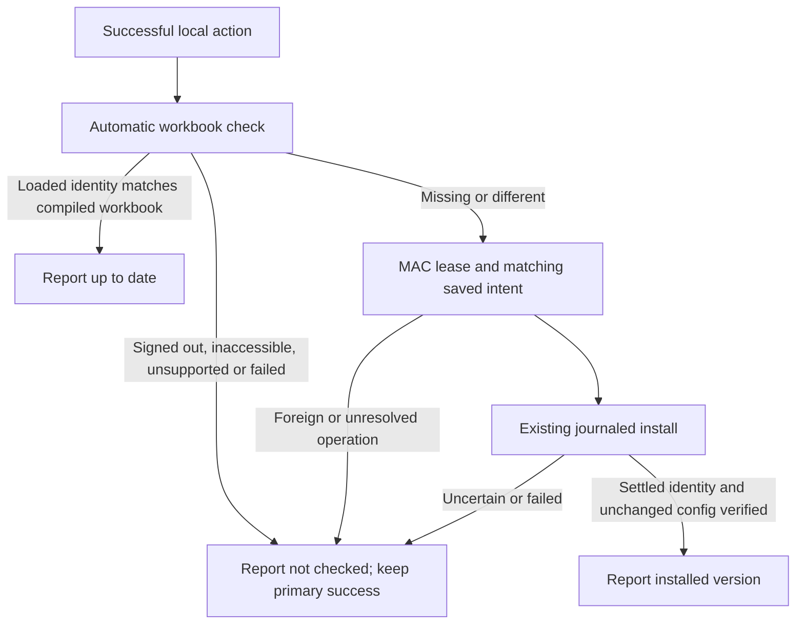

# Automatic workbook and deployment timezone checks

The GUI checks the workbook automatically after a successful **Read device**,
**Save Wi-Fi**, **Test & save**, or verified firmware update. The result has its
own line: `Workbook: up to date`, `Workbook: installed vX`, or
`Workbook: not checked: <reason>`. The Wi-Fi/firmware outcome remains successful
if openJII is unavailable, the operator is signed out, the experiment is not
visible, the workbook cannot compile/install, or firmware lacks journaled push.

The experiment comes exclusively from the raw persistent seven-segment ingest
root (`experiment/data_ingest/v1/<canonical UUID>/<type>/<version>/<id>`).
The main window's experiment selection and registry bindings are irrelevant.
Only destination experiment/workbook read access is used. The workbook is
resolved and compiled for `identity.fw`, then compared with the settled loaded
source, workbook version ID and SHA. Embedded/fallback, missing provenance or
a different SHA causes an install through the existing journaled service path.
Topics, credentials and other configuration are preserved.

A saved unfinished operation is never silently cancelled or archived. Recover
it using **Check saved result** before starting incompatible work. After an
uncertain install, the device may already have changed its workbook; the
primary save result is still true, and a later read rechecks loaded state.

Hardware qualification of this new automatic path is pending coordinated bench
access. Existing experiment-change qualification is documented separately in
[USB experiment maintenance](usb-experiment-maintenance.md).
