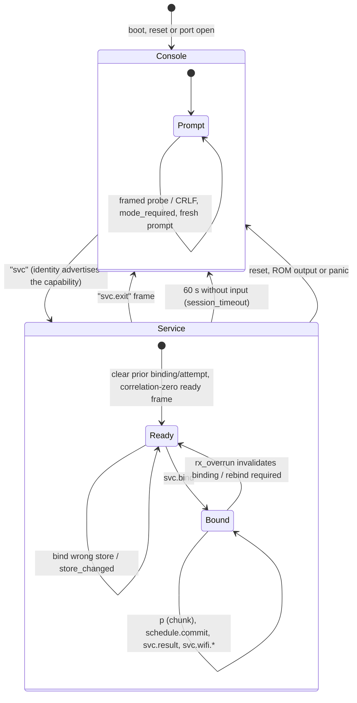
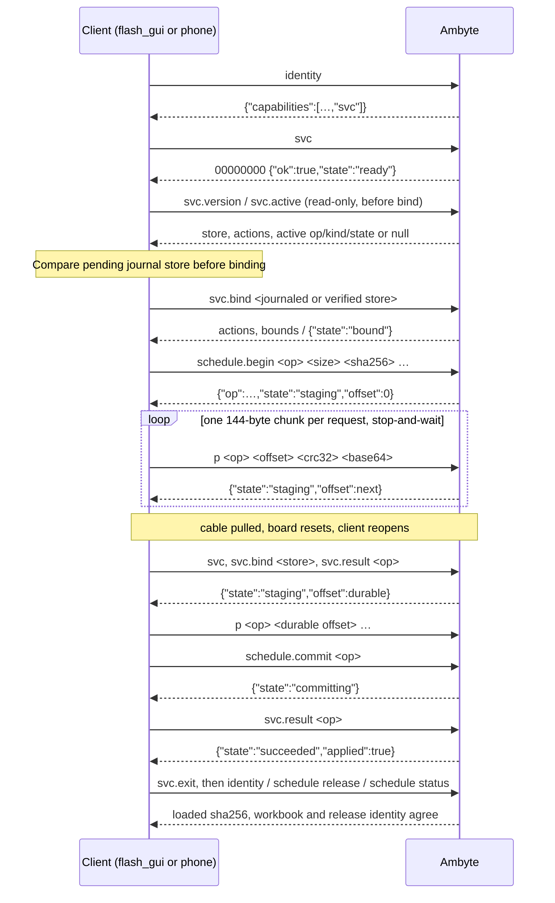
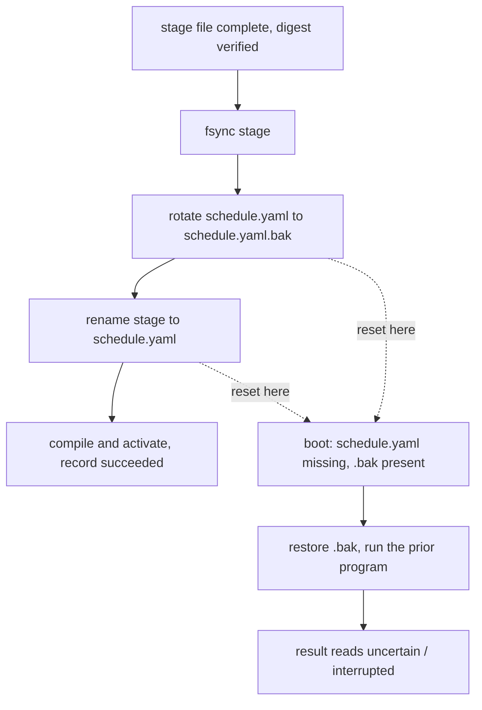
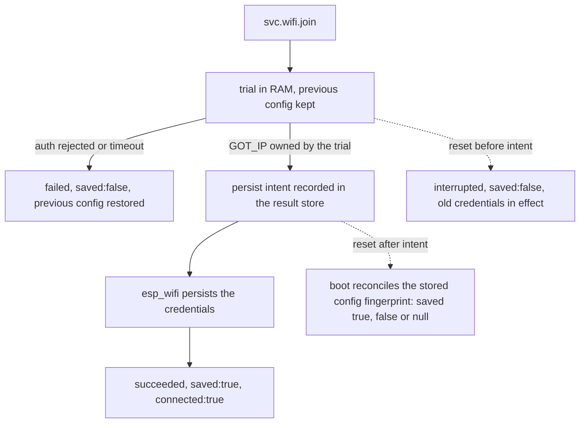
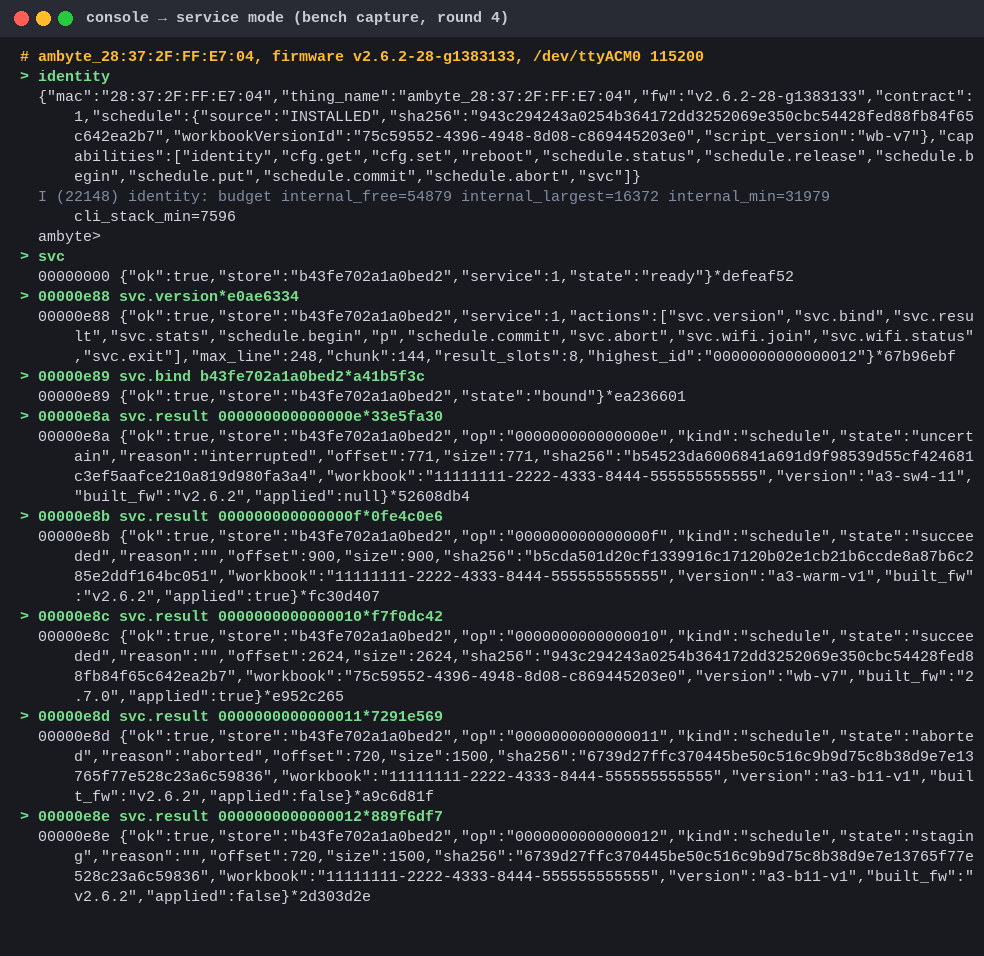
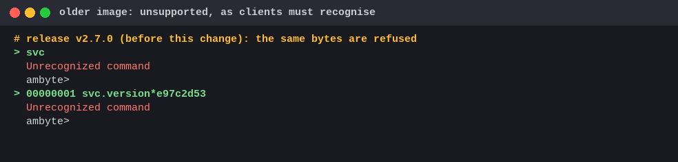
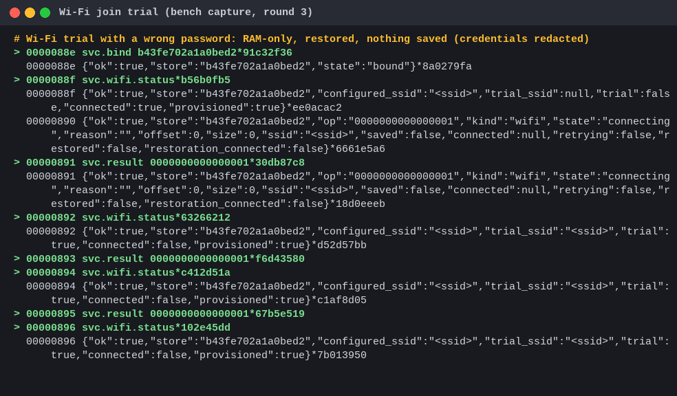
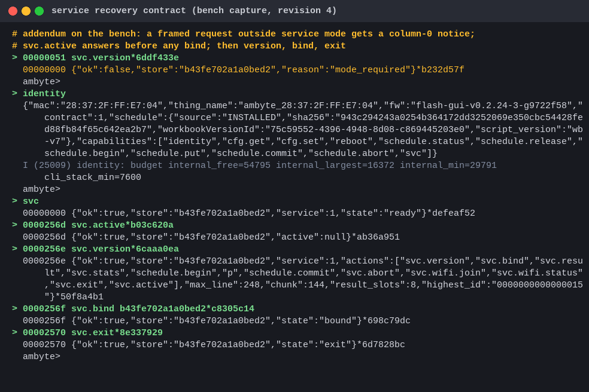

# USB maintenance: console v1 and framed service v1

This is the supported maintenance subset of the physical USB console for an
already provisioned Ambyte. It works without network, SD card or an unlock.
Physical access grants authority to the existing write commands. This document
covers the existing console subset and the explicit framed `svc` mode for
durable schedule transactions and bounded Wi-Fi credential writes. Certificate
provisioning, sensors, firmware transfer, export, receipts and radio authorization
are outside this contract. The console and service each have version `1`;
entering service does not change the plain commands described first.

## Overview

The USB port carries two layers. The plain console is what every image has
had: a prompt, echo and human-readable replies. Service mode is a framed,
machine-only layer that a client enters with `svc` and leaves with `svc.exit`
or by idling for 60 seconds. A reset (which opening the port causes on most
hosts) always lands in the plain console.



A durable operation survives the connection that started it. The sequence
below is the schedule install the GUI and the field app use, including the
reconnect case that the bench reproduced (the cable pull resets the board, so
the client rebinds, reads the result by id and resumes at the durable offset).



Commit swaps the staged program in without a window in which a power loss
loses the previous one. Boot repairs an interrupted swap.



A Wi-Fi join is a trial in RAM first. Credentials are saved only after the
device owns an IP on the new network, and an interrupted trial reports what it
can prove rather than guessing.



Bench captures from the qualification rounds (see `tests/identity_host/bench.yaml`
for the fixture; credentials are redacted):









## Connect and find a response

Use USB-Serial/JTAG at 115200 baud. Deassert DTR and RTS **before opening** the
port, as the existing Python client does. **Opening may still reset the gateway**
on the host/driver in use, even with both lines deasserted. Always wait for the
REPL after every open before sending discovery or another command. A command
sent during boot can be lost; silence before a prompt is not an unsupported
firmware response. The existing Python client opens the port as follows:

```python
import serial

ser = serial.Serial()
ser.port = "/dev/ttyACM0"
ser.baudrate = 115200
ser.timeout = 0.2
ser.dtr = False
ser.rts = False
ser.open()
```

After an open/reset, the console can take 20–35 seconds to appear. Wait until
the `ambyte> ` prompt is observed; keep the same port open through discovery
and later operations, since reopening may reset it again. The console retains
command echo and diagnostic output. Send each command as an
ASCII line terminated by LF. The parser allows 512 bytes, but the USB driver's
RX buffer is only 256 bytes. Keep a complete request **at most 224 ASCII bytes,
including its newline**, counting the command, spaces, quotes and values.
Longer values may fit their configuration buffer but cannot safely be pasted
through this transport. Use quoted arguments for spaces; escaped quotes and
backslashes count toward the wire limit.

For discovery, split received bytes into physical LF-terminated lines, remove
**all** trailing CR/LF bytes (for example `line.rstrip(b"\r\n")`, not just one CR),
and select the first line that parses as one JSON object
whose `contract` is an integer (a JSON boolean does not qualify). The line must
start with `{` at column 0 and have no bytes after its closing `}`. Check the
version and required fields/types before using the result. Ignore blank lines,
prompts, echoes and unrelated logs. Do not strip a prompt/log prefix to make a
damaged line appear valid. The handler emits a leading line break to separate
an unfinished prompt or log tail, then locks stdout through its whole JSON
record and flush.

Normal ESP-IDF v1 logs pass through the sd_logger console tee to the original
`vprintf` on the same newlib stdout FILE, so the stdout lock prevents those logs
from splitting the response. ROM output (`esp_rom_printf`), early/DRAM logs,
panic output and libraries that print through ROM bypass this lock. Discard
any line that does not parse, and treat a reset or incomplete response as an
unconfirmed read. This plain-command subset has no correlated requests or
durable result lookup; the framed service below supplies those separately.

An older image receiving `identity` answers:

```text
Unrecognized command
```

Treat that as unsupported firmware. An unknown command on the new image keeps
the same error. A recognized handler returning 1 is followed by the existing
ESP-IDF diagnostic:

```text
Command returned non-zero error code: 0x1 (ERROR)
```

The blocks below omit prompt/echo/log lines and show response text. Accept LF,
CRLF and CR-CR-LF line endings. On the current USB build, `identity` and many
legacy handlers end their text with `\r\n`, and the VFS converts that LF to
CRLF again: the JSON response therefore ends with **`}\r\r\n`**. IDF diagnostics
that write just LF become CRLF. Strip the whole trailing CR/LF sequence before
checking a line, while still rejecting any other bytes after the closing `}`.
Angle-bracketed values are placeholders for the particular request/device,
rather than literal response bytes.

## Discover the running identity

Request:

```text
identity
```

Illustrative response, on one physical line:

```json
{"mac":"02:00:00:00:00:01","thing_name":"ambyte_02:00:00:00:00:01","fw":"2.6.0-a3","contract":1,"schedule":{"source":"NONE","sha256":null,"workbookVersionId":null,"script_version":null},"capabilities":["identity","cfg.get","cfg.set","reboot","schedule.status","schedule.release","schedule.begin","schedule.put","schedule.commit","schedule.abort","svc"]}
```

| Field | Meaning |
| --- | --- |
| `mac` | Wi-Fi station hardware MAC, uppercase and colon separated; null if unavailable. Independent of configured measurement device id. |
| `thing_name` | Effective MQTT client id resolved at boot, preserving case, after NVS/Kconfig fallback and `{MAC}` expansion. No cloud lookup. A cfg write cannot change this value until reboot. Null if unavailable. |
| `fw` | `esp_app_get_description()->version`, the compiled application version. Stored provisioning version strings are not authoritative. Null if unavailable. |
| `contract` | Integer `1`. |
| `schedule.source` | Loaded program's source: `NONE`, `INSTALLED`, `EMBEDDED_DEFAULT`, `EMBEDDED_FALLBACK`, or null while no consistent snapshot is available. |
| `schedule.sha256` | SHA-256 of the exact **loaded** YAML bytes: 64 lowercase hex characters, or null if unavailable. |
| `schedule.workbookVersionId` | Workbook from the loaded program, or null when absent/unavailable. Never an empty string or the human CLI's `-` sentinel. |
| `schedule.script_version` | Release provenance only when the loaded INSTALLED digest equals the installed-file digest and verified persisted release metadata. Null for embedded programs, stale/missing/incomplete metadata or a file being renamed/unavailable. Not the YAML header `version`. |
| `capabilities` | Unique implemented v1 tokens below; ordering has no meaning. |

The snapshot includes source, digest and workbook from one program generation.
A reload spanning the release-metadata read makes all four schedule fields
null. Before any program is loaded, source is `NONE` and the other three
fields are null. A stopped-but-loaded program retains its loaded identity;
discovery alone does not claim jobs are running. A staged or queued upload is
never reported as activated.

Discovery strings must be valid UTF-8. If a stored or injected string contains
any invalid UTF-8 sequence (including a truncated sequence, overlong encoding,
surrogate or value above U+10FFFF), the **entire field is JSON null**. Valid
UTF-8 is preserved exactly, with JSON escaping for quotes, backslashes and
control characters. This also applies to thing name, compiled version, workbook
and release version: discovery never invents a replacement identifier or emits
invalid JSON. A null identity/provenance value cannot count as a match to an
expected identifier. This read does not change the stored bytes.

The existing v1 capability tokens are:

```text
identity cfg.get cfg.set reboot schedule.status schedule.release
schedule.begin schedule.put schedule.commit schedule.abort
```

These tokens identify the existing space-separated commands; `cfg.get` is
invoked as `cfg get`, for example. A3 adds only the additive `svc` token;
its implemented actions are discovered through `svc.version`. A2 has no `svc`
token. A4 adds `sensors` for the cache-only attachment read below. No export,
receipt, firmware-update or radio capabilities are advertised. `identity unexpected` produces
`Usage: identity` and the existing nonzero diagnostic, with no identity object.

After each response has been flushed and its stdout lock released, one normal
`identity` INFO log reports `budget internal_free=<bytes>
internal_largest=<bytes> internal_min=<bytes> cli_stack_min=<bytes>` on one
log line. These are internal heap free/largest, heap since-boot low-water, and
console stack high-water margin in ESP-IDF byte units. They are diagnostics
outside the JSON contract.

## Read and set destination configuration

Only the following existing string keys are in this subset. Never put userinfo,
passwords, tokens or other credentials in broker URIs or any other value: cfg
echoes what was stored. No certificate/key/Wi-Fi-password key is part of this
subset. This restriction describes the client contract; the whole historical
physical console is not an access-control boundary.

| Key | Safe effective value length in bytes / behavior |
| --- | --- |
| `mqtt_uri` | 255; broker endpoint only, without authentication information. |
| `mqtt_client_id` | 63; becomes effective thing name after boot expansion. |
| `mqtt_topic_root` | 255. |
| `command_topic`, `status_topic` | 287 each; practical USB request limit is smaller. When absent, boot derives them from the topic root. |
| `device_id`, `device_name` | 63 each; payload identity/name, distinct from hardware MAC and thing name. |
| `protocol_id` | 31. |
| `device_version`, `device_firmware` | 15 each; provisioning metadata, never the compiled firmware version. |
| `firmware_version` | Legacy stored string, not an authoritative runtime version. The cfg read buffer permits 319 bytes, but the USB request limit still applies; use short values. |
| `timezone` | 47 after canonicalization; supported IANA zone or existing alias (for example `AMT` → `Europe/Amsterdam`). Invalid zones are rejected. |
| `publish_gzip` | `0/off/false` or `1/on/true`; getter normalizes to `0` or `1`. Existing exception: applies immediately, despite the generic reboot message. |

These are buffer-derived limits for reliable boot readback, **not new firmware
validation**. Most existing setters accept arbitrary NVS strings and do not
enforce the listed limits. Oversized strings can make reads fail, fall back to
compiled defaults or become unavailable. MAC expansion must fit the same
effective buffer; do not rely on truncation. Request size includes syntax,
so a 223-byte value is already too long for most cfg requests.

Read a stored value:

```text
cfg get mqtt_client_id
mqtt_client_id = ambyte_{MAC}
```

That is the raw stored string. It does not perform MAC substitution or show
compiled defaults. On an unset string key, the response template is:

```text
<key> = (unset: ESP_ERR_NVS_NOT_FOUND)
```

Write and read a benign name:

```text
cfg set device_name A2_Bench
cfg set device_name = A2_Bench  (reboot to apply)
cfg get device_name
device_name = A2_Bench
```

Successful cfg writes commit the stored value. Destination values are read
once at boot. Readback before reboot proves storage, not the active MQTT
configuration. `{MAC}` is expanded at boot for `mqtt_client_id`,
`mqtt_topic_root`, `device_id`, `device_name`, `command_topic` and `status_topic`.
`publish_gzip` is the immediate-apply exception; timezone get returns its
canonical form. For `firmware_version`, use `identity.fw` for the compiled
version regardless of what cfg says.

Unknown key:

```text
cfg get no_such_key
cfg: unknown key 'no_such_key'
Command returned non-zero error code: 0x1 (ERROR)
```

Wrong argument counts print `Usage: cfg | cfg get <key> | cfg set <key> <value>`
followed by `Keys:` and the existing table above, then the nonzero diagnostic.
A failed setter prints `cfg set <key> failed: <ESP error name>`, also followed
by that diagnostic. Do not treat an echo or prompt as write success.

## Reboot and verify

```text
reboot
Rebooting...
```

Wait for the console again; if it re-enumerates, reopen with DTR/RTS deasserted.
Read back the key and issue `identity`. For a changed client-id template, verify
that `thing_name` is the intended expanded value and the MAC and compiled
firmware remain the expected values. Save the original stored values before
changing them and restore them after a bench test. Do not use `wifi_reset` or
`wifi_join` to arrange an offline test: obtain disconnection from the configured
AP being off or out of range and confirm `status` reports disconnected and
provisioned. Provisioned credentials must survive.

## Stage a schedule without network or SD

Staging uses internal littlefs, `/littlefs/schedule.yaml.new`. Only one client
and installer may use it at a time. `begin` truncates any existing staged file.
`put` appends, with no offset, idempotence or resumability. If delivery of a put
is uncertain, abort and restart from the exact bytes rather than retry an append.
The total decoded YAML cap is **16,384 bytes**.

Before changing a bench schedule, save the original release tuple and obtain
the exact original YAML bytes (for example from the matching release asset or
stamped experiment source). Their SHA must match the currently loaded INSTALLED
SHA in `schedule status` and installed-file SHA in `schedule release`. Keep its
workbook, script version and built-against firmware. If those restore bytes or
provenance cannot be obtained, stop before uploading. The console has no
download/restore-old-schedule command in this subset.

Compute SHA-256 over the exact bytes to send, including final newline and all
comments/whitespace. Send **144 raw bytes** per base64 chunk (192 characters;
`schedule put ` makes the normal line 206 bytes including LF). No whitespace
inside the base64 token. The final chunk may be shorter.

```text
schedule begin
schedule begin: ready
schedule put <base64-chunk>
schedule put: <cumulative decoded bytes> bytes
schedule validate
schedule.yaml.new: valid
schedule commit <sha256> <id> <script-version> <built-against-fw>
schedule commit queued: id=<id>
```

`schedule validate` is the existing optional compile check before commit. On
failure it prints `schedule.yaml.new: <compile reason>` and the nonzero
diagnostic; the active program is untouched. It has no v1 capability token.

Commit requires 64 hexadecimal SHA digits. Use a fresh whitespace-free id
of at most 63 bytes, and script version / built-against firmware of at most
31 bytes each. The **whole commit line still must fit 224 bytes including LF**;
enforce the individual limits too. These existing bounded buffers truncate
longer metadata, so a client must enforce these limits.
An id is the installer's existing dedupe label; it is not a transaction id.

`queued` means only that a worker accepted the request. The worker stops the
runner, hashes/compiles the staged bytes, preserves the previous file as
`schedule.yaml.bak`, swaps, persists provenance and restarts the runner.
Do not issue another begin/put/abort/install while the queued worker might
still own staging. No operation bound or durable result lookup is promised
by these plain commands; use the framed service below for correlated operations,
bounded admission, resumption and durable results.

Discard staging before a commit is queued:

```text
schedule abort
schedule abort: discarded
```

Abort is idempotent cleanup of staged bytes. It does **not** cancel an already
queued or in-flight install. Active schedule identity stays unchanged.

## Verify activation and recognize failure

After queued acceptance, read all three views:

```text
schedule release
schedule release: sha256=<installed-file-sha> version=<release-version-or-dash> built_against_fw=<fw-or-dash> installed_on_fw=<fw-or-dash> verified=<true-or-false> running=<true-or-false>
schedule status
schedule: RUNNING  source=INSTALLED
  sha256=<loaded-sha>
  id=<schedule-id> version=<header-version> workbook=<workbook-or-dash> name=<name>
identity
```

Status then prints the existing per-job table (including `runs`, failures and
next due times). A stopped runner prints `schedule: stopped  source=<source>`
but can retain its loaded program. Release reports the **installed file's**
digest; status and identity report the **loaded program's** digest. A matching
release file alone or `running=true` alone cannot prove activation.

Activation succeeds only when all of the following agree:

- Runner is running, and loaded source is `INSTALLED`.
- Loaded SHA from identity/status and file SHA from release equal the intended
  exact bytes' SHA.
- Loaded workbook equals the intended workbook (or explicit null if absent).
- Release says `verified=true`; its version and built-against firmware equal
  the intended provenance, and identity's `script_version` equals that version.

`installed_on_fw` is historical: an image change does not invalidate verified
metadata when the persisted SHA still matches the installed file. It records
the compiled firmware that installed that schedule, rather than today's image.
Missing/incomplete/stale metadata prints dashes/`verified=false` in release
and null for identity's script version. Do not infer release version from the
header's schema, header version or workbook.

A timeout, stopped runner, incomplete metadata, queued-only response or
unavailable snapshot is not proven activation. Keep the outcome pending or
unconfirmed until the views agree. Embedded fallback is explicit:
`EMBEDDED_FALLBACK` in identity/status names the embedded program's SHA and
workbook with null script version, and status gives its fallback reason.
`EMBEDDED_DEFAULT` means no installed file. Neither is successful activation
of the requested installed bytes.

Negative staging responses to recognize:

| Request / condition | Existing response text (then nonzero diagnostic for synchronous failures) |
| --- | --- |
| `schedule put !!!` | `schedule put: invalid base64` |
| Put without staging | ``schedule put: no staged file, run `schedule begin` first`` |
| Decoded cap exceeded | `schedule put: refusing to exceed 16384 bytes` |
| `schedule commit bad id version fw` | `schedule commit requires a 64-digit SHA-256` |
| Commit with 64 nonhex characters | `schedule commit SHA-256 must be hexadecimal` |
| Worker cannot queue commit | `schedule commit queue failed: <ESP error name>` |
| Staging cannot be created | `schedule begin: cannot open /littlefs/schedule.yaml.new` |

For a valid-checksum but invalid YAML file, commit can still answer queued.
The worker logs `schedule compile failed: <reason>, schedule.yaml untouched`
and resumes the old program. A mismatched checksum logs
`checksum mismatch, script rejected`. These are asynchronous diagnostics,
not successful commit responses. Recheck loaded SHA/workbook/release; they
must still describe the previous program. Do not abort/reuse staging until
the worker has finished. If fallback occurs, inspect status and do not claim
that the intended bytes activated.

For bench qualification use an explicit test workbook UUID and a fixture that
cannot capture during the test window; confirm its job table still has
`runs=0` before restoration. If it captures anything, record the event ids
because reconnecting to dev MQTT may publish their test provenance. Restore
the original schedule using the saved exact bytes/provenance, then verify its
original SHA, workbook and script version, and restore changed cfg values.
No queue/cursor edits, replay or record deletion are part of this workflow.

## Enter service and validate every physical line

Use the same open USB port and the DTR/RTS rule above. An `identity` capability
`svc` advertises this mode. Enter with the plain command `svc` and no arguments.
Wrong arguments print `Usage: svc` and the existing handler error. On entry,
ordinary echo/prompt/log output ends before this framed ready response:

```json
{"ok":true,"store":"0123456789abcdef","service":1,"state":"ready"}
```

That JSON is the body of correlation-zero frame, not a bare console response.
Its store is the actual device instance, or JSON null if unavailable. From ready
through the exit response, normal USB writes from all tasks are suppressed,
including ESP_LOG, printf/puts, stdout/stderr and direct driver writes. Existing
SD log tee output continues. Dropped USB bytes/calls are counted, with no log
buffer to replay. A reset, ROM output or panic invalidates the session; an
unframed byte is never stripped away to manufacture a valid frame.

Every request and response is exactly:

```text
<8 lowercase hex correlation><space><body>*<8 lowercase hex CRC-32><LF>
```

CRC is IEEE/zlib CRC-32 over the bytes from the first correlation digit through
the last body byte, including the space, excluding `*`, CRC and LF. Requests
are printable ASCII. Responses contain one UTF-8 JSON object. Verify framing
and CRC **before** parsing JSON; reject duplicate keys, wrong field types,
nonfinite JSON values, trailing bytes and correlation mismatch. Never salvage
a response by removing a prompt or log prefix. CRLF is invalid in service.

| Bound | Service v1 value |
| --- | --- |
| Request | 248 bytes total, including LF; 144 raw bytes in a full `p` chunk |
| Response | 1,024 JSON bytes, 1,043 wire bytes including LF |
| Requests outstanding | One; stop-and-wait is required |
| Partial line | 2 seconds from its first byte, then `frame_timeout` and a fresh frame boundary. The first following complete frame is answered. A delayed old suffix must validate as a standalone line or gets a framing error; old prefix bytes never survive. |
| Session idle | 60 seconds without input, then `session_timeout` and REPL exit |
| USB response emission | At most 1 second; a failed write does not undo a stored result |
| Client response wait | 5 seconds; timeout means unknown delivery/outcome |

Nonzero correlation IDs identify exchanges only; they are not durable operation
IDs. Correlation zero is reserved for ready/framing/session notices. A valid
unsupported action returns a correlated `unsupported` error. Invalid/oversized
input drains to LF. The fixed 256-byte RX ring can drop bytes if a client
pipelines: a detected overflow produces `rx_overrun`, invalidates binding and
drains to a quiet boundary. It cannot return a response for each entirely lost
request. Reprobe, rebind and reconcile every unconfirmed operation; no spliced
suffix is executed. Do not increase the ring or infer success from silence.

`svc.exit` returns its correlated exit frame, then restores the ordinary REPL.
Disconnect does not immediately exit mode, and active operations/results remain.
For up to 60 seconds, ordinary flash_gui/fleet console parsers can receive framed
errors and fail to find a prompt. Wait for idle exit or issue a valid framed
exit. The GUI schedule installer recognizes a valid framed notice, performs a
fresh read-only service probe/bind/exit, then resumes typed identity discovery.
Repeated plain nudges count as input and can keep service mode alive.

Outside service, a pre-editor filter shields framed input from echo/history.
It recognizes frames at every input offset, including after Ctrl-C, erased edits,
stray text or incomplete terminal escapes; it does not depend on the editor's
line-start state. At a fresh line the eight-hex/space prefix is reserved. Inside
ordinary input it keeps a bounded suffix (at most 249 bytes), filters complete
CRC frames and credential frames with a damaged CRC, and returns `mode_required`.
Outside-mode notices first emit CRLF, then a complete correlation-zero frame
at column zero. The separator is ordinary-console output, not part of the
CRC frame; established service mode still emits frames only. Ordinary USB
writes are gated during the entire notice so they cannot split its bytes;
the SD tee continues unchanged. The discarded editor line is cancelled,
without history insertion, and the REPL prints its normal prompt again.
The next plain `identity` command or prompt wait works on the same open port.

The private join header through its correlation, operation and SSID tokens is
reserved even inside pasted text: it starts draining before the first password
byte, including if the request is cancelled, malformed or oversized.
This preserves legacy SHA/release arguments and quoted values containing service
names. Partial hex prefixes and potential frames can echo late; withheld bytes
are never released just because input is idle. Bytes that rule out a prefix are
released immediately; a potential complete frame is resolved at its terminator.
All production GUI console templates and terminal escape/probe sequences pass
through byte for byte. fleet_deploy uses MQTT and has no serial console writer.
Older images lack this protection: only a nonsecret version probe may be sent
before fresh mode confirmation.

## Discover, bind and identify a durable operation

All service responses carry boolean `ok` and `store` (16 lowercase hex digits,
or null if unavailable). Errors add only a fixed nonsecret `reason`. Read
`svc.version` before trusting capabilities or sending a write:

```json
{"ok":true,"store":"0123456789abcdef","service":1,"actions":["svc.version","svc.bind","svc.result","svc.stats","schedule.begin","p","schedule.commit","svc.abort","svc.wifi.join","svc.wifi.status","svc.exit","svc.active","svc.sensors","svc.sensors.read"],"max_line":248,"chunk":144,"result_slots":8,"highest_id":"0000000000000000"}
```

`service`, limits and slot count are integers; actions are unique strings.
Production advertises exactly those actions. `svc.bind <store>` must then
confirm `{"ok":true,"store":"…","state":"bound"}` for the discovered store.
Every new connection requires a new probe/bind. A wrong binding clears the old
binding and returns `store_changed`. Version, diagnostics, `svc.active` and exit
are usable without binding; mutations and result lookups require it.

A missing binding returns `not_bound`; a known requested/bound instance
differing from the current store returns `store_changed`. Overflow clears
binding authority while retaining the last attempted instance in session RAM,
so a same-instance recovery needs a rebind, not a new operation. Every session
entry and exit (explicit exit, idle timeout or transport failure) clears both
binding authority and the last attempted instance. A failed bind in an earlier
session cannot make the next session report `store_changed` before its own bind.
Reboot or reformat also loses that RAM: **not_bound never proves the store is unchanged**.
A recovering client compares version.store with its pending journal and binds
with the journaled id. On mismatch it reports an unknown outcome and does not
bind the new instance to replay or resume an old operation. The existing
explicit new-request action after operator state verification may preserve
that old journal and create a distinct intent; automatic recovery may not.

`svc.active` returns exactly `{"ok":true,"store":"…","active":null}` when
no nonterminal operation exists; otherwise `active` has exactly a nonzero
16-hex `op`, `kind` (`schedule` or `wifi`) and its stored `state`. Schedule
states are `staging`/`committing`; Wi-Fi states are `connecting`/`persisting`.
A timed-out, still-owned commit remains `committing`; `timed_out` is omitted
from this summary and available in `svc.result`. After boot reconciliation
makes an operation terminal, active is immediately null. Corrupt stores
return `corrupt_store`, never a false null. Queries count as ordinary input
for the existing60s idle timeout, with no separate keepalive policy.

Do not guess active IDs from `highest_id`. A client that lost its journal can
read active.op, bind, then inspect the full nonsecret descriptor with
`svc.result`. Recovery requires verifying its own bytes/descriptor and an
explicit choice; discovery never automatically adopts, aborts or commits
another client's work. The GUI reports busy with that op id, kind and state.
Older service images without this additive action retain the prior bounded
discovery path; no-svc firmware keeps the legacy console path.

The nonzero store instance is created randomly and persisted when a fresh
service store initializes. A changed instance voids **all earlier IDs and
outcomes**. Existing mount autoformat policy is unchanged: A3 cannot promise
survival across a whole littlefs reformat. A fresh store gets a new instance;
never automatically replay an old request into it.

Choose a durable operation ID strictly greater than `highest_id`, encoded as
16 lowercase hex digits, nonzero, without wrapping. Persist `(gateway MAC,
store, op, immutable descriptor)` on the client before admission. Use stable
hardware MAC rather than the OS port name. Concurrent clients can race: resolve
busy/conflict by readback, without taking over another client's operation.

The same retained ID and identical descriptor returns current state without
executing again. Changed size/digest/release/workbook, action kind or credentials
returns `request_conflict`. The device stores hidden, domain-separated,
length-delimited fingerprints; passwords and fingerprints are not returned.
Missing ID above the watermark is `not_found`; missing ID at/below it is
`expired`. **Expired means outcome unknown, verify device state.** It includes
reservation-crash gaps and IDs never admitted; it proves neither success nor
failure. Expired IDs cannot execute again. At the maximum ID, new admission is
`id_exhausted`; retained results and identical retries remain readable.

One nonterminal operation is admitted across schedule and Wi-Fi. A different
operation gets `busy` before side effects. Results, matching retries and a
permitted abort remain usable while busy. The existing maintenance worker
executes admitted jobs; service adds no task, queue or task-priority change.

## Service actions and result schemas

Sizes/offsets are exactly eight lowercase hex digits; digests are 64 lowercase
hex SHA-256 digits. Release tokens are 1..31 ASCII bytes from
`[A-Za-z0-9_.+-]`. Workbook is a lowercase canonical UUID or `-` for absent.
Base64 is canonical, padded, without whitespace.

| Request body | Admission, effect and response fields after `ok,store` |
| --- | --- |
| `schedule.begin <op> <size> <sha256> <version> <built_fw> <workbook>` | 1..16,384 exact YAML bytes. Persists descriptor/private empty staging before ACK. Reply `op,state,offset`, initially `staging,0`; identical replay returns existing state/offset. Never truncates legacy `.new`. |
| `p <op> <offset> <chunk_crc> <base64>` | 1..144 decoded bytes; separate eight-hex CRC over decoded bytes. Reply `op,state:"staging",offset` only after data fsync and durable offset update. Full request is exactly 248 bytes. |
| `schedule.commit <op>` | Complete prefix required. Persists `committing` before queueing; replies with the full result schema below. Hash, compile and declared/header workbook equality are checked before installation. Both absent is a match. Checks actual loaded source/digest/workbook/running plus verified release version/built_fw after activation. |
| `svc.abort <op>` | Own staging only: durably records `aborted` before private data cleanup. Reply `op,state:"aborted",reason:"aborted"`. Repeated abort reads that record. Cannot cancel admitted commit or another client's work. |
| `svc.active` | Read-only, no binding required. Returns `active:null` or `active:{op,kind,state}` for the durable nonterminal slot. Uses no ID/result slot and changes no stored bytes. |
| `svc.result <op>` | Full nonsecret retained descriptor, state and evidence. Never retries the action. |
| `svc.wifi.join <op> <ssid_base64> <password_base64-or-dash>` | Distinct bounded credential write. Immediate `connecting` result after durable admission; outcome below. SSID 1..31 UTF-8 bytes, no NUL. Password empty (`-`) or 8..63 printable ASCII bytes. No truncation, enterprise credentials or certificate inputs. |
| `svc.wifi.status` | `configured_ssid,trial_ssid,trial,connected,provisioned`; current RAM/connection read, not NVS proof. Original/configured SSID remains separate from the trial SSID (`null` outside trial). A current IP can belong to the trial while `trial:true`. |
| `svc.stats` | Integer `free_heap,largest_block,min_heap,min_free_heap,min_largest_block,samples,cli_stack,worker_stack,runner_stack,dropped_bytes,dropped_calls,logical_bytes,records,log_buffer_bytes,fs_total,fs_used`. Byte units except counts; log buffer is zero. `min_heap` is the since-boot allocator low-water; `min_free_heap` and `min_largest_block` are sampled minima since service initialization. Samples cover parser allocation/free and compile boundaries, schedule validation buffers, operation boundaries and each 250 ms in mode. Runner stack is cached from the runner itself across task generations; zero means no sample yet. `fs_used` is total littlefs allocation, so measure its delta with other filesystem writers quiet; it is not per-directory attribution. Heap/stack diagnostics do not themselves establish a qualified resource floor. |
| `svc.exit` | `state:"exit"`, then prompt restoration. Leaves staging/results intact. |

A schedule result has exactly the base fields below, plus optional boolean
`timed_out` when the commit progress deadline was exceeded:

```json
{"ok":true,"store":"0123456789abcdef","op":"0000000000000001","kind":"schedule","state":"succeeded","reason":"","offset":16384,"size":16384,"sha256":"<exact-byte-sha256>","workbook":null,"version":"a3","built_fw":"test","applied":true}
```

`applied:true` means this operation installed it. Already-active exact tuple
returns `applied:false,reason:"already_active"` without reinstall. Reboot
reconstruction can return `applied:null` when attribution is unprovable.
The descriptor is size, expected SHA, workbook (null if absent), version and
built_fw; a client compares every field before resuming or accepting a result.

A Wi-Fi result replaces the schedule-specific fields with:

```json
{"ok":true,"store":"0123456789abcdef","op":"0000000000000002","kind":"wifi","state":"failed","reason":"wifi_auth_rejected","offset":0,"size":0,"ssid":"<attempted-SSID>","saved":false,"connected":false,"retrying":true,"restored":true,"restoration_connected":true}
```

`saved` and requested-trial `connected` are boolean or null when unprovable.
`retrying,restored,restoration_connected` are booleans. Restoration connectivity
is separate from success of the attempted new credentials. A historical result
does not assert the device is still connected or still runs that program now.

| Existing schedule state | `p` | `schedule.commit` | `svc.abort` |
| --- | --- | --- | --- |
| staging | Validate/write/replay | Require complete bytes, admit commit | Persist aborted |
| committing | commit_started | Read same current result | commit_started |
| succeeded/failed | operation_complete | Read same terminal result | operation_complete |
| aborted | operation_complete | operation_complete | Read same aborted result |

Wrong action kind on a nonterminal Wi-Fi operation is `invalid_sequence`.
Matching terminal commit/result reads never start another worker. Unknown IDs
retain `not_found/expired` semantics rather than masquerading as terminal ones.

## Durable chunk and commit boundaries

At the current durable offset, a valid chunk appends; data is flushed/fsync'd
before the record offset is replaced and before ACK. Earlier complete aligned
chunks compare exact stored bytes/CRC: identical replay returns the **current**
offset without another append. Changed bytes, overlap or non-boundary offsets
are `offset_conflict`; a forward offset is `offset_gap`. A short chunk is allowed
only at the declared end. CRC, length and offset errors leave the prefix intact.

The service store is private `/littlefs/svc/`: a 32-byte `SVCS0001` header with
instance/watermark, 512-byte `SVCR0001` CRC-protected records, `stage.bin`, and
bounded atomic `write.tmp` workspace. It persists no raw pointers or compiler
struct padding. Logical service files are bounded to 32 KiB: one active payload
at most 16 KiB, the last eight terminal results, header and replacement/GC space.
Actual littlefs allocation is larger and is qualified separately. Admission
requires 64 KiB free beyond proposed payload plus 2,048 bytes metadata/workspace.
No capture path, partition, MQTT payload field or new NVS namespace/key is added.

The watermark is committed before admission; a crash in that gap consumes the
ID but executes nothing. Record replacement checks write/flush/fsync/close and
rename. Uncommitted temp data never substitutes for committed evidence. After
reboot, an unacknowledged stage tail is truncated to the recorded offset;
missing/corrupt acknowledged bytes fail closed. A corrupt/unsupported service
store preserves files and refuses new writes, without resetting its watermark.

Eight newer terminal completions expire an older terminal result. There is no
wall-clock TTL. Active staging does not expire on disconnect/reboot; it stays
reserved until explicit abort or commit. A GC/result-write failure does not justify rerunning
an install or credential write: read by ID after recovery. The worker retains
observed nonsecret completion evidence while retrying a failed result write.

Commit and join are asynchronous, so the service loop continues reading while
the maintenance worker runs. Acceptance, a queue ACK or an application log is
not completion. At 120 seconds, a still-owned schedule install remains
**nonterminal committing**, with `timed_out:true,reason:"activation_unverified"`.
Admission stays busy; there is no second worker. A later completion is recorded
once ownership ends. The client may stop polling while keeping its intent.

After reboot, staging resumes. A prior committing schedule is reconciled only
after runner startup: the complete loaded/file/release tuple yields succeeded,
with `applied:null` if attribution is unknown; otherwise
`state:"uncertain",reason:"interrupted"`. The `activation_unverified` reason
continues to identify an unverified live activation or the 120-second progress
deadline, rather than a reboot. It is never
automatically reinstalled. Current success evidence requires the activation
conditions in the plain-console verification section above. Independently read
identity/release after service exit; a fallback or stopped runner cannot pass.

The installer keeps the previous validated program in `schedule.yaml.bak`
before renaming the validated stage to `schedule.yaml`. Each littlefs rename
is atomic, but a reset can fall between the two. Before selecting a boot or
restart program, the runner restores `.bak` if and only if the active path is
missing. A reset during recovery can repeat that single atomic rename. Thus
every reset boundary with an installed prior boots either the prior program
or the complete new program; uncommitted service or legacy staging files are
never promoted by boot recovery. An existing active file always wins over
`.bak`. Recovery does not manufacture provenance: the loaded digest must still
match the persisted release tuple, and an interrupted service result remains
uncertain unless the full activation tuple is proven.

## Wi-Fi trial, persistence and credential handling

The requested station configuration is first held in RAM. The previous config
is snapshotted, driver storage switches to RAM, and the new credentials are
tried under an exclusive service lease. Only GOT_IP owned by this request can
permit saving. Association, a late old GOT_IP or configuration acceptance is
insufficient. Open networks and personal PSK are supported; nonempty passwords
use the existing WPA2 minimum/PMF policy. No enterprise or scan contract is added.

Before persist intent, auth rejection, timeout, driver/config error or
supersession leaves both persisted credential stores unchanged. The station is
restored to its prior RAM config and reconnects automatically, without another
join from the client. Result is failed with `saved:false`; actual restoration
and retry status are separate fields. A reboot during this trial boots on old
stored credentials and later reports uncertain/interrupted, `saved:false` and
`connected:null`.

After owned GOT_IP, the service first commits a **persist-intent marker** anchored
to previous/requested config fingerprints, then selects FLASH storage and saves
the successful config. Because IDF 5.5 drops an associated link inside
`esp_wifi_set_config`, persistence uses the owned reconfigure/drain/rejoin
flow and waits for a new owned GOT_IP after that write. The service lease and
maintenance veto span both waits. Trial plus rejoin (or trial plus restoration)
keeps the same 30-second bound; each connection wait is at most eight seconds.
The wifi_prov/wifi_creds namespaces are untouched.
Littlefs and esp_wifi NVS cannot commit atomically. After a reboot in this
window, the boot config fingerprint is compared with requested and previous
fingerprints: requested means saved:true, previous saved:false, neither or an
unreadable config saved:null/unprovable. The outcome remains uncertain; never
assert pre-reboot connectivity. An interrupted marker write is a pre-intent
failure because FLASH persistence was not yet allowed.

Normal success requires saved:true and observed owned GOT_IP. A save/result
ambiguity is uncertain, rather than a failure claiming old config preservation.
Retrying the same ID reads evidence; only a deliberate new ID starts a new trial.
`svc.wifi.status` is RAM readback, not proof of persisted credentials. A bench
failed-trial check must reboot and demonstrate automatic original GOT_IP/MQTT
reconnect (and the configured fleet ping) to prove boot persistence.

The trial/restoration can interrupt the link for up to 30 seconds. The existing
global maintenance lock vetoes nightly, conn-health, memory and no-PUBACK
self-reboots throughout that interval and is released on every exit. Counters
and anti-loop latches are not reset. Valid IoT Jobs firmware-update admission
during a trial stays QUEUED through the existing retry path; legacy OTA/script
commands keep their existing dropped/busy reports. Unsupported Jobs operations
remain REJECTED as unsupported; no script-Jobs support is introduced.

Credentials may be sent only after a valid service version and bind response
on the **same open port within one second**, with the expected store instance.
Reprobe immediately before join. Plain output, CRC failure, timeout/exit/reset
or reopening invalidates this permission. Once a join might have been sent,
recover by ID only: never retransmit the password automatically. On older images
a credential-bearing framed line could be echoed by the plain editor.

Password and base64 password are absent from device output, results, history
and client journals/progress/errors. Request/decode/work buffers and borrowed
USB RX ring items are wiped before reuse/release; only intended driver credential
configuration and a successful explicit persistent write retain credentials.
Do not record outgoing join frames in a bench transcript. Bench joins use only
the device's configured SSID: synthetic wrong password for the negative case,
and its own privately available credentials for the positive case. No test AP
or manual restore join is part of qualification.

## Error reasons and recovery

Reasons are fixed strings, never raw driver output, credentials or a success
substitute. Success normally has empty reason; already-active and explicit
abort have the documented nonempty reasons. Every shipped reason is listed:

| Reasons | Meaning / client response |
| --- | --- |
| bad_frame, bad_crc, line_too_long, frame_timeout | Discard rejected line; no action. Drain/reprobe if framing is uncertain. |
| session_timeout, mode_required, rx_overrun | Session/binding unavailable. Fresh probe/bind; reconcile all unconfirmed IDs. |
| invalid_args, unsupported | Invalid grammar/metadata or absent action. Do not silently downgrade a service write to legacy mutation. |
| not_bound | Session has no binding authority. Probe and bind the journaled store, then reconcile by ID. Never infer an unchanged store from this reason alone. |
| store_changed | Known requested/bound instance differs. Preserve old client evidence; verify current device state. Never replay into the new instance. |
| not_found, expired, id_exhausted | ID lookup/admission semantics above; expired is unknown, exhausted cannot wrap. |
| request_conflict, busy | Descriptor differs or another operation/worker owns admission. Read nonsecret kind/state; never take over foreign work. |
| no_space, storage_error, corrupt_store | Durable boundary was not confirmed. Read retained ID; preserve files, do not clear a store to make room. |
| chunk_crc, offset_conflict, offset_gap, size_limit, incomplete | Chunk integrity/sequence/bound or missing declared bytes. Resume only from a verified result offset. |
| checksum_mismatch, compile_failed, workbook_mismatch | Exact digest/YAML/header mismatch rejected before install side effects. |
| activation_unverified, interrupted, unprovable | Activation/reboot/save attribution is unconfirmed. State determines pending versus uncertain. Never turn a matching current program alone into historical operation success. |
| aborted, commit_started, operation_complete, invalid_sequence | Explicit abort, non-cancellable commit, terminal-state or wrong-kind sequencing. Follow the state table. |
| already_active | Succeeded with applied:false; complete intended tuple was already active. |
| wifi_auth_rejected, wifi_timeout, wifi_failed | Observed trial rejection, bounded wait expiration or other connection failure. Read saved/restoration/retry evidence. |
| wifi_not_retrying, wifi_driver_unresolved, wifi_invalid_credentials, wifi_unavailable | Retry/driver/config validity or manager readiness prevented a conclusive trial. Never infer saved/connected from the reason alone. |

For `corrupt_store`, preserve the error, store/ID information and nonsecret
transcript. Exit service (framed `svc.exit` works without a binding) or wait for
idle, then inspect plain identity, schedule status/release and configuration.
Legacy schedule commands and `wifi_join` remain available as documented bench
fallbacks; legacy join keeps its historical echo/persistence risks and is not
used to restore a failed service trial. Use a reviewed online OTA path, or an
authorized NVS-skip bench firmware path, while preserving service files for
diagnosis. Never automatically delete `/svc`, reset the watermark, erase NVS or
reformat a capture store. An explicitly authorized deliberate service reset
preserves its old files and creates a new store identity; old outcomes are void.

A compatible older A2 image ignores `/littlefs/svc/`; its legacy staging uses
`.new`, never `svc/stage.bin`. Downgrade/reupgrade qualification preserves
completed results and a staged prefix, configuration and active schedule, using
NVS-skip and recording both image digests. An unknown future service format is
refused rather than interpreted as a fresh store.

## Clients and exact framing examples

The production Python client is `flash_gui/service_client.py`, shared by the GUI
and bench adapters. It validates version/actions/schema/CRC/correlation, bounds
input carry, uses stop-and-wait and records nonsecret intent with atomic
flush/fsync/replace before admission. A MAC-specific OS lease prevents two
processes from replacing that intent. Reopening has a new port generation.
Schedule resume compares the entire returned descriptor and durable offset;
missing/expired/changed-store results never trigger automatic new-ID replay.

The GUI selects service when identity advertises it, with at most two automatic
reconnections within its monotonic six-minute transfer/polling budget. It never
falls back to console mutation after a service error. A URL-only source must
first be downloaded and digest-verified on the PC. Images without svc keep the
existing serial push and older immutable-URL fallback. Post-exit verification
uses identity → release → identity for a stable loaded source/digest/workbook/
version, with text parsed only for supplemental release fields. Disagreement
or a null snapshot cannot pass. The GUI has no live Wi-Fi join control; NVS
onboarding credential provisioning is unchanged.

Closing the app or disconnecting preserves intent. Cancel explicitly aborts
only its own verified staging operation; after commit it stops waiting and
keeps the journal. Another client's active kind/state reports busy. For an
expired/uncertain/changed-store outcome, the GUI's **New schedule request…** first
reads and shows current identity, then lets the operator preserve the previous
intent and start a new operation. Normal retry resumes the previous ID. This
does not retroactively turn an unknown old outcome into success.

These are exact LF-terminated codec fixtures with injected store
`0123456789abcdef`; they illustrate bytes, not a batch to run on an active
device. The `abc` staging descriptor is not a valid schedule to commit.

```text
00000001 svc.version*e97c2d53
00000001 {"ok":true,"store":"0123456789abcdef","service":1,"actions":["svc.version","svc.bind","svc.result","svc.stats","schedule.begin","p","schedule.commit","svc.abort","svc.wifi.join","svc.wifi.status","svc.exit","svc.active","svc.sensors","svc.sensors.read"],"max_line":248,"chunk":144,"result_slots":8,"highest_id":"0000000000000000"}*348d0fb2
00000008 svc.bind 0123456789abcdef*b9f19b5f
00000008 {"ok":true,"store":"0123456789abcdef","state":"bound"}*10bdf71d
00000005 p 0000000000000001 00000000 352441c2 YWJj*5ca3bfdd
00000005 {"ok":true,"store":"0123456789abcdef","op":"0000000000000001","state":"staging","offset":3}*7ed9e192
00000009 svc.result 0000000000000001*ed2ef9eb
00000009 {"ok":true,"store":"0123456789abcdef","op":"0000000000000001","kind":"schedule","state":"aborted","reason":"aborted","offset":3,"size":3,"sha256":"ba7816bf8f01cfea414140de5dae2223b00361a396177a9cb410ff61f20015ad","workbook":null,"version":"a3","built_fw":"test","applied":false}*69341aa2
00000003 svc.exit*b4c015f2
00000003 {"ok":true,"store":"0123456789abcdef","state":"exit"}*5cc36d7d
```

## Bench-only throughput measurements

`pio run -e svc-bench` enables `CONFIG_AMBYTE_SVC_BENCH`; the production build
leaves it off. CI's release guard rejects benchmark symbols, command strings
and effective config. The benchmark config matches production apart from this
flag, including its dedicated 1,792-byte coredump stack. Record separate image
digests/resource evidence; never ship the benchmark image.

After binding, `bench.begin rx|tx <size8hex> <chunk8hex>` owns volatile state up
to 1 MiB, refusing a live durable operation. Its ingress uses the exact `p`
wire shape with reserved **op zero**, invalid for durable operations. Raw bytes
follow `(absolute_offset * 73 + 19) & 255`. The sink checks pattern, per-chunk
CRC, offset/length and rolling CRC. Egress `bench.read <offset8hex> <count8hex>`
returns `ok,store,offset,crc32,data`, in that order; offset/CRC are quoted eight
hex digits, data is base64. Its raw chunks are 144 or 702, with final short only.
702 gives 1,023 JSON/1,042 wire bytes; 703 exceeds the JSON bound and is refused.
`bench.end` requires full length and returns total count/CRC. `bench.abort`, end,
unbind, exit or a new session wipes diagnostic state. No payload/result is
stored, no watermark is advanced and no benchmark reconnect/resume is claimed.

The Evaluator runs the following against the appropriate already-flashed image;
these commands do not flash. Original schedule restore material and the normal
bench prerequisites still apply. The stage fixture is valid log-only YAML,
padded by comments to 16,384 bytes and explicitly aborted before any commit:

```sh
python3 tools/bench_svc.py stage --port /dev/ttyACM0 --expect-mac 28:37:2F:FF:E7:04 --image .pio/build/esp32-s3-devkitm-1/firmware.bin --yaml tests/identity_host/bench.yaml --version a3-throughput --built-fw test --workbook 11111111-2222-4333-8444-555555555555 --output /tmp/a3-stage.json
python3 tools/bench_svc.py transport --port /dev/ttyACM0 --expect-mac 28:37:2F:FF:E7:04 --image .pio/build/svc-bench/firmware.bin --output /tmp/a3-transport.json
python3 tools/bench_svc.py project /tmp/a3-stage.json /tmp/a3-transport.json --output /tmp/a3-projections.json
```

Transport runs 1,048,576 bytes ingress144, egress144 and egress702. Reports give
elapsed seconds, wire bytes in both directions, payload bytes/s, frame count,
median and nearest-rank-p95 RTT, verified pattern SHA and device CRC/count,
resource snapshots, MAC/version/UTC and image digest. Transport timing includes
begin/data/end, excluding discovery/resource reads; stage timing includes
admission/readback/p ACKs, excluding discovery/abort/exit. A resumed partial
prefix cannot be labelled a fresh 16 KiB rate. Stage cleanup is independently
confirmed before the tool reports success.

Projections are linear `payload_bytes / measured_rate` for 9,830,400-byte
backlog and 2,764,800-byte image. Transport rates exclude flash, SD, OTA writes
and export generation; production stage rates include small-file/record fsync,
which does not predict an OTA slot writer or SD export adapter. A7/A9 must
remeasure their adapters. Host-pipe correctness tests provide no device rate.
Numerical device throughput and resource floors remain bench evidence;
acquisition jitter is **not measured** by this implementation.

Service storage workspace has a 21,536-byte logical worst case: 16,384 staged
bytes + nine 512-byte records + 32-byte watermark + 512-byte atomic temp. The
physical littlefs allocation may be larger; record `fs_used` before admission,
at the largest staged prefix, during replacement/GC and after cleanup, with
other writers quiet. Do not infer flash allocation from logical file lengths.
Target builds emit `.su` stack-usage records for service handlers and USB hooks;
these are static per-function frames, while task high-water margins remain the
runtime acceptance measurement. Acquisition jitter is not measured.

Record build-side F6 evidence for each image with:

```sh
python3 tools/qualify_svc_resources.py .pio/build/esp32-s3-devkitm-1 --output /tmp/svc-release-resources.json
python3 tools/qualify_svc_resources.py .pio/build/svc-bench --output /tmp/svc-bench-resources.json
```

### Revision-4 discovery examples

These are complete LF-terminated CRC frames. Outside mode, a `mode_required`
notice is preceded by CR LF to terminate any displayed prompt; the separator
is not included in its CRC. No separator is added inside service.

```text
0000000c svc.active*48648ba4
0000000c {"ok":true,"store":"0123456789abcdef","active":null}*5a689237
0000000d {"ok":true,"store":"0123456789abcdef","active":{"op":"0000000000000001","kind":"schedule","state":"staging"}}*14455baf
0000000e {"ok":false,"store":"0123456789abcdef","reason":"not_bound"}*c14a3047
```


## Inspect attached sensors without interrupting acquisition

Discover the `sensors` capability with a fresh `identity` on the same open
connection. Send `sensors` with no arguments. The response is one JSON line,
physical column zero, followed only by CR/LF; strip all trailing CR/LF as for
identity. `sensors x` prints `Usage: sensors` and the existing command-error
marker. Inspection is cache-only, needs neither Wi-Fi nor SD, and never probes,
resets, stops the schedule or sends any byte to an acquiring leaf.

This complete example is generated by the production C serializer with no
observations yet. **Unknown is not absent.** Every reply always has four ports:

```json
{"contract":1,"boot_id":"0123456789abcdef","captured_uptime_ms":0,"refresh":{"wire_transactions":[0,0,0,0],"deferred_acquisition":0,"run_start_waits":0,"run_start_wait_max_us":0,"stdout_hold_max_us":0,"pin_heap_bytes":0,"pin_heap_peak_bytes":0,"job_start_waits":0,"job_start_wait_max_us":0},"ports":[{"port":0,"state":"unknown","generation":0,"stale":true,"stale_reason":"never_observed","age_ms":null,"presence":{"value":null,"source":null,"observed_uptime_ms":null,"observed_utc_ms":null,"clock":null},"sensor_id":{"value":null,"source":null,"observed_uptime_ms":null,"observed_utc_ms":null,"clock":null},"firmware":{"value":null,"source":null,"observed_uptime_ms":null,"observed_utc_ms":null,"clock":null},"hw_rev":{"value":null,"source":null,"observed_uptime_ms":null,"observed_utc_ms":null,"clock":null},"calibration_digest":{"value":null,"source":null,"observed_uptime_ms":null,"observed_utc_ms":null,"clock":null},"calibration":{"value":null,"source":null,"observed_uptime_ms":null,"observed_utc_ms":null,"clock":null},"spectral":{"value":null,"source":null,"observed_uptime_ms":null,"observed_utc_ms":null,"clock":null}},{"port":1,"state":"unknown","generation":0,"stale":true,"stale_reason":"never_observed","age_ms":null,"presence":{"value":null,"source":null,"observed_uptime_ms":null,"observed_utc_ms":null,"clock":null},"sensor_id":{"value":null,"source":null,"observed_uptime_ms":null,"observed_utc_ms":null,"clock":null},"firmware":{"value":null,"source":null,"observed_uptime_ms":null,"observed_utc_ms":null,"clock":null},"hw_rev":{"value":null,"source":null,"observed_uptime_ms":null,"observed_utc_ms":null,"clock":null},"calibration_digest":{"value":null,"source":null,"observed_uptime_ms":null,"observed_utc_ms":null,"clock":null},"calibration":{"value":null,"source":null,"observed_uptime_ms":null,"observed_utc_ms":null,"clock":null},"spectral":{"value":null,"source":null,"observed_uptime_ms":null,"observed_utc_ms":null,"clock":null}},{"port":2,"state":"unknown","generation":0,"stale":true,"stale_reason":"never_observed","age_ms":null,"presence":{"value":null,"source":null,"observed_uptime_ms":null,"observed_utc_ms":null,"clock":null},"sensor_id":{"value":null,"source":null,"observed_uptime_ms":null,"observed_utc_ms":null,"clock":null},"firmware":{"value":null,"source":null,"observed_uptime_ms":null,"observed_utc_ms":null,"clock":null},"hw_rev":{"value":null,"source":null,"observed_uptime_ms":null,"observed_utc_ms":null,"clock":null},"calibration_digest":{"value":null,"source":null,"observed_uptime_ms":null,"observed_utc_ms":null,"clock":null},"calibration":{"value":null,"source":null,"observed_uptime_ms":null,"observed_utc_ms":null,"clock":null},"spectral":{"value":null,"source":null,"observed_uptime_ms":null,"observed_utc_ms":null,"clock":null}},{"port":3,"state":"unknown","generation":0,"stale":true,"stale_reason":"never_observed","age_ms":null,"presence":{"value":null,"source":null,"observed_uptime_ms":null,"observed_utc_ms":null,"clock":null},"sensor_id":{"value":null,"source":null,"observed_uptime_ms":null,"observed_utc_ms":null,"clock":null},"firmware":{"value":null,"source":null,"observed_uptime_ms":null,"observed_utc_ms":null,"clock":null},"hw_rev":{"value":null,"source":null,"observed_uptime_ms":null,"observed_utc_ms":null,"clock":null},"calibration_digest":{"value":null,"source":null,"observed_uptime_ms":null,"observed_utc_ms":null,"clock":null},"calibration":{"value":null,"source":null,"observed_uptime_ms":null,"observed_utc_ms":null,"clock":null},"spectral":{"value":null,"source":null,"observed_uptime_ms":null,"observed_utc_ms":null,"clock":null}}]}
```

A second complete example uses the matrix's populated input and the same
production serializer (`documentation` case). It contains a known port with all
140 calibration bytes and the spectral vectors, an absent port, a busy port
retaining its historical observations, and a never-observed port. This is host
fixture output, not a bench capture; the bench round will supply device evidence.

<!-- sensors-populated-example:start -->
```json
{"contract":1,"boot_id":"0123456789abcdef","captured_uptime_ms":900,"refresh":{"wire_transactions":[0,1,0,0],"deferred_acquisition":0,"run_start_waits":0,"run_start_wait_max_us":0,"stdout_hold_max_us":0,"pin_heap_bytes":0,"pin_heap_peak_bytes":0,"job_start_waits":0,"job_start_wait_max_us":0},"ports":[{"port":0,"state":"known","generation":1,"stale":false,"stale_reason":null,"age_ms":900,"presence":{"value":true,"source":"last_read","observed_uptime_ms":0,"observed_utc_ms":1792531200000,"clock":{"source":"sntp","suspect":false}},"sensor_id":{"value":"08:09:0A:0B:0C:0D","source":"identity_cache","observed_uptime_ms":0,"observed_utc_ms":1792531200000,"clock":{"source":"sntp","suspect":false}},"firmware":{"value":"1.4.0","source":"identity_cache","observed_uptime_ms":0,"observed_utc_ms":1792531200000,"clock":{"source":"sntp","suspect":false}},"hw_rev":{"value":7,"source":"identity_cache","observed_uptime_ms":0,"observed_utc_ms":1792531200000,"clock":{"source":"sntp","suspect":false}},"calibration_digest":{"value":{"algorithm":"crc32-ieee","scope":"calibration_140","hex":"d404c6ab"},"source":"identity_cache","observed_uptime_ms":0,"observed_utc_ms":1792531200000,"clock":{"source":"sntp","suspect":false}},"calibration":{"value":{"raw_base64":"U2Vuc29yIDAAAAAAAAAAAAAAAAAAAAAA//////7////9/////P////v////6////+f////j////3////9v////X////0////8////wAAAAABAAAAAgAAAAMAAAAEAAAABQAAAAAAgD4AAIA+AACAPgAAgD4AAIA+AACAPgAAgD4AAIA+AACAPgAAgD4=","ambit_name":"Sensor 0","mlx_coef":[0,-1,-2,-3,-4,-5,-6,-7,-8,-9,-10,-11,-12,-13],"adpd":[0,1,2,3,4,5],"temp_offset":0.25,"temp_slope":0.25,"actinic_coef":0.25,"spec_coef":0.25,"act_50":0,"act_100":16000,"act_150":0,"act_200":16000,"act_250":0,"mlx_emissivity":0.25,"sun_coef":0.25,"tick_factor":0.25},"source":"last_read","observed_uptime_ms":0,"observed_utc_ms":1792531200000,"clock":{"source":"sntp","suspect":false}},"spectral":{"value":{"format":1,"spec_offset":[1,2,3,4,5,6,7,8,9,10],"spec_sens":[11,12,13,14,15,16,17,18,19,20],"par_weight":[21,22,23,24,25,26,27,28,29,30],"par_slope":31,"par_intercept":32},"source":"last_read","observed_uptime_ms":0,"observed_utc_ms":1792531200000,"clock":{"source":"sntp","suspect":false}}},{"port":1,"state":"absent","generation":0,"stale":false,"stale_reason":null,"age_ms":0,"presence":{"value":false,"source":"last_read","observed_uptime_ms":900,"observed_utc_ms":1792531200900,"clock":{"source":"sntp","suspect":false}},"sensor_id":{"value":null,"source":null,"observed_uptime_ms":null,"observed_utc_ms":null,"clock":null},"firmware":{"value":null,"source":null,"observed_uptime_ms":null,"observed_utc_ms":null,"clock":null},"hw_rev":{"value":null,"source":null,"observed_uptime_ms":null,"observed_utc_ms":null,"clock":null},"calibration_digest":{"value":null,"source":null,"observed_uptime_ms":null,"observed_utc_ms":null,"clock":null},"calibration":{"value":null,"source":null,"observed_uptime_ms":null,"observed_utc_ms":null,"clock":null},"spectral":{"value":null,"source":null,"observed_uptime_ms":null,"observed_utc_ms":null,"clock":null}},{"port":2,"state":"busy","generation":1,"stale":false,"stale_reason":null,"age_ms":900,"presence":{"value":true,"source":"last_read","observed_uptime_ms":0,"observed_utc_ms":1792531200000,"clock":{"source":"sntp","suspect":false}},"sensor_id":{"value":"28:29:2A:2B:2C:2D","source":"identity_cache","observed_uptime_ms":0,"observed_utc_ms":1792531200000,"clock":{"source":"sntp","suspect":false}},"firmware":{"value":"1.4.0","source":"identity_cache","observed_uptime_ms":0,"observed_utc_ms":1792531200000,"clock":{"source":"sntp","suspect":false}},"hw_rev":{"value":7,"source":"identity_cache","observed_uptime_ms":0,"observed_utc_ms":1792531200000,"clock":{"source":"sntp","suspect":false}},"calibration_digest":{"value":{"algorithm":"crc32-ieee","scope":"calibration_140","hex":"70057862"},"source":"identity_cache","observed_uptime_ms":0,"observed_utc_ms":1792531200000,"clock":{"source":"sntp","suspect":false}},"calibration":{"value":{"raw_base64":"U2Vuc29yIDIAAAAAAAAAAAAAAAAw+P//L/j//y74//8t+P//LPj//yv4//8q+P//Kfj//yj4//8n+P//Jvj//yX4//8k+P//I/j//8gAAADJAAAAygAAAMsAAADMAAAAzQAAAAAAEEAAABBAAAAQQAAAEEAAABBAAAAQQAAAEEAAABBAAAAQQAAAEEA=","ambit_name":"Sensor 2","mlx_coef":[-2000,-2001,-2002,-2003,-2004,-2005,-2006,-2007,-2008,-2009,-2010,-2011,-2012,-2013],"adpd":[200,201,202,203,204,205],"temp_offset":2.25,"temp_slope":2.25,"actinic_coef":2.25,"spec_coef":2.25,"act_50":0,"act_100":16400,"act_150":0,"act_200":16400,"act_250":0,"mlx_emissivity":2.25,"sun_coef":2.25,"tick_factor":2.25},"source":"last_read","observed_uptime_ms":0,"observed_utc_ms":1792531200000,"clock":{"source":"sntp","suspect":false}},"spectral":{"value":{"format":1,"spec_offset":[3,4,5,6,7,8,9,10,11,12],"spec_sens":[13,14,15,16,17,18,19,20,21,22],"par_weight":[23,24,25,26,27,28,29,30,31,32],"par_slope":33,"par_intercept":34},"source":"last_read","observed_uptime_ms":0,"observed_utc_ms":1792531200000,"clock":{"source":"sntp","suspect":false}}},{"port":3,"state":"unknown","generation":0,"stale":true,"stale_reason":"never_observed","age_ms":null,"presence":{"value":null,"source":null,"observed_uptime_ms":null,"observed_utc_ms":null,"clock":null},"sensor_id":{"value":null,"source":null,"observed_uptime_ms":null,"observed_utc_ms":null,"clock":null},"firmware":{"value":null,"source":null,"observed_uptime_ms":null,"observed_utc_ms":null,"clock":null},"hw_rev":{"value":null,"source":null,"observed_uptime_ms":null,"observed_utc_ms":null,"clock":null},"calibration_digest":{"value":null,"source":null,"observed_uptime_ms":null,"observed_utc_ms":null,"clock":null},"calibration":{"value":null,"source":null,"observed_uptime_ms":null,"observed_utc_ms":null,"clock":null},"spectral":{"value":null,"source":null,"observed_uptime_ms":null,"observed_utc_ms":null,"clock":null}}]}
```
<!-- sensors-populated-example:end -->

| Field | Contract v1 meaning |
| --- | --- |
| `contract`, `boot_id`, `captured_uptime_ms` | Integer 1, nonzero random 16-lowercase-hex gateway boot id, monotonic capture time in ms. Boot id is generated after hardware entropy initialization; no network association is required. |
| `ports` | Four objects ordered by zero-based port 0..3, matching uart_0..uart_3. Human AMBIT1..4 labels are one-based. |
| `state` | `known`: observed eFuse identity; `unknown`: no verified identity; `absent`: between-run failed presence observation; `busy`: gateway owns an actual or possibly active acquisition on that port. Busy overrides the observed state. |
| `generation` | Per-port uint32 attachment generation within boot_id. Positive on discovery, higher after reconnect (even same MAC), MAC change or reset/update followed by rediscovery. Busy never increments it. Counter exhaustion fails closed until reboot. |
| `age_ms`, `stale`, `stale_reason` | Monotonic age of latest completed presence/identity confirmation, or null. Stale after 60,000 ms (60,000 itself is fresh), failed required revalidation, or never observed. Reason is null / `age` / `revalidation_failed` / `never_observed`, with never-observed then failure then age precedence. Busy and stale are independent. |
| `presence` | Observation of true/false, not a guarantee of continuous physical presence. Unknown until a check. |
| `sensor_id`, `firmware`, `hw_rev` | Observed eFuse MAC, three-component numeric binary firmware version, and hardware revision. Wire hardware revision 0 is unknown/null. A numeric 0.0.0 remains an observation, not a release identity. |
| `calibration_digest` | Observation of `{algorithm:"crc32-ieee",scope:"calibration_140",hex:"8 lowercase hex"}`. IEEE/zlib CRC32 of exactly the 140 wire bytes, including padding; genuine CRC zero is valid. This does not cover spectral vectors. |
| `calibration`, `spectral` | Observed blocks defined below, or null. Blocks and descendants inherit their single read's source/time/clock. No inferred calibrator, written/default/validity flag or calibration certification. |

Each of the seven observation fields is an object with exactly
`value,source,observed_uptime_ms,observed_utc_ms,clock`. Unavailable observations
have **all five values null**. Identity/firmware/hardware/digest use source
`identity_cache`; presence/calibration/spectral use `last_read`. These describe
where the value came from, not a fresh UART read caused by inspection.
`clock` is the quality at that observation: `{source:"rtc"|"hwm"|"sntp",
suspect:boolean}`, or null if unavailable. UTC before 2024-01-01 is null;
monotonic time can still be available. A suspect clock retains its suspect flag.
Clock corrections never rewrite old stamps and never make age negative.

Busy and stale snapshots retain historical values with their original stamps
and generation. These are last observed attachments, not evidence of which
sensor produced a measurement or where it was placed. A physical reconnect
completely between observations cannot be counted; a changed MAC on the next
identity confirmation invalidates old blocks before the replacement becomes
known. No insertion detector is claimed.

### Full calibration and spectral blocks

Calibration value keys are `raw_base64` (canonical base64 of exactly 140 bytes),
`ambit_name` (up to 20 UTF-8 bytes), `mlx_coef` (14 int32), `adpd` (6 uint32),
`temp_offset,temp_slope,actinic_coef,spec_coef`, `act_50,act_100,act_150,act_200,
act_250` (uint16), `mlx_emissivity,sun_coef,tick_factor`. Nonfinite float cells
and invalid UTF-8 names are null individually; exact raw bytes and digest remain
available. There is no validity/default inference from a zero coefficient.

The 140-byte LE layout is name[20] at 0, mlx[14] at 20, adpd[6] at 76,
four float32 at 100/104/108/112, five uint16 at 116..124, padding at 126..127,
and float32 emissivity/sun/tick_factor at 128/132/136.

Spectral value keys are `format:1`, `spec_offset,spec_sens,par_weight` (10
float cells each), and `par_slope,par_intercept`. Wire subtype33/4 is exactly
132 bytes: format/reserved at 0..3, LE float32 vectors at 4/44/84 and scalars
at 124/128. Unknown format, wrong length or failed read never supplies invented
vectors. Numeric firmware >=1.2.0 allows a bounded read attempt; lower/unknown
versions, including 0.0.0 and JII0.0.6, do not. Binary numeric firmware cannot
distinguish dev or stale tags, so only a validated 132-byte format1 response
establishes observed spectral vectors.

A bare CMD_END means unsupported for the attachment generation: no more
spectral attempts until it changes. Timeout/garbage retries at most once per
600,000 ms of available idle time per generation. Every failed spectral read
leaves presence, identity, firmware, calibration, generation, state and stale
unchanged; it never invalidates the attachment or becomes absence.

### Refresh, exclusion and counters

The existing resident maintenance worker drives automatic refresh, including
while the schedule is stopped. Its queue wait follows the next due action,
up to the 60 s revalidation interval, and is indefinite when no safe work is
due. Between blocks the minimum spacing is 250 ms; there is no fixed 4 Hz
polling loop. Retry/revalidation budgets accumulate only while the bank is
available. Present/absent ports revalidate within 60 s of available idle time;
without an idle window historical observations can become explicitly stale.

Each refresh admits one bounded presence or cmd33 block. One absolute deadline
covers locks, UART0 remapping, wake retries and response bytes; the 900 ms wire
budget leaves scheduling margin under the 1,000 ms admission bound. The bank is
one ownership unit across all four current channels. Acquisition reservation,
maintenance lock, ROM flash/probe/versions, shared reset and runner exit cleanup
exclude refresh atomically. Parallel-run identity setup finishes before the
first trigger. An acquisition-time timeout does not erase gains, currents or
identity. A lost trigger ACK stays busy until completion is proven or an
explicit existing reset/update recovery ends the run. Explicit same-port acquisition
retries remain possible. Schedule jobs retain exclusion across every action. A failed trigger or an
unproven nonpersistent run does not add a shared-bank reset: its busy bit keeps
refresh excluded until a later definitive acquisition result or an existing
reset owner. The existing persistent-light cleanup policy is unchanged. Inspection never resets
it to force progress.

Top-level `refresh` has these saturating uint32 diagnostic counters (ms/us are
monotonic, independent of wall-clock trust):

| Key | Meaning |
| --- | --- |
| `wire_transactions[4]` | Inspection-refresh-origin transactions that actually transmitted their first wake byte, per port. Acquisition poll/fetch/run, OTA, versions and probe traffic do not increment it. |
| `deferred_acquisition` | Refresh attempts refused because acquisition owns the bank. |
| `run_start_waits`, `run_start_wait_max_us` | Run admission delays caused by an admitted refresh, count and measured maximum. Bound 1,000,000 us. |
| `job_start_waits`, `job_start_wait_max_us` | Queued maintenance/service jobs waiting behind the one admitted refresh, count and measured maximum. Bound 1,000,000 us; queued jobs take priority over another refresh. |
| `stdout_hold_max_us` | Maximum actual plain-snapshot stdout FILE-lock hold. Bound 250,000 us, including a stalled reader; the deadline-aware USB sink stops after 200 ms emission budget. |
| `pin_heap_bytes`, `pin_heap_peak_bytes` | Instrumented current/peak allocation charge for the volatile compact service pin. Bound 4,096 bytes. Allocation/free boundaries also sample internal heap. |

The complete current schema has a conservative 12,027 JSON-byte maximum
(12,032 physical bytes including separators), below the 16,384 parser cap.
Output is streamed from a coherent compact snapshot, with no full-line heap
allocation. A stalled USB reader can cause a partial rejected line; it cannot
hold the stdout lock indefinitely. The next attempt starts on a fresh line.

### Framed snapshot paging

Service v1 adds `svc.sensors` and `svc.sensors.read` to svc.version.actions.
Both require the current store binding. No operation ID is allocated, no
highest_id changes, and no result/attachment file or NVS key is written.

| Request body | Fields after existing ok/store |
| --- | --- |
| `svc.sensors` | `snapshot` nonzero 16-hex volatile token, `size` integer <=16,384, `sha256` digest of the exact JSON bytes with no newline, `chunk:576`. Replaces this session's prior pin. |
| `svc.sensors.read <snapshot> <offset>` | `snapshot`, `offset` quoted eight lowercase hex, `crc32` eight lowercase hex over decoded bytes, `data` canonical base64, `eof` boolean. 576 decoded bytes except final short page; repeated offset is byte-identical. |

For example, body `svc.sensors.read 0123456789abcdef 00000000` is wrapped in
the existing nonzero correlation/CRC frame. Each response remains <=1,024 JSON
and 1,043 wire bytes. Reassemble stop-and-wait, verify token/store/offset,
per-page CRC/count/eof, final size and SHA, then strict JSON schema. A refresh,
clock step or swap during paging cannot alter pinned bytes; obtain a new pin
to observe the newer attachment generation.

Pins expire after 60 s from capture or on replacement, unbind, session timeout,
exit or reboot. Old token returns `snapshot_expired`; malformed arguments or
offset >=size return `invalid_args`, missing provider `sensors_unavailable`,
allocation failure `no_memory`, stale binding `store_changed`. Errors remain
correlated and do not mutate durable operations. A failed response is never
rescued by stripping plain prompt/log prefixes.

Production client examples (same serial handle for every exchange):

```python
from flash_gui.ambyte_serial import connect_after_boot
from flash_gui.service_client import ServiceClient
from flash_gui.sensor_diagnostics import read_sensor_diagnostics

model = read_sensor_diagnostics("/dev/ttyACM0")  # same callable as visible GUI diagnostics
with connect_after_boot("/dev/ttyACM0", recover_service=True) as console:
    observed = console.sensors()              # fresh identity capability check
    session = ServiceClient(console._ser, None)  # read-only: no journal writes
    try:
        framed = session.sensors()           # fresh version/bind, CRC/digest/schema checks
    finally:
        session.exit()
```

Older valid identities without sensors produce a visible unavailable result,
without unsafe ambit_info/probe/versions fallback. The real 2.5.0 unsupported
identity response uses existing status MAC discovery, then unavailable sensor
inspection. Silence/malformed advertised responses are errors, not empty ports.
Current fleet tools do not parse the USB identity line; the B2a phone driver is
the next consumer. Existing attached[] telemetry and ambit.device/1 event shapes
remain unchanged; these observation fields do not become measurement evidence.

Host qualification runs without a connected gateway:

```sh
CC=clang python3 -m unittest discover -s tests
python3 -m pytest flash_gui/tests
CC=clang python3 tests/sensors_host/run.py --matrix --seeds 1,7
python3 tools/qualify_sensor_resources.py .pio/build/esp32-s3-devkitm-1 --output /tmp/sensor-resources.json
```

The default suite includes the real inventory/serializer, complete UART driver,
console handler and service provider, and the exact resident-worker/maintenance
admission functions. Matrix seeds drive 4,000 transitions each across swaps,
absent/reconnected ports, busy/veto windows, failed reads and in-flight
invalidation; they also exercise clock quality/rollback, zero CRC, generation
exhaustion and unsupported/silent/malformed spectral replies. The controller
harness counts actual event admissions and NVS setters/commits through the
production announcement tracker and NVS adapter over 1,000 stable and 1,000
flapping calibration revalidations. Ten production trace records are compared
byte for byte with controller/trace source loaded from A3 `6a57c2a` by `git show`.
The service harness checks allocator/digest failures, pin replacement, expiry,
rebind, token exhaustion and cleanup through the real framed Python client.
These host gates do not replace the same-image device resource and acquisition
checks in the sprint contract.

The maintenance worker reserves task notification index 0 for queue/refresh wakeups.
Job handlers must not wait on that index. The pin heap charge takes the larger
of allocator-reported size and the measured free-heap delta; concurrent allocation
can increase this conservative sample. Bench pin attribution is measured with
other allocation bursts quiet, while the isolation bursts use their separate
free-heap and low-water bounds.

Opening diagnostics can restart the gateway. The diagnostics callable keeps the
same connection open and waits up to 10 s for identity/calibration observations,
within its existing 45 s total startup/read deadline. If measurements leave no
idle window, the panel says explicitly that no attachments have been observed
since this gateway boot, or that some ports still await observations. It never
reports never-observed ports as absent. Spectral data stays optional.
