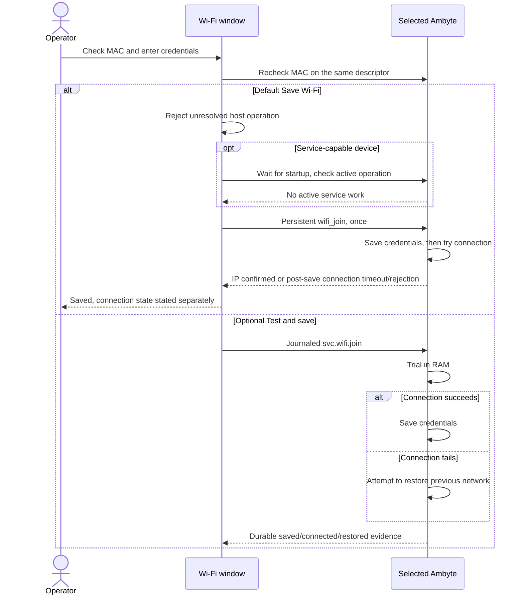
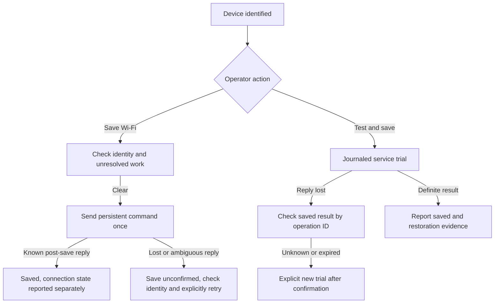
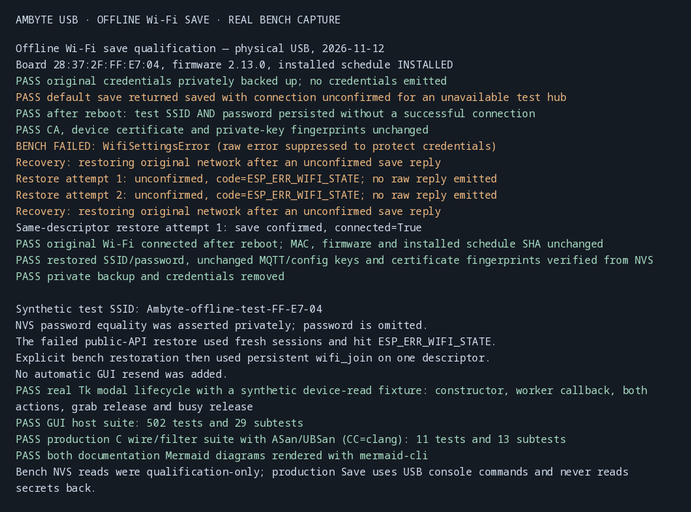

# Local USB Wi-Fi maintenance

The flash GUI's **Wi-Fi settings (USB)…** action updates the connected Ambyte's
network without calling openJII, issuing or rotating certificates, writing a
complete provisioning image, changing the schedule or flashing firmware. It is
available without an API key, selected experiment or downloaded release.

The separate **Initial setup / replace identity…** action still performs registration and
certificate provisioning. A device-registration conflict there means the MAC
is already registered and is inaccessible to the current account; it does not
prevent a local USB Wi-Fi change. Device names and MACs can be read locally.
Cloud ownership and the identity of the person who registered a device require
access to the corresponding openJII registry records.

## Identify, then update

The window reads the selected USB port and displays the device name, stable
MAC, firmware version when available, and Wi-Fi state at the time of reading.
An older image can identify itself through `status` when it explicitly rejects
the newer `identity` command. A malformed identity never triggers that fallback.
`{MAC}` in a stored name is expanded for display, matching firmware behavior.

Every update re-reads identity on the selected port, compares its MAC with the
one the operator saw, and sends credentials on that same open descriptor. A
board swap fails before credentials are sent. The flow never scans other ports.
A booting board gets up to 45 seconds for the console on one descriptor; re-enumeration requires
the operator to refresh ports and identify the board again. Read and write work
runs on a worker thread. Before a service Wi-Fi write, the GUI waits up to three
minutes on the same descriptor for `identity.schedule.source` to leave `NONE`,
because boot-time AMBIT sync can still hold the maintenance lock after the
console responds. This wait sends no credentials and never retries a rejected
join. A separate maintenance task can still return a definite busy result. The Wi-Fi window owns the GUI's serial-action gate
until closed, and stale identity is cleared before a new read.

## Save for deployment or test a reachable hub

**Save Wi-Fi** is the default action. It uses the existing persistent
`wifi_join` command on both older and service-capable firmware. The firmware
writes the credentials before waiting for a connection, so the destination hub
can be absent while boards are prepared. The message separates **saved** from
**connection confirmed**. This deliberately overwrites the previous network,
including when a password is mistyped. Check the password before saving.
Power-cycle at deployment if the board does not connect when its hub is available: newer firmware bounds retries, and older firmware may stop retrying sooner.

**Test & save** is optional on service-capable firmware (v2.9.0+). It uses
`svc.wifi.join`: try credentials in RAM, save after getting an IP, otherwise
attempt to restore the previous network. The hub must be powered on and in
range for this action. A failed trial never falls back to a persistent save.
The trial contract dates to v2.9.0; pre-flashed NVS credentials have always been
saved without requiring a connection and are unaffected by this GUI change.



For a persistent save, only `ESP_OK`, `ESP_ERR_TIMEOUT`, and
`WIFI_MANAGER_ERR_AUTH_REJECTED` are recognized as post-save results. Only
`ESP_OK` confirms an IP connection. Other errors can arise before persistence,
so they report an unconfirmed save and no automatic retry. `ESP_ERR_WIFI_STATE`
can mean the driver was busy trying the old network. Wait a few seconds and
explicitly save the same credentials again; repeating them is safe. The command and its
password-bearing echo never leave the backend. A lost reply has no operation ID;
**Check saved result** describes earlier service operations, not this console
save. Read the device again to confirm its identity, then explicitly save the same
credentials again if needed. A device read does not expose its stored password
or prove a previous save.

Before a persistent save, the MAC-keyed journal lease blocks every unresolved
host operation. On service firmware, a read-only service check also refuses
another active operation before returning to the console and rechecking the MAC.
These checks never archive or cancel another operation to make a save proceed.
An interrupted service Wi-Fi trial must still be resolved before Save: check its
result, or explicitly start a new trial. An expired result may therefore need an
explicit terminal trial (even a failed one) before offline Save is available.
CLI saves do not take the firmware maintenance lock. Wait for any remotely
started firmware update to finish before changing Wi-Fi, to avoid dropping its
network connection.

## Recovery and failures



**Check saved result** needs no password. Recovery reads the MAC-keyed journal
and the device's operation result. Its message describes that earlier operation,
and **Read device again** checks the current connection. A new Wi-Fi attempt cannot silently overwrite
unresolved intent or displace another active service operation. If an outcome
remains uncertain, the window exposes an explicit new-attempt action; the
existing service client preserves the prior intent and checks for active work
before admitting it. The journal retains one `.previous.json` archive; a later
explicit archive replaces it. Pending schedule transfers can also be checked
and resolved from this window after a GUI restart.

The service trial holds the journal's lease while checking the pending operation
kind and invoking the client. It rejects any unresolved schedule intent before
a join, explicit new attempt or Wi-Fi recovery call, preserving that schedule's
recovery record. **Check saved result** resolves terminal schedule results, offers
explicit cancellation for a staged transfer, or offers explicit archival for an
unknown/expired result only after checking that no device operation is active.
A completed journal needs no USB access. These actions do not install a workbook
or verify the current workbook. A definite failed Wi-Fi result allows
normal correction and retry; recovery guidance is reserved for unresolved work.

Firmware lacking `wifi_join` cannot use the default save. Unsupported commands
fail without automatically flashing or trying another write path.

Credentials are validated before opening USB: SSID 1–31 UTF-8 bytes without
console controls, and either an empty password or 8–63 printable ASCII bytes.
Spaces are preserved. Legacy arguments escape quotes and backslashes using
ESP-IDF's console parsing rules, including `""` for an open network. The serial
reply can echo the password; neither that reply nor the command-bearing timeout
exception is exposed to the GUI or application logs. Local window inputs are
not written to `Settings.save`; service journals contain no password.

## Verification

Run from the repository root:

```sh
python -m pytest flash_gui/tests -q
```

The local-flow tests exercise the production console parser and service client
against deterministic USB bytes: current/older firmware, identity fallback,
board replacement, invalid inputs, quoting and open networks, join failures,
lost replies and recovery without duplicate credential transmission, malformed
service responses, preservation of pending schedule recovery, explicit retries,
rollback evidence and descriptor cleanup. Headless GUI tests
exercise access without sign-in, worker-to-main-thread completion, stale-read
write gating, offline save versus optional trial, validation, error redaction and
cleanup after a failed dialog construction. These tests do not substitute for
a real Tk session. The existing registration-conflict
test verifies the error points operators at the local USB action.

Physical qualification on bench Ambyte `28:37:2F:FF:E7:04` (2026-11-12):
legacy 2.7.0 joined the saved network through `wifi_join`; service 2.13.0 saved
and joined the network, recovered the result by ID, rejected a wrong-password
trial without saving it, restored the previous network and connected after a
reboot. Opening USB reset this board, which exposed the startup-maintenance busy
window and led to the same-descriptor readiness wait. A separate maintenance
operation can still return busy safely and requires a later operator retry.
One service discovery attempt rejected a malformed frame before admission; an
explicit retry succeeded. No automatic credential resend was added.


The redacted [terminal transcript](images/usb-maintenance-gui/qualification.txt)
also contains the firmware run. This establishes local Wi-Fi behavior on these
two images, not qualification of every firmware release or cloud ingestion.
The final host suite passed 485 tests and 29 subtests; the additional production
C framing/editor filter suite passed all 11 tests with ASan/UBSan.
That first qualification did not include a real Tk desktop session.


### Offline-save qualification (GUI correction)

The default persistent save was exercised on the same physical Ambyte with
firmware 2.13.0 and an installed workbook. The synthetic destination hub was
absent. **Save Wi-Fi** returned `connected=False`, then a reboot and private NVS
readback verified the exact SSID and password were stored. CA, device certificate
and private-key fingerprints matched the original baseline.

Restoration through fresh public-API sessions hit `ESP_ERR_WIFI_STATE` while the
old network was unavailable. The result remained unconfirmed. An explicit bench
restore using the same persistent command on one descriptor succeeded, and the
original network connected after reboot. Its SSID/password, certificate
fingerprints and MQTT/config keys matched the private baseline; firmware and the
installed schedule SHA were unchanged. The private backup was removed. This is
also why the GUI gives a specific wait-and-explicitly-save-again hint for that
error rather than claiming success or retrying silently.

A real Tk desktop lifecycle check used a synthetic device-read fixture and
verified modal construction, worker completion, both action labels, grab release
and the app busy gate on close. It did not send credentials. The updated GUI
suite passes **502 tests and 29 subtests**; the production C wire/filter suite
passes **11 tests and 13 subtests** under ASan/UBSan with `CC=clang`. Both new
Mermaid diagrams were rendered with mermaid-cli.



[Redacted qualification transcript](images/offline-wifi-save/qualification.txt).
The production GUI never reads passwords or certificates back; private NVS
readback was used only to qualify persistence. This run qualifies the 2.13.0
image, with host coverage for older firmware, rather than every firmware image.
