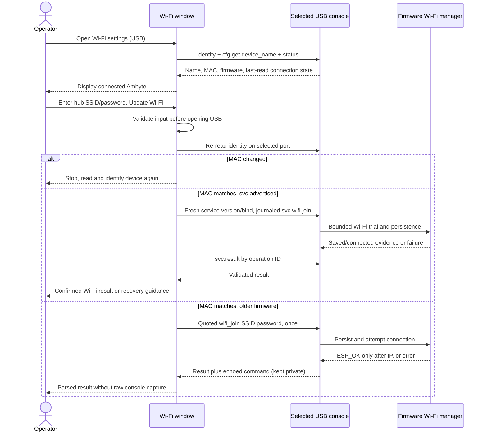
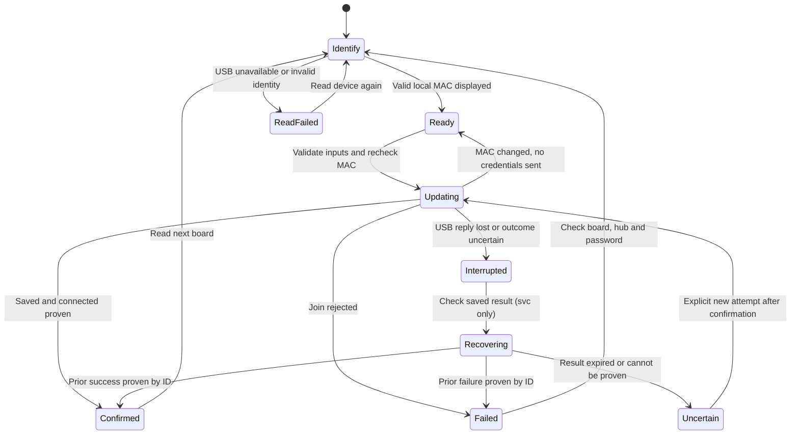
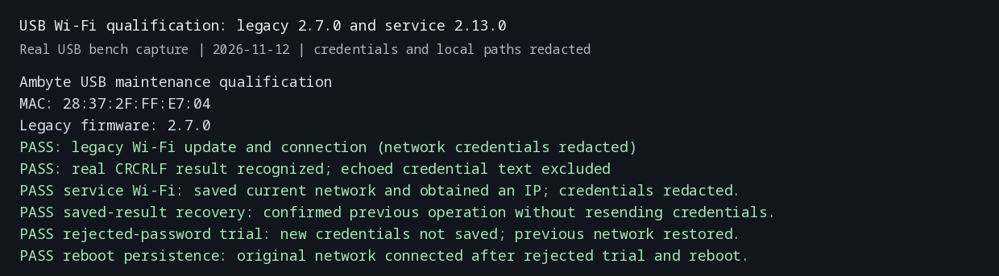

# Local USB Wi-Fi maintenance

The flash GUI's **Wi-Fi settings (USB)…** action updates the connected Ambyte's
network without calling openJII, issuing or rotating certificates, writing a
complete provisioning image, changing the schedule or flashing firmware. It is
available without an API key, selected experiment or downloaded release.

The separate **Initial setup / replace identity…** action still performs registration and
certificate provisioning. A device-registration conflict there means the MAC
is already registered and is inaccessible to the current account; it does not
prevent a local USB Wi-Fi change. Device names and MACs can be read locally.
Cloud ownership and the identity of the person who registered a device require
access to the corresponding openJII registry records.

## Identify, then update

The window reads the selected USB port and displays the device name, stable
MAC, firmware version when available, and Wi-Fi state at the time of reading.
An older image can identify itself through `status` when it explicitly rejects
the newer `identity` command. A malformed identity never triggers that fallback.
`{MAC}` in a stored name is expanded for display, matching firmware behavior.

Every update re-reads identity on the selected port, compares its MAC with the
one the operator saw, and sends credentials on that same open descriptor. A
board swap fails before credentials are sent. The flow never scans other ports.
A booting board gets up to 45 seconds for the console on one descriptor; re-enumeration requires
the operator to refresh ports and identify the board again. Read and write work
runs on a worker thread. Before a service Wi-Fi write, the GUI waits up to three
minutes on the same descriptor for `identity.schedule.source` to leave `NONE`,
because boot-time AMBIT sync can still hold the maintenance lock after the
console responds. This wait sends no credentials and never retries a rejected
join. A separate maintenance task can still return a definite busy result. The Wi-Fi window owns the GUI's serial-action gate
until closed, and stale identity is cleared before a new read.



Service behavior comes from the existing
[USB maintenance protocol](usb-maintenance.md). A service failure never
downgrades to a plain `wifi_join` mutation. This action does not automatically
reconnect or resend credentials after a dropped USB link.

**Service-capable firmware requires the destination hub to be powered on and
in range during the USB session.** It tries the credentials in RAM and commits
them only after a successful connection. This action cannot preload a network
that the Ambyte cannot currently reach. Failed trials attempt to restore the
previous configuration; the GUI reports the recorded saved/restored/retrying
evidence instead of assuming restoration succeeded.

## Recovery and failures



**Check saved result** needs no password. Recovery reads the MAC-keyed journal
and the device's operation result. Its message describes that earlier operation,
and **Read device again** checks the current connection. A new Wi-Fi attempt cannot silently overwrite
unresolved intent or displace another active service operation. If an outcome
remains uncertain, the window exposes an explicit new-attempt action; the
existing service client preserves the prior intent and checks for active work
before admitting it. The journal retains one `.previous.json` archive; a later
explicit archive replaces it. Pending schedule transfers can also be checked
and resolved from this window after a GUI restart.

The Wi-Fi action holds the journal's lease while checking the pending operation
kind and invoking the client. It rejects any unresolved schedule intent before
a join, explicit new attempt or Wi-Fi recovery call, preserving that schedule's
recovery record. **Check saved result** resolves terminal schedule results, offers
explicit cancellation for a staged transfer, or offers explicit archival for an
unknown/expired result only after checking that no device operation is active.
A completed journal needs no USB access. These actions do not install a workbook
or verify the current workbook. A definite failed Wi-Fi result allows
normal correction and retry; recovery guidance is reserved for unresolved work.

On older firmware, `wifi_join` persists configuration before attempting to
connect. A rejected or timed-out legacy join may therefore leave new credentials
stored and retrying. Its success line must explicitly return `ESP_OK`; an old
connection bit alone is insufficient. Unsupported commands, malformed replies
and timeouts never display success. The GUI asks the operator to confirm this
overwrite before sending legacy credentials. Older images lacking `wifi_join` require a
separate firmware decision; this action does not flash them automatically.

Credentials are validated before opening USB: SSID 1–31 UTF-8 bytes without
console controls, and either an empty password or 8–63 printable ASCII bytes.
Spaces are preserved. Legacy arguments escape quotes and backslashes using
ESP-IDF's console parsing rules, including `""` for an open network. The serial
reply can echo the password; neither that reply nor the command-bearing timeout
exception is exposed to the GUI or application logs. Local window inputs are
not written to `Settings.save`; service journals contain no password.

## Verification

Run from the repository root:

```sh
python -m pytest flash_gui/tests -q
```

The local-flow tests exercise the production console parser and service client
against deterministic USB bytes: current/older firmware, identity fallback,
board replacement, invalid inputs, quoting and open networks, join failures,
lost replies and recovery without duplicate credential transmission, malformed
service responses, preservation of pending schedule recovery, explicit retries,
rollback evidence and descriptor cleanup. Headless GUI tests
exercise access without sign-in, worker-to-main-thread completion, stale-read
write gating, legacy-overwrite confirmation, validation, error redaction and
cleanup after a failed dialog construction. These tests do not substitute for
a real Tk session. The existing registration-conflict
test verifies the error points operators at the local USB action.

Physical qualification on bench Ambyte `28:37:2F:FF:E7:04` (2026-11-12):
legacy 2.7.0 joined the saved network through `wifi_join`; service 2.13.0 saved
and joined the network, recovered the result by ID, rejected a wrong-password
trial without saving it, restored the previous network and connected after a
reboot. Opening USB reset this board, which exposed the startup-maintenance busy
window and led to the same-descriptor readiness wait. A separate maintenance
operation can still return busy safely and requires a later operator retry.
One service discovery attempt rejected a malformed frame before admission; an
explicit retry succeeded. No automatic credential resend was added.



The redacted [terminal transcript](images/usb-maintenance-gui/qualification.txt)
also contains the firmware run. This establishes local Wi-Fi behavior on these
two images, not qualification of every firmware release or cloud ingestion.
A real Tk desktop session was not available on the bench host.
