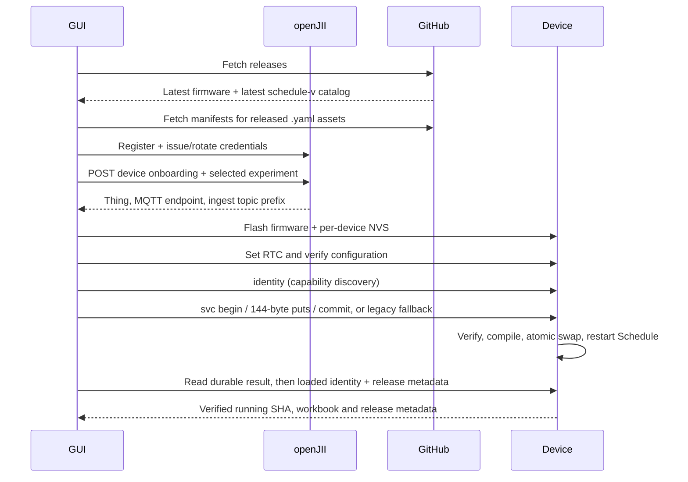

# ambyte on-boarding GUI

Cross-platform (Windows / Linux / macOS) Tkinter tool that flashes and
provisions ambyte boards in one click per device. It replaces the manual
`flash/flash.cmd` bundle flow for operator on-boarding sessions.

```
python -m pip install -r flash_gui/requirements.txt
python -m flash_gui        # from the repo root
```

## Prebuilt executables

CI (`.github/workflows/flash-gui-build.yml`) builds standalone executables for
Windows, Linux and macOS with PyInstaller — no Python install needed on the
operator's machine:

- every PR touching `flash_gui/**` builds them once as workflow artifacts,
  keyed by the PR head SHA (30-day retention, GitHub login required);
- the merge to `main` waits for that PR run, downloads and verifies those exact
  artifacts, signs the Windows bundle if signing is configured, and publishes
  them as a public GitHub release. Nothing is rebuilt at release time, so the
  bytes users download are the bytes CI tested on the PR.

**Every merge to `main` cuts a release.** There is no manual tag step. The tag
is patch-incremented from the highest existing `flash-gui-v*` tag, so merging a
GUI change is the whole release process. Releases are always marked
`prerelease` and never `latest`, so `/releases/latest` keeps resolving to the
newest *firmware* release. The flash GUI belongs to **no** semantic-release
unit, and `flash_gui/**` commits never bump the firmware version
(`tools/release/path-scoped.js`).

If you need a minor or major bump rather than a patch, create the tag by hand
before merging and CI will continue from it.

Release assets are one zip per platform (`*-windows.zip`, `*-linux.zip`,
`*-macos.zip`), each holding a PyInstaller `--onedir` bundle. Unzip it and run
`ambyte-flash-gui` from inside the extracted folder; the folder must stay
intact, since the executable loads its Python runtime from its siblings.

### GUI version and updates

The top of the application always identifies what is running and shows one of
these explicit states: **UP TO DATE**, **UPDATE AVAILABLE**, **PRE-RELEASE
BUILD**, or **UPDATE CHECK UNAVAILABLE**. Packaged builds show their version in
both the window title and the application banner. Old packages without embedded
identity are labelled **UNKNOWN — update recommended**; source checkouts are
labelled as development builds rather than pretending to have a release
version.

When an update exists, **Download X.Y.Z** opens that exact GitHub release page
so the operator can choose the correct platform zip. This is intentionally not
an in-place self-update: the distributed application is a multi-file `--onedir`
bundle, and replacing files while they are running without an installer,
signature verification and rollback would be less safe than one clear click to
the immutable release.

The version is not hand-maintained in source. The PR build predicts the next
`flash-gui-v*` tag, embeds that tag plus the PR source SHA in every platform
bundle, and the main release job verifies all three embedded identities against
the tag it is about to publish. If another GUI release lands between build and
merge, publication fails instead of shipping a bundle that claims the wrong
version; rerunning the PR build refreshes the prediction.

Every release also ships a `SHA256SUMS` asset. Verify before running:

```bash
sha256sum -c SHA256SUMS --ignore-missing   # Linux
shasum -a 256 -c SHA256SUMS --ignore-missing   # macOS
```

```powershell
Get-FileHash .\ambyte-flash-gui-windows.zip -Algorithm SHA256   # Windows
```

### Antivirus false positives

Windows builds are **not code-signed**, and Microsoft Defender misclassifies
them, most often as `Trojan:Win32/Sabsik.TE.A!ml` (first seen 2026-08-17 on
`flash-gui-v0.2.1`). It is a false positive driven by three things at once: no
signature, near-zero download prevalence, and a program that opens USB serial
ports and writes certificates. The verdict depends on the machine's
cloud-protection level, so it fires for some operators and not others on
byte-identical files.

If it trips, in Windows Security open Protection history, find the entry, and
choose **Allow** (or **Restore** then **Allow on device**). On a managed laptop
where that is greyed out, add a folder exclusion under Manage settings and
re-download into it. Check `SHA256SUMS` first. Do not disable real-time
protection.

CI does what it can without a certificate: `--onedir` instead of `--onefile`
(no PE payload unpacked to `%TEMP%` at runtime), and a real Win32 version
resource with CompanyName/ProductName/FileDescription instead of a blank PE
(`build_version_info.py`). Both lower the score; neither is a fix.

The only durable fix is an Authenticode signature, and every route to one has a
price:

| Route | Cost | Blocker |
| --- | --- | --- |
| Azure Artifact Signing | ~$10/month | wired into the release job already, gated on the `AZURE_SIGNING_ENDPOINT` Actions variable, so it starts working the moment that variable is set |
| SignPath Foundation | free | needs an OSI-approved licence for *all* components; `flash_gui/` is now GPL-3.0 but the firmware alongside it is CERN-OHL-S-2.0, so this only becomes viable if the GUI moves to its own repo. The cert also names SignPath Foundation as publisher, not JII |
| Certum open-source cert | ~EUR 30/year | hardware token, so it cannot sign from a hosted runner |
| Microsoft submission portal | free | keyed to one file hash, so it has to be redone every build |

macOS builds are not notarized either: expect the Gatekeeper right-click-Open
dance.

### Schedule transfer and recovery

The GUI reads the device's versioned `identity` JSON. An advertised `svc`
capability selects the bounded service transactions described in
[USB maintenance](../docs/usb-maintenance.md). The PC supplies digest-verified
bytes; the device checks their SHA-256, compiles them, checks the declared
workbook, installs them and verifies activation. Neither serial upload path
needs the board on Wi-Fi. A URL-only selection must first be downloaded and
verified on the PC; if those bytes are unavailable, the GUI asks you to cache
the selection and retry.

The service client saves nonsecret intent in `<config>/service_operations/`,
keyed by gateway MAC and the device's store instance. It flushes that intent
before admitting an operation. Every 144-byte chunk is acknowledged with the
durable offset. Disconnecting or closing the app preserves the journal; retrying
the same selection resumes the same operation from the recorded offset. A lost
commit or final response is resolved by reading the recorded result, including
after restarting the app. Transfer and polling run on a worker thread. The GUI
permits at most two automatic reconnects within the six-minute transfer budget.
Opening a port keeps DTR and RTS deasserted; a board that resets on USB reopen is
allowed to boot before recovery. A fresh identity must prove the same gateway.

Success requires a durable successful result for the exact descriptor. After
exiting service mode, the GUI independently checks identity JSON for the loaded
source, digest, workbook and version, plus release metadata for verified/running
state and built-against firmware. Acknowledging commit is not success. A changing
identity, fallback program, stopped runner or disagreement with release metadata
cannot pass verification. If the selected tuple was already active, the stored
result says `applied:false`.

**Cancel schedule transfer** explicitly aborts only this client's verified
staging operation. Once commit is admitted, cancel stops waiting and keeps the
journal; it does not undo the install. **Retry provisioning** resumes saved
work. A different client's active operation reports its kind and state as busy;
the GUI does not take it over.

An uncertain or expired result means the previous outcome is unknown. A changed
store instance invalidates all IDs from the old store. The GUI preserves this
evidence and stops automatic replay. After a failure, **New schedule request…**
reads a stable current identity and shows the loaded tuple. You may then choose
to preserve the old journal and admit a new operation for the selected schedule.
Declining leaves the saved intent untouched. A live operation still blocks this
action. Keep the journal directory when moving or cleaning the PC; an OS lock
prevents two GUI processes from replacing the same gateway's intent.

Images without `svc` retain the console `schedule begin/put/commit/abort` path.
Its chunks are still 144 raw bytes (200 characters per put), below the fixed
256-byte USB RX ring. Firmware predating serial push retains the immutable URL
installer fallback; that path requires device Wi-Fi. Explicit `Unrecognized
command` selects the 2.5.0 identity fallback. Invalid JSON or a service error
never downgrades an advertised service board to legacy mutation. A device left
in service mode after disconnect can send framed errors to ordinary console
clients for up to 60 seconds; the schedule installer performs read-only mode
recovery before identity discovery.

The GUI has no live Wi-Fi join control. Its existing onboarding credentials
remain part of the NVS image. The shared service client offers a distinct bounded
join for service consumers and bench tools, with fresh same-port confirmation,
readback by ID and no automatic credential retransmission. Passwords are absent
from service journals and service progress/error messages.

### GitHub rate limits

The GUI reads the repo's release list to find the firmware, the Schedule catalog and
the latest GUI version. Unauthenticated GitHub allows **60 requests/hour per
IP**, and an office behind one NAT shares that budget across every operator.

The listing is fetched once and shared by all three startup lookups, cached on
disk for five minutes, and revalidated with `If-None-Match` after that; a lock
prevents the startup threads from racing into duplicate requests. GitHub does
not count a `304 Not Modified` against the limit, so repeated starts are
effectively free. If the limit is hit anyway, or GitHub is unreachable, the
last cached listing is used and the reason is logged rather than blocking the
session, and the error names the time the window resets.

To raise the ceiling to 5000/hour, set `GH_TOKEN` (or `GITHUB_TOKEN`) to a
GitHub personal access token before launching. The repo is public, so the token
needs **no scopes at all**.

The executables bundle Mozilla's CA root store through `certifi`; HTTPS does
not depend on Python's build-machine certificate paths existing on the
operator's computer. Platform roots are retained as well, so managed machines
can continue to trust locally installed proxy certificates.

## Operator flow (10 boards in a row)

Once per session:

1. Pick the **environment** (dev / prod).
2. Click **Sign in (API key)** — a browser opens on the openJII *API keys*
   page; create a key there (shown once, `jii_...`) and paste it into the
   dialog. The key is validated and remembered per environment.
3. Pick the **experiment** from the dropdown (active experiments you are a
   member of). During each board run, openJII binds the device to this
   experiment and returns its authoritative broker endpoint and ingest topic
   prefix; the GUI does not construct or edit either value. Selecting an
   experiment also resolves its **workbook programming**: when the pinned
   workbook version carries an Ambyte schedule command cell, the GUI stamps
   that schedule with the `workbookVersionId` and the version's macro list
   (block-style `macros:` header; macro list only when the flashed firmware
   is new enough to compile it) and installs it instead of the catalog
   default. When there is no such cell, a persistent warning says so and the
   released default is installed.
4. Pick the **Schedule script**. The GUI always loads the newest stable `schedule-v*`
   catalog and lists the released `.yaml` files it contains; `default.yaml` is the
   default when available. When workbook programming was found, this combobox is
   the explicit **override**: touching it installs the chosen catalog asset
   instead of the workbook's schedule.
5. Enter the **Wi-Fi SSID/password** the boards should join.

Per board: plug it in via USB-C → **Refresh** → pick the port → **On-board
device** → confirm/edit the name in the prompt. Everything else is automatic,
and the procedure ends with an explicit per-item PASS/FAIL (name, timezone,
RTC, installed schedule — including its stamped workbook id when installed
from a workbook).

## Factory PCBA flash + test (`factory_test`)

Separate from onboarding: one CLI invocation per freshly assembled board. It
flashes the firmware, then drives the firmware's `selftest` console command
(identity, PSRAM, both internal littlefs mounts, NVS, I2C population, RTC
tick, MP2731 power rails, BME280, LED) and archives the result. The test
intelligence is firmware-side; this runner flashes, connects, parses, asks
the operator whether the LED lit, and logs.

```
python -m flash_gui.factory_test [--fw latest|BUILD_DIR] [--no-flash]
                                 [--port COM7] [--logdir factory_logs]
                                 [--operator NAME] [--station ID] [--no-led]
                                 [--no-rtc-set]
```

With one board plugged in, no arguments are needed: the newest published
firmware release is downloaded (then cached), the single Espressif USB-JTAG
port is auto-detected (the tool also waits if the board is plugged in after
starting), the release images are written, and the console is awaited through
the S3's boot-time re-enumeration. Flashing writes only bootloader, partition
table, otadata and app — **never NVS**, so identity/provisioning survives a
retest and a fresh PCBA simply boots unprovisioned (the selftest needs no
network). `--fw .pio/build/esp32-s3-devkitm-1` flashes a local build instead
(any directory with a `flasher_args.json`); `--no-flash` skips straight to
testing whatever is on the board.

Before the selftest runs, the station writes its own UTC clock to the board's
RTC. This is required, not cosmetic: a factory-fresh PCF2131 powers up with
its oscillator-stop flag set, and the driver refuses to return a time while
that flag is set, so that a never-set clock cannot be mistaken for a real one.
The selftest's tick test reads through that same path, so without a prior set
a perfectly good board reports `rtc FAIL ready=1 osf=1 tick=fail epoch=0`.
Writing the clock clears the flag and is what makes the oscillator observable.
It does not weaken the test: a dead 32 kHz crystal still fails, because the
time will not advance between the selftest's two reads even after a set. The
board also leaves the station with a correct clock. `--no-rtc-set` skips the
write when you want to see a board's as-found RTC state.

Each run writes one JSON file (parsed tests, raw measured values, flashed
release tag, what the station wrote to the RTC, the verbatim serial
transcript) plus one appended row in
`results.csv`; nothing is ever overwritten — a retest is a new row. The LED
is driven red by the firmware, confirmed by the operator (recorded as
attested, skippable with `--no-led` for unattended runs), then switched off.
Expect it to **blink** rather than glow: the firmware's field-status blinker
owns the LED and, on a station with no SD card fitted, flashes the red
"SD not mounted" state every 3 s over the selftest's steady red. Any red
flash is a successful LED write, so the answer is "y". Exit code:
0 = board PASS, 1 = board FAIL, 2 = the run could not complete (flash or
connection failure).

A normal cycle is ~35–40 s. The S3 sometimes stays parked in its ROM
download mode after the post-flash reset (silent board, port present); the
tool detects that within ~10 s and fires another reset on its own. If the
tool asks for it, **unplug the board's USB cable and plug it back in** — a
physical power cycle always clears the download-mode latch, and the run
continues automatically; no restart needed.

## What one procedure does

1. **Pre-flash check** — waits up to 45 s for the REPL, keeping one descriptor
   open through boot. Opening USB can reset the board even with DTR/RTS false.
   Discovery uses the versioned `identity` JSON for MAC, effective MQTT thing
   name, compiled firmware, loaded schedule and capabilities; `cfg get` reads
   the stored device name separately. Only an explicit `Unrecognized command`
   selects the older `status` probe. Malformed replies and silence are errors.
   If no console becomes ready, falls back to reading the MAC with esptool
   (works on unflashed chips). The name prompt is pre-filled with the stored
   name, else `AMBYTE_<MAC>`.
2. **openJII registration + certificate + onboarding** — registers the MAC as
   an `ambyte` device owned by the **selected experiment's organization** (or
   re-uses the existing registration, see *Device ownership*), issues — or
   rotates, when a live cert exists — its X.509 credentials, then calls
   `POST /api/v1/devices/{deviceId}/onboard` with the selected experiment. The
   call binds the device and returns the server-owned Thing name, broker
   endpoint, device family, and ingest topic prefix. The show-once private key
   is written to disk *before* the onboarding call
   (`<config>/device_certs/<thing>/`). This happens **before** flashing, so an
   API failure leaves the board untouched.
3. **NVS + littlefs bake** — a per-board provisioning image: device name, IANA
   timezone (from this PC's clock), `flash_time` RTC seed, the board's own
   cert + key + Amazon Root CA 1, Wi-Fi credentials, MQTT broker from openJII,
   client id = openJII Thing name (required by the AWS IoT policy),
   server-provided topic prefix plus the API-required sensor version/id suffix,
   command/status topics, and the selected Schedule release's provenance
   (sha256/version/campaign). Alongside it, a littlefs image of the internal
   script partition carrying that release's `default.yaml`, built host-side (no
   mklittlefs needed).
4. **Flash** — the latest GitHub release (`ambyte-iot-v*.zip`, cached locally,
   version shown in the GUI) + the NVS image + the littlefs image, offsets
   from the release's own `flasher_args.json` plus the fixed NVS/littlefs
   partition offsets. Only those regions are written — field data in
   coredump/storage survives. A mid-way failure leaves the chip in
   the ROM bootloader (re-flashable) and enables **Retry flash**.
5. **RTC** — waits up to three minutes for the freshly booted console (normally
   20–35 s, but SD recovery can take longer and the USB port may re-enumerate),
   keeping one serial handle open so polling cannot repeatedly reset the board,
   then sets the exact current UTC epoch with `rtc set` (applies immediately).
6. **Schedule script** — with a firmware that runs schedule.yaml from internal flash
   (littlefs), the baked image + NVS provenance already verify, so this step
   usually confirms and moves on. Otherwise it pushes the selected immutable
   release asset down the console (no device network needed); the firmware
   checks SHA-256 and schedule syntax, keeps the previous file as `schedule.yaml.bak`,
   atomically installs it as `schedule.yaml`, and restarts the runner in place. On older
   firmware without the push commands it falls back to the firmware's URL
   downloader (the only path that needs the board online). Verification keeps
   the same serial connection open while this asynchronous operation
   completes. On images advertising `identity`, verification reads identity,
   then `schedule release`, then identity again: the two loaded tuples must
   agree with the installed release SHA/version, and the runner must be running
   with verified metadata and the expected build. Reload snapshots keep polling.
   Workbook provenance comes from JSON; older images retain release/status
   verification. Advertised capabilities gate all serial-push writes.
7. **Verify** — reads back `cfg get device_name`, `cfg get timezone`, `rtc`,
   and the active Schedule file identity, then reports PASS/FAIL per item.
   New images also verify the discovered MAC, effective thing and compiled
   firmware against the provisioning plan and selected release. SD card
   presence is reported for information only — it is not required: the event
   store and schedule.yaml are internal; a card serves archive/logs/AMBIT OTA only.
   On failure, **Retry provisioning** repairs name/timezone and retries the
   Schedule install over the console — never a re-flash.

### Onboarding sequence



## Design notes / firmware facts this tool relies on

- The GUI provisions certificates and Wi-Fi credentials through NVS baking at
  0x9000 (`0x6000` bytes, matches `partitions.csv`). The certificate setters are
  dead code; legacy `wifi_join` does not set the provisioned flag. The bounded
  service join is a separate credential write and does not change this flow. The NVS generator is vendored
  (`vendor/nvs_partition_gen.py`, from ESP-IDF), so no IDF install is needed.
- `cfg get` returns **raw NVS strings**: a fleet-default board answers
  `device_name = AMBYTE_{MAC}` — the tool expands the token before comparing.
- The MQTT client id **must equal the openJII Thing name**
  (`ambyte_<MAC>`): the platform IoT policy renders identity-bound resources
  as `${iot:Connection.Thing.ThingName}`, which AWS only resolves when they
  match.
- The device timezone table is fixed (`components/timezone/timezone.c`); the
  GUI warns when this PC's zone is not in it (scheduling then falls back to a
  fixed UTC offset on the device).
- openJII auth: the API exposes **no password login and no OAuth device
  flow**; the supported desktop flow is a personal **API key** sent as
  `x-api-key`. The key only authenticates the operator during the run; the
  board never sees it and delivers with its own certificate, so nobody needs
  to hand their key over afterwards. The registry used to be gated by the
  `iot-devices` feature flag; openJII removed that gate on 2026-09-14
  (open-jii #2082), so a 403 is now an access decision (see below).
- **Device ownership.** openJII has no route that moves a device between
  organizations, so the GUI decides ownership at registration: a new device
  is registered into the organization that owns the selected experiment. A
  personal-workspace experiment (no organization name) keeps openJII's
  default, the operator's personal workspace. Consequences:
  - The operator must be a **member** of that organization, or registration
    answers 403. A plain member is enough: registering seeds a creator grant,
    so they can issue the certificate and onboard the board they just added.
  - A board **someone else** registered into the organization is read-only
    to a plain member, so certificate issuance answers 403. An organization
    admin onboards it, or grants the operator admin on that device.
  - A board already registered elsewhere (e.g. a student's personal
    workspace) is re-used as-is and the log warns about the mismatch: it
    still delivers to the experiment, but only its current owners manage it.
    Delete it on openJII and onboard again to re-home it. A board registered
    by an account whose devices you cannot see fails with a 409 naming that.
- The AWS IoT broker endpoint and ingest topic prefix are authoritative values
  from openJII's device-onboarding response. The GUI only appends the
  contract-required `/{sensorVersion}/{sensorId}` suffix because that portion
  is device-owned; the firmware appends its final protocol segment at publish
  time.
- Firmware and Schedule are independent release streams. The GUI scans the release
  feed separately for the newest stable firmware `vX.Y.Z` flash bundle and the
  highest stable `schedule-vX.Y.Z` catalog, so a Schedule or GUI release can never be
  mistaken for firmware.

## Files

```
flash_gui/
  __main__.py        python -m flash_gui
  gui.py             Tkinter app (worker threads, never blocks the UI)
  procedure.py       the per-board state machine + retry paths
  config.py          environments, topic conventions, persisted settings
  release_fetch.py   firmware download/cache + latest Schedule catalog validation
  nvs_builder.py     per-board NVS image (identity/certs/Wi-Fi/RTC seed)
  esptool_ops.py     esptool>=5 scripting API (read MAC, flash, NVS-only)
  ambyte_serial.py   firmware console client (probe / cfg / rtc / verify)
  service_client.py  bounded framed operations, resume and result recovery
  service_wire.py    strict CRC/JSON codec and nonsecret result validation
  service_benchmark.py bench measurement adapters over the shared client
  service_journal.py per-gateway durable intent and process ownership
  openjii_client.py  API-key auth, experiments, device registry, credentials
  timezones.py       host IANA zone + the firmware's supported-zone table
  vendor/            vendored ESP-IDF nvs_partition_gen.py
  tests/             pure-logic unit tests (no hardware/network)
```

Settings, release cache and issued certificates live in the per-user config
dir (`%APPDATA%\ambyte-flash-gui` on Windows, `~/.config/ambyte-flash-gui` on
Linux, `~/Library/Application Support/ambyte-flash-gui` on macOS). The API key
and Wi-Fi password are stored there in plain text with owner-only permissions
— treat that directory as sensitive.

## License

GPL-3.0, matching [openJII](https://github.com/Jan-IngenHousz-Institute/open-jii).
See [LICENSE.GPL-3.0](../LICENSE.GPL-3.0). The firmware alongside this directory
is CERN-OHL-S-2.0 instead; the repo root README has the full split.

The packaged executables bundle esptool (GPL-2.0-or-later), pyserial (BSD),
tzlocal (MIT) and certifi (MPL-2.0), so the shipped bundle is GPL-3.0 as a
combined work.
